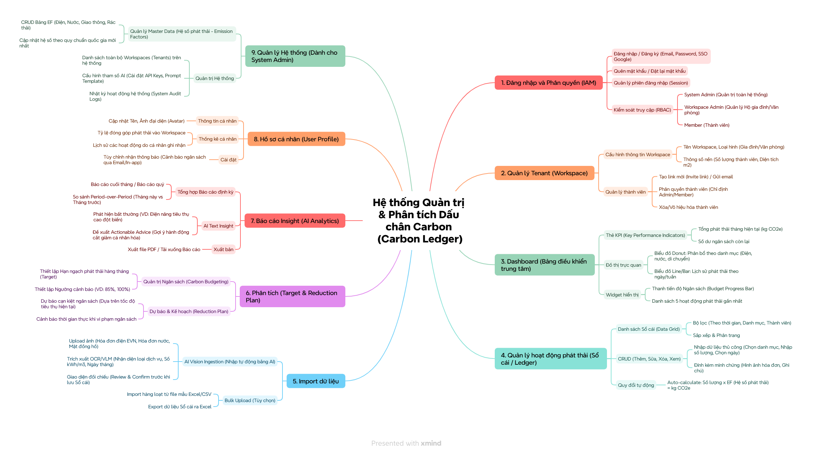
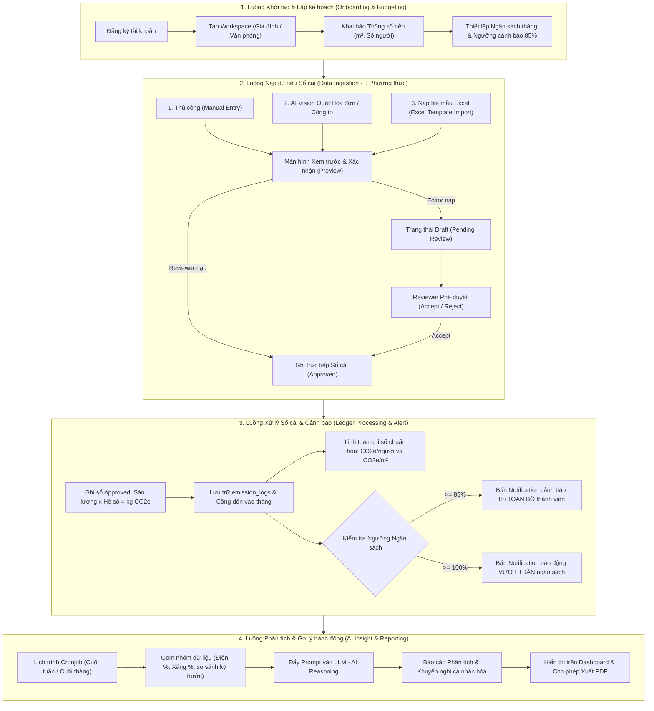

# Hệ thống Quản trị & Phân tích Dấu chân Carbon cho Gia đình/Văn phòng nhỏ

## (Personal & Micro-Office Carbon Ledger)

[](https://github.com/DatTienNguyenn/PMDC-BATCH4-DATNT250)
[](docs/04-user-stories.md)
[](docs/04-user-stories.md)
[](docs/04-user-stories.md)

---

## 📌 1. Giới thiệu Dự án

**Personal & Micro-Office Carbon Ledger** là nền tảng số hóa hỗ trợ **Hộ gia đình** và **Văn phòng nhỏ** ghi nhận hoạt động, kiểm soát hạn ngạch, theo dõi dấu chân carbon và **hỗ trợ đề xuất phương án cắt giảm cá nhân hóa từ AI** (tính theo chuẩn $\text{kg CO}_2\text{e}$).

> [!NOTE]
> Hệ thống **không hướng tới việc tự động nạp hóa dữ liệu** mà tập trung vào **tự động hóa tính toán dựa theo những hoạt động mà người dùng nhập liệu vào hệ thống một cách có kiến trúc và dễ dàng theo dõi**. Hệ thống đóng vai trò số hóa và cố vấn dữ liệu thông minh hỗ trợ người dùng đưa ra quyết định, hỗ trợ đề xuất các phương án cắt giảm cá nhân hóa từ AI chứ **không trực tiếp can thiệp hay tự cắt giảm phát thải (emission) vật lý**.

Hệ thống giải quyết nỗi đau lớn nhất của người dùng là **phải tự tra cứu danh mục, hệ số phát thải tương ứng và tự tính toán/tổng hợp bằng tay** gây nản lòng và mất nhiều thời gian, thông qua sự kết hợp giữa:
- **Tự động quy đổi chuẩn mực:** Tự động áp dụng hệ số phát thải quy chuẩn để tính toán chính xác kg CO2e theo từng hoạt động người dùng nhập vào.
- **Luồng nạp dữ liệu có kiến trúc:** Hai luồng nạp chính là **Khai báo thủ công** (nhập nhanh sinh hoạt lẻ $\le 20-30\text{s}$/activity) và **Nạp hàng loạt bằng file mẫu Excel** (xử lý 100 activities $\le 5\text{s}$). Quét ảnh hóa đơn bằng AI Vision là **tiện ích phụ và là ưu tiên sau cùng**, chỉ triển khai khi luồng nạp tay và Excel đã ổn định.
- **Quy trình kiểm duyệt sổ cái chặt chẽ (Approval Workflow):** Tách bạch vai trò Thành viên (Editor - nạp dữ liệu ở trạng thái Draft) và Trưởng nhóm (Reviewer - kiểm duyệt chính thức trước khi ghi sổ).
- **Kiểm soát ngân sách & Cảnh báo sớm:** Thiết lập trần phát thải (Target Quota) theo tháng và tự động bắn Notification cảnh báo tới toàn bộ thành viên khi chạm ngưỡng $85\%$ và vượt trần $100\%$.
- **Đề xuất cá nhân hóa từ AI & Phản hồi nhanh (Tự động hoặc Kích hoạt bằng tay):** Cho phép Reviewer tùy biến lịch tự động (tuần/tháng/tắt) hoặc kích hoạt on-demand tức thời, AI phân tích dữ liệu và đề xuất phương án cắt giảm cá nhân hóa khả thi (chứ không trực tiếp cắt giảm emission), hỗ trợ xuất báo cáo PDF chuẩn in ấn phản hồi nhanh trong $\le 3-5\text{ giây}$.

---

## 🗺️ 2. Sơ đồ Cấu trúc Sản phẩm (Product Mindmap)

Hệ thống được cấu trúc thành **9 phân hệ chức năng hoàn chỉnh** như thể hiện trong sơ đồ Mindmap sản phẩm dưới đây:



---

## 🗺️ 3. Kiến trúc Thông tin & Phân cấp Màn hình (Information Architecture & Screen Hierarchy)

Hệ thống được thiết kế và chuẩn hóa toàn diện thành **26 Màn hình & Giao diện tương tác** (Full Pages, Modals, Drawers và Error Views), được tổ chức phân cấp mạch lạc từ khâu xác thực, quản lý không gian làm việc cho tới cổng quản trị hệ thống:


### 3.1. Sơ đồ Phân cấp Màn hình Toàn hệ thống (Mermaid Screen Hierarchy)

```mermaid
graph TD
    Root["Root Application (Session & Context Provider)"] --> L1_Auth["1. Khối Xác thực & Tenant Onboarding"]
    Root --> L1_Core["2. Khối Ứng dụng Không gian làm việc (Workspace App)"]
    Root --> L1_Admin["3. Khối Cổng Quản trị Hệ thống (System Admin Backoffice)"]
    Root --> L1_Error["4. Khối Xử lý Sự cố & Điều hướng (System Error Shell)"]

    %% Khối 1: Auth & Onboarding
    L1_Auth --> SCR_AUTH_01["SCR-AUTH-01: Đăng nhập / Đăng ký (/auth/login, /auth/register)"]
    L1_Auth --> SCR_AUTH_02["SCR-AUTH-02: Quên / Đặt lại Mật khẩu (/auth/forgot-password)"]
    L1_Auth --> SCR_WS_01["SCR-WS-01: Chọn Workspace (/workspaces)"]
    SCR_WS_01 -.->|"Kích hoạt Modal"| SCR_WS_MODAL_01["SCR-WS-MODAL-01: Khởi tạo & Cấu hình Workspace Modal"]
    SCR_WS_01 --> SCR_WS_JOIN_01["SCR-WS-JOIN-01: Màn hình Gửi Yêu cầu Gia nhập (/workspaces/join)"]

    %% Khối 2: Workspace App
    L1_Core --> SCR_DASH_01["SCR-DASH-01: Dashboard Trung tâm (/workspace/:id/dashboard)"]
    L1_Core --> SCR_LEDGER_01["SCR-LEDGER-01: Sổ cái Phát thải (/workspace/:id/ledger)"]
    L1_Core --> SCR_APPROVE_01["SCR-APPROVE-01: Hàng đợi Kiểm duyệt (/workspace/:id/approvals)"]
    L1_Core --> SCR_INSIGHT_01["SCR-INSIGHT-01: Báo cáo AI & Kế hoạch (/workspace/:id/insights)"]
    L1_Core --> SCR_SETTING_01["SCR-SETTING-01: Cài đặt Workspace (/workspace/:id/settings)"]
    L1_Core --> SCR_PROFILE_01["SCR-PROFILE-01: Hồ sơ Cá nhân (/profile)"]
    L1_Core -.->|"Kích hoạt Drawer"| SCR_NOTIF_01["SCR-NOTIF-01: Trung tâm Thông báo (Notification Drawer)"]

    %% Sub-views & Modals của Sổ cái
    SCR_LEDGER_01 -.->|"Click dòng dữ liệu"| SCR_LEDGER_DETAIL_01["SCR-LEDGER-DETAIL-01: Modal Chi tiết & Vết duyệt"]
    SCR_LEDGER_01 -.->|"Nút Thêm / FAB"| SCR_EMISSION_ADD_01["SCR-EMISSION-ADD-01: Modal Thêm Phát thải 3 Tabs"]
    SCR_EMISSION_ADD_01 --> SCR_AI_PREVIEW_01["SCR-AI-PREVIEW-01: Modal Kiểm chứng AI Vision"]
    SCR_EMISSION_ADD_01 --> SCR_EXCEL_PREVIEW_01["SCR-EXCEL-PREVIEW-01: Modal Xem trước Import Excel"]

    %% Modals của Duyệt & Cài đặt
    SCR_APPROVE_01 -.->|"Click Từ chối"| SCR_APPROVE_REJECT_01["SCR-APPROVE-REJECT-01: Modal Nhập Lý do Từ chối"]
    SCR_SETTING_01 -.->|"Nút Tạo mã mời"| SCR_INVITE_MODAL_01["SCR-INVITE-MODAL-01: Modal Quản lý Mã mời"]
    SCR_SETTING_01 -.->|"Nút Từ chối đơn"| SCR_JOIN_REJECT_01["SCR-JOIN-REJECT-01: Modal Từ chối Gia nhập"]

    %% Khối 3: Admin Backoffice
    L1_Admin --> SCR_ADM_DASH_01["SCR-ADM-DASH-01: Dashboard Quản trị Hệ thống (/admin/dashboard)"]
    L1_Admin --> SCR_ADM_FACTOR_01["SCR-ADM-FACTOR-01: Quản lý Hệ số Quy chuẩn (/admin/emission-factors)"]
    SCR_ADM_FACTOR_01 -.->|"Nút Thêm/Sửa"| SCR_ADM_FACTOR_MODAL_01["SCR-ADM-FACTOR-MODAL-01: Modal Thêm/Sửa Hệ số"]
    L1_Admin --> SCR_ADM_TENANT_01["SCR-ADM-TENANT-01: Quản lý Workspace Tenants (/admin/workspaces)"]
    SCR_ADM_TENANT_01 -.->|"Tạo Tenant"| SCR_WS_MODAL_01
    L1_Admin --> SCR_ADM_AUDIT_01["SCR-ADM-AUDIT-01: Cấu hình AI & Nhật ký Kiểm toán (/admin/settings)"]

    %% Khối 4: Error Pages
    L1_Error --> SCR_ERR_403["SCR-ERR-403: 403 Forbidden (/403)"]
    L1_Error --> SCR_ERR_404["SCR-ERR-404: 404 Not Found (/404)"]
```



### 3.2. Cấu trúc Phân cấp theo Cấp độ Giao diện (Level Hierarchy)

Hệ thống được chia tách thành 5 tầng cấu trúc kỹ thuật rõ ràng:
- **Level 0 (Global Context & Session):** Quản lý phiên đăng nhập (Session), chuyển đổi ngữ cảnh Không gian làm việc (`workspace_id`), Toast Notification Provider.
- **Level 1 (Root Layout Shells):**
  - `AuthShell`: Bố cục tối giản căn giữa cho Đăng nhập / Đăng ký.
  - `AppShell`: Sidebar menu trái, Header chứa thanh chuyển Workspace & chuông thông báo, FAB góc phải dưới mobile.
  - `AdminShell`: Header màu than chì riêng biệt kèm huy hiệu `System Admin`.
  - `ErrorShell`: Bố cục toàn trang không sidebar cho lỗi `403` và `404`.
- **Level 2 (Trang Chính - Primary Pages):** 14 màn hình gắn với định tuyến URL cấp 1 (`/dashboard`, `/ledger`, `/approvals`, `/insights`, `/settings`, `/profile`, `/admin/*`).
- **Level 3 (Sub-views & Tabs lồng nhau):** Quản lý trạng thái tab qua query parameters (3 Tabs nạp phát thải, 3 Tabs cài đặt workspace, 2 Tabs cấu hình admin).
- **Level 4 (Lớp phủ Modals, Drawers & Dialogs):** 10 modals/drawers kiểm soát xác nhận, preview bóc tách AI, kiểm tra lỗi file Excel, nhập lý do từ chối và tạo mã mời.

### 3.3. Tóm tắt 4 Khối Màn hình Chính:
1. **Khối 1: Xác thực & Khởi tạo (Auth & Onboarding):**
   - `SCR-AUTH-01` (`/auth/login`, `/auth/register`): Đăng nhập, Đăng ký (Google SSO, Email/Mật khẩu).
   - `SCR-AUTH-02` (`/auth/forgot-password`, `/auth/reset-password`): Quên & Đặt lại mật khẩu.
   - `SCR-WS-01` (`/workspaces`): Danh sách Workspace (Switcher).
   - `SCR-WS-MODAL-01` (Modal): Khởi tạo Workspace mới (Tên, Loại hình, m², Số người).
   - `SCR-WS-JOIN-01` (`/workspaces/join`): Nhập mã mời 6 ký tự để gửi đơn xin gia nhập.
2. **Khối 2: Ứng dụng Không gian làm việc Cốt lõi (Workspace App):**
   - `SCR-DASH-01` (`/workspace/[id]/dashboard`): Dashboard KPI, chỉ số chuẩn hóa quy mô ($\text{CO}_2\text{e}/\text{người}$, $\text{CO}_2\text{e}/m^2$), biểu đồ xu hướng, thanh tiến độ và Banner cảnh báo đổi màu $85\%$ / $100\%$.
   - `SCR-LEDGER-01` (`/workspace/[id]/ledger`): Sổ cái phát thải Grid lọc đa tiêu chí, nguồn nạp và xuất file Excel.
   - `SCR-LEDGER-DETAIL-01` (Modal): Xem chi tiết bản ghi, hệ số quy chuẩn áp dụng và vết kiểm duyệt (Audit trail).
   - `SCR-EMISSION-ADD-01` (Modal 3 Tabs): Khai báo thủ công (quy đổi realtime), Quét AI Vision, Nạp file mẫu Excel.
   - `SCR-AI-PREVIEW-01` (Modal): Kiểm chứng dữ liệu bóc tách từ AI (Human-in-the-loop) trước khi lưu.
   - `SCR-EXCEL-PREVIEW-01` (Modal): Bảng xem trước và xác thực dòng hợp lệ / dòng lỗi trước khi nạp batch.
   - `SCR-APPROVE-01` (`/workspace/[id]/approvals`): Hàng đợi duyệt dành riêng cho Reviewer (`Accept` / `Reject`).
   - `SCR-APPROVE-REJECT-01` (Modal): Bắt buộc Reviewer nhập lý do từ chối nạp phát thải.
   - `SCR-INSIGHT-01` (`/workspace/[id]/insights`): Báo cáo AI phân tích xu hướng, Actionable Advice và xuất file PDF.
   - `SCR-SETTING-01` (`/workspace/[id]/settings`): Cài đặt thông số nền ($m^2$, số người), ngân sách tháng và quản lý thành viên.
   - `SCR-INVITE-MODAL-01` (Modal): Sinh mã mời 6 ký tự (hạn 7 ngày) và sao chép link mời.
   - `SCR-JOIN-REJECT-01` (Modal): Nhập lý do từ chối đơn xin gia nhập của thành viên mới.
   - `SCR-PROFILE-01` (`/profile`): Hồ sơ cá nhân, thống kê tỷ lệ phát thải đóng góp cá nhân và cài đặt thông báo.
   - `SCR-NOTIF-01` (Drawer): Trung tâm thông báo cảnh báo ngân sách 85%/100% và kết quả duyệt đơn.
3. **Khối 3: Cổng Quản trị Hệ thống (System Admin Backoffice):**
   - `SCR-ADM-DASH-01` (`/admin/dashboard`): Dashboard toàn hệ thống (KPIs, giám sát lượng gọi API và chi phí AI).
   - `SCR-ADM-FACTOR-01` & `SCR-ADM-FACTOR-MODAL-01` (`/admin/emission-factors`): Quản lý Master Data hệ số phát thải quy chuẩn (EVN, IPCC, Bộ TN&MT).
   - `SCR-ADM-TENANT-01` (`/admin/workspaces`): Quản trị danh sách Tenants, hỗ trợ khóa/mở khóa workspace.
   - `SCR-ADM-AUDIT-01` (`/admin/settings`): Cấu hình tham số AI (model, prompt template) và Nhật ký kiểm toán (Audit Logs).
4. **Khối 4: Hệ thống Xử lý Sự cố & Điều hướng Lỗi (System Error Pages):**
   - `SCR-ERR-403` (`/403`): Trang chặn truy cập khi thành viên thiếu quyền (Route Guard cho Approval Queue hoặc Workspace lạ).
   - `SCR-ERR-404` (`/404`): Trang thông báo đường dẫn hoặc bản ghi không tồn tại.

👉 **Xem chi tiết đặc tả 26 màn hình, UI/UX State Contract và Screen-to-API Mapping tại:** [docs/09-information-architecture.md](docs/09-information-architecture.md)

---

## 👥 4. Sơ đồ Use Case Tổng quan & Ma trận Phân quyền (Use Case Diagram & RBAC)

### 4.1. Sơ đồ UML Use Case Tổng quan (UCD)

Hệ thống được mô hình hóa theo chuẩn UML với 3 tác nhân chính (`Workspace Admin`, `Member`, `System Admin`), quan hệ kế thừa (Generalization) giữa Workspace Admin và Member, cùng quan hệ phụ thuộc `<<include>>` trong luồng xử lý AI:


_Ghi chú quan hệ trên sơ đồ:_

- **Quan hệ Kế thừa (Generalization):** `Workspace Admin` kế thừa toàn bộ các Use Case của `Member` (có thể khai báo phát thải, xem dashboard, xem báo cáo, quản lý hồ sơ cá nhân).
- **Quan hệ Phụ thuộc (`<<include>>`):** Use Case `Quét hóa đơn bằng AI (Import)` bắt buộc bao gồm bước `Xác nhận & Chỉnh sửa số liệu AI` qua Popup xem trước trước khi ghi dữ liệu.

---

### 4.2. Danh sách Vai trò & Ma trận Phân quyền (RBAC Matrix)

Hệ thống phân định 3 vai trò rõ ràng, kết hợp mô hình Multi-tenant cho từng Workspace:

1. **Trưởng nhóm gia đình / Văn phòng (Reviewer / Workspace Admin):**
   - Toàn quyền quản trị Workspace, mời thành viên, khai báo thông số nền ($m^2$, số người).
   - **Quyền Reviewer:** Phê duyệt (`Accept`) hoặc từ chối (`Reject` kèm lý do) các request phát thải từ thành viên.
   - Thiết lập Target ngân sách tháng, theo dõi Dashboard, tiếp nhận báo cáo và xuất Kế hoạch cắt giảm (Reduction Plan) ra file PDF.
2. **Thành viên gia đình / Văn phòng (Editor / Workspace Member):**
   - Khai báo hoạt động phát thải qua 3 phương thức (Thủ công, Quét AI, File Excel); mọi bản ghi lưu ở trạng thái **`Draft / Chờ duyệt (Pending Review)`**.
   - Xem Dashboard tiến độ chung, nhận notification cảnh báo ngưỡng 85% và theo dõi trạng thái duyệt các yêu cầu cá nhân.
3. **Quản trị viên Hệ thống (System Admin):**
   - Quản lý và cập nhật các **Hệ số phát thải quy chuẩn (Standard Emission Factors)** theo quy định của Nhà nước (EVN, Bộ TN&MT, GHG Protocol).
   - **Có toàn quyền khởi tạo, cấu hình và quản trị các Không gian làm việc (Workspace)** trên hệ thống phục vụ công tác thiết lập tenant, cấu hình thông số ban đầu và hỗ trợ người dùng.

#### Bảng Ma trận Phân quyền (RBAC Matrix)

| Chức năng / Thao tác                                                          | System Admin | Trưởng nhóm (Reviewer) |  Thành viên (Editor)  |
| ----------------------------------------------------------------------------- | :----------: | :--------------------: | :-------------------: |
| Khởi tạo & Cấu hình Workspace                                                 |      ✅      |           ✅           |          ❌           |
| Khai báo thông số nền (thành viên, diện tích $m^2$)                           |      ❌      |           ✅           |          ❌           |
| Mời thành viên vào Workspace                                                  |      ❌      |           ✅           |          ❌           |
| Xem Dashboard & chỉ số chuẩn hóa ($\text{CO}_2\text{e}/\text{người}$, $/m^2$) |      ❌      |     ✅ (Toàn diện)     |    ✅ (Xem chung)     |
| Khai báo phát thải thủ công (Manual Entry)                                    |      ❌      |     ✅ (Tự duyệt)      | ✅ (Trạng thái Draft) |
| Quét hóa đơn / công tơ bằng AI Vision                                         |      ❌      |     ✅ (Tự duyệt)      | ✅ (Trạng thái Draft) |
| Nạp dữ liệu qua File mẫu Excel                                                |      ❌      |     ✅ (Tự duyệt)      | ✅ (Trạng thái Draft) |
| Phê duyệt / Từ chối Request phát thải                                         |      ❌      |           ✅           |          ❌           |
| Thiết lập Ngân sách tháng & Ngưỡng 85%                                        |      ❌      |           ✅           |          ❌           |
| Nhận Notification cảnh báo ngưỡng 85% & 100%                                  |      ❌      |           ✅           |          ✅           |
| Xem & Xuất Kế hoạch cắt giảm ra file PDF                                      |      ❌      |           ✅           |          ❌           |
| Quản lý Bảng Hệ số phát thải chuẩn quốc gia                                   |      ✅      |           ❌           |          ❌           |

---

## ⚡ 5. Bốn Luồng Hoạt động Cốt lõi (Core Workflows)



1. **Luồng 1 - Khởi tạo & Lập kế hoạch (Onboarding & Budgeting):** Tạo Workspace -> Khai báo diện tích $m^2$ và số nhân khẩu (phục vụ tính toán $\text{CO}_2\text{e}/\text{người}$ và $\text{CO}_2\text{e}/m^2$) -> Đặt hạn ngạch trần phát thải tháng kèm mốc cảnh báo sớm $85\%$.
2. **Luồng 2 - Nạp dữ liệu có cấu trúc & Phê duyệt (Data Ingestion & Approval):** Luồng chính là Khai báo thủ công sinh hoạt lẻ và Upload file Excel mẫu hàng loạt. Quét ảnh hóa đơn AI là luồng phụ (ưu tiên sau cùng). Dữ liệu của Thành viên được chuyển vào hàng đợi `Draft / Pending Review` để Trưởng nhóm (Reviewer) xem xét duyệt.
3. **Luồng 3 - Xử lý Sổ cái & Cảnh báo (Ledger Processing & Alert):** Sau khi duyệt, Backend tự động quy đổi theo Hệ số chuẩn ($\text{kg CO}_2\text{e} = \text{Sản lượng} \times \text{Hệ số}$), cộng dồn vào bảng `emission_logs`. Nếu chạm ngưỡng $\ge 85\%$, hệ thống tự động bắn Notification cảnh báo tới toàn bộ thành viên.
4. **Luồng 4 - Phân tích & Gợi ý hành động (AI Insight & PDF Export):** Cronjob tự động chạy cuối tuần/tháng hoặc kích hoạt bằng tay On-demand, gom nhóm dữ liệu, gọi LLM phân tích bất thường và hỗ trợ đề xuất phương án cắt giảm định lượng cá nhân hóa từ AI (hỗ trợ đề xuất giải pháp chứ không trực tiếp cắt giảm emission); Reviewer có thể xuất báo cáo ra file PDF với thời gian phản hồi nhanh $\le 3-5\text{ giây}$.

---

## 📂 6. Cấu trúc Tài liệu Dự án

Tất cả các tài liệu đặc tả và backlog đã được hoàn thiện trong thư mục gốc và thư mục `/docs`:

```
.
├── README.md                          # Tài liệu tổng quan dự án (File này)
├── spec.md                            # Đặc tả phạm vi bài toán, 3 Roles, 4 Luồng & 12 Use Cases
└── docs/
    ├── 01-PRD.md                      # Tài liệu Yêu cầu Sản phẩm (Product Requirements Document)
    ├── 02-MVP.md                      # Kế hoạch triển khai & phát hành MVP 6 tuần (3 Sprints x 2 tuần)
    ├── 03-use-cases.md                # Đặc tả chi tiết 12 Use Cases (UC01 - UC12, Actors, Flows, Exceptions)
    ├── 04-user-stories.md             # Bộ 15 User Stories chuẩn INVEST (Story Statement, Metadata, INVEST check)
    ├── 05-data-model.md               # Thiết kế Cơ sở Dữ liệu quan hệ PostgreSQL 16 & Data Model chi tiết (13 bảng, ERD)
    ├── 06-acceptance-criteria.md      # Bộ Tiêu chí Nghiệm thu chi tiết cho 15 User Stories (Gherkin Given-When-Then, 51 ACs)
    ├── 07-folder-structure.md         # Quy chuẩn Cấu trúc Thư mục & Quản trị Tài liệu Dự án
    ├── 09-information-architecture.md # Kiến trúc Thông tin & Đặc tả 26 Màn hình (IA, Screen Hierarchy, UI State Contract)
    ├── activity-supported.md          # Danh mục 8 hoạt động phát thải & Hệ số phát thải quy chuẩn (Scope 1, 2, 3)
    ├── emission-reference-benchmark.md# Phương pháp luận Mức phát thải tham chiếu quốc gia (Household 46.4% vs Workplace 100%)
    ├── mindmap.png                    # Sơ đồ Mindmap cấu trúc sản phẩm 9 phân hệ chức năng
    ├── image/                         # Thư mục lưu trữ hình ảnh minh họa, sơ đồ thiết kế
    │   ├── sitemap.png                # Sơ đồ Kiến trúc Thông tin & Sitemap cây màn hình
    │   └── UCD.png                    # Sơ đồ UML Use Case Diagram tổng quan toàn hệ thống
    ├── api-schema/                    # Phân hệ đặc tả giao diện lập trình ứng dụng RESTful API
    │   ├── api-schema.md              # Đặc tả chi tiết RESTful API Endpoints, Data Contracts & Kiểm tra Use Cases
    │   └── openapi.yaml               # Đặc tả kỹ thuật chuẩn máy OpenAPI 3.1 (Swagger)
    └── c4-documentation/              # Phân hệ tài liệu thiết kế kiến trúc hệ thống chuẩn C4 Model
        ├── c4-documentation.md        # Tài liệu Kiến trúc C4 đầy đủ 4 tầng (Context, Container, Component, Deployment)
        └── c4-verification-checklist.md# Bảng kiểm chuẩn kiến trúc C4 (5 trụ cột, 26 tiêu chí, Ma trận truy vết)
```

### Chi tiết các tài liệu liên kết:

- **[docs/01-PRD.md](docs/01-PRD.md):** Tài liệu Yêu cầu Sản phẩm (Product Requirements Document) hoàn chỉnh, đặc tả 6 phân hệ, ma trận RBAC và các quyết định kiến trúc then chốt.
- **[docs/02-MVP.md](docs/02-MVP.md):** Kế hoạch chi tiết triển khai và phát hành MVP trong 6 tuần (3 Sprints), định nghĩa DoR/DoD và quản trị rủi ro kỹ thuật.
- **[docs/03-use-cases.md](docs/03-use-cases.md):** Đặc tả chi tiết từng Use Case từ UC01 đến UC12 (Tiền điều kiện, Hậu điều kiện, Luồng chính, Luồng ngoại lệ).
- **[docs/04-user-stories.md](docs/04-user-stories.md):** Danh mục 15 User Stories được chuẩn hóa theo chuẩn **INVEST** (Story Narrative, Metadata, INVEST check).
- **[docs/05-data-model.md](docs/05-data-model.md):** Thiết kế Cơ sở Dữ liệu quan hệ PostgreSQL 16 chi tiết: Sơ đồ ERD, 13 bảng dữ liệu, kiểu dữ liệu, ràng buộc CHECK/DEFAULT, Partial Indexes và các quyết định tối ưu.
- **[docs/06-acceptance-criteria.md](docs/06-acceptance-criteria.md):** Bộ Tiêu chí Nghiệm thu chi tiết cho 15 User Stories (51 kịch bản Gherkin Syntax `Given - When - Then - And`, bao phủ Happy Path, Edge Cases, Negative Paths).
- **[docs/07-folder-structure.md](docs/07-folder-structure.md):** Quy chuẩn Cấu trúc Thư mục & Quản trị Tài liệu Dự án, hướng dẫn liên kết nội bộ và ma trận truy vết tài liệu.
- **[docs/09-information-architecture.md](docs/09-information-architecture.md):** Danh mục 26 màn hình chuẩn hóa (Screen ID, Routes), sơ đồ phân cấp Screen Hierarchy 5 tầng, Hợp đồng 5 Cung bậc Trạng thái UI (State Contract), Screen-to-API Mapping Matrix và Ma trận phân quyền RBAC chi tiết.
- **[docs/activity-supported.md](docs/activity-supported.md):** Danh mục 8 hoạt động phát thải được hỗ trợ (bao gồm năng lượng, di chuyển, rác thải, nước sạch, vật tư và du lịch hàng không), đơn vị tính, phân loại Scope 1, 2, 3 và trích dẫn nguồn hệ số chuẩn (Bộ TN&MT, IPCC, ICAO, DEFRA, US EPA, IEA).
- **[docs/emission-reference-benchmark.md](docs/emission-reference-benchmark.md):** Quy định và giải thích nguồn gốc dữ liệu, phương pháp luận xác định mức phát thải tham chiếu quốc gia dựa trên Our World in Data ($3.67	ext{ tấn/người/năm}$), phân bổ tỷ lệ $46,4\%$ cho Hộ gia đình (3 nhóm sinh hoạt cốt lõi: Điện, Giao thông đường bộ, Rác thải) và $100\%$ cho Nơi làm việc, đặc tả công thức toán học và cấu trúc dữ liệu tham chiếu.
- **[spec.md](spec.md):** Định nghĩa chi tiết phạm vi In-Scope / Out-of-Scope, ma trận RBAC, 4 luồng hoạt động cốt lõi và danh mục 12 Use Cases.
- **[docs/api-schema/api-schema.md](docs/api-schema/api-schema.md):** Đặc tả toàn diện hệ thống RESTful API Schema, Data Contracts (Request/Response Envelopes, Validation Rules), kiểm tra đối soát quy trình nghiệp vụ và bao phủ 100% danh mục 12 Use Cases (kèm file OpenAPI 3.1 [`docs/api-schema/openapi.yaml`](docs/api-schema/openapi.yaml)).
- **[docs/c4-documentation/c4-documentation.md](docs/c4-documentation/c4-documentation.md):** Tài liệu Thiết kế Kiến trúc Hệ thống theo chuẩn C4 Model đầy đủ 4 tầng: Ngữ cảnh (System Context L1), Khối ứng dụng (Container L2), Thành phần nội bộ (Component L3) và Mô hình miền/Triển khai hạ tầng Docker (Code & Deployment L4), tích hợp các quyết định kiến trúc then chốt (ADRs).
- **[docs/c4-documentation/c4-verification-checklist.md](docs/c4-documentation/c4-verification-checklist.md):** Bảng kiểm chuẩn kiến trúc C4 Documentation với bộ tiêu chuẩn 5 trụ cột (26 tiêu chí, 100 điểm), Ma trận đối soát truy vết đầu - cuối (End-to-End Traceability Matrix 100% Use Cases, User Stories, Màn hình IA, REST APIs, Bảng CSDL và SLAs) cùng Biên bản nghiệm thu kiến trúc chính thức.
---

## 📋 7. Danh mục 15 User Stories (Backlog Overview)

| Mã US         | Tên User Story                                               | Phân hệ / Luồng       | Persona chính                   | MoSCoW | Est. (SP) |
| ------------- | ------------------------------------------------------------ | --------------------- | ------------------------------- | :----: | :-------: |
| **US-WS-001** | Khởi tạo & Cấu hình Không gian làm việc (Workspace)          | Luồng 1: Onboarding   | Reviewer / System Admin         |  Must  |     2     |
| **US-WS-002** | Khai báo thông số nền ($m^2$, số người)                      | Luồng 1: Onboarding   | Trưởng nhóm (Reviewer)          |  Must  |     3     |
| **US-WS-003** | Mời thành viên gia nhập với vai trò Editor                   | Luồng 1: Onboarding   | Trưởng nhóm (Reviewer) / Editor |  Must  |     3     |
| **US-SA-001** | Quản lý & cập nhật Hệ số phát thải quy chuẩn                 | Quản trị Hệ thống     | System Admin                    | Should |     3     |
| **US-CL-001** | Khai báo phát thải thủ công ở trạng thái Draft               | Luồng 2: Nạp dữ liệu  | Thành viên (Editor)             |  Must  |     3     |
| **US-CL-002** | Tự động quy đổi mức tiêu thụ ra chỉ số kg CO2e               | Luồng 3: Xử lý Sổ cái | Editor / Reviewer               |  Must  |     2     |
| **US-CL-003** | Quét hóa đơn / công tơ bằng AI Vision (Popup xác nhận)       | Luồng 2: Nạp dữ liệu  | Editor / Reviewer               | Should |     5     |
| **US-CL-004** | Nạp dữ liệu phát thải qua file mẫu Excel (Preview & Import)  | Luồng 2: Nạp dữ liệu  | Editor / Reviewer               | Should |     4     |
| **US-CL-005** | Kiểm duyệt & phê duyệt (Accept / Reject) request phát thải   | Luồng 2: Phê duyệt    | Trưởng nhóm (Reviewer)          |  Must  |     3     |
| **US-CL-006** | Tra cứu lịch sử sổ cái và trạng thái phê duyệt               | Luồng 2: Lịch sử      | Editor / Reviewer               |  Must  |     3     |
| **US-BG-001** | Thiết lập Ngân sách tháng & Ngưỡng cảnh báo sớm 85%          | Luồng 1: Budgeting    | Trưởng nhóm (Reviewer)          |  Must  |     2     |
| **US-BG-002** | Theo dõi tiến độ tiêu thụ & chỉ số chuẩn hóa trên Dashboard  | Luồng 3: Giám sát     | Editor / Reviewer               |  Must  |     3     |
| **US-BG-003** | Bắn Notification cảnh báo ngưỡng 85% đến TOÀN BỘ thành viên  | Luồng 3: Cảnh báo     | Editor / Reviewer               |  Must  |     3     |
| **US-AI-001** | AI Insight định kỳ (Cronjob) & Kế hoạch cắt giảm cá nhân hóa | Luồng 4: AI Reporting | Trưởng nhóm (Reviewer)          | Could  |     5     |
| **US-AI-002** | Xuất Báo cáo Phân tích & Kế hoạch cắt giảm ra file PDF       | Luồng 4: AI Reporting | Trưởng nhóm (Reviewer)          | Could  |     3     |

---

## 🚀 8. Kế hoạch Triển khai & Phát hành MVP

Chi tiết kế hoạch phát hành MVP trong **6 tuần (3 Sprints x 2 tuần)**, bảng phân bổ Story Points, định nghĩa Definition of Ready (DoR), Definition of Done (DoD) và quản trị rủi ro kỹ thuật đã được tách riêng vào tài liệu:

👉 **Xem chi tiết tại:** [docs/02-MVP.md](docs/02-MVP.md)

- **Sprint 1 (Tuần 1 - 2 | 16 SP):** Onboarding, Thiết lập Thông số nền $m^2$/số người, Quản lý Hệ số chuẩn (System Admin), Form nạp phát thải thủ công (Draft) & Engine tính toán quy đổi $\text{kg CO}_2\text{e}$.
- **Sprint 2 (Tuần 3 - 4 | 18 SP):** Nạp dữ liệu qua file mẫu Excel (Bulk Import with Preview), Hàng đợi duyệt Reviewer (Approval Queue), Lịch sử sổ cái, Ngân sách tháng, Dashboard chỉ số chuẩn hóa và Bắn Notification cảnh báo $85\%$.
- **Sprint 3 (Tuần 5 - 6 | 13 SP):** AI Vision bóc tách hóa đơn điện/nước/công tơ, Cronjob AI Insight phân tích bất thường sinh kế hoạch cắt giảm định lượng cá nhân hóa và Xuất Báo cáo PDF chuẩn in ấn.

---

## 🛠️ 9. Nền tảng Kỹ thuật & Công nghệ (Tech Stack)

| Thành phần | Công nghệ lựa chọn | Mục đích sử dụng |
|---|---|---|
| **Frontend** | **React + Vite**, TailwindCSS | Xây dựng Web App SPA / PWA Mobile-First Responsive với tốc độ bundling cực nhanh từ Vite, tối ưu thao tác chụp ảnh và duyệt nhanh trên điện thoại. |
| **Backend** | **Java Spring Boot (3.x)** | Xây dựng RESTful API chuẩn mực; Spring Security + JWT cho xác thực và RBAC; Spring Data JPA quản lý dữ liệu sổ cái `emission_logs`. |
| **Database** | **PostgreSQL** | Cơ sở dữ liệu quan hệ đảm bảo toàn vẹn giao dịch (ACID) cho sổ cái phát thải và mô hình Multi-tenant Workspace. |
| **Multimodal AI** | **Google Gemini 1.5 Flash / Claude 3.5 Sonnet** | Vision Parser bóc tách dữ liệu có cấu trúc (JSON) từ ảnh hóa đơn EVN, hóa đơn nước và mặt số công tơ. |
| **Generative LLM** | **Google Gemini 1.5 Pro / Claude 3.5 Sonnet** | Insight Generator phân tích nguyên nhân bất thường và sinh Kế hoạch cắt giảm định lượng cá nhân hóa. |
| **Background Jobs** | **Spring Scheduler (`@Scheduled`)** | Thiết lập Cronjob tự động chạy phân tích dữ liệu vào 23:59 ngày cuối tuần hoặc cuối tháng. |
| **File Processing** | **Apache POI & OpenPDF / iText** | Xử lý đọc, validate và ánh xạ file mẫu Excel trên Java Backend; kết xuất tài liệu báo cáo đồ họa chuẩn PDF. |

---

_Dự án: Personal & Micro-Office Carbon Ledger (Batch 4 - 2026)._
