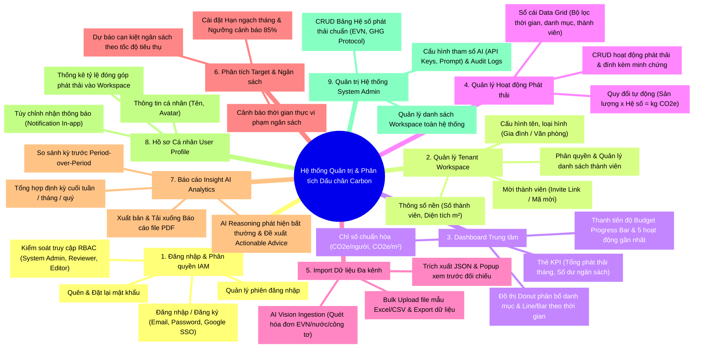
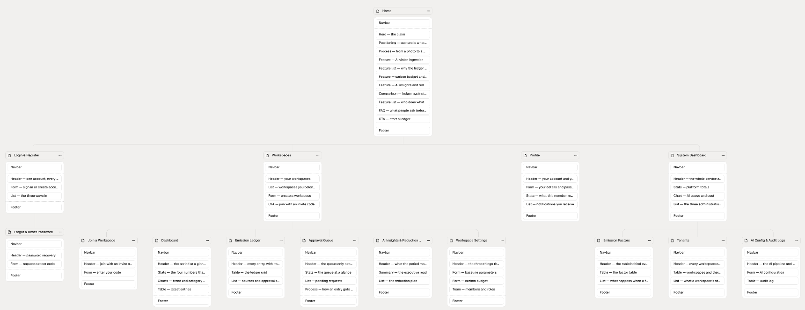
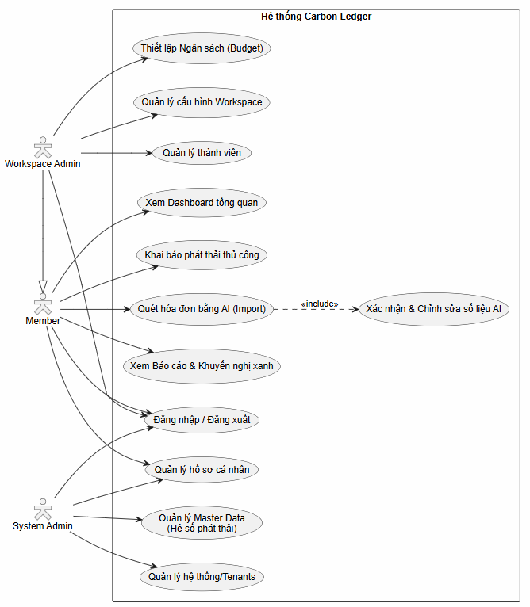
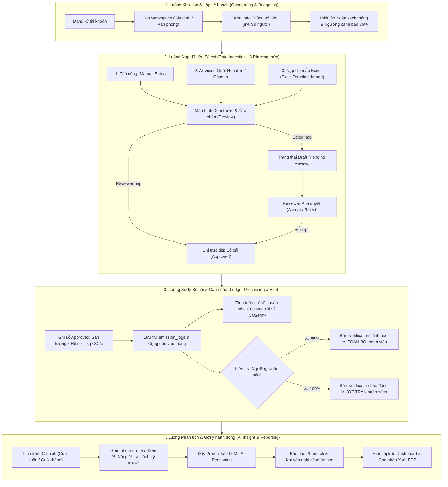

# Hệ thống Quản trị & Phân tích Dấu chân Carbon cho Gia đình/Văn phòng nhỏ

## (Personal & Micro-Office Carbon Ledger)

[](https://github.com/DatTienNguyenn/PMDC-BATCH4-DATNT250)
[](docs/user-stories.md)
[](docs/user-stories.md)
[](docs/user-stories.md)

---

## 📌 1. Giới thiệu Dự án

**Personal & Micro-Office Carbon Ledger** là nền tảng số hóa hỗ trợ **Hộ gia đình** và **Văn phòng nhỏ** ghi nhận hoạt động, kiểm soát hạn ngạch và theo dõi dấu chân carbon (tính theo chuẩn $\text{kg CO}_2\text{e}$).

> [!NOTE]
> Hệ thống **không hướng tới việc tự động nạp hóa dữ liệu** mà tập trung vào **tự động hóa tính toán dựa theo những hoạt động mà người dùng nhập liệu vào hệ thống một cách có kiến trúc và dễ dàng theo dõi**. Hệ thống đóng vai trò số hóa và cố vấn dữ liệu thông minh hỗ trợ người dùng đưa ra quyết định, hỗ trợ đề xuất các phương án cắt giảm cá nhân hóa từ AI chứ **không trực tiếp can thiệp hay tự cắt giảm phát thải (emission) vật lý**.

Hệ thống giải quyết nỗi đau lớn nhất của người dùng là **phải tự tra cứu danh mục, hệ số phát thải tương ứng và tự tính toán/tổng hợp bằng tay** gây nản lòng và mất nhiều thời gian, thông qua sự kết hợp giữa:
- **Tự động quy đổi chuẩn mực:** Tự động áp dụng hệ số phát thải quy chuẩn để tính toán chính xác kg CO2e theo từng hoạt động người dùng nhập vào.
- **Luồng nạp dữ liệu có kiến trúc:** Hai luồng nạp chính là **Khai báo thủ công** (nhập nhanh sinh hoạt lẻ $\le 20-30\text{s}$/activity) và **Nạp hàng loạt bằng file mẫu Excel** (xử lý 100 activities $\le 5\text{s}$). Quét ảnh hóa đơn bằng AI Vision là **tiện ích phụ và là ưu tiên sau cùng**, chỉ triển khai khi luồng nạp tay và Excel đã ổn định.
- **Quy trình kiểm duyệt sổ cái chặt chẽ (Approval Workflow):** Tách bạch vai trò Thành viên (Editor - nạp dữ liệu ở trạng thái Draft) và Trưởng nhóm (Reviewer - kiểm duyệt chính thức trước khi ghi sổ).
- **Kiểm soát ngân sách & Cảnh báo sớm:** Thiết lập trần phát thải (Target Quota) theo tháng và tự động bắn Notification cảnh báo tới toàn bộ thành viên khi chạm ngưỡng $85\%$ và vượt trần $100\%$.
- **Đề xuất cá nhân hóa từ AI & Phản hồi nhanh (Tự động hoặc Kích hoạt bằng tay):** Cho phép Reviewer tùy biến lịch tự động (tuần/tháng/tắt) hoặc kích hoạt on-demand tức thời, AI phân tích dữ liệu và đề xuất phương án cắt giảm cá nhân hóa khả thi, hỗ trợ xuất báo cáo PDF chuẩn in ấn phản hồi nhanh trong $\le 3-5\text{ giây}$.

---

## 🗺️ 2. Sơ đồ Cấu trúc Sản phẩm (Product Mindmap)

Hệ thống được cấu trúc thành **9 phân hệ chức năng hoàn chỉnh** như thể hiện trong sơ đồ Mindmap sản phẩm dưới đây:


### Chi tiết 9 phân hệ chức năng:



---

## 🗺️ 3. Kiến trúc Thông tin & Sơ đồ Trang (Information Architecture & Sitemap)

Cấu trúc luồng màn hình của hệ thống được tổ chức phân cấp mạch lạc, kết nối từ trang giới thiệu (Landing Page), xác thực tài khoản, không gian làm việc cho tới cổng quản trị hệ thống:



### Tóm tắt các khối màn hình chính:
- **Trang chủ & Xác thực (Home & Auth):** Landing page giới thiệu giải pháp, Đăng nhập / Đăng ký (Google SSO, Email/Pass), Quên & Đặt lại mật khẩu.
- **Quản lý Workspace (Workspaces & Onboarding):** Danh sách Workspace (Switcher), Modal tạo mới (nhập tên, loại hình, diện tích $m^2$, số người) và Màn hình nhập mã mời gia nhập (Join Workspace with code).
- **Ứng dụng Không gian làm việc cốt lõi (Workspace App):**
  - **Dashboard:** Thẻ 4 chỉ số KPI, chỉ số chuẩn hóa quy mô ($\text{CO}_2\text{e}/\text{người}$, $\text{CO}_2\text{e}/m^2$), biểu đồ xu hướng Line/Donut, thanh tiến độ và Banner cảnh báo $85\%$.
  - **Sổ cái (Emission Ledger):** Bảng dữ liệu Grid lọc đa tiêu chí, nguồn nạp (Nhập tay, AI Vision, Excel) và nút Xuất Excel.
  - **Modal Thêm Phát thải (3 Tabs):** Quét hóa đơn/công tơ AI (kèm popup xác nhận), Nhập thủ công sinh hoạt lẻ, và Import file mẫu Excel có bảng xem trước đối chiếu.
  - **Hàng đợi Phê duyệt (Approval Queue):** Dành riêng cho Reviewer duyệt (`Accept`) hoặc từ chối (`Reject` kèm lý do) các request nạp dữ liệu từ Editor.
  - **Báo cáo AI & Kế hoạch Cắt giảm (AI Insights & Reduction Plan):** Nhận định xu hướng, Actionable Advice định lượng cá nhân hóa và nút Xuất PDF.
  - **Cài đặt Workspace (Settings):** Cấu hình thông số nền, Hạn ngạch ngân sách tháng và Quản lý phân quyền thành viên.
- **Hồ sơ Cá nhân (User Profile):** Thông tin tài khoản, thống kê tỷ lệ phát thải đóng góp cá nhân và tùy chọn nhận thông báo (Notification Preferences).
- **Cổng Quản trị Hệ thống (System Admin Backoffice):** Dashboard toàn hệ thống (KPIs, chi phí API AI), Quản lý Hệ số chuẩn Master Data (EVN), Quản lý Tenants và Cấu hình AI / Audit Logs.

👉 **Xem đặc tả giao diện và ma trận quyền chi tiết tại:** [docs/information-architecture/information-architecture.md](file:///home/datnguyen-nuoa/PMDC-BATCH4-DATNT250/docs/information-architecture/information-architecture.md)

---

## 👥 4. Sơ đồ Use Case Tổng quan & Ma trận Phân quyền (Use Case Diagram & RBAC)

### 4.1. Sơ đồ UML Use Case Tổng quan (UCD)

Hệ thống được mô hình hóa theo chuẩn UML với 3 tác nhân chính (`Workspace Admin`, `Member`, `System Admin`), quan hệ kế thừa (Generalization) giữa Workspace Admin và Member, cùng quan hệ phụ thuộc `<<include>>` trong luồng xử lý AI:



_Ghi chú quan hệ trên sơ đồ:_

- **Quan hệ Kế thừa (Generalization):** `Workspace Admin` kế thừa toàn bộ các Use Case của `Member` (có thể khai báo phát thải, xem dashboard, xem báo cáo, quản lý hồ sơ cá nhân).
- **Quan hệ Phụ thuộc (`<<include>>`):** Use Case `Quét hóa đơn bằng AI (Import)` bắt buộc bao gồm bước `Xác nhận & Chỉnh sửa số liệu AI` qua Popup xem trước trước khi ghi dữ liệu.

---

### 4.2. Danh sách Vai trò & Ma trận Phân quyền (RBAC Matrix)

Hệ thống phân định 3 vai trò rõ ràng, kết hợp mô hình Multi-tenant cho từng Workspace:

1. **Trưởng nhóm gia đình / Văn phòng (Reviewer / Workspace Admin):**
   - Toàn quyền quản trị Workspace, mời thành viên, khai báo thông số nền ($m^2$, số người).
   - **Quyền Reviewer:** Phê duyệt (`Accept`) hoặc từ chối (`Reject` kèm lý do) các request phát thải từ thành viên.
   - Thiết lập Target ngân sách tháng, theo dõi Dashboard, tiếp nhận báo cáo và xuất Kế hoạch cắt giảm (Reduction Plan) ra file PDF.
2. **Thành viên gia đình / Văn phòng (Editor / Workspace Member):**
   - Khai báo hoạt động phát thải qua 3 phương thức (Thủ công, Quét AI, File Excel); mọi bản ghi lưu ở trạng thái **`Draft / Chờ duyệt (Pending Review)`**.
   - Xem Dashboard tiến độ chung, nhận notification cảnh báo ngưỡng 85% và theo dõi trạng thái duyệt các yêu cầu cá nhân.
3. **Quản trị viên Hệ thống (System Admin):**
   - Quản lý và cập nhật các **Hệ số phát thải quy chuẩn (Standard Emission Factors)** theo quy định của Nhà nước (EVN, Bộ TN&MT, GHG Protocol).
   - **Có toàn quyền khởi tạo, cấu hình và quản trị các Không gian làm việc (Workspace)** trên hệ thống phục vụ công tác thiết lập tenant, cấu hình thông số ban đầu và hỗ trợ người dùng.

#### Bảng Ma trận Phân quyền (RBAC Matrix)

| Chức năng / Thao tác                                                          | System Admin | Trưởng nhóm (Reviewer) |  Thành viên (Editor)  |
| ----------------------------------------------------------------------------- | :----------: | :--------------------: | :-------------------: |
| Khởi tạo & Cấu hình Workspace                                                 |      ✅      |           ✅           |          ❌           |
| Khai báo thông số nền (thành viên, diện tích $m^2$)                           |      ❌      |           ✅           |          ❌           |
| Mời thành viên vào Workspace                                                  |      ❌      |           ✅           |          ❌           |
| Xem Dashboard & chỉ số chuẩn hóa ($\text{CO}_2\text{e}/\text{người}$, $/m^2$) |      ❌      |     ✅ (Toàn diện)     |    ✅ (Xem chung)     |
| Khai báo phát thải thủ công (Manual Entry)                                    |      ❌      |     ✅ (Tự duyệt)      | ✅ (Trạng thái Draft) |
| Quét hóa đơn / công tơ bằng AI Vision                                         |      ❌      |     ✅ (Tự duyệt)      | ✅ (Trạng thái Draft) |
| Nạp dữ liệu qua File mẫu Excel                                                |      ❌      |     ✅ (Tự duyệt)      | ✅ (Trạng thái Draft) |
| Phê duyệt / Từ chối Request phát thải                                         |      ❌      |           ✅           |          ❌           |
| Thiết lập Ngân sách tháng & Ngưỡng 85%                                        |      ❌      |           ✅           |          ❌           |
| Nhận Notification cảnh báo ngưỡng 85% & 100%                                  |      ❌      |           ✅           |          ✅           |
| Xem & Xuất Kế hoạch cắt giảm ra file PDF                                      |      ❌      |           ✅           |          ❌           |
| Quản lý Bảng Hệ số phát thải chuẩn quốc gia                                   |      ✅      |           ❌           |          ❌           |

---

## ⚡ 5. Bốn Luồng Hoạt động Cốt lõi (Core Workflows)



1. **Luồng 1 - Khởi tạo & Lập kế hoạch (Onboarding & Budgeting):** Tạo Workspace -> Khai báo diện tích $m^2$ và số nhân khẩu (phục vụ tính toán $\text{CO}_2\text{e}/\text{người}$ và $\text{CO}_2\text{e}/m^2$) -> Đặt hạn ngạch trần phát thải tháng kèm mốc cảnh báo sớm $85\%$.
2. **Luồng 2 - Nạp dữ liệu có cấu trúc & Phê duyệt (Data Ingestion & Approval):** Luồng chính là Khai báo thủ công sinh hoạt lẻ và Upload file Excel mẫu hàng loạt. Quét ảnh hóa đơn AI là luồng phụ (ưu tiên sau cùng). Dữ liệu của Thành viên được chuyển vào hàng đợi `Draft / Pending Review` để Trưởng nhóm (Reviewer) xem xét duyệt.
3. **Luồng 3 - Xử lý Sổ cái & Cảnh báo (Ledger Processing & Alert):** Sau khi duyệt, Backend tự động quy đổi theo Hệ số chuẩn ($\text{kg CO}_2\text{e} = \text{Sản lượng} \times \text{Hệ số}$), cộng dồn vào bảng `emission_logs`. Nếu chạm ngưỡng $\ge 85\%$, hệ thống tự động bắn Notification cảnh báo tới toàn bộ thành viên.
4. **Luồng 4 - Phân tích & Gợi ý hành động (AI Insight & PDF Export):** Cronjob tự động chạy cuối tuần/tháng, gom nhóm dữ liệu, gọi LLM phân tích bất thường và hỗ trợ đề xuất phương án cắt giảm định lượng cá nhân hóa từ AI; Reviewer có thể xuất báo cáo ra file PDF với thời gian phản hồi nhanh $\le 3-5\text{ giây}$.

---

## 📂 6. Cấu trúc Tài liệu Dự án

Tất cả các tài liệu đặc tả và backlog đã được hoàn thiện trong thư mục gốc và thư mục `/docs`:

```
.
├── README.md                          # Tài liệu tổng quan dự án (File này)
├── spec.md                            # Đặc tả phạm vi bài toán, 3 Roles, 4 Luồng & 12 Use Cases
└── docs/
    ├── PRD.md                         # Tài liệu Yêu cầu Sản phẩm (Product Requirements Document)
    ├── MVP.md                         # Kế hoạch triển khai & phát hành MVP 6 tuần (3 Sprints x 2 tuần)
    ├── activity-supported.md          # Danh mục hoạt động phát thải & Hệ số phát thải quy chuẩn (Scope 1, 2, 3)
    ├── cau_truc_san_pham_xmind.png    # Sơ đồ Mindmap cấu trúc sản phẩm 9 phân hệ
    ├── information-architecture/
    │   ├── information-architecture.md# Tài liệu Kiến trúc Thông tin & Đặc tả giao diện (IA)
    │   └── sitemap.png                # Sơ đồ kiến trúc thông tin & cây màn hình (Sitemap)
    ├── usecase/
    │   ├── UCD.png                    # Sơ đồ UML Use Case Diagram tổng quan hệ thống
    │   └── use-cases.md               # Đặc tả chi tiết 12 Use Cases (Actors, Flows, Alternatives)
    └── user-stories.md                # Bộ 15 User Stories chuẩn INVEST & Gherkin ACs (Given-When-Then)
```

### Chi tiết các tài liệu liên kết:

- **[docs/MVP.md](file:///home/datnguyen-nuoa/PMDC-BATCH4-DATNT250/docs/MVP.md):** Kế hoạch chi tiết triển khai và phát hành MVP trong 6 tuần (3 Sprints), định nghĩa DoR/DoD và quản trị rủi ro kỹ thuật.
- **[docs/activity-supported.md](file:///home/datnguyen-nuoa/PMDC-BATCH4-DATNT250/docs/activity-supported.md):** Danh mục 8 hoạt động phát thải được hỗ trợ (bao gồm năng lượng, di chuyển, rác thải, nước sạch, vật tư và du lịch hàng không), đơn vị tính, phân loại Scope 1, 2, 3 và trích dẫn nguồn hệ số chuẩn (Bộ TN&MT, IPCC, ICAO, DEFRA, US EPA, IEA).
- **[spec.md](file:///home/datnguyen-nuoa/PMDC-BATCH4-DATNT250/spec.md):** Định nghĩa chi tiết phạm vi In-Scope / Out-of-Scope, ma trận RBAC, 4 luồng hoạt động cốt lõi và danh mục 12 Use Cases.
- **[docs/information-architecture/information-architecture.md](file:///home/datnguyen-nuoa/PMDC-BATCH4-DATNT250/docs/information-architecture/information-architecture.md):** Thiết kế sơ đồ cây kiến trúc thông tin (Sitemap), ma trận phân quyền View và đặc tả UI chi tiết cho toàn bộ các màn hình.
- **[docs/usecase/use-cases.md](file:///home/datnguyen-nuoa/PMDC-BATCH4-DATNT250/docs/usecase/use-cases.md):** Đặc tả chi tiết từng Use Case từ UC01 đến UC12 (Tiền điều kiện, Hậu điều kiện, Luồng chính, Luồng ngoại lệ).
- **[docs/user-stories.md](file:///home/datnguyen-nuoa/PMDC-BATCH4-DATNT250/docs/user-stories.md):** Danh mục 15 User Stories được chuẩn hóa theo chuẩn **INVEST** và tiêu chí nghiệm thu **Gherkin Syntax (Given-When-Then)** theo phương pháp luận của BA Zone & Digital School (Phúc NT).

---

## 📋 7. Danh mục 15 User Stories (Backlog Overview)

| Mã US         | Tên User Story                                               | Phân hệ / Luồng       | Persona chính                   | MoSCoW | Est. (SP) |
| ------------- | ------------------------------------------------------------ | --------------------- | ------------------------------- | :----: | :-------: |
| **US-WS-001** | Khởi tạo & Cấu hình Không gian làm việc (Workspace)          | Luồng 1: Onboarding   | Reviewer / System Admin         |  Must  |     2     |
| **US-WS-002** | Khai báo thông số nền ($m^2$, số người)                      | Luồng 1: Onboarding   | Trưởng nhóm (Reviewer)          |  Must  |     3     |
| **US-WS-003** | Mời thành viên gia nhập với vai trò Editor                   | Luồng 1: Onboarding   | Trưởng nhóm (Reviewer) / Editor |  Must  |     3     |
| **US-SA-001** | Quản lý & cập nhật Hệ số phát thải quy chuẩn                 | Quản trị Hệ thống     | System Admin                    | Should |     3     |
| **US-CL-001** | Khai báo phát thải thủ công ở trạng thái Draft               | Luồng 2: Nạp dữ liệu  | Thành viên (Editor)             |  Must  |     3     |
| **US-CL-002** | Tự động quy đổi mức tiêu thụ ra chỉ số kg CO2e               | Luồng 3: Xử lý Sổ cái | Editor / Reviewer               |  Must  |     2     |
| **US-CL-003** | Quét hóa đơn / công tơ bằng AI Vision (Popup xác nhận)       | Luồng 2: Nạp dữ liệu  | Editor / Reviewer               | Should |     5     |
| **US-CL-004** | Nạp dữ liệu phát thải qua file mẫu Excel (Preview & Import)  | Luồng 2: Nạp dữ liệu  | Editor / Reviewer               | Should |     4     |
| **US-CL-005** | Kiểm duyệt & phê duyệt (Accept / Reject) request phát thải   | Luồng 2: Phê duyệt    | Trưởng nhóm (Reviewer)          |  Must  |     3     |
| **US-CL-006** | Tra cứu lịch sử sổ cái và trạng thái phê duyệt               | Luồng 2: Lịch sử      | Editor / Reviewer               |  Must  |     3     |
| **US-BG-001** | Thiết lập Ngân sách tháng & Ngưỡng cảnh báo sớm 85%          | Luồng 1: Budgeting    | Trưởng nhóm (Reviewer)          |  Must  |     2     |
| **US-BG-002** | Theo dõi tiến độ tiêu thụ & chỉ số chuẩn hóa trên Dashboard  | Luồng 3: Giám sát     | Editor / Reviewer               |  Must  |     3     |
| **US-BG-003** | Bắn Notification cảnh báo ngưỡng 85% đến TOÀN BỘ thành viên  | Luồng 3: Cảnh báo     | Editor / Reviewer               |  Must  |     3     |
| **US-AI-001** | AI Insight định kỳ (Cronjob) & Kế hoạch cắt giảm cá nhân hóa | Luồng 4: AI Reporting | Trưởng nhóm (Reviewer)          | Could  |     5     |
| **US-AI-002** | Xuất Báo cáo Phân tích & Kế hoạch cắt giảm ra file PDF       | Luồng 4: AI Reporting | Trưởng nhóm (Reviewer)          | Could  |     3     |

---

## 🚀 8. Kế hoạch Triển khai & Phát hành MVP

Chi tiết kế hoạch phát hành MVP trong **6 tuần (3 Sprints x 2 tuần)**, bảng phân bổ Story Points, định nghĩa Definition of Ready (DoR), Definition of Done (DoD) và quản trị rủi ro kỹ thuật đã được tách riêng vào tài liệu:

👉 **Xem chi tiết tại:** [docs/MVP.md](file:///home/datnguyen-nuoa/PMDC-BATCH4-DATNT250/docs/MVP.md)

- **Sprint 1 (Tuần 1 - 2 | 16 SP):** Onboarding, Thiết lập Thông số nền $m^2$/số người, Quản lý Hệ số chuẩn (System Admin), Form nạp phát thải thủ công (Draft) & Engine tính toán quy đổi $\text{kg CO}_2\text{e}$.
- **Sprint 2 (Tuần 3 - 4 | 18 SP):** Nạp dữ liệu qua file mẫu Excel (Bulk Import with Preview), Hàng đợi duyệt Reviewer (Approval Queue), Lịch sử sổ cái, Ngân sách tháng, Dashboard chỉ số chuẩn hóa và Bắn Notification cảnh báo $85\%$.
- **Sprint 3 (Tuần 5 - 6 | 13 SP):** AI Vision bóc tách hóa đơn điện/nước/công tơ, Cronjob AI Insight phân tích bất thường sinh kế hoạch cắt giảm định lượng cá nhân hóa và Xuất Báo cáo PDF chuẩn in ấn.

---

## 🛠️ 9. Nền tảng Kỹ thuật & Công nghệ (Tech Stack)

| Thành phần | Công nghệ lựa chọn | Mục đích sử dụng |
|---|---|---|
| **Frontend** | **React + Vite**, TailwindCSS | Xây dựng Web App SPA / PWA Mobile-First Responsive với tốc độ bundling cực nhanh từ Vite, tối ưu thao tác chụp ảnh và duyệt nhanh trên điện thoại. |
| **Backend** | **Java Spring Boot (3.x)** | Xây dựng RESTful API chuẩn mực; Spring Security + JWT cho xác thực và RBAC; Spring Data JPA quản lý dữ liệu sổ cái `emission_logs`. |
| **Database** | **PostgreSQL** | Cơ sở dữ liệu quan hệ đảm bảo toàn vẹn giao dịch (ACID) cho sổ cái phát thải và mô hình Multi-tenant Workspace. |
| **Multimodal AI** | **Google Gemini 1.5 Flash / Claude 3.5 Sonnet** | Vision Parser bóc tách dữ liệu có cấu trúc (JSON) từ ảnh hóa đơn EVN, hóa đơn nước và mặt số công tơ. |
| **Generative LLM** | **Google Gemini 1.5 Pro / Claude 3.5 Sonnet** | Insight Generator phân tích nguyên nhân bất thường và sinh Kế hoạch cắt giảm định lượng cá nhân hóa. |
| **Background Jobs** | **Spring Scheduler (`@Scheduled`)** | Thiết lập Cronjob tự động chạy phân tích dữ liệu vào 23:59 ngày cuối tuần hoặc cuối tháng. |
| **File Processing** | **Apache POI & OpenPDF / iText** | Xử lý đọc, validate và ánh xạ file mẫu Excel trên Java Backend; kết xuất tài liệu báo cáo đồ họa chuẩn PDF. |

---

_Dự án: Personal & Micro-Office Carbon Ledger (Batch 4 - 2026)._
