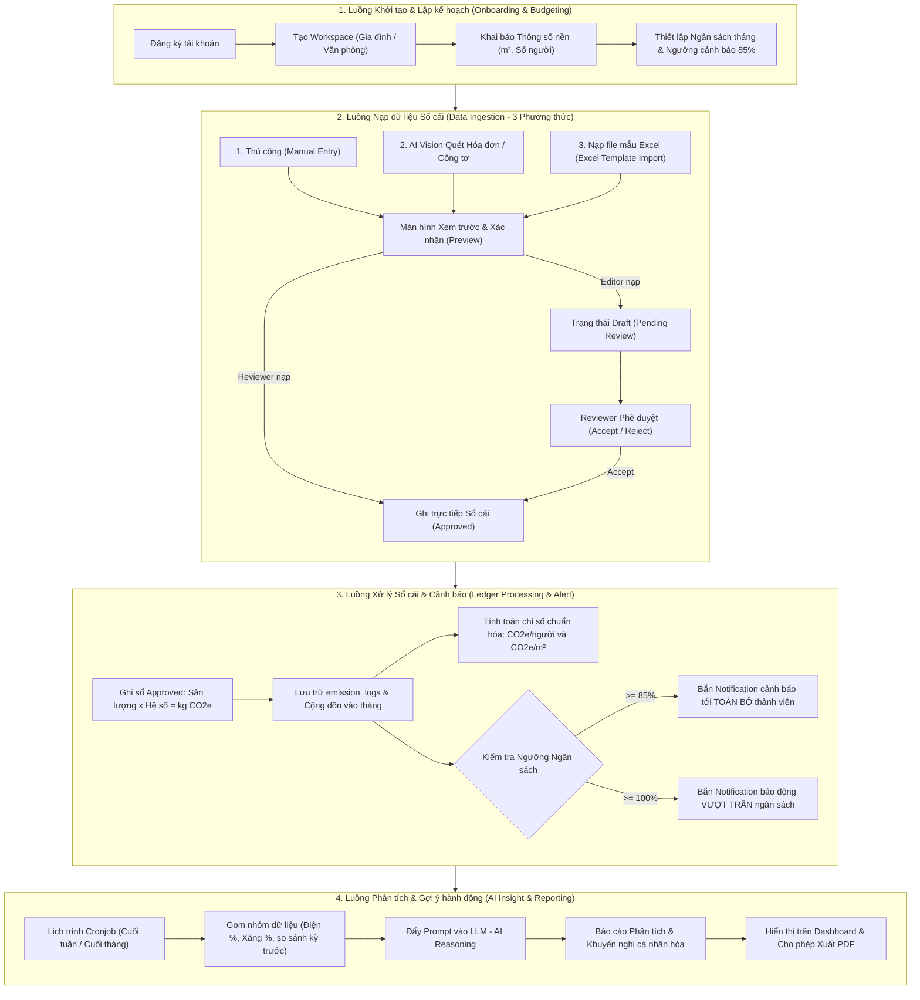

# Hệ thống Quản trị & Phân tích Dấu chân Carbon cho Gia đình/Văn phòng nhỏ
## (Personal & Micro-Office Carbon Ledger)

[](https://github.com/DatTienNguyenn/PMDC-BATCH4-DATNT250)
[](docs/user-stories.md)
[](docs/user-stories.md)
[](docs/user-stories.md)

---

## 📌 1. Giới thiệu Dự án

**Personal & Micro-Office Carbon Ledger** là nền tảng số hóa hỗ trợ **Hộ gia đình** và **Văn phòng nhỏ** ghi nhận, kiểm soát hạn ngạch, phân tích và chủ động cắt giảm dấu chân carbon (tính theo chuẩn $\text{kg CO}_2\text{e}$). 

Hệ thống giải quyết bài toán biến đổi khí hậu từ cấp độ vi mô thông qua sự kết hợp giữa **Quy trình kiểm duyệt sổ cái chặt chẽ (Approval Workflow)**, **Đa kênh nạp dữ liệu thông minh (Thủ công, Quét ảnh bằng AI Vision, Import Excel)** và **Kế hoạch cắt giảm định lượng mang tính cá nhân hóa (AI Insight & Actionable Advice)**.

### Mục tiêu cốt lõi:
- **Số hóa nhanh chóng:** Loại bỏ rào cản ghi chép thủ công nhờ công nghệ Multimodal AI bóc tách trực tiếp hóa đơn tiền điện (EVN), hóa đơn nước và mặt số công tơ.
- **Minh bạch & Phê duyệt:** Tách bạch vai trò Thành viên (Editor - nạp dữ liệu ở trạng thái Draft) và Trưởng nhóm (Reviewer - kiểm duyệt chính thức trước khi ghi sổ).
- **Kiểm soát ngân sách & Cảnh báo sớm:** Thiết lập trần phát thải (Target Quota) theo tháng và tự động bắn Notification cảnh báo tới toàn bộ thành viên khi chạm ngưỡng $85\%$ và vượt trần $100\%$.
- **Hành động thiết thực:** AI phân tích bất thường cuối kỳ và đưa ra các khuyến nghị cắt giảm cụ thể, khả thi kèm báo cáo PDF chuẩn in ấn.

---

## 🗺️ 2. Sơ đồ Cấu trúc Sản phẩm (Product Mindmap)

Hệ thống được cấu trúc thành **9 phân hệ chức năng hoàn chỉnh** như thể hiện trong sơ đồ Mindmap sản phẩm dưới đây:


### Chi tiết 9 phân hệ chức năng:

```mermaid
mindmap
  root((Hệ thống Quản trị & Phân tích Dấu chân Carbon))
    1. Đăng nhập & Phân quyền IAM
      Đăng nhập / Đăng ký (Email, Password, Google SSO)
      Quên & Đặt lại mật khẩu
      Quản lý phiên đăng nhập
      Kiểm soát truy cập RBAC (System Admin, Reviewer, Editor)
    2. Quản lý Tenant Workspace
      Cấu hình tên, loại hình (Gia đình / Văn phòng)
      Thông số nền (Số thành viên, Diện tích m²)
      Mời thành viên (Invite Link / Mã mời)
      Phân quyền & Quản lý danh sách thành viên
    3. Dashboard Trung tâm
      Thẻ KPI (Tổng phát thải tháng, Số dư ngân sách)
      Chỉ số chuẩn hóa (CO2e/người, CO2e/m²)
      Đồ thị Donut phân bổ danh mục & Line/Bar theo thời gian
      Thanh tiến độ Budget Progress Bar & 5 hoạt động gần nhất
    4. Quản lý Hoạt động Phát thải
      Sổ cái Data Grid (Bộ lọc thời gian, danh mục, thành viên)
      CRUD hoạt động phát thải & đính kèm minh chứng
      Quy đổi tự động (Sản lượng x Hệ số = kg CO2e)
    5. Import Dữ liệu Đa kênh
      AI Vision Ingestion (Quét hóa đơn EVN/nước/công tơ)
      Trích xuất JSON & Popup xem trước đối chiếu
      Bulk Upload file mẫu Excel/CSV & Export dữ liệu
    6. Phân tích Target & Ngân sách
      Cài đặt Hạn ngạch tháng & Ngưỡng cảnh báo 85%
      Dự báo cạn kiệt ngân sách theo tốc độ tiêu thụ
      Cảnh báo thời gian thực vi phạm ngân sách
    7. Báo cáo Insight AI Analytics
      Tổng hợp định kỳ cuối tuần / tháng / quý
      So sánh kỳ trước Period-over-Period
      AI Reasoning phát hiện bất thường & Đề xuất Actionable Advice
      Xuất bản & Tải xuống Báo cáo file PDF
    8. Hồ sơ Cá nhân User Profile
      Thông tin cá nhân (Tên, Avatar)
      Thống kê tỷ lệ đóng góp phát thải vào Workspace
      Tùy chỉnh nhận thông báo (Notification In-app)
    9. Quản trị Hệ thống System Admin
      CRUD Bảng Hệ số phát thải chuẩn (EVN, GHG Protocol)
      Quản lý danh sách Workspace toàn hệ thống
      Cấu hình tham số AI (API Keys, Prompt) & Audit Logs
```

---

## 👥 3. Sơ đồ Use Case Tổng quan & Ma trận Phân quyền (Use Case Diagram & RBAC)

### 3.1. Sơ đồ UML Use Case Tổng quan (UCD)

Hệ thống được mô hình hóa theo chuẩn UML với 3 tác nhân chính (`Workspace Admin`, `Member`, `System Admin`), quan hệ kế thừa (Generalization) giữa Workspace Admin và Member, cùng quan hệ phụ thuộc `<<include>>` trong luồng xử lý AI:


*Ghi chú quan hệ trên sơ đồ:*
- **Quan hệ Kế thừa (Generalization):** `Workspace Admin` kế thừa toàn bộ các Use Case của `Member` (có thể khai báo phát thải, xem dashboard, xem báo cáo, quản lý hồ sơ cá nhân).
- **Quan hệ Phụ thuộc (`<<include>>`):** Use Case `Quét hóa đơn bằng AI (Import)` bắt buộc bao gồm bước `Xác nhận & Chỉnh sửa số liệu AI` qua Popup xem trước trước khi ghi dữ liệu.

---

### 3.2. Danh sách Vai trò & Ma trận Phân quyền (RBAC Matrix)

Hệ thống phân định 3 vai trò rõ ràng, kết hợp mô hình Multi-tenant cho từng Workspace:

1. **Trưởng nhóm gia đình / Văn phòng (Reviewer / Workspace Admin):**
   - Toàn quyền quản trị Workspace, mời thành viên, khai báo thông số nền ($m^2$, số người).
   - **Quyền Reviewer:** Phê duyệt (`Accept`) hoặc từ chối (`Reject` kèm lý do) các request phát thải từ thành viên.
   - Thiết lập Target ngân sách tháng, theo dõi Dashboard, tiếp nhận báo cáo và xuất Kế hoạch cắt giảm (Reduction Plan) ra file PDF.
2. **Thành viên gia đình / Văn phòng (Editor / Workspace Member):**
   - Khai báo hoạt động phát thải qua 3 phương thức (Thủ công, Quét AI, File Excel); mọi bản ghi lưu ở trạng thái **`Draft / Chờ duyệt (Pending Review)`**.
   - Xem Dashboard tiến độ chung, nhận notification cảnh báo ngưỡng 85% và theo dõi trạng thái duyệt các yêu cầu cá nhân.
3. **Quản trị viên Hệ thống (System Admin):**
   - Độc lập với dữ liệu các Workspace. Chịu trách nhiệm quản lý và cập nhật các **Hệ số phát thải quy chuẩn (Standard Emission Factors)** theo quy định của Nhà nước (EVN, Bộ TN&MT, GHG Protocol).

#### Bảng Ma trận Phân quyền (RBAC Matrix)

| Chức năng / Thao tác | System Admin | Trưởng nhóm (Reviewer) | Thành viên (Editor) |
|---|:---:|:---:|:---:|
| Khởi tạo & Cấu hình Workspace | ❌ | ✅ | ❌ |
| Khai báo thông số nền (thành viên, diện tích $m^2$) | ❌ | ✅ | ❌ |
| Mời thành viên vào Workspace | ❌ | ✅ | ❌ |
| Xem Dashboard & chỉ số chuẩn hóa ($\text{CO}_2\text{e}/\text{người}$, $/m^2$) | ❌ | ✅ (Toàn diện) | ✅ (Xem chung) |
| Khai báo phát thải thủ công (Manual Entry) | ❌ | ✅ (Tự duyệt) | ✅ (Trạng thái Draft) |
| Quét hóa đơn / công tơ bằng AI Vision | ❌ | ✅ (Tự duyệt) | ✅ (Trạng thái Draft) |
| Nạp dữ liệu qua File mẫu Excel | ❌ | ✅ (Tự duyệt) | ✅ (Trạng thái Draft) |
| Phê duyệt / Từ chối Request phát thải | ❌ | ✅ | ❌ |
| Thiết lập Ngân sách tháng & Ngưỡng 85% | ❌ | ✅ | ❌ |
| Nhận Notification cảnh báo ngưỡng 85% & 100% | ❌ | ✅ | ✅ |
| Xem & Xuất Kế hoạch cắt giảm ra file PDF | ❌ | ✅ | ❌ |
| Quản lý Bảng Hệ số phát thải chuẩn quốc gia | ✅ | ❌ | ❌ |

---

## ⚡ 4. Bốn Luồng Hoạt động Cốt lõi (Core Workflows)



1. **Luồng 1 - Khởi tạo & Lập kế hoạch (Onboarding & Budgeting):** Tạo Workspace -> Khai báo diện tích $m^2$ và số nhân khẩu (phục vụ tính toán $\text{CO}_2\text{e}/\text{người}$ và $\text{CO}_2\text{e}/m^2$) -> Đặt hạn ngạch trần phát thải tháng kèm mốc cảnh báo sớm $85\%$.
2. **Luồng 2 - Nạp dữ liệu đa phương thức & Phê duyệt (Data Ingestion & Approval):** Hỗ trợ 3 kênh nạp (Thủ công sinh hoạt lẻ, AI Vision bóc tách hóa đơn/công tơ, Upload file Excel mẫu). Dữ liệu của Thành viên được chuyển vào hàng đợi `Draft / Pending Review` để Trưởng nhóm (Reviewer) xem xét duyệt.
3. **Luồng 3 - Xử lý Sổ cái & Cảnh báo (Ledger Processing & Alert):** Sau khi duyệt, Backend quy đổi theo Hệ số chuẩn ($\text{kg CO}_2\text{e} = \text{Sản lượng} \times \text{Hệ số}$), cộng dồn vào bảng `emission_logs`. Nếu chạm ngưỡng $\ge 85\%$, hệ thống tự động bắn Notification cảnh báo tới toàn bộ thành viên.
4. **Luồng 4 - Phân tích & Gợi ý hành động (AI Insight & PDF Export):** Cronjob tự động chạy cuối tuần/tháng, gom nhóm dữ liệu, gọi LLM phân tích bất thường và sinh khuyến nghị định lượng thực tế (ví dụ: chuyển sang đi tàu điện Cát Linh - Hà Đông 3 ngày/tuần giảm 18 kg CO2e); Reviewer có thể xuất báo cáo ra file PDF.

---

## 📂 5. Cấu trúc Tài liệu Dự án

Tất cả các tài liệu đặc tả và backlog đã được hoàn thiện trong thư mục gốc và thư mục `/docs`:

```
.
├── README.md                      # Tài liệu tổng quan dự án (File này)
├── spec.md                        # Đặc tả phạm vi bài toán, 3 Roles, 4 Luồng & 12 Use Cases
└── docs/
    ├── UCD.png                    # Sơ đồ UML Use Case Diagram tổng quan hệ thống
    ├── cau_truc_san_pham_xmind.png# Sơ đồ Mindmap cấu trúc sản phẩm 9 phân hệ
    ├── information-architecture.md# Tài liệu Kiến trúc Thông tin & Đặc tả giao diện (IA)
    ├── use-cases.md               # Đặc tả chi tiết 12 Use Cases (Actors, Flows, Alternatives)
    └── user-stories.md            # Bộ 15 User Stories chuẩn INVEST & Gherkin ACs (Given-When-Then)
```

### Chi tiết các tài liệu liên kết:
- **[spec.md](file:///home/datnguyen-nuoa/PMDC-BATCH4-DATNT250/spec.md):** Định nghĩa chi tiết phạm vi In-Scope / Out-of-Scope, ma trận RBAC, 4 luồng hoạt động cốt lõi và danh mục 12 Use Cases.
- **[docs/information-architecture.md](file:///home/datnguyen-nuoa/PMDC-BATCH4-DATNT250/docs/information-architecture.md):** Thiết kế sơ đồ cây kiến trúc thông tin (Sitemap), ma trận phân quyền View và đặc tả UI chi tiết cho toàn bộ các màn hình.
- **[docs/use-cases.md](file:///home/datnguyen-nuoa/PMDC-BATCH4-DATNT250/docs/use-cases.md):** Đặc tả chi tiết từng Use Case từ UC01 đến UC12 (Tiền điều kiện, Hậu điều kiện, Luồng chính, Luồng ngoại lệ).
- **[docs/user-stories.md](file:///home/datnguyen-nuoa/PMDC-BATCH4-DATNT250/docs/user-stories.md):** Danh mục 15 User Stories được chuẩn hóa theo chuẩn **INVEST** và tiêu chí nghiệm thu **Gherkin Syntax (Given-When-Then)** theo phương pháp luận của BA Zone & Digital School (Phúc NT).

---

## 📋 6. Danh mục 15 User Stories (Backlog Overview)

| Mã US | Tên User Story | Phân hệ / Luồng | Persona chính | MoSCoW | Est. (SP) |
|---|---|---|---|:---:|:---:|
| **US-WS-001** | Khởi tạo Không gian làm việc (Workspace) | Luồng 1: Onboarding | Trưởng nhóm (Reviewer) | Must | 2 |
| **US-WS-002** | Khai báo thông số nền ($m^2$, số người) | Luồng 1: Onboarding | Trưởng nhóm (Reviewer) | Must | 3 |
| **US-WS-003** | Mời thành viên gia nhập với vai trò Editor | Luồng 1: Onboarding | Trưởng nhóm (Reviewer) / Editor | Must | 3 |
| **US-SA-001** | Quản lý & cập nhật Hệ số phát thải quy chuẩn | Quản trị Hệ thống | System Admin | Should | 3 |
| **US-CL-001** | Khai báo phát thải thủ công ở trạng thái Draft | Luồng 2: Nạp dữ liệu | Thành viên (Editor) | Must | 3 |
| **US-CL-002** | Tự động quy đổi mức tiêu thụ ra chỉ số kg CO2e | Luồng 3: Xử lý Sổ cái | Editor / Reviewer | Must | 2 |
| **US-CL-003** | Quét hóa đơn / công tơ bằng AI Vision (Popup xác nhận) | Luồng 2: Nạp dữ liệu | Editor / Reviewer | Should | 5 |
| **US-CL-004** | Nạp dữ liệu phát thải qua file mẫu Excel (Preview & Import) | Luồng 2: Nạp dữ liệu | Editor / Reviewer | Should | 4 |
| **US-CL-005** | Kiểm duyệt & phê duyệt (Accept / Reject) request phát thải | Luồng 2: Phê duyệt | Trưởng nhóm (Reviewer) | Must | 3 |
| **US-CL-006** | Tra cứu lịch sử sổ cái và trạng thái phê duyệt | Luồng 2: Lịch sử | Editor / Reviewer | Must | 3 |
| **US-BG-001** | Thiết lập Ngân sách tháng & Ngưỡng cảnh báo sớm 85% | Luồng 1: Budgeting | Trưởng nhóm (Reviewer) | Must | 2 |
| **US-BG-002** | Theo dõi tiến độ tiêu thụ & chỉ số chuẩn hóa trên Dashboard | Luồng 3: Giám sát | Editor / Reviewer | Must | 3 |
| **US-BG-003** | Bắn Notification cảnh báo ngưỡng 85% đến TOÀN BỘ thành viên | Luồng 3: Cảnh báo | Editor / Reviewer | Must | 3 |
| **US-AI-001** | AI Insight định kỳ (Cronjob) & Kế hoạch cắt giảm cá nhân hóa | Luồng 4: AI Reporting | Trưởng nhóm (Reviewer) | Could | 5 |
| **US-AI-002** | Xuất Báo cáo Phân tích & Kế hoạch cắt giảm ra file PDF | Luồng 4: AI Reporting | Trưởng nhóm (Reviewer) | Could | 3 |

---

## 🚀 7. Kế hoạch Phát hành 6 Tuần (Release Plan)

Dự án được chia thành **3 Sprints (mỗi Sprint 2 tuần)** với tổng nỗ lực ước lượng là **44 Story Points**:

```mermaid
flowchart LR
    subgraph Sprint1["Sprint 1: Onboarding, Hệ chuẩn & Nạp thủ công (Tuần 1 - 2 | 16 SP)"]
        direction TB
        S1_1["US-WS-001: Khởi tạo Workspace (2 SP)"]
        S1_2["US-WS-002: Khai báo Thông số nền (3 SP)"]
        S1_3["US-WS-003: Mời Editor vào Workspace (3 SP)"]
        S1_4["US-SA-001: Quản lý Hệ số Quy chuẩn (3 SP)"]
        S1_5["US-CL-001: Khai báo Thủ công Draft (3 SP)"]
        S1_6["US-CL-002: Tự động Quy đổi kg CO2e (2 SP)"]
    end

    subgraph Sprint2["Sprint 2: Excel Import, Phê duyệt & Cảnh báo 85% (Tuần 3 - 4 | 18 SP)"]
        direction TB
        S2_1["US-CL-004: Import File mẫu Excel (4 SP)"]
        S2_2["US-CL-005: Phê duyệt Request (Reviewer) (3 SP)"]
        S2_3["US-CL-006: Lịch sử Sổ cái & Trạng thái (3 SP)"]
        S2_4["US-BG-001: Cài đặt Ngân sách & Ngưỡng 85% (2 SP)"]
        S2_5["US-BG-002: Dashboard & Chỉ số Chuẩn hóa (3 SP)"]
        S2_6["US-BG-003: Bắn Notification Cảnh báo 85% (3 SP)"]
    end

    subgraph Sprint3["Sprint 3: AI Vision Quét Hóa đơn & Báo cáo PDF (Tuần 5 - 6 | 13 SP)"]
        direction TB
        S3_1["US-CL-003: AI Vision Quét Hóa đơn/Công tơ (5 SP)"]
        S3_2["US-AI-001: Cronjob AI Insight Cá nhân hóa (5 SP)"]
        S3_3["US-AI-002: Xuất Báo cáo Kế hoạch ra PDF (3 SP)"]
    end

    Sprint1 --> Sprint2 --> Sprint3
```



---

## 🛠️ 8. Nền tảng Kỹ thuật & Công nghệ (Tech Stack)

| Thành phần | Công nghệ lựa chọn | Mục đích sử dụng |
|---|---|---|
| **Frontend** | React / Next.js, TailwindCSS | Giao diện Mobile-First Responsive PWA, tối ưu thao tác chụp ảnh và duyệt nhanh trên điện thoại. |
| **Backend** | Node.js / NestJS hoặc Python FastAPI | Xử lý nghiệp vụ sổ cái, tính toán số học quy đổi, kiểm tra ngưỡng và cấp quyền RBAC. |
| **Database** | PostgreSQL | Cơ sở dữ liệu quan hệ đảm bảo toàn vẹn giao dịch (ACID) của bảng `emission_logs`. |
| **Multimodal AI** | Google Gemini 1.5 Flash / Claude 3.5 Sonnet | Vision Parser bóc tách dữ liệu có cấu trúc (JSON) từ ảnh hóa đơn EVN, hóa đơn nước và mặt số công tơ. |
| **Generative LLM** | Google Gemini 1.5 Pro / Claude 3.5 Sonnet | Insight Generator phân tích nguyên nhân bất thường và sinh Kế hoạch cắt giảm định lượng cá nhân hóa. |
| **Background Jobs** | Node-cron / BullMQ | Lịch trình Cronjob tự động chạy phân tích dữ liệu vào 23:59 ngày cuối tuần hoặc cuối tháng. |
| **File Processing** | SheetJS (xlsx), Puppeteer / jsPDF | Đọc và ánh xạ file template Excel hàng loạt; kết xuất báo cáo đồ họa ra file PDF chuẩn in ấn. |

---

*Tài liệu được phát triển và chuẩn hóa theo tiêu chuẩn **BA Zone & Digital School** — Biên soạn bởi **Phúc NT**.*  
*Dự án: Personal & Micro-Office Carbon Ledger (Batch 4 - 2026).*
