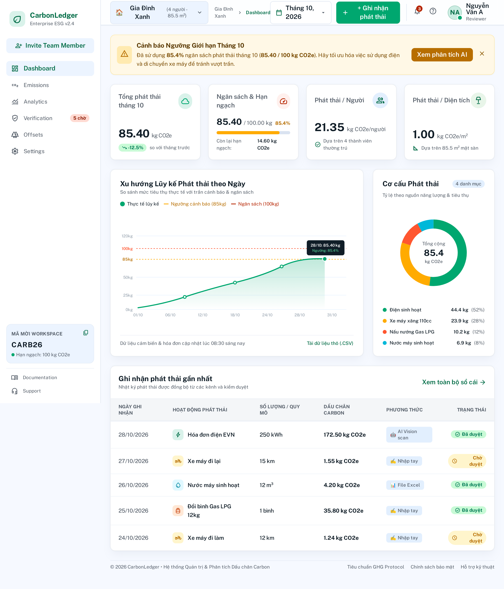
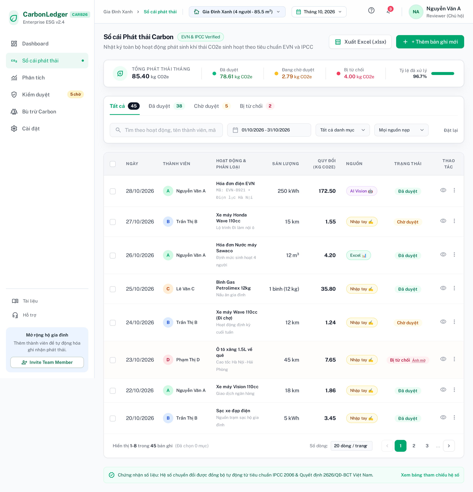
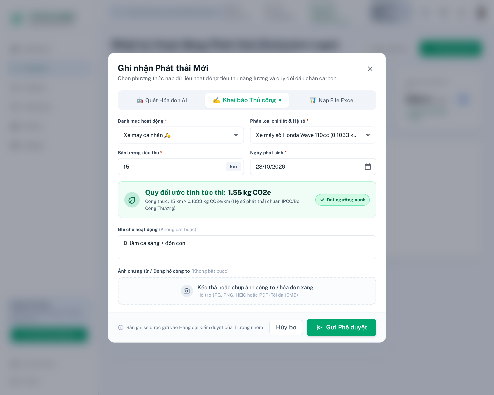
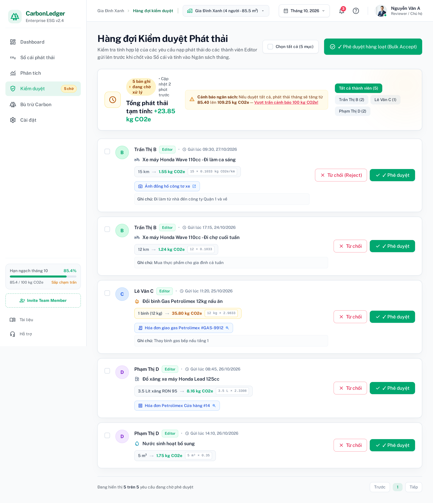
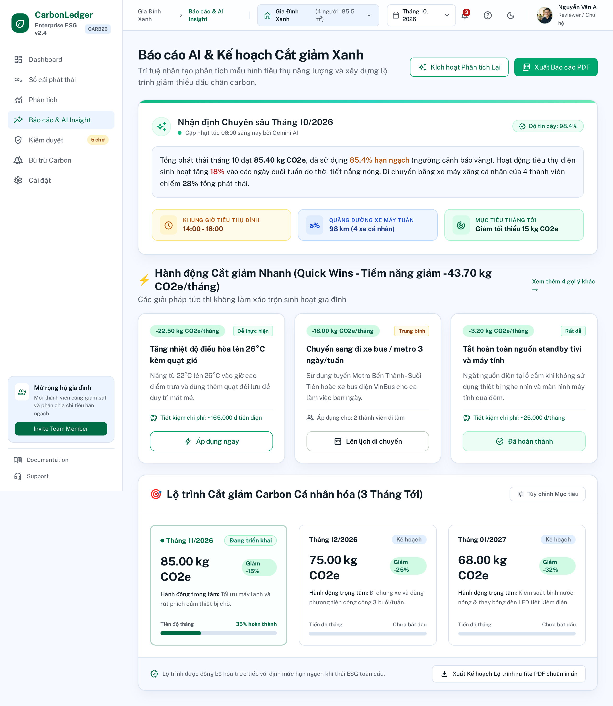
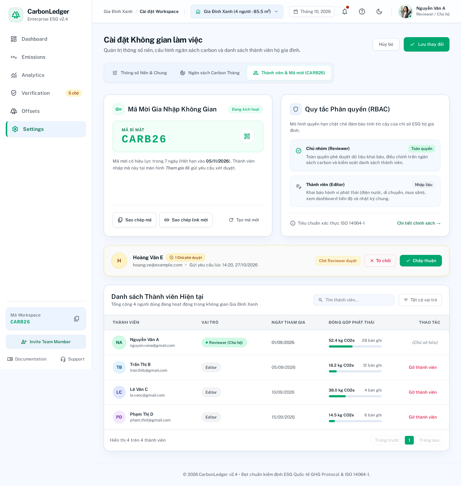
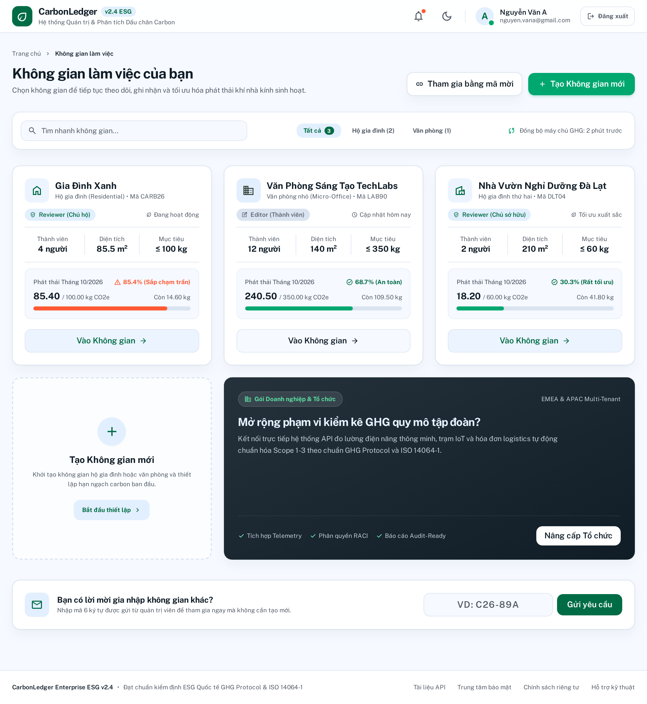
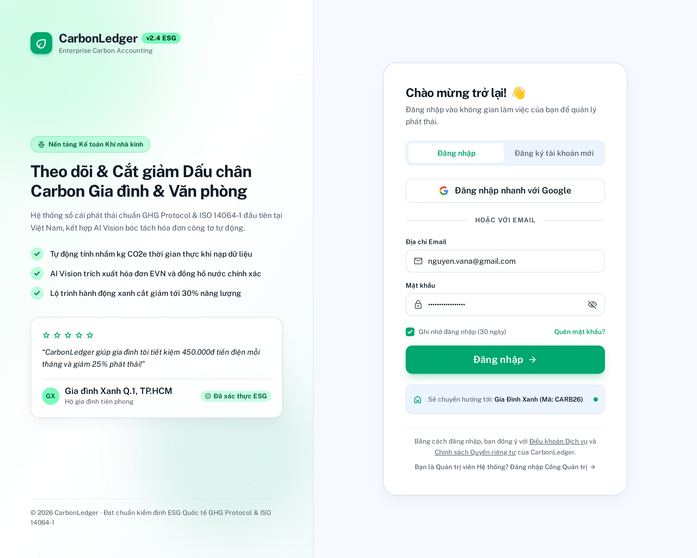

# 🌿 CarbonLedger - MUI Minimal UI Design System & Screen Mockups

> **Dự án:** Hệ thống Quản trị & Phân tích Dấu chân Carbon cho Gia đình/Văn phòng nhỏ (Personal & Micro-Office Carbon Ledger)  
> **Nền tảng Thiết kế:** Google Stitch (AI-Driven Design Platform)  
> **Stitch Project ID:** `2234879253181793294`  
> **Stitch Project Name:** `CarbonLedger - MUI Minimal UI (Green Theme)`  
> **Phong cách UI/UX:** MUI Minimal UI ([minimals.cc](https://minimals.cc))  
> **Tone màu chủ đạo:** Trắng sáng (`#FFFFFF` / `#F9FAFB`) & Xanh ngọc lục bảo Emerald Green (`#00A76F`)  
> **Nhánh Git Worktree:** `design/stitch-minimal-ui`  
> **Căn cứ nghiệp vụ:** [docs/information-architecture/information-architecture.md](../../docs/information-architecture/information-architecture.md), [docs/PRD.md](../../docs/PRD.md), [docs/user-stories.md](../../docs/user-stories.md)

---

## 🎨 1. THIẾT KẾ DESIGN SYSTEM (MUI MINIMAL UI THEME)

Hệ thống giao diện được tinh chỉnh theo ngôn ngữ **MUI Minimal UI** nổi tiếng của **minimals.cc**, tối ưu hóa cho ứng dụng quản trị phát thải năng lượng và kế toán khí nhà kính:

| Token / Thành phần | Giá trị Màu sắc / Quy chuẩn | Ứng dụng trong Giao diện |
|:---|:---|:---|
| **Primary (Màu chủ đạo)** | `#00A76F` (Emerald Green) | Nút bấm chính, Menu mục kích hoạt, Icon trọng tâm, Điểm nhấn thương hiệu |
| **Primary Light / Container** | `#C8FAD6` / `#E8F8EE` | Nền chip trạng thái "Đã duyệt", thẻ quy đổi tức thời, vòng tròn icon |
| **Primary Dark / Hover** | `#007867` / `#004B50` | Trạng thái hover nút, text tiêu đề tương phản cao |
| **Background Canvas** | `#F9FAFB` (hoặc `#F4F6F8`) | Nền tổng thể toàn trang web |
| **Surface (Paper / Card)** | `#FFFFFF` | Nền các thẻ Card KPI, Bảng dữ liệu, Hộp thoại Modal |
| **Text Primary** | `#1C252E` / `#111827` | Tiêu đề, số liệu chính, chỉ số KPI |
| **Text Secondary** | `#637381` | Mô tả phụ, nhãn cột, breadcrumbs, timestamp |
| **Border / Divider** | `#E5E8EB` / `rgba(145, 158, 171, 0.16)` | Viền thẻ siêu mỏng 1px, vạch ngăn cách bảng, input |
| **Warning (Ngưỡng 85%)** | `#FFAB00` (Nền: `#FFF5CC`) | Banner cảnh báo chạm 85% ngân sách, chip trạng thái "Chờ duyệt" |
| **Error / Alert (Ngưỡng 100%)** | `#FF5630` (Nền: `#FFEBE6`) | Báo động vượt trần ngân sách, chip "Bị từ chối", nút từ chối |
| **Typography** | `Public Sans` / `Inter` | Chuẩn typographic sắc nét, dễ quét thông tin, font chữ mặc định của minimals.cc |
| **Corner Radius** | `12px` (Cards) / `16px` (Modals) / `9999px` (Pills) | Bo góc mềm mại đặc trưng, không góc cạnh thô ráp |
| **Shadow / Elevation** | `0 0 2px 0 rgba(145, 158, 171, 0.2), 0 12px 24px -4px rgba(145, 158, 171, 0.12)` | Đổ bóng khuếch tán ambient dịu mắt |

---

## 🖥️ 2. DANH MỤC MÀN HÌNH ĐÃ THIẾT KẾ TRÊN GOOGLE STITCH

Tất cả 8 màn hình trọng tâm cốt lõi của Kiến trúc Thông tin (Information Architecture) đã được tạo lập hoàn chỉnh trên Stitch, xuất ảnh chụp màn hình độ phân giải cao và lưu mã nguồn HTML nguyên bản:

| Screen ID | Tên Màn hình / Modal | Phân hệ (Module) | Đường dẫn Route | Stitch Screen ID | File Ảnh & HTML |
|:---|:---|:---|:---|:---|:---:|
| **SCR-AUTH-01** | Đăng nhập & Đăng ký (Split View) | Auth & Onboarding | `/auth/login`<br>`/auth/register` | `746ec6a57a6341cf87ac1ef353ea2211` | [Ảnh](screens/SCR-AUTH-01.png) • [HTML](html/SCR-AUTH-01.html) |
| **SCR-WS-01** | Chọn Không gian làm việc (Switcher) | Workspace Onboarding | `/workspaces` | `6641d8da63524dd4ba5c5968af816785` | [Ảnh](screens/SCR-WS-01.png) • [HTML](html/SCR-WS-01.html) |
| **SCR-DASH-01** | Dashboard Trung tâm & Giám sát Ngân sách | Workspace App Shell | `/workspace/[id]/dashboard` | `5e8e8e5717af46ea99fbd90d282e794b` | [Ảnh](screens/SCR-DASH-01.png) • [HTML](html/SCR-DASH-01.html) |
| **SCR-LEDGER-01** | Sổ cái Phát thải & Xuất Excel | Core Ledger | `/workspace/[id]/ledger` | `c3e92a2ee5f543aaa6408f9067bde925` | [Ảnh](screens/SCR-LEDGER-01.png) • [HTML](html/SCR-LEDGER-01.html) |
| **SCR-EMISSION-ADD-01** | Modal Thêm Phát thải Đa kênh (3 Tabs) | Ingestion Flow | `/workspace/[id]/ledger?action=add` | `a679bc5cde2c4ab58b8fc78e3db761ec` | [Ảnh](screens/SCR-EMISSION-ADD-01.png) • [HTML](html/SCR-EMISSION-ADD-01.html) |
| **SCR-APPROVE-01** | Hàng đợi Kiểm duyệt Sổ cái | Reviewer Workflow | `/workspace/[id]/approvals` | `7e3ba1df24be4e2f9e1db56bbe3532a1` | [Ảnh](screens/SCR-APPROVE-01.png) • [HTML](html/SCR-APPROVE-01.html) |
| **SCR-INSIGHT-01** | Báo cáo AI Insight & Lộ trình Cắt giảm | Intelligence & ESG | `/workspace/[id]/insights` | `00623946ce224b14bc5b1f0af5c698c4` | [Ảnh](screens/SCR-INSIGHT-01.png) • [HTML](html/SCR-INSIGHT-01.html) |
| **SCR-SETTING-01** | Cài đặt Workspace, Ngân sách & Thành viên | Administration | `/workspace/[id]/settings` | `9df1636a4def41b39522e5036c77683a` | [Ảnh](screens/SCR-SETTING-01.png) • [HTML](html/SCR-SETTING-01.html) |

---

## 📸 3. CHI TIẾT & BẰNG CHỨNG THIẾT KẾ TỪNG MÀN HÌNH

### 3.1. `SCR-DASH-01`: Dashboard Trung tâm & Giám sát Ngân sách Thời gian thực
- **Bối cảnh nghiệp vụ:** Màn hình trung tâm dành cho Reviewer và Editor theo dõi toàn diện tình hình tiêu thụ năng lượng của Hộ gia đình (`Gia Đình Xanh`).
- **Thành phần tương tác nổi bật:**
  - **Banner Cảnh báo Ngưỡng Trực quan (Threshold Alert):** Tự động chuyển màu Vàng Hổ Phách khi đạt `85.40 / 100 kg CO2e` (85.4% ngân sách tháng) kèm CTA *"Xem phân tích AI"*.
  - **4 Thẻ KPI Cốt lõi:** Tổng phát thải (`85.40 kg CO2e`, -12.5% MoM), Ngân sách còn lại kèm thanh tiến trình cam, Phát thải theo đầu người (`21.35 kg CO2e/người`), và Phát thải theo diện tích (`1.00 kg CO2e/m²`).
  - **Đồ thị Xu hướng Lũy kế:** Area/Line chart so sánh thực tế với trần 100kg và mốc cảnh báo 85kg.
  - **Đồ thị Donut Cơ cấu Phát thải:** Điện sinh hoạt (52%), Xe máy xăng (28%), Gas nấu nướng (12%), Nước máy (8%).
  - **Widget Hoạt động Gần nhất:** 5 bản ghi mới nhất kèm nguồn nhập liệu (*AI Vision* 🤖, *Nhập tay* ✍️, *Excel* 📊) và trạng thái duyệt.



---

### 3.2. `SCR-LEDGER-01`: Sổ cái Phát thải & Xuất Dữ liệu Excel
- **Bối cảnh nghiệp vụ:** Nơi lưu trữ toàn bộ dữ liệu phát sinh khí nhà kính theo chuẩn ISO 14064-1 & GHG Protocol.
- **Thành phần tương tác nổi bật:**
  - **Summary Mini Banner:** Thống kê nhanh Tổng phát thải, Đã duyệt (78.61 kg), Chờ duyệt (2.79 kg), Bị từ chối (4.00 kg).
  - **Status Tabs chuẩn Minimals.cc:** Tất cả (45), Đã duyệt (38), Chờ duyệt (5), Bị từ chối (2).
  - **Toolbar đa tiêu chí:** Ô tìm kiếm, bộ chọn ngày `01/10 - 31/10`, lọc danh mục hoạt động, nguồn nạp.
  - **Data Table:** 8 dòng dữ liệu thực tế với avatar thành viên, khối lượng tiêu thụ, hệ số quy đổi và badge trạng thái rõ nét.
  - **Thao tác hành động:** Xuất Excel `.xlsx` và Thêm bản ghi mới.



---

### 3.3. `SCR-EMISSION-ADD-01`: Modal Thêm Phát thải Đa phương thức (3-in-1 Modal)
- **Bối cảnh nghiệp vụ:** Cổng nạp liệu linh hoạt phục vụ cả người dùng thích nhập tay lẫn tự động hóa qua AI hoặc file tính.
- **Thành phần tương tác nổi bật:**
  - Nền mờ `backdrop-blur-md` giữ nguyên không gian làm việc phía sau.
  - 3 Tabs phân đoạn: *Quét Hóa đơn AI*, *Khai báo Thủ công* (Active), *Nạp File Excel*.
  - **Hộp quy đổi tức thì (Quy tắc tương tác 1):** Khi nhập `15 km`, giao diện tự động tính `≈ 1.55 kg CO2e` kèm công thức minh bạch $15 \times 0.1033$.
  - Khu vực đính kèm ảnh công tơ / hóa đơn xăng dầu nét đứt thanh thoát.



---

### 3.4. `SCR-APPROVE-01`: Hàng đợi Kiểm duyệt Sổ cái (Approval Queue)
- **Bối cảnh nghiệp vụ:** Khu vực quản trị độc quyền cho Trưởng nhóm (Reviewer) xem xét tính hợp lệ của các yêu cầu nạp từ thành viên Editor.
- **Thành phần tương tác nổi bật:**
  - **Thẻ cảnh báo tác động ngân sách:** Dự báo nếu duyệt tất cả 5 yêu cầu, phát thải sẽ chạm `109.25 kg CO2e` (Vượt trần đỏ 100 kg CO2e!).
  - **Thẻ yêu cầu chi tiết:** Đầy đủ avatar thành viên, ảnh công tơ xe máy / hóa đơn giao gas, công thức nhân hệ số.
  - Nút **Từ chối (Reject)** viền đỏ (mở Modal nhập lý do từ chối tối thiểu 5 ký tự) và **✓ Phê duyệt (Accept)** xanh ngọc lục bảo.
  - Hỗ trợ **Phê duyệt hàng loạt (Bulk Accept)**.



---

### 3.5. `SCR-INSIGHT-01`: Báo cáo AI Insight & Kế hoạch Cắt giảm Xanh
- **Bối cảnh nghiệp vụ:** Báo cáo trí tuệ nhân tạo Gemini phân tích mẫu hình tiêu thụ điện nước và đề xuất hành động giảm phát thải định lượng.
- **Thành phần tương tác nổi bật:**
  - **Nhận định Chuyên sâu:** Phân tích ngôn ngữ tự nhiên từ Gemini AI với dải viền gradient ngọc bích sang trọng.
  - **Khuyến nghị Cắt giảm Nhanh (Quick Wins):** 3 thẻ giải pháp có thể giảm ngay `-43.70 kg CO2e/tháng` (tăng nhiệt độ điều hòa lên 26°C tiết kiệm 165.000đ, đi xe bus/metro, tắt nguồn standby).
  - **Lộ trình Cắt giảm Dài hạn (Roadmap 3 Tháng):** Tháng 11 (-15%), Tháng 12 (-25%), Tháng 01 (-32%) kèm nút **"Xuất Kế hoạch Lộ trình ra file PDF chuẩn in ấn"**.



---

### 3.6. `SCR-SETTING-01`: Cài đặt Không gian làm việc, Ngân sách & Thành viên
- **Bối cảnh nghiệp vụ:** Trung tâm cấu hình thông số nền (Baseline), hạn ngạch và phân quyền thành viên trong không gian.
- **Thành phần tương tác nổi bật:**
  - 3 Tabs quản trị: *Thông số Nền*, *Ngân sách Tháng*, *Thành viên & Mã mời*.
  - Khung mã mời bí mật **`CARB26`** chữ to tracking rộng, kèm thời hạn hiệu lực và nút sao chép link một chạm.
  - Hàng đợi đơn xin gia nhập chờ duyệt của thành viên mới (`Hoàng Văn E`).
  - Danh sách thành viên kèm thanh tiến độ đóng góp phát thải cá nhân.



---

### 3.7. `SCR-WS-01`: Màn hình Chọn Không gian làm việc (Workspace Switcher)
- **Bối cảnh nghiệp vụ:** Màn hình chào đón khi đăng nhập thành công, cho phép người dùng chuyển đổi linh hoạt giữa Hộ gia đình và Văn phòng.
- **Thành phần tương tác nổi bật:**
  - Lưới thẻ các không gian: `Gia Đình Xanh` (Chủ hộ, cảnh báo 85.4%), `Văn Phòng Sáng Tạo TechLabs` (Editor, an toàn 68.7%), `Nhà Vườn Nghỉ Dưỡng Đà Lạt` (Reviewer, rất tối ưu 30.3%).
  - Thẻ nét đứt `+ Tạo Không gian mới` trực quan.
  - Nút `Tham gia bằng mã mời` và thanh nhập mã tức thì.



---

### 3.8. `SCR-AUTH-01`: Đăng nhập & Đăng ký (Split View Authentication)
- **Bối cảnh nghiệp vụ:** Cổng xác thực người dùng đầu vào.
- **Thành phần tương tác nổi bật:**
  - Bố cục Split View 2 cột hiện đại của minimals.cc.
  - Cột trái truyền cảm hứng sống xanh với nhận diện ESG v2.4, lời trích dẫn từ hộ gia đình thực tế.
  - Cột phải là thẻ đăng nhập trắng bo góc lớn, hỗ trợ Đăng nhập Google một chạm, tab chuyển đổi Đăng ký, và form nhập email/password bảo mật.



---

## 🚀 4. HƯỚNG DẪN XEM VÀ MỞ NGUYÊN MẪU HTML

Toàn bộ các file HTML đều là nguyên mẫu độc lập (standalone prototypes) có thể mở trực tiếp trên trình duyệt:

```bash
# Di chuyển vào thư mục chứa mã nguồn giao diện HTML
cd design/stitch-ui/html

# Mở Dashboard
google-chrome SCR-DASH-01.html
# Hoặc trên macOS: open SCR-DASH-01.html
# Hoặc khởi chạy local server:
python3 -m http.server 3000
```
Truy cập `http://localhost:3000` để trải nghiệm trực tiếp toàn bộ 8 giao diện.
