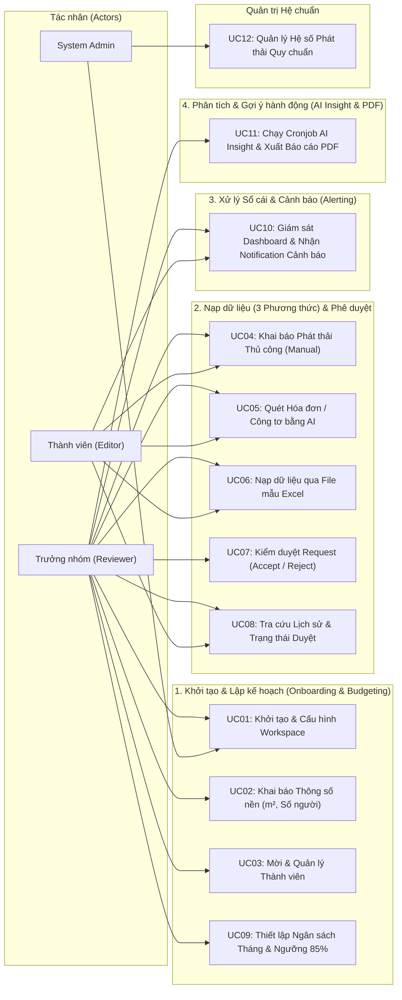

# ĐẶC TẢ USE CASE CHI TIẾT (USE CASE SPECIFICATIONS)
## Dự án: Personal & Micro-Office Carbon Ledger

> **Dự án:** Hệ thống Quản trị & Phân tích Dấu chân Carbon cho Gia đình/Văn phòng nhỏ  
> **Căn cứ nghiệp vụ:** [Đặc tả phạm vi bài toán (spec.md)](../spec.md)  
> **Phiên bản:** 3.0 (Đồng bộ toàn diện 4 Luồng hoạt động, 3 Phương thức nạp dữ liệu, Notification cảnh báo và Xuất PDF)  

---

## 1. TỔNG QUAN TÁC NHÂN (ACTORS & ROLES)

| Tác nhân (Actor) | Tên vai trò | Trách nhiệm trong các luồng hoạt động |
|---|---|---|
| **Trưởng nhóm (Reviewer)** | Workspace Admin / Reviewer | **Luồng 1:** Tạo Workspace, khai báo thông số nền ($m^2$, số nhân khẩu), thiết lập ngân sách tháng. **Luồng 2:** Nạp dữ liệu (tự động duyệt) hoặc phê duyệt (`Accept` / `Reject`) các request nạp dữ liệu từ Editor. **Luồng 3:** Theo dõi tiến độ ngân sách, nhận notification cảnh báo 85% & 100%. **Luồng 4:** Tiếp nhận báo cáo AI định kỳ từ Cronjob và xuất Kế hoạch cắt giảm ra file PDF. |
| **Thành viên (Editor)** | Workspace Member / Editor | **Luồng 2:** Thực hiện nạp dữ liệu phát thải qua 3 phương thức (Thủ công, Quét ảnh hóa đơn/công tơ bằng AI, Import file mẫu Excel) ở trạng thái **`Draft / Chờ duyệt`**. **Luồng 3:** Xem Dashboard, nhận notification cảnh báo ngưỡng 85% của Workspace. **Lịch sử:** Theo dõi tiến độ duyệt các yêu cầu cá nhân đã gửi. |
| **Quản trị viên Hệ thống (System Admin)** | System Admin | Quản trị độc lập danh mục và giá trị các **Hệ số phát thải quy chuẩn (Standard Emission Factors)** phục vụ công thức nhân tự động của Backend khi giao dịch được ghi sổ. |

---

## 2. SƠ ĐỒ USE CASE TỔNG THỂ (USE CASE DIAGRAM)

### 2.1. Sơ đồ Chuẩn UML (UCD)

*Sơ đồ thể hiện 3 tác nhân chính (`Workspace Admin`, `Member`, `System Admin`), quan hệ kế thừa (Generalization) giữa Workspace Admin và Member, cùng quan hệ phụ thuộc `<<include>>` trong việc quét và xác nhận dữ liệu AI.*

### 2.2. Sơ đồ Phân rã theo 4 Luồng Hoạt động (Mermaid)

---

## 3. ĐẶC TẢ CHI TIẾT TỪNG USE CASE

---

### UC01: Khởi tạo & Cấu hình Workspace
- **Mã Use Case:** UC01
- **Tác nhân chính:** Trưởng nhóm (Reviewer) / Quản trị viên Hệ thống (System Admin)
- **Mô tả vắn tắt:** Người dùng (Reviewer hoặc System Admin) khởi tạo và cấu hình một Không gian làm việc (Workspace) mới đại diện cho Hộ gia đình hoặc Văn phòng nhỏ.
- **Tiền điều kiện:** Người dùng đã hoàn tất đăng ký và đăng nhập vào ứng dụng (hoặc phiên làm việc System Admin).
- **Hậu điều kiện:** Workspace được khởi tạo thành công, người dùng được cấp vai trò `Reviewer (Workspace Admin)` (đối với người dùng thông thường) hoặc ghi nhận quyền quản trị Workspace cho System Admin.
- **Luồng sự kiện chính:**
  1. Người dùng chọn chức năng "Khởi tạo Không gian làm việc" (từ giao diện người dùng hoặc Cổng Quản trị Hệ thống).
  2. Hệ thống hiển thị form nhập: Tên Workspace (từ 3 đến 50 ký tự), Loại hình ("Hộ gia đình" hoặc "Văn phòng nhỏ").
  3. Người dùng nhập thông tin hợp lệ và nhấn "Tiếp tục" (hoặc "Tạo Workspace").
  4. Hệ thống lưu Workspace vào cơ sở dữ liệu, kích hoạt quyền quản trị Workspace và chuyển tiếp đến bước Khai báo thông số nền (UC02).
- **Luồng rẽ nhánh / Ngoại lệ:**
  - *2a. Tên Workspace trống hoặc vượt quá 50 ký tự:* Hệ thống hiển thị lỗi yêu cầu điều chỉnh.

---

### UC02: Khai báo Thông số nền (Baseline Setup)
- **Mã Use Case:** UC02
- **Tác nhân chính:** Trưởng nhóm (Reviewer)
- **Mô tả vắn tắt:** Trưởng nhóm khai báo số lượng thành viên thường trú/làm việc và diện tích mặt sàn ($m^2$) của hộ gia đình hoặc văn phòng để hệ thống chuẩn bị dữ liệu tính toán chỉ số $\text{CO}_2\text{e}/\text{người}$, $\text{CO}_2\text{e}/m^2$ và xác định Mức phát thải Tham chiếu Quốc gia (Reference Benchmark).
- **Tiền điều kiện:** Người dùng là Reviewer của Workspace.
- **Hậu điều kiện:** Thông số nền được ghi nhận vào cấu hình Workspace.
- **Luồng sự kiện chính:**
  1. Hệ thống hiển thị form "Khai báo Thông số nền Workspace".
  2. Reviewer nhập:
     - Số lượng thành viên (ví dụ: `4` người).
     - Diện tích mặt sàn sử dụng (ví dụ: `85.5` $m^2$).
  3. Reviewer nhấn "Lưu thông số".
  4. Hệ thống kiểm tra tính hợp lệ của số liệu, lưu vào bảng `workspace_baselines`, tự động xác định Mức phát thải Tham chiếu chuẩn quốc gia ($141.93\text{ kg CO}_2\text{e/người/tháng}$ cho Hộ gia đình - $46,4\%$ ranh giới phát thải, hoặc $305.83\text{ kg CO}_2\text{e/người/tháng}$ cho Nơi làm việc - $100\%$ theo [docs/emission-reference-benchmark.md](emission-reference-benchmark.md)) và thông báo hoàn tất cài đặt nền tảng.
- **Luồng rẽ nhánh / Ngoại lệ:**
  - *2a. Nhập số thành viên <= 0 hoặc diện tích <= 0:* Hệ thống báo lỗi: "Số lượng thành viên và diện tích mặt sàn phải là số dương lớn hơn 0".

---

### UC03: Mời & Phê duyệt Thành viên Gia nhập (Member Invitation & Join Approval)
- **Mã Use Case:** UC03
- **Tác nhân chính:** Trưởng nhóm (Reviewer)
- **Tác nhân phụ:** Người dùng xin gia nhập (Editor)
- **Mô tả vắn tắt:** Reviewer sinh mã mời 6 ký tự; người dùng nhập mã mời để gửi Yêu cầu gia nhập (Join Request) ở trạng thái chờ duyệt (PENDING); Reviewer xem xét phê duyệt (Accept) để thêm vào Workspace hoặc từ chối (Reject), đảm bảo an toàn tuyệt đối cho dữ liệu gia đình/văn phòng.
- **Tiền điều kiện:** Workspace đã được khởi tạo; người dùng xin gia nhập đã có tài khoản trên hệ thống.
- **Hậu điều kiện:** Người dùng được thêm vào bảng `workspace_members` với vai trò `Editor` chỉ khi Reviewer chấp thuận.
- **Luồng sự kiện chính:**
  1. Reviewer vào mục "Quản lý Thành viên" và nhấn "Tạo mã mời".
  2. Hệ thống sinh mã ngẫu nhiên 6 ký tự (ví dụ: `CARB26`) hiệu lực 7 ngày và lưu vào `workspaces.invite_code`.
  3. Người dùng đăng nhập tài khoản của mình, vào màn hình "Tham gia Workspace", nhập mã mời và nhấn "Gửi yêu cầu".
  4. Hệ thống kiểm tra mã mời hợp lệ, tạo bản ghi trong bảng `workspace_join_requests` với trạng thái `PENDING` và hiển thị thông báo chờ phê duyệt.
  5. Reviewer vào danh sách "Yêu cầu chờ duyệt", xem thông tin người xin gia nhập (Tên, Email) và nhấn "Chấp thuận (Accept)".
  6. Hệ thống cập nhật yêu cầu sang `APPROVED`, tự động liên kết người dùng vào Workspace với vai trò `Editor` và gửi thông báo thành công.
- **Luồng rẽ nhánh / Ngoại lệ:**
  - *3a. Mã mời hết hạn hoặc không tồn tại:* Hệ thống thông báo lỗi: "Mã mời không tồn tại hoặc đã hết hạn".
  - *3b. Người dùng đã gửi yêu cầu PENDING hoặc đã là thành viên:* Hệ thống chặn gửi trùng lặp.
  - *5a. Reviewer nhấn Từ chối (Reject):* Hệ thống cập nhật yêu cầu sang `REJECTED` (kèm lý do), người dùng không được cấp quyền vào Workspace.

---

### UC04: Khai báo Phát thải Thủ công (Manual Entry)
- **Mã Use Case:** UC04
- **Tác nhân chính:** Thành viên (Editor), Trưởng nhóm (Reviewer)
- **Mô tả vắn tắt:** Người dùng nhập thủ công số liệu định lượng cho các hoạt động sinh hoạt lẻ (ví dụ: đi xe máy xăng 110cc quãng đường 15 km, đun nấu gas LPG, tiêu thụ điện lẻ).
- **Tiền điều kiện:** Người dùng đã thuộc Workspace.
- **Hậu điều kiện:**
  - Nếu Editor: Tạo bản ghi ở trạng thái `Pending Review (Draft)` chờ Reviewer duyệt.
  - Nếu Reviewer: Ghi trực tiếp trạng thái `Approved` vào sổ cái.
- **Luồng sự kiện chính:**
  1. Người dùng mở form "Khai báo phát thải thủ công".
  2. Người dùng chọn: Danh mục (Di chuyển cá nhân, Điện, Nước, Nấu nướng), Loại cụ thể (Xe máy xăng 110cc, Ô tô xăng...), Sản lượng tiêu thụ (15 km), Ngày phát sinh.
  3. Hệ thống tự động tính và hiển thị số kg CO2e ước tính theo thời gian thực (real-time preview).
  4. Người dùng bấm "Xác nhận gửi".
  5. Hệ thống lưu bản ghi:
     - Editor: Gán `status = 'pending_review'`.
     - Reviewer: Gán `status = 'approved'` và cộng vào tổng phát thải tháng.
- **Luồng rẽ nhánh / Ngoại lệ:**
  - *2a. Sản lượng <= 0 hoặc ngày ở tương lai:* Hệ thống báo lỗi và chặn lưu dữ liệu.

---

### UC05: Quét Hóa đơn / Công tơ bằng AI (AI Vision Ingestion)
- **Mã Use Case:** UC05
- **Tác nhân chính:** Thành viên (Editor), Trưởng nhóm (Reviewer)
- **Mô tả vắn tắt:** Người dùng chụp ảnh hóa đơn tiền điện EVN, hóa đơn nước hoặc ảnh chụp mặt công tơ thực tế; Multimodal AI (Gemini/Claude) bóc tách JSON và hiển thị popup xem trước để xác nhận trước khi lưu.
- **Tiền điều kiện:** Người dùng có file ảnh hóa đơn hoặc ảnh công tơ rõ nét (< 5MB).
- **Hậu điều kiện:** Thông tin bóc tách được chuyển vào bản ghi phát thải (Draft nếu Editor, Approved nếu Reviewer).
- **Luồng sự kiện chính:**
  1. Người dùng chọn "Quét bằng AI Vision" và tải ảnh lên.
  2. Backend gửi ảnh đến Multimodal AI API kèm JSON Schema chuẩn.
  3. AI nhận diện và trả về JSON: Loại dịch vụ, Sản lượng tiêu thụ, Đơn vị, Kỳ hóa đơn/Ngày, Tổng tiền.
  4. Frontend hiển thị Popup xem trước (Preview Modal) chứa các dữ liệu đã bóc tách.
  5. Người dùng rà soát thông tin, chỉnh sửa nếu cần và bấm "Lưu".
  6. Hệ thống lưu bản ghi theo vai trò người dùng (Editor -> Draft; Reviewer -> Approved).
- **Luồng rẽ nhánh / Ngoại lệ:**
  - *3a. Ảnh mờ hoặc không nhận dạng được:* Hệ thống thông báo không bóc tách được và gợi ý nhập thủ công (UC04).

---

### UC06: Nạp dữ liệu qua File mẫu Excel (Excel Template Import)
- **Mã Use Case:** UC06
- **Tác nhân chính:** Thành viên (Editor), Trưởng nhóm (Reviewer)
- **Mô tả vắn tắt:** Người dùng tải về file mẫu Excel của hệ thống, điền số liệu nhiều hoạt động phát thải và upload lên; hệ thống tự động ánh xạ (map) các trường, hiển thị bảng preview xác nhận và lưu hàng loạt.
- **Tiền điều kiện:** Người dùng đã điền dữ liệu vào file mẫu Excel định dạng `.xlsx` theo đúng cấu trúc cột.
- **Hậu điều kiện:** Các bản ghi hợp lệ được tạo hàng loạt trong hệ thống (ở trạng thái Draft nếu là Editor, Approved nếu là Reviewer).
- **Luồng sự kiện chính:**
  1. Người dùng nhấn nút "Nạp file Excel" và có thể bấm "Tải file mẫu" nếu chưa có.
  2. Người dùng tải lên file Excel đã điền dữ liệu.
  3. Hệ thống đọc file qua Apache POI, kiểm tra tính hợp lệ và tự động ánh xạ các cột: Ngày phát sinh, Danh mục, Phân loại, Sản lượng, Đơn vị, Ghi chú.
  4. Hệ thống hiển thị bảng Xem trước (Import Preview Table) trong vòng không quá 5 giây (với file 100 dòng) chỉ rõ:
     - Số dòng hợp lệ sẵn sàng nạp.
     - Số dòng bị lỗi định dạng (nếu có, highlight màu đỏ kèm lý do).
     - Tổng lượng phát thải quy đổi ước tính của file.
  5. Người dùng xác nhận và bấm "Lưu vào hệ thống".
  6. Hệ thống lưu hàng loạt các dòng hợp lệ (Editor -> `Pending Review`; Reviewer -> `Approved`).
- **Luồng rẽ nhánh / Ngoại lệ:**
  - *2a. File sai định dạng hoặc cấu trúc cột không khớp:* Hệ thống báo lỗi "File không đúng cấu trúc mẫu chuẩn. Vui lòng tải file mẫu và thử lại".

---

### UC07: Phê duyệt Yêu cầu Phát thải (Reviewer Phê duyệt / Từ chối)
- **Mã Use Case:** UC07
- **Tác nhân chính:** Trưởng nhóm (Reviewer)
- **Tác nhân phụ:** Thành viên (Editor)
- **Mô tả vắn tắt:** Reviewer duyệt qua danh sách các yêu cầu nạp dữ liệu (từ thủ công, AI quét hóa đơn hoặc import Excel) đang ở trạng thái `Pending Review` và quyết định Chấp thuận (`Accept`) hoặc Từ chối (`Reject` kèm lý do).
- **Tiền điều kiện:** Có ít nhất một bản ghi phát thải ở trạng thái `Pending Review`.
- **Hậu điều kiện:**
  - Nếu `Accept`: Trạng thái chuyển thành `Approved`, Backend nhân Hệ số quy chuẩn và cộng dồn vào bảng `emission_logs` của tháng.
  - Nếu `Reject`: Trạng thái chuyển thành `Rejected` kèm lý do, không cộng dồn vào sổ cái.
- **Luồng sự kiện chính:**
  1. Reviewer mở danh sách "Chờ duyệt (Approval Queue)".
  2. Reviewer chọn một hoặc nhiều bản ghi cần kiểm tra.
  3. Reviewer bấm "Phê duyệt (Accept)" -> Hệ thống cập nhật `status = 'approved'`, kích hoạt tính toán cộng dồn phát thải và kiểm tra ngưỡng cảnh báo.
  4. Hoặc Reviewer bấm "Từ chối (Reject)" -> Nhập lý do (ví dụ: "Số km khai báo không hợp lý") và xác nhận.
  5. Hệ thống gửi thông báo kết quả duyệt cho Editor tương ứng.
- **Luồng rẽ nhánh / Ngoại lệ:**
  - *Actor là Editor cố tình gửi API duyệt:* Hệ thống chặn từ chối (403 Forbidden).

---

### UC08: Tra cứu Lịch sử Sổ cái & Trạng thái Duyệt
- **Mã Use Case:** UC08
- **Tác nhân chính:** Thành viên (Editor), Trưởng nhóm (Reviewer)
- **Mô tả vắn tắt:** Tra cứu toàn bộ giao dịch trong sổ cái phát thải, lọc theo tháng, phương thức nạp (Thủ công / AI Vision / Excel), danh mục và trạng thái duyệt (`Approved`, `Pending`, `Rejected`).
- **Tiền điều kiện:** Người dùng đã tham gia Workspace.
- **Hậu điều kiện:** Danh sách giao dịch được kết xuất đúng theo bộ lọc.
- **Luồng sự kiện chính:**
  1. Người dùng mở mục "Sổ cái phát thải".
  2. Người dùng tùy chọn bộ lọc: Tháng, Danh mục, Nguồn nạp dữ liệu, Trạng thái phê duyệt.
  3. Hệ thống trả về danh sách kèm thông tin chi tiết: Ngày, Người nạp, Sản lượng, Hệ số áp dụng, kg CO2e, Trạng thái.

---

### UC09: Thiết lập Target Ngân sách Tháng & Ngưỡng 85%
- **Mã Use Case:** UC09
- **Tác nhân chính:** Trưởng nhóm (Reviewer)
- **Mô tả vắn tắt:** Vào đầu tháng, Reviewer thiết lập hạn ngạch phát thải tối đa cho cả Workspace (ví dụ: $300\text{ kg CO}_2\text{e}$) và kích hoạt ngưỡng cảnh báo sớm ở mức $85\%$. Hệ thống hỗ trợ gợi ý thông minh dựa trên Mức phát thải Tham chiếu Quốc gia ($46,4\%$ cho Household, $100\%$ cho Workplace).
- **Tiền điều kiện:** Người dùng là Reviewer của Workspace.
- **Hậu điều kiện:** Hạn ngạch tháng và ngưỡng 85% được thiết lập cho Workspace.
- **Luồng sự kiện chính:**
  1. Reviewer vào mục "Ngân sách Carbon".
  2. Hệ thống tự động hiển thị gợi ý thông minh dựa trên thông số nền và Mức tham chiếu quốc gia (ví dụ: Hộ gia đình 4 người có mức tham chiếu chuẩn là $568\text{ kg CO}_2\text{e/tháng}$; gợi ý mục tiêu Xanh $511\text{ kg}$, mục tiêu Chuẩn $568\text{ kg}$).
  3. Reviewer chọn tháng áp dụng, chọn mức gợi ý hoặc nhập trần phát thải mục tiêu tùy chỉnh (ví dụ: `300` kg CO2e).
  4. Hệ thống tự động tính ngưỡng cảnh báo sớm 85% ($300 \times 0.85 = 255\text{ kg CO}_2\text{e}$).
  5. Reviewer nhấn "Lưu ngân sách".
  6. Hệ thống ghi nhận cấu hình ngân sách tháng và áp dụng ngay cho Dashboard.
- **Luồng rẽ nhánh / Ngoại lệ:**
  - *3a. Nhập giá trị <= 0:* Hệ thống thông báo hạn ngạch phải là số dương lớn hơn 0.

---

### UC10: Giám sát Dashboard & Bắn Notification Cảnh báo
- **Mã Use Case:** UC10
- **Tác nhân chính:** Thành viên (Editor), Trưởng nhóm (Reviewer)
- **Mô tả vắn tắt:** Người dùng theo dõi trực quan tiến độ phát thải thực tế so với ngân sách, các chỉ số chuẩn hóa ($\text{CO}_2\text{e}/\text{người}$, $\text{CO}_2\text{e}/m^2$, đối sánh Mức tham chiếu quốc gia) và tự động nhận Notification cảnh báo khi chạm mốc 85%, vượt 100% hoặc phát hiện dị biệt tiêu thụ.
- **Tiền điều kiện:** Người dùng đã đăng nhập Workspace.
- **Hậu điều kiện:** Giao diện Dashboard hiển thị cập nhật thời gian thực; notification được gửi đến thiết bị của toàn bộ thành viên khi chạm ngưỡng.
- **Luồng sự kiện chính:**
  1. Người dùng mở Dashboard chính của Workspace.
  2. Hệ thống tổng hợp các giao dịch `Approved` trong tháng và chia cho số người, diện tích mặt sàn đã khai báo ở UC02 để hiển thị:
     - Tổng kg CO2e đã phát thải và thanh tiến độ % so với Target.
     - Chỉ số chuẩn hóa $\text{kg CO}_2\text{e}/\text{người}$.
     - Chỉ số chuẩn hóa $\text{kg CO}_2\text{e}/m^2$.
     - Tỷ lệ đối sánh với Mức tham chiếu quốc gia (Benchmark Intensity Ratio $\mathcal{R}$) và Huy hiệu phân hạng Xanh (Green Pioneer, Standard, Above Benchmark).
  3. Khi phát thải tích lũy đạt $\ge 85\%$ ngân sách:
     - Hệ thống tự động bắn **Notification cảnh báo** đến toàn bộ các thành viên trong Workspace.
     - Đổi màu thanh tiến độ sang Vàng cam (Warning) trên giao diện.
  4. Khi phát thải tích lũy đạt $\ge 100\%$ ngân sách:
     - Hệ thống bắn **Notification báo động vượt trần** đến toàn bộ thành viên.
     - Đổi màu thanh tiến độ sang Đỏ (Danger).
  5. Khi phát thải bình quân đầu người vượt mức tham chiếu quốc gia hoặc Run-rate dự báo cuối tháng vượt chuẩn:
     - Hệ thống kích hoạt **Cảnh báo Dị biệt Tham chiếu Quốc gia (Anomaly Warning)** trên Dashboard và gửi thông báo khuyến cáo kiểm tra các nhóm phát thải trọng điểm (Điện, Phương tiện di chuyển). *(Mức chuẩn tham chiếu được quy định tại [docs/emission-reference-benchmark.md](emission-reference-benchmark.md)).*

---

### UC11: Sinh Báo cáo AI Insight, Đề xuất Lộ trình Cắt giảm Cá nhân hóa (Reduction Plan Roadmap) & Xuất PDF
- **Mã Use Case:** UC11
- **Tác nhân chính:** Trưởng nhóm (Reviewer), Hệ thống (Background Cronjob / API On-demand)
- **Mô tả vắn tắt:** Reviewer có thể thiết lập lịch chạy tự động hoặc kích hoạt tức thời để xem nhận định xu hướng phát thải kỳ hiện tại; đồng thời Reviewer có thể **thiết lập mục tiêu cắt giảm dài hạn (giảm bao nhiêu % và tầm nhìn bao nhiêu tháng)** để AI phân tích dữ liệu lịch sử của Workspace và sinh ra một **Kế hoạch Lộ trình Cắt giảm Cá nhân hóa Theo Từng Tháng (Month-by-Month Reduction Roadmap)** với các hành động định lượng cụ thể; Reviewer xem lộ trình trên giao diện và có quyền xuất ra file PDF chuẩn in ấn trong vòng 3-5 giây.
- **Tiền điều kiện:** Workspace có dữ liệu giao dịch phát thải trong kỳ.
- **Hậu điều kiện:** Báo cáo AI và Kế hoạch Lộ trình Cắt giảm được lưu trữ trong Workspace, hỗ trợ tải file PDF về thiết bị.
- **Luồng sự kiện chính:**
  - **Nhánh A - Báo cáo Xu hướng Định kỳ & Tức thời (AI Insight Report):**
    1. Tác vụ Cronjob tự động chạy theo lịch cấu hình (`WEEKLY`, `MONTHLY`) hoặc Reviewer chủ động bấm nút "Sinh báo cáo ngay" (On-demand).
    2. Hệ thống tổng hợp tỷ trọng tiêu thụ (Điện %, Xăng xe %, Nước %, so sánh kỳ trước) và gọi LLM (Gemini 1.5 Pro).
    3. AI phân tích nguyên nhân phát thải tăng/giảm và trả về nhận định xu hướng cùng các khuyến nghị khắc phục nhanh.
    4. Báo cáo được lưu vào bảng `ai_reports` và hiển thị trực quan trên giao diện.
  - **Nhánh B - Thiết lập Mục tiêu & Sinh Lộ trình Cắt giảm Dài hạn (Personalized Reduction Roadmap):**
    1. Reviewer mở form "Thiết lập Mục tiêu Cắt giảm":
       - Nhập tỷ lệ cắt giảm mong muốn (ví dụ: `15%`).
       - Chọn tầm nhìn thời gian (ví dụ: `3 tháng`, `6 tháng`, `12 tháng`).
       - Chọn danh mục trọng tâm ưu tiên (Điện, Phương tiện di chuyển, Nấu nướng...).
    2. Reviewer nhấn "AI Sinh Lộ trình Cắt giảm".
    3. Backend nạp dữ liệu lịch sử phát thải, thông số nền ($m^2$, số người) và Mức tham chiếu quốc gia vào prompt LLM chuyên biệt.
    4. AI phân rã mục tiêu thành **Lộ trình từng tháng (Month-by-Month Milestones)**:
       - Hạn ngạch phát thải mục tiêu của từng tháng giảm dần theo thời gian.
       - Danh sách các hành động định lượng cụ thể khả thi cho hộ gia đình/văn phòng trong từng tháng (ví dụ: Tháng 1 chuyển 2 ngày đi xe máy sang tàu điện Cát Linh - Hà Đông giảm 12 kg CO2e; Tháng 2 đặt điều hòa 26°C kết hợp quạt giảm 13.5 kg CO2e).
    5. Kế hoạch được lưu trữ vào bảng `emission_reduction_plans` ở trạng thái `ACTIVE`.
    6. Reviewer xem bảng lộ trình, đối chiếu tiến độ thực tế và nhấn **"Xuất Kế hoạch Cắt giảm PDF"** để tải file PDF chuẩn in ấn trong $\le 3-5\text{s}$.
- **Luồng rẽ nhánh / Ngoại lệ:**
  - *1a. Nhập tỷ lệ giảm <= 0% hoặc > 100%, hoặc số tháng < 1:* Hệ thống báo lỗi "Mục tiêu cắt giảm và thời gian thực hiện không hợp lệ".
  - *4a. Dịch vụ AI timeout hoặc gián đoạn:* Hệ thống báo lỗi thân thiện và giữ nguyên kế hoạch hiện có.

---

### UC12: Quản lý Hệ số Phát thải Quy chuẩn
- **Mã Use Case:** UC12
- **Tác nhân chính:** Quản trị viên Hệ thống (System Admin)
- **Mô tả vắn tắt:** System Admin cập nhật hệ số quy đổi chuẩn (EVN, GHG Protocol) trên toàn hệ thống để Backend tự động áp dụng khi quy đổi sản lượng thành kg CO2e.
- **Tiền điều kiện:** Người dùng đăng nhập có quyền `System Admin`.
- **Hậu điều kiện:** Bảng hệ số chuẩn được cập nhật, áp dụng cho các giao dịch mới.
- **Luồng sự kiện chính:**
  1. System Admin vào trang System Admin Portal.
  2. Chọn danh mục cần cập nhật (Điện sinh hoạt, Nước, Xăng xe, Gas LPG) và điền hệ số mới kèm căn cứ pháp lý.
  3. Bấm "Lưu hệ số".
  4. Hệ thống lưu hệ số mới kèm timestamp và áp dụng cho các giao dịch ghi sổ tiếp theo.

---

*Tài liệu đặc tả Use Case này đảm bảo đồng bộ 100% với [spec.md](../spec.md) và phản ánh trọn vẹn 4 Luồng hoạt động cốt lõi của hệ thống.*
