# BỘ TÀI LIỆU USER STORY (INVEST FRAMEWORK)
## Dự án: Hệ thống Quản trị & Phân tích Dấu chân Carbon cho Gia đình/Văn phòng nhỏ (Personal & Micro-Office Carbon Ledger)

> **Phương pháp chuẩn hóa:** Tiêu chuẩn **INVEST Framework** & Ma trận truy vết 4 Luồng nghiệp vụ  
> **Tiêu chí nghiệm thu chi tiết:** Xem tại [docs/06-acceptance-criteria.md](06-acceptance-criteria.md) (Gherkin Given-When-Then)  
> **Tham chiếu chuẩn:** Kỹ năng BA Zone & Digital School — Biên soạn bởi **Phúc NT**  
> **Căn cứ tài liệu:** [spec.md](../spec.md), [01-PRD.md](01-PRD.md), [02-MVP.md](02-MVP.md), [03-use-cases.md](03-use-cases.md), [06-acceptance-criteria.md](06-acceptance-criteria.md)  
> **Phiên bản:** 3.0 (Tích hợp 4 Luồng hoạt động cốt lõi, 3 Phương thức nạp dữ liệu, Notification cảnh báo 85% và Xuất báo cáo PDF)  
> **Thời gian triển khai:** 6 tuần (3 Sprints x 2 tuần)  

---

## MỤC LỤC & BẢNG TỔNG HỢP USER STORIES (BACKLOG OVERVIEW)

| Mã US | Tên User Story | Module / Luồng | Persona chính | MoSCoW | Est. (SP) | Sprint |
|---|---|---|---|:---:|:---:|:---:|
| **US-WS-001** | Khởi tạo & Cấu hình Không gian làm việc (Workspace) | Luồng 1: Onboarding | Reviewer / System Admin | Must | 2 | Sprint 1 |
| **US-WS-002** | Khai báo thông số nền ($m^2$, số người) | Luồng 1: Onboarding | Trưởng nhóm (Reviewer) | Must | 3 | Sprint 1 |
| **US-WS-003** | Mời thành viên & Phê duyệt yêu cầu gia nhập Workspace | Luồng 1: Onboarding | Trưởng nhóm (Reviewer) / Editor | Must | 3 | Sprint 1 |
| **US-SA-001** | Quản lý & cập nhật Hệ số phát thải quy chuẩn | Quản trị Hệ thống | System Admin | Should | 3 | Sprint 1 |
| **US-CL-001** | Khai báo phát thải thủ công ở trạng thái Draft | Luồng 2: Nạp dữ liệu | Thành viên (Editor) | Must | 3 | Sprint 1 |
| **US-CL-002** | Tự động quy đổi mức tiêu thụ ra chỉ số kg CO2e | Luồng 3: Xử lý Sổ cái | Editor / Reviewer | Must | 2 | Sprint 1 |
| **US-CL-003** | Quét hóa đơn / công tơ bằng AI Vision (Tiện ích phụ) | Luồng 2: Nạp dữ liệu | Editor / Reviewer | Could (Sau cùng) | 5 | Sprint 3 |
| **US-CL-004** | Nạp dữ liệu phát thải qua file mẫu Excel (Preview & Import) | Luồng 2: Nạp dữ liệu | Editor / Reviewer | Should | 4 | Sprint 2 |
| **US-CL-005** | Kiểm duyệt & phê duyệt (Accept / Reject) request phát thải | Luồng 2: Phê duyệt | Trưởng nhóm (Reviewer) | Must | 3 | Sprint 2 |
| **US-CL-006** | Tra cứu lịch sử sổ cái và trạng thái phê duyệt | Luồng 2: Lịch sử | Editor / Reviewer | Must | 3 | Sprint 2 |
| **US-BG-001** | Thiết lập Ngân sách tháng & Ngưỡng cảnh báo sớm 85% | Luồng 1: Budgeting | Trưởng nhóm (Reviewer) | Must | 2 | Sprint 2 |
| **US-BG-002** | Theo dõi tiến độ tiêu thụ & chỉ số chuẩn hóa trên Dashboard | Luồng 3: Giám sát | Editor / Reviewer | Must | 3 | Sprint 2 |
| **US-BG-003** | Bắn Notification cảnh báo ngưỡng 85% đến TOÀN BỘ thành viên | Luồng 3: Cảnh báo | Editor / Reviewer | Must | 3 | Sprint 2 |
| **US-AI-001** | AI Insight định kỳ (Cronjob) & Kế hoạch cắt giảm cá nhân hóa | Luồng 4: AI Reporting | Trưởng nhóm (Reviewer) | Could | 5 | Sprint 3 |
| **US-AI-002** | Xuất Báo cáo Phân tích & Kế hoạch cắt giảm ra file PDF | Luồng 4: AI Reporting | Trưởng nhóm (Reviewer) | Could | 3 | Sprint 3 |

*Tổng điểm ước lượng (Total Story Points): 44 SP (phân bổ cân đối trong 3 Sprint, trung bình ~14-15 SP/Sprint).*

---

# CHI TIẾT TỪNG USER STORY & TIÊU CHÍ NGHIỆM THU (ACCEPTANCE CRITERIA)

---

## PHẦN 1: LUỒNG KHỞI TẠO & LẬP KẾ HOẠCH (ONBOARDING & BUDGETING)

---

### US-WS-001: Khởi tạo & Cấu hình Không gian làm việc (Workspace)

**As a** Trưởng nhóm gia đình, Quản lý văn phòng nhỏ hoặc Quản trị viên Hệ thống (System Admin)  
**I want to** khởi tạo và cấu hình một Không gian làm việc (Workspace) mới với tên đại diện và loại hình (Hộ gia đình hoặc Văn phòng nhỏ)  
**So that** tôi có một môi trường dữ liệu độc lập để làm Trưởng nhóm (Reviewer) hoặc phục vụ System Admin quản trị, phân bổ tenant và giám sát sổ cái phát thải  

#### Metadata
- **Epic/Feature**: Luồng 1 - Khởi tạo & Lập kế hoạch (Onboarding)
- **Priority**: Must Have (MoSCoW)
- **Estimate**: 2 Story Points
- **Dependencies**: Không có (Story nền tảng)
- **Assumptions**: Người dùng đã hoàn tất đăng ký tài khoản qua Email/Password hoặc Google OAuth.

#### INVEST Self-check

| Tiêu chí | ✅/⚠️ | Ghi chú đánh giá |
|:---|:---:|:---|
| **I**ndependent | ✅ | Độc lập hoàn toàn với các luồng nạp dữ liệu hay AI. |
| **N**egotiable | ✅ | Không ràng buộc chi tiết màu sắc UI, tập trung vào tạo bản ghi Workspace và cấp quyền. |
| **V**aluable | ✅ | Tạo ranh giới dữ liệu cho hộ gia đình/văn phòng theo mô hình Multi-tenant. |
| **E**stimable | ✅ | Luồng CRUD tạo dữ liệu cơ bản, ước lượng 1-2 ngày dev. |
| **S**mall | ✅ | Phạm vi chỉ bao gồm form tạo tên và loại hình Workspace. |
| **T**estable | ✅ | Kiểm thử rõ ràng qua tính hợp lệ của tên và kiểm tra vai trò Reviewer được cấp trong DB. |

#### Acceptance Criteria Summary

👉 **Chi tiết toàn bộ kịch bản Gherkin ACs:** Xem tại [docs/06-acceptance-criteria.md#us-ws-001](06-acceptance-criteria.md#us-ws-001)

- **AC1: Tạo Không gian làm việc thành công - Happy path**
- **AC2: Trùng tên Workspace với workspace cũ của cùng tài khoản - Edge case**
- **AC3: Nhập tên Workspace rỗng hoặc vượt quá độ dài - Negative path**
- **AC4: Quản trị viên Hệ thống (System Admin) khởi tạo & cấu hình Workspace thành công**

#### Notes
- **Dependencies**: Bảng `workspaces`, `workspace_members`.
- **Assumptions**: Tối đa 3 Workspaces cho mỗi tài khoản trong giai đoạn 6 tuần MVP.
- **Open Questions**: Không có.

---

### US-WS-002: Khai báo thông số nền Workspace ($m^2$, số người)

**As a** Trưởng nhóm gia đình hoặc Quản lý văn phòng (Reviewer)  
**I want to** khai báo số lượng thành viên và diện tích mặt sàn sử dụng ($m^2$) của hộ gia đình hoặc văn phòng  
**So that** hệ thống có dữ liệu cơ sở để tự động tính toán các chỉ số cường độ phát thải chuẩn hóa ($\text{CO}_2\text{e}/\text{người}$ và $\text{CO}_2\text{e}/m^2$) giúp so sánh hiệu quả sử dụng năng lượng  

#### Metadata
- **Epic/Feature**: Luồng 1 - Khởi tạo & Lập kế hoạch (Baseline Parameters Setup)
- **Priority**: Must Have (MoSCoW)
- **Estimate**: 3 Story Points
- **Dependencies**: US-WS-001 (Workspace đã được tạo)
- **Assumptions**: Số thành viên là số nguyên dương, diện tích là số thực dương (tính bằng mét vuông).

#### INVEST Self-check

| Tiêu chí | ✅/⚠️ | Ghi chú đánh giá |
|:---|:---:|:---|
| **I**ndependent | ✅ | Có thể cập nhật thông số nền bất kỳ lúc nào mà không phụ thuộc vào việc đã có giao dịch hay chưa. |
| **N**egotiable | ✅ | Có thể bổ sung thêm các thông số mở rộng (số tầng, số phòng) ở giai đoạn nâng cao sau này. |
| **V**aluable | ✅ | Tạo cơ sở chuẩn hóa dữ liệu để tính các KPI phát thải công bằng theo quy mô thực tế. |
| **E**stimable | ✅ | Lưu cấu hình bảng `workspace_baselines`, ước lượng ~1.5 ngày dev. |
| **S**mall | ✅ | Chỉ bao gồm lưu 2 chỉ số: Số người và Diện tích ($m^2$). |
| **T**estable | ✅ | Kiểm thử với các giá trị hợp lệ, giá trị biên cực nhỏ/cực lớn, và giá trị âm. |

#### Acceptance Criteria Summary

👉 **Chi tiết toàn bộ kịch bản Gherkin ACs:** Xem tại [docs/06-acceptance-criteria.md#us-ws-002](06-acceptance-criteria.md#us-ws-002)

- **AC1: Khai báo thông số nền thành công - Happy path**
- **AC2: Cập nhật thông số nền khi có sự thay đổi quy mô - Edge case**
- **AC3: Nhập số người hoặc diện tích không hợp lệ - Negative path**

#### Notes
- **Dependencies**: Bảng `workspace_baselines` gồm các cột: `workspace_id`, `member_count`, `floor_area_m2`, `updated_at`.
- **Assumptions**: Cho phép Trưởng nhóm chỉnh sửa lại các thông số này bất kỳ lúc nào trong phần Cài đặt Workspace.
- **Open Questions**: Không có.

---

### US-WS-003: Mời thành viên & Phê duyệt yêu cầu gia nhập Workspace (Join Approval Flow)

**As a** Trưởng nhóm (Reviewer) của một Workspace và Người dùng muốn tham gia (User)  
**I want to** hệ thống cung cấp mã mời (Invite Code) để người dùng gửi Yêu cầu gia nhập (Join Request) và Reviewer xem xét phê duyệt (Accept/Reject)  
**So that** việc thêm thành viên vào Workspace được kiểm soát an toàn, ngăn chặn việc người lạ tùy tiện hoặc chủ đích truy cập trái phép vào sổ cái của gia đình/văn phòng  

#### Metadata
- **Epic/Feature**: Luồng 1 - Khởi tạo & Lập kế hoạch (Member Invitation & Join Approval)
- **Priority**: Must Have (MoSCoW)
- **Estimate**: 3 Story Points
- **Dependencies**: US-WS-001 (Workspace đã tồn tại)
- **Assumptions**: Thành viên được mời cần đăng ký tài khoản trước khi nhập mã tham gia.

#### INVEST Self-check

| Tiêu chí | ✅/⚠️ | Ghi chú đánh giá |
|:---|:---:|:---|
| **I**ndependent | ✅ | Độc lập với luồng nhập dữ liệu bằng test user có sẵn. |
| **N**egotiable | ✅ | Giao diện danh sách yêu cầu chờ duyệt có thể nằm trong Cài đặt Workspace hoặc Approval Queue. |
| **V**aluable | ✅ | Ngăn chặn triệt để nguy cơ người ngoài xâm nhập trái phép vào không gian dữ liệu riêng của gia đình/văn phòng. |
| **E**stimable | ✅ | Cơ chế tạo mã token 6 ký tự, bảng join request và API duyệt, ước lượng ~2-3 ngày dev. |
| **S**mall | ✅ | Chỉ bao gồm việc tạo mã mời, gửi request và hành động Accept/Reject thành viên. |
| **T**estable | ✅ | Kiểm thử rõ ràng qua các kịch bản: gửi request PENDING, Reviewer Accept, Reviewer Reject, mã hết hạn. |

#### Acceptance Criteria Summary

👉 **Chi tiết toàn bộ kịch bản Gherkin ACs:** Xem tại [docs/06-acceptance-criteria.md#us-ws-003](06-acceptance-criteria.md#us-ws-003)

- **AC1: Người dùng gửi Yêu cầu gia nhập bằng mã mời hợp lệ - Happy path**
- **AC2: Trưởng nhóm (Reviewer) Phê duyệt (Accept) yêu cầu gia nhập - Happy path**
- **AC3: Trưởng nhóm (Reviewer) Từ chối (Reject) yêu cầu gia nhập - Happy path**
- **AC4: Mã mời đã quá hạn hiệu lực hoặc không tồn tại - Negative path**
- **AC5: Người dùng đã có yêu cầu PENDING hoặc đã là thành viên - Edge case**

#### Notes
- **Dependencies**: Bảng `workspace_join_requests`, bảng `workspace_members`, bảng `workspaces`.
- **Assumptions**: Tối đa 20 thành viên cho mỗi Workspace trong phạm vi Micro-Office.
- **Open Questions**: Không có.

---

### US-BG-001: Thiết lập Ngân sách tháng & Ngưỡng cảnh báo sớm 85%

**As a** Trưởng nhóm gia đình hoặc Quản lý văn phòng (Reviewer)  
**I want to** thiết lập trần phát thải tối đa (Carbon Budget Target) cho cả Workspace vào đầu tháng và kích hoạt ngưỡng cảnh báo sớm ở mức 85%  
**So that** cả gia đình/văn phòng có một mục tiêu định lượng trần cụ thể để kiểm soát và cam kết bảo vệ môi trường  

#### Metadata
- **Epic/Feature**: Luồng 1 - Khởi tạo & Lập kế hoạch (Monthly Budgeting & Threshold Setup)
- **Priority**: Must Have (MoSCoW)
- **Estimate**: 2 Story Points
- **Dependencies**: US-WS-001 (Workspace đã tồn tại)
- **Assumptions**: Áp dụng theo chu kỳ tháng dương lịch; hệ thống tự động gán ngưỡng cảnh báo sớm tại 85% của ngân sách.

#### INVEST Self-check

| Tiêu chí | ✅/⚠️ | Ghi chú đánh giá |
|:---|:---:|:---|
| **I**ndependent | ✅ | Thiết lập ngân sách độc lập với việc đã có giao dịch phát sinh hay chưa. |
| **N**egotiable | ✅ | Có thể điều chỉnh gợi ý hạn ngạch dựa trên quy mô số người hoặc diện tích. |
| **V**aluable | ✅ | Tạo ra thước đo mục tiêu tối thượng cho toàn bộ Luồng 3 (Cảnh báo) và Luồng 4 (AI Reporting). |
| **E**stimable | ✅ | Lưu cấu hình `carbon_budgets` với mốc 85% và 100%, ước lượng 1-2 ngày dev. |
| **S**mall | ✅ | Gói gọn trong việc lưu số hạn ngạch tháng và tính mốc 85%. |
| **T**estable | ✅ | Kiểm thử quyền Reviewer, tính toán mốc 85% chuẩn xác và validation số âm. |

#### Acceptance Criteria Summary

👉 **Chi tiết toàn bộ kịch bản Gherkin ACs:** Xem tại [docs/06-acceptance-criteria.md#us-bg-001](06-acceptance-criteria.md#us-bg-001)

- **AC1: Thiết lập ngân sách tháng thành công - Happy path**
- **AC2: Thành viên (Editor) cố tình truy cập chức năng thiết lập ngân sách - Negative path**
- **AC3: Nhập ngân sách là số âm hoặc bằng 0 - Negative path**
- **AC4: Gợi ý hạn ngạch ngân sách thông minh dựa trên Mức tham chiếu Quốc gia - Happy path**

#### Notes
- **Dependencies**: Bảng `carbon_budgets`.
- **Assumptions**: Tự động kế thừa hạn ngạch của tháng trước nếu tháng mới chưa được cài đặt thủ công.
- **Open Questions**: Không có.

---

## PHẦN 2: LUỒNG NẠP DỮ LIỆU SỔ CÁI ĐA KÊNH & PHÊ DUYỆT (DATA INGESTION & APPROVAL)

---

### US-CL-001: Khai báo phát thải thủ công cho sinh hoạt lẻ ở trạng thái Draft

**As a** Thành viên gia đình hoặc Nhân viên văn phòng (Editor)  
**I want to** nhập thông tin định lượng cho các hoạt động sinh hoạt lẻ (xe máy xăng 110cc, ô tô, gas LPG, điện lẻ) qua biểu mẫu thủ công để lưu ở trạng thái Draft / Chờ duyệt  
**So that** Trưởng nhóm (Reviewer) có thể kiểm tra và phê duyệt trước khi chính thức ghi vào sổ cái chung của cả nhà/văn phòng  

#### Metadata
- **Epic/Feature**: Luồng 2 - Nạp dữ liệu (Phương thức 1: Manual Entry)
- **Priority**: Must Have (MoSCoW)
- **Estimate**: 3 Story Points
- **Dependencies**: US-WS-003 (Đã tham gia Workspace với vai trò Editor), US-SA-001 (Đã có hệ số chuẩn)
- **Assumptions**: Bản ghi ở trạng thái `Pending Review (Draft)` chưa được tính vào tổng phát thải và chưa trừ vào ngân sách tháng.

#### INVEST Self-check

| Tiêu chí | ✅/⚠️ | Ghi chú đánh giá |
|:---|:---:|:---|
| **I**ndependent | ✅ | Độc lập với luồng quét AI Vision hay nạp file Excel. |
| **N**egotiable | ✅ | Các trường tùy chọn (ảnh hóa đơn đính kèm, lý do di chuyển) có thể mở rộng. |
| **V**aluable | ✅ | Cho phép ghi nhận các phát sinh năng lượng vi mô hàng ngày không có hóa đơn giấy tờ. |
| **E**stimable | ✅ | Form nhập liệu lưu trạng thái `status = 'pending_review'`, ước lượng ~2 ngày dev. |
| **S**mall | ✅ | Chỉ bao gồm việc nhập form và tạo bản ghi draft. |
| **T**estable | ✅ | Kiểm tra được bản ghi tạo ra có trạng thái `pending_review` và chưa làm tăng số phát thải của Workspace. |

#### Acceptance Criteria Summary

👉 **Chi tiết toàn bộ kịch bản Gherkin ACs:** Xem tại [docs/06-acceptance-criteria.md#us-cl-001](06-acceptance-criteria.md#us-cl-001)

- **AC1: Thành viên (Editor) khai báo di chuyển xe máy xăng 110cc thành công - Happy path**
- **AC2: Trưởng nhóm (Reviewer) tự khai báo phát thải - Edge case (Tự động duyệt)**
- **AC3: Nhập số lượng tiêu thụ âm, bằng 0 hoặc ngày tương lai - Negative path**

#### Notes
- **Dependencies**: Bảng `emission_logs` với cột `status` (`pending_review`, `approved`, `rejected`).
- **Assumptions**: Hỗ trợ 4 nhóm danh mục vi mô: Di chuyển, Điện, Nước, Nấu nướng Gas.
- **Open Questions**: Không có.

---

### US-CL-002: Tự động quy đổi mức tiêu thụ ra chỉ số kg CO2e

**As a** Thành viên (Editor) hoặc Trưởng nhóm (Reviewer) đang nhập số liệu phát thải  
**I want to** hệ thống tự động tính toán tức thì lượng phát thải quy đổi chuẩn (kg CO2e) dựa trên hệ số quy chuẩn của danh mục  
**So that** tôi biết trước tác động môi trường cụ thể của hoạt động đó trước khi gửi yêu cầu phê duyệt  

#### Metadata
- **Epic/Feature**: Luồng 3 - Xử lý Sổ cái (Emission Conversion Engine)
- **Priority**: Must Have (MoSCoW)
- **Estimate**: 2 Story Points
- **Dependencies**: US-SA-001 (Đã có hệ số quy chuẩn từ System Admin)
- **Assumptions**: Tự động tính real-time trên giao diện người dùng theo công thức $\text{kg CO}_2\text{e} = \text{Sản lượng} \times \text{Hệ số}$.

#### INVEST Self-check

| Tiêu chí | ✅/⚠️ | Ghi chú đánh giá |
|:---|:---:|:---|
| **I**ndependent | ✅ | Logic tính toán số học có thể kiểm thử đơn vị độc lập bằng Unit Test. |
| **N**egotiable | ✅ | Vị trí hiển thị số kg CO2e ước tính trên giao diện có thể tùy biến. |
| **V**aluable | ✅ | Cung cấp phản hồi tức thời giúp nâng cao nhận thức định lượng về dấu chân carbon. |
| **E**stimable | ✅ | Phép nhân số học cơ bản kèm làm tròn chuẩn, ước lượng 1 ngày dev. |
| **S**mall | ✅ | Chỉ bao gồm việc hiển thị số liệu quy đổi và lưu giá trị tính toán. |
| **T**estable | ✅ | Kiểm thử kết quả với các giá trị đầu vào khác nhau so sánh với công thức chuẩn. |

#### Acceptance Criteria Summary

👉 **Chi tiết toàn bộ kịch bản Gherkin ACs:** Xem tại [docs/06-acceptance-criteria.md#us-cl-002](06-acceptance-criteria.md#us-cl-002)

- **AC1: Hiển thị ngay chỉ số quy đổi kg CO2e khi nhập số lượng điện - Happy path**
- **AC2: Tính toán với số lượng tiêu thụ có phần thập phân - Edge case**
- **AC3: Nhập ký tự không phải số vào ô sản lượng - Negative path**

#### Notes
- **Dependencies**: Sử dụng hàm làm tròn số học (Half-up) 2 chữ số thập phân.
- **Assumptions**: Lưu lại snapshot hệ số tại thời điểm ghi nhận để không bị ảnh hưởng khi System Admin cập nhật hệ số sau này.
- **Open Questions**: Không có.

---

### US-CL-003: Quét hóa đơn / công tơ bằng AI Vision (Popup xem trước & xác nhận)

**As a** Thành viên (Editor) hoặc Trưởng nhóm (Reviewer) sử dụng ứng dụng Web trên điện thoại (PWA)  
**I want to** chụp ảnh hóa đơn tiền điện/nước hoặc ảnh chụp mặt công tơ thực tế để Multimodal AI bóc tách thông tin và hiển thị popup xem trước  
**So that** tôi chỉ cần kiểm tra lại và nhấn "Xác nhận", loại bỏ hoàn toàn thao tác gõ tay phức tạp và tránh nhầm lẫn chỉ số  

#### Metadata
- **Epic/Feature**: Luồng 2 - Nạp dữ liệu (Phương thức 3: AI Vision Ingestion - Luồng phụ)
- **Priority**: Could Have / Nice-to-have (Ưu tiên sau cùng, chỉ triển khai khi US-CL-001 Nạp thủ công và US-CL-004 Import Excel đã hoàn thành và hoạt động ổn định)
- **Estimate**: 5 Story Points
- **Dependencies**: Tích hợp Commercial Multimodal AI API (Google Gemini 1.5 Flash hoặc Anthropic Claude); US-CL-001 & US-CL-004 đã hoàn thành.
- **Assumptions**: Ảnh chụp hóa đơn điện EVN, hóa đơn nước hoặc mặt công tơ có độ rõ nét đủ để nhận dạng chữ số.

#### INVEST Self-check

| Tiêu chí | ✅/⚠️ | Ghi chú đánh giá |
|:---|:---:|:---|
| **I**ndependent | ✅ | Nếu API AI tạm thời gián đoạn, người dùng vẫn có thể chuyển sang nhập thủ công (US-CL-001) hoặc nạp file Excel. |
| **N**egotiable | ✅ | Giao diện Popup xem trước có thể điều chỉnh vị trí các trường bóc tách. |
| **V**aluable | ✅ | Tiết kiệm 80% thời gian nhập liệu hóa đơn định kỳ hàng tháng cho gia đình/văn phòng. |
| **E**stimable | ✅ | Sử dụng Structured JSON Output của Gemini/Claude API, ước lượng 3-4 ngày dev. |
| **S**mall | ✅ | Tập trung vào nhận diện hóa đơn điện EVN, hóa đơn nước và mặt số công tơ. |
| **T**estable | ✅ | Kiểm thử bằng bộ ảnh mẫu hóa đơn và ảnh công tơ thực tế (rõ nét, mờ, sai loại). |

#### Acceptance Criteria Summary

👉 **Chi tiết toàn bộ kịch bản Gherkin ACs:** Xem tại [docs/06-acceptance-criteria.md#us-cl-003](06-acceptance-criteria.md#us-cl-003)

- **AC1: AI bóc tách hóa đơn điện EVN và hiển thị Popup xác nhận - Happy path**
- **AC2: AI quét ảnh chụp mặt công tơ điện cơ/điện tử - Edge case**
- **AC3: Tải ảnh không phải hóa đơn hoặc file quá dung lượng 5MB - Negative path**

#### Notes
- **Dependencies**: API Key Gemini/Claude, thư viện resize ảnh client-side trước khi upload.
- **Assumptions**: Popup xem trước cho phép người dùng click vào từng ô để sửa lại số nếu AI nhận dạng nhầm một chữ số.
- **Open Questions**: Không có.

---

### US-CL-004: Nạp dữ liệu qua file mẫu Excel (Preview & Import)

**As a** Thành viên (Editor) hoặc Trưởng nhóm (Reviewer) có nhiều dữ liệu phát thải cần ghi nhận  
**I want to** tải về file mẫu Excel của phần mềm, điền dữ liệu hàng loạt và upload lên để hệ thống tự động ánh xạ (map) các trường và hiển thị bảng preview xác nhận trước khi lưu  
**So that** tôi có thể số hóa toàn bộ dữ liệu phát thải của nhiều tuần hoặc nhiều tháng nhanh chóng trong một lần thao tác duy nhất  

#### Metadata
- **Epic/Feature**: Luồng 2 - Nạp dữ liệu (Phương thức 3: Excel Template Ingestion)
- **Priority**: Should Have (MoSCoW)
- **Estimate**: 4 Story Points
- **Dependencies**: Thư viện đọc file Excel (SheetJS/xlsx)
- **Assumptions**: File nạp lên phải theo đúng cấu trúc cột của file mẫu do hệ thống cung cấp.

#### INVEST Self-check

| Tiêu chí | ✅/⚠️ | Ghi chú đánh giá |
|:---|:---:|:---|
| **I**ndependent | ✅ | Độc lập với luồng quét AI và nhập thủ công từng bản ghi lẻ. |
| **N**egotiable | ✅ | Định dạng file hỗ trợ `.xlsx` và `.csv`. |
| **V**aluable | ✅ | Cung cấp phương thức nạp dữ liệu hàng loạt mạnh mẽ, đặc biệt hữu ích cho văn phòng nhỏ. |
| **E**stimable | ✅ | Logic đọc file Excel, validate từng dòng và hiển thị preview table, ước lượng 2-3 ngày dev. |
| **S**mall | ✅ | Giới hạn tối đa 100 dòng cho mỗi lần import trong giai đoạn MVP. |
| **T**estable | ✅ | Kiểm thử bằng file mẫu chuẩn, file có dòng sai định dạng, file sai cấu trúc cột. |

#### Acceptance Criteria Summary

👉 **Chi tiết toàn bộ kịch bản Gherkin ACs:** Xem tại [docs/06-acceptance-criteria.md#us-cl-004](06-acceptance-criteria.md#us-cl-004)

- **AC1: Nạp thành công file Excel mẫu hợp lệ qua màn hình Preview - Happy path**
- **AC2: File Excel chứa một số dòng bị sai định dạng - Edge case**
- **AC3: Upload file sai cấu trúc cột hoặc không phải file Excel - Negative path**

#### Notes
- **Dependencies**: Endpoint `/api/ledger/import-excel`, thư viện phân tích bảng tính.
- **Assumptions**: Bản ghi import từ Editor sẽ ở trạng thái `pending_review` (hàng loạt) chờ Reviewer phê duyệt.
- **Open Questions**: Không có.

---

### US-CL-005: Kiểm duyệt & phê duyệt (Accept / Reject) request phát thải

**As a** Trưởng nhóm gia đình hoặc Quản lý văn phòng (Reviewer)  
**I want to** xem danh sách các yêu cầu khai báo phát thải (từ thủ công, quét AI hoặc import Excel) đang ở trạng thái Chờ duyệt (Draft) và đưa ra quyết định Phê duyệt (Accept) hoặc Từ chối (Reject kèm lý do)  
**So that** tôi đảm bảo tính chính xác, trung thực của các số liệu tiêu thụ trước khi ghi chính thức vào sổ cái và tính vào ngân sách của tập thể  

#### Metadata
- **Epic/Feature**: Luồng 2 - Phê duyệt phát thải (Approval Management)
- **Priority**: Must Have (MoSCoW)
- **Estimate**: 3 Story Points
- **Dependencies**: US-CL-001, US-CL-003, US-CL-004 (Đã có request từ Editor gửi lên)
- **Assumptions**: Chỉ Reviewer mới có quyền truy cập màn hình duyệt và thực hiện thao tác Accept/Reject.

#### INVEST Self-check

| Tiêu chí | ✅/⚠️ | Ghi chú đánh giá |
|:---|:---:|:---|
| **I**ndependent | ✅ | Có thể kiểm thử độc lập bằng cách tạo sẵn các bản ghi trạng thái `pending_review` trong DB. |
| **N**egotiable | ✅ | Có thể phê duyệt từng bản ghi hoặc phê duyệt hàng loạt (bulk approve). |
| **V**aluable | ✅ | Đây là chức năng cốt lõi hiện thực hóa vai trò **Reviewer** của Trưởng nhóm. |
| **E**stimable | ✅ | Luồng chuyển trạng thái giao dịch kèm kích hoạt cộng dồn ngân sách, ước lượng 2 ngày dev. |
| **S**mall | ✅ | Tập trung vào thao tác duyệt/từ chối từng request kèm lý do. |
| **T**estable | ✅ | Kiểm thử rõ ràng: Khi Accept -> cộng dồn sổ cái; Khi Reject -> giữ nguyên tổng phát thải. |

#### Acceptance Criteria Summary

👉 **Chi tiết toàn bộ kịch bản Gherkin ACs:** Xem tại [docs/06-acceptance-criteria.md#us-cl-005](06-acceptance-criteria.md#us-cl-005)

- **AC1: Trưởng nhóm (Reviewer) phê duyệt (Accept) yêu cầu phát thải - Happy path**
- **AC2: Trưởng nhóm (Reviewer) từ chối (Reject) yêu cầu phát thải - Happy path / Exception**
- **AC3: Người dùng có vai trò Editor cố tình thực hiện thao tác duyệt - Negative path**

#### Notes
- **Dependencies**: Bảng `emission_logs`, cột `reviewed_by`, `reviewed_at`, `rejection_reason`.
- **Assumptions**: Editor có quyền xem lý do từ chối và tạo một yêu cầu mới đã điều chỉnh.
- **Open Questions**: Không có.

---

### US-CL-006: Tra cứu lịch sử sổ cái và trạng thái phê duyệt

**As a** Thành viên (Editor) hoặc Trưởng nhóm (Reviewer)  
**I want to** xem danh sách các giao dịch phát thải trong Workspace và lọc theo trạng thái duyệt (`Đã duyệt`, `Chờ duyệt`, `Từ chối`), nguồn nạp (Thủ công / Quét AI / Excel) và danh mục  
**So that** tôi nắm rõ tình trạng các hoạt động đã được ghi sổ và theo dõi tiến độ xử lý các request của mình  

#### Metadata
- **Epic/Feature**: Luồng 2 - Lịch sử Sổ cái (Ledger History & Approval Tracking)
- **Priority**: Must Have (MoSCoW)
- **Estimate**: 3 Story Points
- **Dependencies**: US-CL-001, US-CL-005
- **Assumptions**: Editor luôn xem được các bản ghi do mình gửi lên và các bản ghi đã duyệt của toàn Workspace.

#### INVEST Self-check

| Tiêu chí | ✅/⚠️ | Ghi chú đánh giá |
|:---|:---:|:---|
| **I**ndependent | ✅ | Chỉ thực thi truy vấn đọc dữ liệu (read-only), độc lập với luồng nhập hay duyệt. |
| **N**egotiable | ✅ | Cách thức lọc (tabs hoặc dropdown) có thể tinh chỉnh theo UI. |
| **V**aluable | ✅ | Giúp minh bạch dữ liệu giữa Trưởng nhóm và các Thành viên trong gia đình/văn phòng. |
| **E**stimable | ✅ | Truy vấn SQL có điều kiện `WHERE status = ...` và phân trang, ước lượng 2 ngày dev. |
| **S**mall | ✅ | Gói gọn trong việc hiển thị danh sách và bộ lọc trạng thái duyệt. |
| **T**estable | ✅ | Kiểm thử kết quả trả về khớp chính xác với từng trạng thái lọc. |

#### Acceptance Criteria Summary

👉 **Chi tiết toàn bộ kịch bản Gherkin ACs:** Xem tại [docs/06-acceptance-criteria.md#us-cl-006](06-acceptance-criteria.md#us-cl-006)

- **AC1: Editor xem danh sách yêu cầu đang chờ duyệt của mình - Happy path**
- **AC2: Reviewer lọc toàn bộ giao dịch chính thức đã ghi sổ trong tháng - Happy path**
- **AC3: Xem chi tiết lý do của yêu cầu bị từ chối - Edge case**

#### Notes
- **Dependencies**: Index trên `(workspace_id, status, created_at)`.
- **Assumptions**: Hỗ trợ phân trang 20 bản ghi mỗi trang.
- **Open Questions**: Không có.

---

## PHẦN 3: LUỒNG XỬ LÝ SỔ CÁI, GIÁM SÁT DASHBOARD & CẢNH BÁO (LEDGER PROCESSING, DASHBOARD & ALERT)

---

### US-BG-002: Theo dõi tiến độ tiêu thụ & chỉ số chuẩn hóa trên Dashboard

**As a** Thành viên (Editor) hoặc Trưởng nhóm (Reviewer)  
**I want to** xem thanh tiến độ (Progress Bar) % phát thải so với Target ngân sách cùng các chỉ số chuẩn hóa ($\text{CO}_2\text{e}/\text{người}$ và $\text{CO}_2\text{e}/m^2$) trên Dashboard  
**So that** tôi và các thành viên khác luôn nắm bắt được mức độ tiêu thụ thực tế theo quy mô của gia đình/văn phòng tại mọi thời điểm trong tháng  

#### Metadata
- **Epic/Feature**: Luồng 3 - Xử lý Sổ cái & Giám sát (Dashboard & Normalized KPIs)
- **Priority**: Must Have (MoSCoW)
- **Estimate**: 3 Story Points
- **Dependencies**: US-WS-002 (Đã có thông số nền), US-BG-001 (Đã có Target), US-CL-005 (Đã có giao dịch Approved)
- **Assumptions**: Chỉ tính trên các bản ghi phát thải đã được duyệt (`status = 'approved'`).

#### INVEST Self-check

| Tiêu chí | ✅/⚠️ | Ghi chú đánh giá |
|:---|:---:|:---|
| **I**ndependent | ✅ | Màn hình đọc dữ liệu tổng hợp (Read-only), không làm thay đổi state của các giao dịch. |
| **N**egotiable | ✅ | Có thể thể hiện bằng thanh ngang (linear bar) hoặc biểu đồ tròn tùy kích thước màn hình. |
| **V**aluable | ✅ | Cung cấp cái nhìn trực quan thời gian thực giúp cả gia đình/văn phòng tự giác điều chỉnh tiêu thụ. |
| **E**stimable | ✅ | Truy vấn `SUM(emission_kg_co2e)` và chia cho số người, diện tích mặt sàn, ước lượng ~2 ngày dev. |
| **S**mall | ✅ | Chỉ bao gồm việc hiển thị số liệu và thanh tiến độ trên Dashboard. |
| **T**estable | ✅ | Kiểm tra độ chính xác của % hiển thị và các phép chia chỉ số chuẩn hóa. |

#### Acceptance Criteria Summary

👉 **Chi tiết toàn bộ kịch bản Gherkin ACs:** Xem tại [docs/06-acceptance-criteria.md#us-bg-002](06-acceptance-criteria.md#us-bg-002)

- **AC1: Hiển thị tiến độ ngân sách và chỉ số chuẩn hóa chính xác - Happy path**
- **AC2: Workspace chưa có phát sinh giao dịch nào trong tháng - Edge case**
- **AC3: Hiển thị tối ưu trên thiết bị di động (Mobile-First PWA) - Edge case**

#### Notes
- **Dependencies**: Truy vấn chỉ tính `WHERE status = 'approved' AND month = ... AND year = ...`.
- **Assumptions**: Tự động làm mới số liệu khi có giao dịch mới được duyệt.
- **Open Questions**: Không có.

---

### US-BG-003: Bắn Notification cảnh báo ngưỡng 85% đến TOÀN BỘ thành viên

**As a** Thành viên (Editor) hoặc Trưởng nhóm (Reviewer) trong Workspace  
**I want to** hệ thống tự động bắn Notification cảnh báo ngay lập tức khi tổng phát thải của Workspace chạm mốc 85% hoặc vượt 100% ngân sách  
**So that** toàn bộ các thành viên trong gia đình/văn phòng đều nhận được cảnh báo sớm để cùng nhau chung tay tiết kiệm điện, nước và giảm sử dụng nhiên liệu  

#### Metadata
- **Epic/Feature**: Luồng 3 - Xử lý Sổ cái & Cảnh báo (Notification Threshold Trigger)
- **Priority**: Must Have (MoSCoW)
- **Estimate**: 3 Story Points
- **Dependencies**: US-BG-001 (Đã có Target và ngưỡng 85%), US-CL-005 (Giao dịch được duyệt)
- **Assumptions**: Bắn In-App Notification (Toast/Notification Bell) và Web Push Notification tới toàn thể thành viên thuộc Workspace.

#### INVEST Self-check

| Tiêu chí | ✅/⚠️ | Ghi chú đánh giá |
|:---|:---:|:---|
| **I**ndependent | ✅ | Kích hoạt tự động thông qua sự kiện (Event-driven) sau khi giao dịch được duyệt. |
| **N**egotiable | ✅ | Kênh nhận notification (In-app banner, Push notification trình duyệt) có thể cấu hình. |
| **V**aluable | ✅ | Đáp ứng trực tiếp yêu cầu của đề bài: "Hệ thống tự động bắn notification cảnh báo đến toàn bộ các thành viên trong Workspace khi vượt ngưỡng 85%". |
| **E**stimable | ✅ | Logic kiểm tra ngưỡng `total >= 0.85 * budget` và vòng lặp bắn thông báo cho thành viên, ước lượng ~2 ngày dev. |
| **S**mall | ✅ | Giới hạn ở việc bắn notification trong ứng dụng và đổi màu trạng thái Dashboard. |
| **T**estable | ✅ | Kiểm thử bằng cách duyệt giao dịch nâng tỷ lệ phát thải lên 84.9%, 85.0%, và 100.1%. |

#### Acceptance Criteria Summary

👉 **Chi tiết toàn bộ kịch bản Gherkin ACs:** Xem tại [docs/06-acceptance-criteria.md#us-bg-003](06-acceptance-criteria.md#us-bg-003)

- **AC1: Tự động bắn Notification cảnh báo đến TOÀN BỘ thành viên khi chạm ngưỡng 85% - Happy path**
- **AC2: Bắn Notification báo động Đỏ khi vượt trần 100% ngân sách - Happy path**
- **AC3: Tránh bắn thông báo lặp lại liên tục trong cùng một ngưỡng - Edge case**
- **AC4: Kích hoạt cảnh báo dị biệt Mức tham chiếu Quốc gia (National Benchmark Anomaly Alert) - Happy path**

#### Notes
- **Dependencies**: Tỷ lệ `total_co2e_kg / target_co2e_kg` từ API Dashboard (`carbon_budgets` & `emission_logs`). Không phụ thuộc bảng lưu trữ `notifications` vì frontend tự động tính toán real-time để hiển thị.
- **Assumptions**: Người dùng có thể xem cảnh báo trực tiếp trên Banner Dashboard và Popup Drawer thông báo tính toán động.
- **Open Questions**: Không có.

---

## PHẦN 4: LUỒNG PHÂN TÍCH & GỢI Ý HÀNH ĐỘNG BẰNG AI (AI INSIGHT & REPORTING)

---

### US-AI-001: AI Insight linh hoạt (Cấu hình lịch tự động hoặc kích hoạt bằng tay) & Kế hoạch cắt giảm cá nhân hóa

**As a** Trưởng nhóm gia đình hoặc Quản lý văn phòng (Reviewer)  
**I want to** có quyền tự cấu hình lịch chạy tác vụ tự động (hàng tuần, hàng tháng hoặc tắt) vào thời điểm tùy chọn, đồng thời có thể bấm nút "Sinh báo cáo ngay" bất kỳ lúc nào để AI gom nhóm dữ liệu tiêu thụ và đề xuất Kế hoạch cắt giảm cá nhân hóa có số liệu định lượng  
**So that** tôi chủ động kiểm soát thời điểm nhận báo cáo, biết chính xác nhóm phát thải đột biến và có giải pháp thực tế cụ thể (ví dụ: đi tàu điện Cát Linh - Hà Đông) để cắt giảm kg CO2e trong kỳ tới  

#### Metadata
- **Epic/Feature**: Luồng 4 - Phân tích & Báo cáo AI (AI Reasoning & Actionable Advice)
- **Priority**: Could Have (MoSCoW)
- **Estimate**: 5 Story Points
- **Dependencies**: Background Cronjob Scheduler, Tích hợp Commercial LLM API (Google Gemini 1.5 Pro/Flash hoặc Anthropic Claude)
- **Assumptions**: Workspace có tối thiểu 3 giao dịch phát thải đã duyệt trong kỳ để AI có đủ context phân tích.

#### INVEST Self-check

| Tiêu chí | ✅/⚠️ | Ghi chú đánh giá |
|:---|:---:|:---|
| **I**ndependent | ✅ | Hoạt động như một module tư vấn chạy nền, không ảnh hưởng đến tính toàn vẹn của sổ cái. |
| **N**egotiable | ✅ | Reviewer tự do chọn tần suất chạy (Weekly/Monthly/Disabled), chọn ngày/giờ chạy hoặc kích hoạt bằng tay on-demand. |
| **V**aluable | ✅ | Đáp ứng trực tiếp yêu cầu đề tài: AI Reasoning đưa ra ví dụ cắt giảm định lượng cá nhân hóa thực tế. |
| **E**stimable | ✅ | Tác vụ Cronjob tổng hợp dữ liệu JSON + Prompt Engineering + On-demand API, ước lượng 3-4 ngày dev. |
| **S**mall | ✅ | Giới hạn ở việc phân tích dữ liệu tổng hợp của Workspace và sinh báo cáo văn bản có cấu trúc. |
| **T**estable | ✅ | Kiểm thử kích hoạt theo lịch cấu hình, kiểm thử nút bấm on-demand và kiểm tra tính đầy đủ của báo cáo AI. |

#### Acceptance Criteria Summary

👉 **Chi tiết toàn bộ kịch bản Gherkin ACs:** Xem tại [docs/06-acceptance-criteria.md#us-ai-001](06-acceptance-criteria.md#us-ai-001)

- **AC1: Cronjob tự động phân tích và sinh Kế hoạch cắt giảm định lượng theo lịch cấu hình - Happy path**
- **AC2: Reviewer chủ động bấm nút "Sinh báo cáo ngay" (On-demand) bất kỳ lúc nào - Alternative path**
- **AC3: Reviewer cấu hình lịch tự động sinh báo cáo trong Workspace Settings - Setup path**
- **AC4: Lỗi gián đoạn kết nối hoặc timeout API AI (> 15 giây) - Negative path**
- **AC5: Reviewer thiết lập mục tiêu cắt giảm dài hạn và nhận Lộ trình Cắt giảm Theo Từng Tháng từ AI - Reduction Roadmap path**

#### Notes
- **Dependencies**: Bảng `ai_reports`, cron task scheduler (node-cron hoặc PostgreSQL pg_cron).
- **Assumptions**: Lưu lại kết quả để Reviewer có thể xem lại bất kỳ lúc nào mà không cần gọi API AI tốn kém chi phí.
- **Open Questions**: Không có.

---

### US-AI-002: Xuất Báo cáo Phân tích & Kế hoạch cắt giảm ra file PDF

**As a** Trưởng nhóm gia đình hoặc Quản lý văn phòng (Reviewer)  
**I want to** xuất toàn bộ Báo cáo phân tích phát thải và Kế hoạch cắt giảm do AI tạo ra thành một file PDF có định dạng chuẩn in ấn đẹp mắt  
**So that** tôi có thể lưu trữ hồ sơ, in ra dán tại bảng tin văn phòng hoặc chia sẻ vào nhóm Zalo/Telegram của gia đình để mọi người cùng đọc  

#### Metadata
- **Epic/Feature**: Luồng 4 - Phân tích & Báo cáo AI (PDF Exporting)
- **Priority**: Could Have (MoSCoW)
- **Estimate**: 3 Story Points
- **Dependencies**: US-AI-001 (Đã có báo cáo phân tích AI), Thư viện kết xuất PDF (Puppeteer hoặc jsPDF)
- **Assumptions**: File PDF có độ phân giải cao, hiển thị tiếng Việt có dấu chuẩn UTF-8 và bố cục trang rõ ràng.

#### INVEST Self-check

| Tiêu chí | ✅/⚠️ | Ghi chú đánh giá |
|:---|:---:|:---|
| **I**ndependent | ✅ | Chỉ đọc báo cáo đã có và kết xuất file tải về, độc lập với luồng sinh báo cáo của AI. |
| **N**egotiable | ✅ | Mẫu bố cục (template layout) của trang PDF có thể tùy biến thêm logo hoặc chân trang. |
| **V**aluable | ✅ | Cung cấp tài liệu hữu hình để truyền thông và lưu trữ cam kết xanh của tập thể. |
| **E**stimable | ✅ | Tạo HTML template và convert sang PDF bằng thư viện, ước lượng ~2 ngày dev. |
| **S**mall | ✅ | Gói gọn trong việc render và tải file PDF về máy. |
| **T**estable | ✅ | Kiểm tra file PDF tải về mở được bình thường, đúng font chữ tiếng Việt và đủ các thành phần thông tin. |

#### Acceptance Criteria Summary

👉 **Chi tiết toàn bộ kịch bản Gherkin ACs:** Xem tại [docs/06-acceptance-criteria.md#us-ai-002](06-acceptance-criteria.md#us-ai-002)

- **AC1: Xuất file PDF Báo cáo phát thải thành công - Happy path**
- **AC2: Workspace chưa có báo cáo AI nào được sinh ra - Edge case**
- **AC3: Xử lý lỗi kết xuất file PDF phía máy chủ - Negative path**

#### Notes
- **Dependencies**: Module PDF Generator phía backend hoặc thư viện client-side rendering.
- **Assumptions**: Định dạng trang A4 tiêu chuẩn (dọc).
- **Open Questions**: Không có.

---

## PHẦN 5: MODULE QUẢN TRỊ HỆ THỐNG (SYSTEM ADMINISTRATION)

---

### US-SA-001: Quản lý & Cập nhật Hệ số phát thải quy chuẩn

**As a** Quản trị viên Hệ thống (System Admin)  
**I want to** cấu hình và cập nhật giá trị các Hệ số phát thải chuẩn (Standard Emission Factors) của quốc gia (lưới điện EVN, xăng xe máy, xăng ô tô, gas LPG, nước sạch)  
**So that** toàn bộ các Workspace trên hệ thống luôn tính toán dấu chân carbon chính xác theo quy chuẩn nhà nước mới nhất khi có sự thay đổi  

#### Metadata
- **Epic/Feature**: Quản trị Hệ thống (System Emission Standard Management)
- **Priority**: Should Have (MoSCoW)
- **Estimate**: 3 Story Points
- **Dependencies**: Bảng `standard_emission_factors`
- **Assumptions**: Chỉ tài khoản có cờ `is_system_admin = true` mới có quyền truy cập.

#### INVEST Self-check

| Tiêu chí | ✅/⚠️ | Ghi chú đánh giá |
|:---|:---:|:---|
| **I**ndependent | ✅ | Độc lập hoàn toàn với dữ liệu vận hành của từng gia đình/văn phòng. |
| **N**egotiable | ✅ | Có thể lưu thêm số hiệu văn bản căn cứ của EVN/Bộ TN&MT đi kèm hệ số. |
| **V**aluable | ✅ | Đảm bảo tính pháp lý và tính nhất quán khoa học của công thức tính trên toàn hệ thống. |
| **E**stimable | ✅ | Màn hình CRUD danh mục hệ số đơn giản cho admin hệ thống, ước lượng 2 ngày dev. |
| **S**mall | ✅ | Chỉ bao gồm xem danh sách và cập nhật hệ số của 4 nhóm năng lượng vi mô. |
| **T**estable | ✅ | Kiểm tra phân quyền truy cập và kiểm tra giá trị hệ số mới được áp dụng cho các bản ghi sau đó. |

#### Acceptance Criteria Summary

👉 **Chi tiết toàn bộ kịch bản Gherkin ACs:** Xem tại [docs/06-acceptance-criteria.md#us-sa-001](06-acceptance-criteria.md#us-sa-001)

- **AC1: System Admin cập nhật hệ số phát thải lưới điện EVN thành công - Happy path**
- **AC2: Giữ nguyên tính toàn vẹn của các bản ghi phát thải cũ - Edge case**
- **AC3: Người dùng thông thường cố tình truy cập khu vực Quản trị Hệ thống - Negative path**

#### Notes
- **Dependencies**: Middleware xác thực quyền System Admin.
- **Assumptions**: Bảng hệ số mặc định:
  - Điện sinh hoạt: `0.7221` kg CO2e/kWh
  - Nước sạch: `0.3440` kg CO2e/m3
  - Xăng xe máy: `0.0650` kg CO2e/km
  - Xe ô tô xăng: `0.1920` kg CO2e/km
  - Gas LPG: `2.9830` kg CO2e/kg
- **Open Questions**: Không có.

---

## MA TRẬN ĐỐI CHIẾU TRUY VẾT YÊU CẦU & 4 LUỒNG HOẠT ĐỘNG (TRACEABILITY MATRIX)

Bảng đối chiếu đảm bảo 100% các thành phần trong 4 Luồng hoạt động của [spec.md](../spec.md) và [03-use-cases.md](03-use-cases.md) đều được thể hiện đầy đủ qua bộ User Story:

| Luồng hoạt động | Bước nghiệp vụ trong luồng | Mã Use Case | Mã User Story tương ứng | Ghi chú bao phủ |
|---|---|:---:|:---:|---|
| **1. Onboarding & Budgeting** | Tạo & Cấu hình Workspace | UC01 | **US-WS-001** | Tạo không gian dữ liệu riêng, gán Reviewer hoặc System Admin. |
| **1. Onboarding & Budgeting** | Khai báo thông số nền ($m^2$, số người) | UC02 | **US-WS-002** | Cơ sở tính $\text{CO}_2\text{e}/\text{người}$ và $\text{CO}_2\text{e}/m^2$. |
| **1. Onboarding & Budgeting** | Mời thành viên & Phê duyệt yêu cầu gia nhập | UC03 | **US-WS-003** | Sinh mã mời, gửi Join Request, Reviewer Accept/Reject. |
| **1. Onboarding & Budgeting** | Thiết lập Ngân sách & Ngưỡng 85% | UC09 | **US-BG-001** | Trần phát thải tối đa và mốc cảnh báo sớm. |
| **2. Nạp dữ liệu & Phê duyệt** | Luồng nạp thủ công (Manual Entry) | UC04 | **US-CL-001** | Sinh hoạt lẻ (xe máy 110cc, gas...) lưu Draft. |
| **2. Nạp dữ liệu & Phê duyệt** | Luồng AI quét hóa đơn/công tơ (Popup) | UC05 | **US-CL-003** | Multimodal AI bóc tách JSON, Popup preview xác nhận. |
| **2. Nạp dữ liệu & Phê duyệt** | Luồng nạp bằng file mẫu Excel | UC06 | **US-CL-004** | Tải template, tự động map trường, preview lưu hàng loạt. |
| **2. Nạp dữ liệu & Phê duyệt** | Phê duyệt yêu cầu (Accept/Reject) | UC07 | **US-CL-005** | Reviewer duyệt ghi sổ chính thức hoặc từ chối kèm lý do. |
| **2. Nạp dữ liệu & Phê duyệt** | Tra cứu lịch sử & trạng thái duyệt | UC08 | **US-CL-006** | Lọc theo trạng thái Chờ duyệt / Đã duyệt / Từ chối. |
| **3. Xử lý Sổ cái & Cảnh báo** | Quy đổi kg CO2e theo Hệ số chuẩn | UC12 | **US-CL-002, US-SA-001** | Backend nhân Hệ số quy chuẩn; System Admin quản lý. |
| **3. Xử lý Sổ cái & Cảnh báo** | Giám sát Dashboard & chỉ số chuẩn hóa | UC10 | **US-BG-002** | Xem % ngân sách, $\text{CO}_2\text{e}/\text{người}$, $\text{CO}_2\text{e}/m^2$. |
| **3. Xử lý Sổ cái & Cảnh báo** | Bắn Notification cảnh báo ngưỡng 85% | UC10 | **US-BG-003** | Tự động bắn thông báo tới toàn bộ thành viên. |
| **4. AI Insight & Báo cáo** | Cronjob chạy định kỳ & AI Reasoning | UC11 | **US-AI-001** | Chạy cuối tuần/tháng, gom nhóm dữ liệu, gợi ý cá nhân hóa. |
| **4. AI Insight & Báo cáo** | Xuất Báo cáo Kế hoạch ra file PDF | UC11 | **US-AI-002** | Kết xuất tài liệu PDF chuẩn in ấn tải về máy. |

---

## KẾ HOẠCH TRIỂN KHAI THEO SPRINT (6-WEEK RELEASE PLAN)

```mermaid
flowchart LR
    subgraph Sprint1["Sprint 1: Onboarding, Hệ chuẩn & Nạp thủ công (Tuần 1 - 2)"]
        direction TB
        S1_1["US-WS-001: Khởi tạo Workspace (2 SP)"]
        S1_2["US-WS-002: Khai báo Thông số nền (3 SP)"]
        S1_3["US-WS-003: Mời Editor vào Workspace (3 SP)"]
        S1_4["US-SA-001: Quản lý Hệ số Quy chuẩn (3 SP)"]
        S1_5["US-CL-001: Khai báo Thủ công Draft (3 SP)"]
        S1_6["US-CL-002: Tự động Quy đổi kg CO2e (2 SP)"]
    end

    subgraph Sprint2["Sprint 2: Excel Import, Phê duyệt & Cảnh báo 85% (Tuần 3 - 4)"]
        direction TB
        S2_1["US-CL-004: Import File mẫu Excel (4 SP)"]
        S2_2["US-CL-005: Phê duyệt Request (Reviewer) (3 SP)"]
        S2_3["US-CL-006: Lịch sử Sổ cái & Trạng thái (3 SP)"]
        S2_4["US-BG-001: Cài đặt Ngân sách & Ngưỡng 85% (2 SP)"]
        S2_5["US-BG-002: Dashboard & Chỉ số Chuẩn hóa (3 SP)"]
        S2_6["US-BG-003: Bắn Notification Cảnh báo 85% (3 SP)"]
    end

    subgraph Sprint3["Sprint 3: AI Vision Quét Hóa đơn & Báo cáo PDF (Tuần 5 - 6)"]
        direction TB
        S3_1["US-CL-003: AI Vision Quét Hóa đơn/Công tơ (5 SP)"]
        S3_2["US-AI-001: Cronjob AI Insight Cá nhân hóa (5 SP)"]
        S3_3["US-AI-002: Xuất Báo cáo Kế hoạch ra PDF (3 SP)"]
    end

    Sprint1 --> Sprint2 --> Sprint3
```

- **Sprint 1 (Tuần 1 - 2 | 16 SP):** Hoàn thành Luồng 1 (Onboarding, Thông số nền $m^2$, số người, mời thành viên), cổng System Admin quản lý hệ số chuẩn, form nhập thủ công (Manual Entry) ở trạng thái Draft và engine tính toán quy đổi kg CO2e.
- **Sprint 2 (Tuần 3 - 4 | 18 SP):** Hoàn thành phương thức nạp dữ liệu bằng Excel template (Preview & Confirm), quy trình Reviewer phê duyệt (Accept/Reject), phân hệ Ngân sách tháng, Dashboard hiển thị chỉ số chuẩn hóa và hệ thống bắn Notification cảnh báo ngưỡng 85% tới toàn thể thành viên.
- **Sprint 3 (Tuần 5 - 6 | 13 SP):** Hoàn thành phương thức nạp dữ liệu bằng AI Vision quét hóa đơn/công tơ, tác vụ nền Cronjob chạy AI Insight định kỳ với các gợi ý cá nhân hóa thực tế, và module xuất Báo cáo Kế hoạch ra file PDF chuẩn in ấn.

---

*Tài liệu được chuẩn hóa theo phương pháp luận Agile/Scrum của **BA Zone & Digital School** — Biên soạn bởi **Phúc NT**.*  
*Dự án: Personal & Micro-Office Carbon Ledger (Batch 4 - 2026).*
