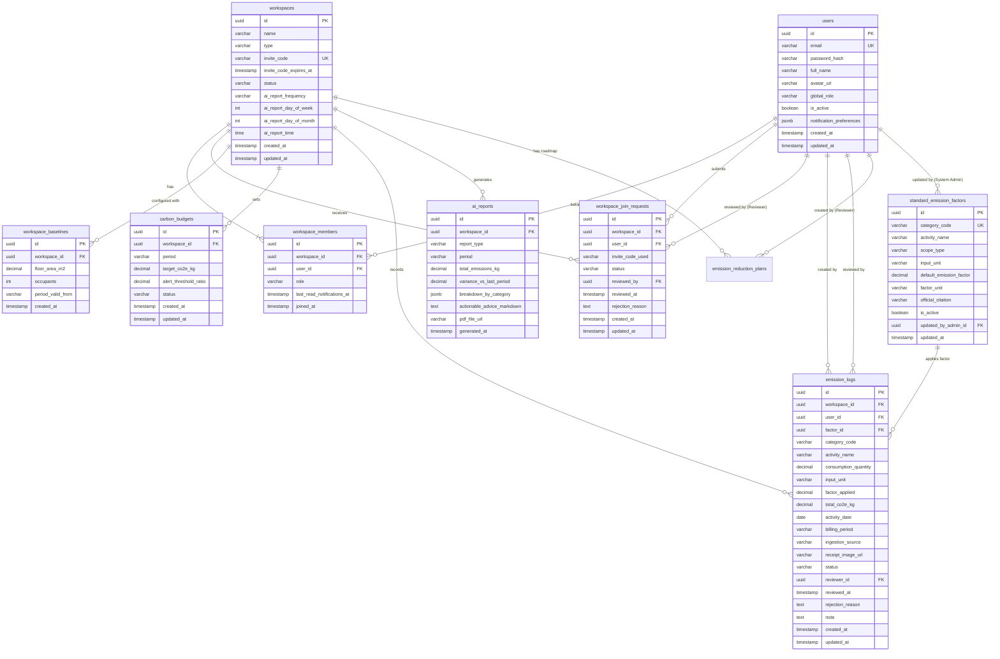

# THIẾT KẾ CƠ SỞ DỮ LIỆU & DATA MODEL CHI TIẾT (DATABASE SYSTEM DESIGN)
## Dự án: Hệ thống Quản trị & Phân tích Dấu chân Carbon cho Gia đình/Văn phòng nhỏ (Personal & Micro-Office Carbon Ledger)

> **Hệ quản trị CSDL:** PostgreSQL 16 (Hỗ trợ JSONB, UUID v4, Partial Indexes)  
> **Chuẩn hóa:** 3NF (Third Normal Form) kết hợp denormalization có kiểm soát (`factor_applied`) để bảo toàn tính bất biến của sổ cái carbon  
> **Căn cứ tài liệu:** [spec.md](../spec.md), [01-PRD.md](01-PRD.md), [03-use-cases.md](03-use-cases.md), [04-user-stories.md](04-user-stories.md), [api-schema/api-schema.md](api-schema/api-schema.md), [c4-documentation/c4-documentation.md](c4-documentation/c4-documentation.md)  
> **Phiên bản:** 2.0 (Chuẩn hóa 13 bảng dữ liệu, tối ưu hóa Dynamic Derivation cho Notification)  

---

## MỤC LỤC TỔNG QUAN

1. [Sơ đồ Thực thể Quan hệ (Entity Relationship Diagram - ERD)](#1-sơ-đồ-thực-thể-quan-hệ-entity-relationship-diagram---erd)
2. [Đặc tả Chi tiết Các Bảng Dữ liệu (Table Specifications)](#2-đặc-tả-chi-tiết-các-bảng-dữ-liệu-table-specifications)
   - 2.1. `users` (Tài khoản người dùng toàn hệ thống)
   - 2.2. `workspaces` (Không gian làm việc / Tenants)
   - 2.3. `workspace_members` (Thành viên tham gia Workspace & Vai trò)
   - 2.4. `workspace_join_requests` (Yêu cầu Tham gia Workspace Chờ duyệt)
   - 2.5. `workspace_baselines` (Thông số nền diện tích & nhân khẩu)
   - 2.6. `standard_emission_factors` (Master Data Hệ số Quy chuẩn Quốc gia)
   - 2.7. `carbon_budgets` (Hạn ngạch Ngân sách Phát thải Tháng)
   - 2.8. `emission_logs` (Sổ cái Ghi nhận Phát thải & Trạng thái Phê duyệt)
   - 2.9. `ai_reports` (Báo cáo Phân tích AI & Đề xuất Cắt giảm Định kỳ)
   - 2.10. `system_configurations` (Cấu hình Tham số Toàn hệ thống & Prompts AI)
   - 2.11. `system_audit_logs` (Nhật ký Kiểm toán Thao tác Quản trị Hệ thống)
   - 2.12. `ai_usage_logs` (Giám sát Lượt gọi API & Chi phí AI)
   - 2.13. `emission_reduction_plans` (Kế hoạch Lộ trình Cắt giảm Phát thải Cá nhân hóa từ AI)
3. [Chiến lược Đánh Index (Database Indexing Strategy)](#3-chiến-lược-đánh-index-database-indexing-strategy)
4. [Các Quyết định Thiết kế CSDL Đã Được Phê duyệt (Approved Database Design Decisions)](#4-các-quyết-định-thiết-kế-csdl-đã-được-phê-duyệt-approved-database-design-decisions)

---

Lược đồ cơ sở dữ liệu quan hệ (PostgreSQL) dưới đây được thiết kế chuẩn hóa 3NF, phục vụ trọn vẹn việc tính toán tự động dựa trên hoạt động người dùng nạp vào và đảm bảo tính bất biến của sổ cái carbon.

## 1. Sơ đồ Thực thể Quan hệ (Entity Relationship Diagram - ERD)

## 2. Đặc tả Chi tiết Các Bảng Dữ liệu (Table Specifications)

#### 1. Bảng `users` (Tài khoản người dùng toàn hệ thống)
- `id`: `UUID PRIMARY KEY DEFAULT gen_random_uuid()`
- `email`: `VARCHAR(255) NOT NULL UNIQUE` (được đánh index B-Tree)
- `password_hash`: `VARCHAR(255) NULL` (mã hóa chuẩn BCrypt/Argon2; cho phép null nếu đăng nhập Google OAuth)
- `full_name`: `VARCHAR(100) NOT NULL`
- `avatar_url`: `VARCHAR(500) NULL`
- `global_role`: `VARCHAR(20) NOT NULL DEFAULT 'USER'` (`SYSTEM_ADMIN`, `USER`)
- `is_active`: `BOOLEAN NOT NULL DEFAULT true`
- `notification_preferences`: `JSONB NOT NULL DEFAULT '{"notify_budget_warning": true, "notify_approval_result": true}'::jsonb`
- `created_at`: `TIMESTAMPTZ NOT NULL DEFAULT CURRENT_TIMESTAMP`
- `updated_at`: `TIMESTAMPTZ NOT NULL DEFAULT CURRENT_TIMESTAMP`

#### 2. Bảng `workspaces` (Không gian làm việc / Tenants)
- `id`: `UUID PRIMARY KEY DEFAULT gen_random_uuid()`
- `name`: `VARCHAR(100) NOT NULL`
- `type`: `VARCHAR(20) NOT NULL` (`HOME`, `OFFICE`)
- `invite_code`: `VARCHAR(10) NULL UNIQUE`
- `invite_code_expires_at`: `TIMESTAMPTZ NULL`
- `status`: `VARCHAR(20) NOT NULL DEFAULT 'ACTIVE'` (`ACTIVE`, `ARCHIVED`, `SUSPENDED`)
- `ai_report_frequency`: `VARCHAR(20) NOT NULL DEFAULT 'MONTHLY'` (`DISABLED`, `WEEKLY`, `MONTHLY`)
- `ai_report_day_of_week`: `INT NULL CHECK (ai_report_day_of_week BETWEEN 1 AND 7)` (1 = Thứ Hai, 7 = Chủ Nhật; áp dụng khi frequency là `WEEKLY`)
- `ai_report_day_of_month`: `INT NULL CHECK (ai_report_day_of_month BETWEEN -1 AND 31)` (-1: ngày cuối cùng của tháng, 1..31: ngày cụ thể; áp dụng khi frequency là `MONTHLY`)
- `ai_report_time`: `TIME NOT NULL DEFAULT '23:59:00'` (Thời điểm trong ngày tác vụ nền chạy)
- `created_at`: `TIMESTAMPTZ NOT NULL DEFAULT CURRENT_TIMESTAMP`
- `updated_at`: `TIMESTAMPTZ NOT NULL DEFAULT CURRENT_TIMESTAMP`

#### 3. Bảng `workspace_members` (Thành viên tham gia Workspace & Vai trò)
- `id`: `UUID PRIMARY KEY DEFAULT gen_random_uuid()`
- `workspace_id`: `UUID NOT NULL REFERENCES workspaces(id) ON DELETE CASCADE`
- `user_id`: `UUID NOT NULL REFERENCES users(id) ON DELETE CASCADE`
- `role`: `VARCHAR(20) NOT NULL` (`REVIEWER`, `EDITOR`)
- `last_read_notifications_at`: `TIMESTAMPTZ NULL` (Thời điểm người dùng mở xem Drawer thông báo gần nhất)
- `joined_at`: `TIMESTAMPTZ NOT NULL DEFAULT CURRENT_TIMESTAMP`
- **Ràng buộc:** `UNIQUE (workspace_id, user_id)`

#### 4. Bảng `workspace_join_requests` (Yêu cầu Tham gia Workspace Chờ duyệt)
Quản lý luồng kiểm duyệt gia nhập 2 bước, bảo vệ an toàn cho Workspace tránh việc người lạ tùy tiện vào khi có mã code.
- `id`: `UUID PRIMARY KEY DEFAULT gen_random_uuid()`
- `workspace_id`: `UUID NOT NULL REFERENCES workspaces(id) ON DELETE CASCADE`
- `user_id`: `UUID NOT NULL REFERENCES users(id) ON DELETE CASCADE` (Người dùng xin gia nhập)
- `invite_code_used`: `VARCHAR(10) NOT NULL` (Mã mời đã nhập)
- `status`: `VARCHAR(20) NOT NULL DEFAULT 'PENDING'` (`PENDING`, `APPROVED`, `REJECTED`)
- `reviewed_by`: `UUID NULL REFERENCES users(id)` (Reviewer thực hiện duyệt/từ chối)
- `reviewed_at`: `TIMESTAMPTZ NULL`
- `rejection_reason`: `TEXT NULL`
- `created_at`: `TIMESTAMPTZ NOT NULL DEFAULT CURRENT_TIMESTAMP`
- `updated_at`: `TIMESTAMPTZ NOT NULL DEFAULT CURRENT_TIMESTAMP`
- **Ràng buộc:** Unique Partial Index `(workspace_id, user_id)` WHERE `status = 'PENDING'` (Mỗi người dùng chỉ được có tối đa 1 yêu cầu chờ duyệt tại một Workspace).

#### 5. Bảng `workspace_baselines` (Thông số nền diện tích & nhân khẩu)
- `id`: `UUID PRIMARY KEY DEFAULT gen_random_uuid()`
- `workspace_id`: `UUID NOT NULL REFERENCES workspaces(id) ON DELETE CASCADE`
- `floor_area_m2`: `NUMERIC(10, 2) NOT NULL CHECK (floor_area_m2 > 0)`
- `occupants`: `INT NOT NULL CHECK (occupants >= 1)`
- `period_valid_from`: `VARCHAR(7) NOT NULL` (Định dạng `YYYY-MM`)
- `created_at`: `TIMESTAMPTZ NOT NULL DEFAULT CURRENT_TIMESTAMP`

#### 6. Bảng `standard_emission_factors` (Master Data Hệ số Quy chuẩn Quốc gia)
- `id`: `UUID PRIMARY KEY DEFAULT gen_random_uuid()`
- `category_code`: `VARCHAR(50) NOT NULL UNIQUE` (`ELEC_GRID`, `FUEL_LPG`, `FUEL_DIESEL`, `MOBILITY`, `WASTE_LANDFILL`, `WATER_SUPPLY_TREAT`, `OFFICE_PAPER`, `TRAVEL_FLIGHT`)
- `activity_name`: `VARCHAR(100) NOT NULL`
- `scope_type`: `VARCHAR(10) NOT NULL` (`SCOPE_1`, `SCOPE_2`, `SCOPE_3`)
- `input_unit`: `VARCHAR(20) NOT NULL`
- `default_emission_factor`: `NUMERIC(12, 6) NOT NULL CHECK (default_emission_factor >= 0)`
- `factor_unit`: `VARCHAR(50) NOT NULL DEFAULT 'kg CO2e/unit'`
- `official_citation`: `TEXT NOT NULL`
- `is_active`: `BOOLEAN NOT NULL DEFAULT true`
- `updated_by_admin_id`: `UUID NULL REFERENCES users(id)`
- `updated_at`: `TIMESTAMPTZ NOT NULL DEFAULT CURRENT_TIMESTAMP`

#### 7. Bảng `carbon_budgets` (Hạn ngạch Ngân sách Phát thải Tháng)
- `id`: `UUID PRIMARY KEY DEFAULT gen_random_uuid()`
- `workspace_id`: `UUID NOT NULL REFERENCES workspaces(id) ON DELETE CASCADE`
- `period`: `VARCHAR(7) NOT NULL` (Định dạng `YYYY-MM`, ví dụ: `2026-10`)
- `target_co2e_kg`: `NUMERIC(12, 2) NOT NULL CHECK (target_co2e_kg > 0)`
- `alert_threshold_ratio`: `NUMERIC(3, 2) NOT NULL DEFAULT 0.85`
- `status`: `VARCHAR(20) NOT NULL DEFAULT 'ACTIVE'`
- `created_at`: `TIMESTAMPTZ NOT NULL DEFAULT CURRENT_TIMESTAMP`
- `updated_at`: `TIMESTAMPTZ NOT NULL DEFAULT CURRENT_TIMESTAMP`
- **Ràng buộc:** `UNIQUE (workspace_id, period)`

#### 8. Bảng `emission_logs` (Sổ cái Ghi nhận Phát thải & Trạng thái Phê duyệt)
- `id`: `UUID PRIMARY KEY DEFAULT gen_random_uuid()`
- `workspace_id`: `UUID NOT NULL REFERENCES workspaces(id) ON DELETE CASCADE`
- `user_id`: `UUID NOT NULL REFERENCES users(id)` (Người tạo bản ghi)
- `factor_id`: `UUID NOT NULL REFERENCES standard_emission_factors(id)`
- `category_code`: `VARCHAR(50) NOT NULL`
- `activity_name`: `VARCHAR(100) NOT NULL`
- `consumption_quantity`: `NUMERIC(12, 3) NOT NULL CHECK (consumption_quantity >= 0)`
- `input_unit`: `VARCHAR(20) NOT NULL`
- `factor_applied`: `NUMERIC(12, 6) NOT NULL` (Lưu cứng hệ số tại thời điểm ghi nhận để đảm bảo tính bất biến của sổ cái)
- `total_co2e_kg`: `NUMERIC(12, 4) NOT NULL` (Giá trị quy đổi: `consumption_quantity` $\times$ `factor_applied`)
- `activity_date`: `DATE NOT NULL`
- `billing_period`: `VARCHAR(7) NOT NULL` (Định dạng `YYYY-MM`)
- `ingestion_source`: `VARCHAR(20) NOT NULL` (`MANUAL`, `EXCEL_IMPORT`, `AI_VISION`)
- `receipt_image_url`: `VARCHAR(500) NULL`
- `status`: `VARCHAR(20) NOT NULL DEFAULT 'PENDING_REVIEW'` (`DRAFT`, `PENDING_REVIEW`, `APPROVED`, `REJECTED`)
- `reviewer_id`: `UUID NULL REFERENCES users(id)`
- `reviewed_at`: `TIMESTAMPTZ NULL`
- `rejection_reason`: `TEXT NULL`
- `note`: `TEXT NULL`
- `created_at`: `TIMESTAMPTZ NOT NULL DEFAULT CURRENT_TIMESTAMP`
- `updated_at`: `TIMESTAMPTZ NOT NULL DEFAULT CURRENT_TIMESTAMP`

#### 9. Bảng `ai_reports` (Báo cáo Phân tích AI & Đề xuất Cắt giảm Định kỳ)
- `id`: `UUID PRIMARY KEY DEFAULT gen_random_uuid()`
- `workspace_id`: `UUID NOT NULL REFERENCES workspaces(id) ON DELETE CASCADE`
- `report_type`: `VARCHAR(20) NOT NULL` (`WEEKLY`, `MONTHLY`)
- `period`: `VARCHAR(10) NOT NULL` (Ví dụ `2026-W44` hoặc `2026-10`)
- `total_emissions_kg`: `NUMERIC(12, 2) NOT NULL`
- `variance_vs_last_period`: `NUMERIC(5, 2) NULL`
- `breakdown_by_category`: `JSONB NOT NULL`
- `actionable_advice_markdown`: `TEXT NOT NULL`
- `pdf_file_url`: `VARCHAR(500) NULL`
- `generated_at`: `TIMESTAMPTZ NOT NULL DEFAULT CURRENT_TIMESTAMP`

#### 10. Bảng `system_configurations` (Cấu hình Tham số Toàn hệ thống & Prompts AI)
- `id`: `UUID PRIMARY KEY DEFAULT gen_random_uuid()`
- `config_key`: `VARCHAR(100) NOT NULL UNIQUE` (ví dụ: `AI_MODEL_NAME`, `PROMPT_VISION_PARSER`, `PROMPT_INSIGHT_REPORT`)
- `config_value`: `JSONB NOT NULL`
- `description`: `VARCHAR(255) NULL`
- `updated_by`: `UUID NULL REFERENCES users(id)`
- `updated_at`: `TIMESTAMPTZ NOT NULL DEFAULT CURRENT_TIMESTAMP`

#### 11. Bảng `system_audit_logs` (Nhật ký Kiểm toán Thao tác Quản trị Hệ thống)
- `id`: `UUID PRIMARY KEY DEFAULT gen_random_uuid()`
- `admin_id`: `UUID NOT NULL REFERENCES users(id)`
- `action`: `VARCHAR(100) NOT NULL` (`UPDATE_EMISSION_FACTOR`, `SUSPEND_WORKSPACE`, `ACTIVATE_WORKSPACE`, `UPDATE_AI_CONFIG`)
- `resource_type`: `VARCHAR(50) NOT NULL` (`STANDARD_FACTOR`, `WORKSPACE`, `SYSTEM_CONFIG`)
- `resource_id`: `VARCHAR(100) NULL`
- `details`: `JSONB NULL`
- `ip_address`: `VARCHAR(45) NULL`
- `created_at`: `TIMESTAMPTZ NOT NULL DEFAULT CURRENT_TIMESTAMP`

#### 12. Bảng `ai_usage_logs` (Giám sát Lượt gọi API & Chi phí AI)
- `id`: `UUID PRIMARY KEY DEFAULT gen_random_uuid()`
- `workspace_id`: `UUID NULL REFERENCES workspaces(id) ON DELETE SET NULL`
- `service_type`: `VARCHAR(50) NOT NULL` (`VISION_PARSER`, `INSIGHT_GENERATOR`, `REDUCTION_PLANNER`)
- `prompt_tokens`: `INT NOT NULL DEFAULT 0`
- `completion_tokens`: `INT NOT NULL DEFAULT 0`
- `estimated_cost_usd`: `NUMERIC(10, 6) NOT NULL DEFAULT 0`
- `created_at`: `TIMESTAMPTZ NOT NULL DEFAULT CURRENT_TIMESTAMP`

#### 13. Bảng `emission_reduction_plans` (Kế hoạch Lộ trình Cắt giảm Phát thải Cá nhân hóa từ AI)
Lưu trữ mục tiêu cắt giảm dài hạn, tầm nhìn thời gian và lộ trình phân rã chi tiết theo từng tháng do AI đề xuất riêng cho Workspace.
- `id`: `UUID PRIMARY KEY DEFAULT gen_random_uuid()`
- `workspace_id`: `UUID NOT NULL REFERENCES workspaces(id) ON DELETE CASCADE`
- `created_by_user_id`: `UUID NOT NULL REFERENCES users(id)`
- `baseline_period`: `VARCHAR(7) NOT NULL` (Kỳ làm mốc đo lường, ví dụ `2026-10`)
- `baseline_emissions_kg`: `NUMERIC(12, 2) NOT NULL` (Tổng phát thải tại kỳ cơ sở, ví dụ `348.50`)
- `target_reduction_percentage`: `NUMERIC(5, 2) NOT NULL CHECK (target_reduction_percentage > 0 AND target_reduction_percentage <= 100)` (Tỷ lệ cắt giảm mục tiêu, ví dụ `15.00`%)
- `target_emissions_kg`: `NUMERIC(12, 2) NOT NULL` (Mức phát thải mục tiêu cuối lộ trình, ví dụ `296.23`)
- `time_horizon_months`: `INT NOT NULL CHECK (time_horizon_months BETWEEN 1 AND 36)` (Tầm nhìn thời gian, ví dụ `3`, `6`, `12` tháng)
- `monthly_roadmap`: `JSONB NOT NULL` (Cấu trúc mảng chứa các mốc tháng: mục tiêu kg CO2e, % giảm lũy kế và danh sách các hành động định lượng khả thi)
- `status`: `VARCHAR(20) NOT NULL DEFAULT 'ACTIVE'` (`ACTIVE`, `COMPLETED`, `ARCHIVED`)
- `pdf_file_url`: `VARCHAR(500) NULL` (Đường dẫn tải tài liệu PDF lộ trình)
- `created_at`: `TIMESTAMPTZ NOT NULL DEFAULT CURRENT_TIMESTAMP`
- `updated_at`: `TIMESTAMPTZ NOT NULL DEFAULT CURRENT_TIMESTAMP`

> [!TIP]
> **Quyết định Tinh gọn Database Schema (Theo Review):**  
> Bảng `notifications` được **loại bỏ hoàn toàn khỏi thiết kế CSDL**.  
> **Lý do:** Frontend hoàn toàn tự động tính toán được các trạng thái và loại thông báo (`notification_type`) theo thời gian thực (Real-time Dynamic Derivation) dựa trực tiếp trên trạng thái dữ liệu có sẵn từ Dashboard API:
> - *Cảnh báo ngưỡng 85% / 100%:* Tính theo tỷ lệ `current_emissions / budget_target` từ `carbon_budgets` & `emission_logs`.
> - *Yêu cầu chờ duyệt:* Đếm số lượng bản ghi `status = 'PENDING_REVIEW'` trong `emission_logs` của Workspace.
> - *Kết quả duyệt của cá nhân:* Lọc các bản ghi `user_id = :currentUser` có `status IN ('APPROVED', 'REJECTED')` mới nhất.
> - *Báo cáo AI mới:* Kiểm tra sự tồn tại của bản ghi trong `ai_reports` cho kỳ gần nhất.  
> 
> Giải pháp này giúp loại bỏ hoàn toàn việc lưu trữ các bản ghi thông báo trùng lặp/dư thừa, tránh rủi ro lệch đồng bộ (out-of-sync) và tối ưu hóa hiệu năng cơ sở dữ liệu.

## 3. Chiến lược Đánh Index (Database Indexing Strategy)
1. `idx_emission_logs_ws_period_status`: `(workspace_id, billing_period, status)` -> Tối ưu hóa tính tổng phát thải tháng và kiểm tra ngưỡng 85%.
2. `idx_emission_logs_ws_created`: `(workspace_id, created_at DESC)` -> Tối ưu hóa hiển thị Sổ cái phân trang.
3. `idx_emission_logs_approval`: `(workspace_id, status)` WHERE `status = 'PENDING_REVIEW'` -> Partial Index cho Hàng đợi duyệt tức thời.
4. `idx_ws_join_requests_pending`: `(workspace_id, status)` WHERE `status = 'PENDING'` -> Partial Index giúp Reviewer tải danh sách Yêu cầu gia nhập Workspace tức thời (< 50ms).

## 4. Các Quyết định Thiết kế CSDL Đã Được Phê duyệt (Approved Database Design Decisions)
1. **Loại bỏ Bảng `notifications`:** Chuyển sang mô hình Frontend tự động tính toán trạng thái cảnh báo theo thời gian thực (Real-time Dynamic Derivation) từ dữ liệu Dashboard/Sổ cái, tránh dư thừa lưu trữ và lệch pha đồng bộ.
2. **Bổ sung Bảng `workspace_join_requests`:** Thiết lập quy trình kiểm duyệt gia nhập 2 bước chặt chẽ: Khi người dùng nhập Invite Code, hệ thống tạo bản ghi `PENDING` và yêu cầu Reviewer duyệt (`Accept`/`Reject`) trước khi thêm vào `workspace_members`, ngăn chặn triệt để nguy cơ người ngoài chủ đích hoặc dò mã gia nhập trái phép.
3. **Tích hợp Cấu hình Lịch Báo cáo AI vào Bảng `workspaces`:** Lưu trữ `ai_report_frequency`, `ai_report_day_of_week`, `ai_report_day_of_month`, `ai_report_time` trực tiếp tại bảng `workspaces`, hỗ trợ Reviewer chủ động chọn chu kỳ chạy tự động hoặc tắt đi, kết hợp API kích hoạt thủ công on-demand.
4. **Bảo toàn Tính Bất biến của Sổ cái:** Lưu cứng `factor_applied` tại `emission_logs` tại thời điểm ghi nhận, ngăn chặn việc cập nhật hệ số trong tương lai làm sai lệch số liệu lịch sử của sổ cái phát thải.

---

*Tài liệu Thiết kế Cơ sở Dữ liệu & Data Model này đồng bộ 100% với [spec.md](../spec.md), [01-PRD.md](01-PRD.md), [03-use-cases.md](03-use-cases.md), [04-user-stories.md](04-user-stories.md) và [api-schema/api-schema.md](api-schema/api-schema.md).*
