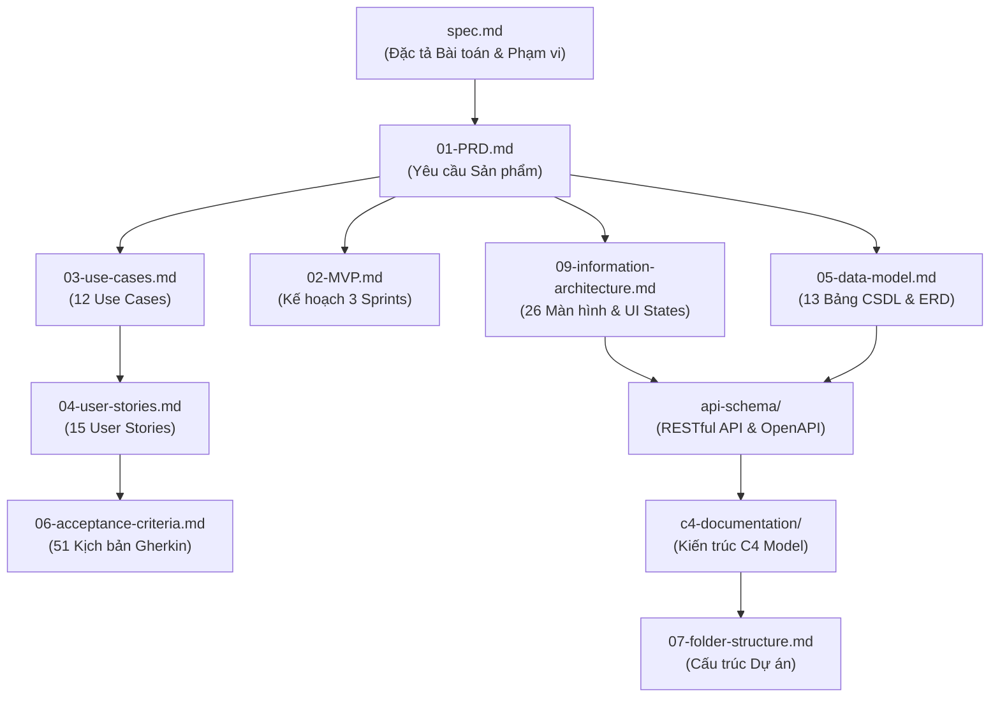

# CẤU TRÚC THƯ MỤC DỰ ÁN & QUẢN TRỊ TÀI LIỆU (PROJECT FOLDER STRUCTURE & DOCS GOVERNANCE)
## Dự án: Hệ thống Quản trị & Phân tích Dấu chân Carbon cho Gia đình/Văn phòng nhỏ (Personal & Micro-Office Carbon Ledger)

> **Căn cứ tài liệu:** [README.md](../README.md), [spec.md](../spec.md), [01-PRD.md](01-PRD.md), [02-MVP.md](02-MVP.md)  
> **Quy chuẩn tổ chức:** Hệ thống phân loại số thứ tự chuẩn hóa (Numbered Documentation Architecture) kết hợp quản lý tài nguyên tĩnh tập trung (`docs/image/`)  
> **Phiên bản:** 2.0 (Cập nhật sau đợt tái cấu trúc tài liệu toàn diện)  

---

## MỤC LỤC TỔNG QUAN

1. [Sơ đồ Cây Thư mục Dự án Toàn diện (Complete Repository Tree)](#1-sơ-đồ-cây-thư-mục-dự-án-toàn-diện-complete-repository-tree)
2. [Quy chuẩn Đánh số & Phân loại Tài liệu trong /docs (Documentation Taxonomy)](#2-quy-chuẩn-đánh-số--phân-loại-tài-liệu-trong-docs-documentation-taxonomy)
3. [Đặc tả Chi tiết Mục đích & Nội dung Từng Tài liệu](#3-đặc-tả-chi-tiết-mục-đích--nội-dung-từng-tài-liệu)
4. [Ma trận Liên kết & Truy vết Giữa các Tài liệu (Cross-Reference Matrix)](#4-ma-trận-liên-kết--truy-vết-giữa-các-tài-liệu-cross-reference-matrix)
5. [Quy tắc Quản lý Đường dẫn & Tài nguyên Tĩnh (Linking & Asset Rules)](#5-quy-tắc-quản-lý-đường-dẫn--tài-nguyên-tĩnh-linking--asset-rules)
6. [Quy trình Bảo trì & Đóng góp Tài liệu (Maintenance & Governance)](#6-quy-trình-bảo-trì--đóng-góp-tài-liệu-maintenance--governance)

---

## 1. Sơ đồ Cây Thư mục Dự án Toàn diện (Complete Repository Tree)

Dưới đây là cấu trúc thư mục hiện tại của toàn bộ kho lưu trữ mã nguồn và tài liệu kỹ thuật:

```
.
├── README.md                          # Tài liệu tổng quan dự án, mục tiêu, kiến trúc vĩ mô và hướng dẫn tra cứu
├── spec.md                            # Đặc tả yêu cầu bài toán, phạm vi In/Out scope, 3 Roles, 4 Luồng & 12 Use Cases
└── docs/                              # Thư mục chứa toàn bộ tài liệu đặc tả chi tiết của dự án
    ├── 01-PRD.md                      # Tài liệu Yêu cầu Sản phẩm (Product Requirements Document)
    ├── 02-MVP.md                      # Kế hoạch triển khai & phát hành MVP 6 tuần (3 Sprints x 2 tuần)
    ├── 03-use-cases.md                # Đặc tả chi tiết 12 Use Cases (UC01 - UC12, Actors, Flows, Exceptions)
    ├── 04-user-stories.md             # Bộ 15 User Stories chuẩn INVEST (Story Statement, Metadata, INVEST check)
    ├── 05-data-model.md               # Thiết kế Cơ sở Dữ liệu quan hệ PostgreSQL 16 & Data Model chi tiết (13 bảng, ERD)
    ├── 06-acceptance-criteria.md      # Bộ Tiêu chí Nghiệm thu chi tiết cho 15 User Stories (Gherkin Given-When-Then, 51 ACs)
    ├── 07-folder-structure.md         # Quy chuẩn Cấu trúc Thư mục & Quản trị Tài liệu Dự án (Tài liệu này)
    ├── 09-information-architecture.md # Kiến trúc Thông tin & Đặc tả 26 Màn hình (IA, Screen Hierarchy, UI State Contract)
    ├── activity-supported.md          # Danh mục 8 hoạt động phát thải & Hệ số phát thải quy chuẩn (Scope 1, 2, 3)
    ├── emission-reference-benchmark.md# Phương pháp luận Mức phát thải tham chiếu quốc gia (Household 46.4% vs Workplace 100%)
    ├── mindmap.png                    # Sơ đồ Mindmap cấu trúc sản phẩm 9 phân hệ chức năng
    ├── image/                         # Thư mục lưu trữ hình ảnh minh họa, sơ đồ thiết kế
    │   ├── sitemap.png                # Sơ đồ Kiến trúc Thông tin & Sitemap cây màn hình
    │   └── UCD.png                    # Sơ đồ UML Use Case Diagram tổng quan toàn hệ thống
    ├── api-schema/                    # Phân hệ đặc tả giao diện lập trình ứng dụng (Application Programming Interface)
    │   ├── api-schema.md              # Đặc tả chi tiết RESTful API Endpoints, Data Contracts & Kiểm tra Use Cases
    │   └── openapi.yaml               # Đặc tả kỹ thuật chuẩn máy OpenAPI 3.1 (Swagger)
    └── c4-documentation/              # Phân hệ tài liệu thiết kế kiến trúc hệ thống chuẩn C4 Model
        ├── c4-documentation.md        # Tài liệu Kiến trúc C4 đầy đủ 4 tầng (Context, Container, Component, Deployment)
        └── c4-verification-checklist.md# Bảng kiểm chuẩn kiến trúc C4 (5 trụ cột, 26 tiêu chí, Ma trận truy vết)
```

---

## 2. Quy chuẩn Đánh số & Phân loại Tài liệu trong /docs (Documentation Taxonomy)

Để hỗ trợ việc tra cứu tuần tự theo quy trình kỹ nghệ phần mềm và phân định rõ ranh giới nghiệp vụ (Separation of Concerns), các tài liệu trong `docs/` được chuẩn hóa theo tiền tố đánh số có chủ đích:

| Tiền tố / Đường dẫn | Tên Tài liệu | Nhóm Nội dung Chính | Đối tượng Sử dụng Chính |
|:---:|:---|:---|:---|
| `01-` | `01-PRD.md` | Yêu cầu Sản phẩm, Mục tiêu, Phạm vi, Luồng cốt lõi, NFRs | PO, PM, BA, Tech Lead, Stakeholders |
| `02-` | `02-MVP.md` | Lộ trình phát triển 3 Sprints (6 tuần), DoR/DoD, Phân bổ Story Points | Scrum Master, Developers, QA |
| `03-` | `03-use-cases.md` | Đặc tả 12 Use Cases (UC01 - UC12), Luồng chính, Luồng ngoại lệ | BA, QA/QC, Developers |
| `04-` | `04-user-stories.md` | Danh mục 15 User Stories theo chuẩn INVEST, Story Narrative | PO, Developers, QA, Scrum Team |
| `05-` | `05-data-model.md` | Sơ đồ ERD, 13 bảng dữ liệu PostgreSQL, Kiểu dữ liệu, Index, Ràng buộc | Database Engineer, Backend Developers |
| `06-` | `06-acceptance-criteria.md` | 51 Kịch bản Acceptance Criteria chuẩn Gherkin (`Given - When - Then`) | QA/QC, Automation Testers, Developers |
| `07-` | `07-folder-structure.md` | Cấu trúc thư mục, quy tắc đặt tên, hướng dẫn liên kết tài liệu | Toàn bộ thành viên đội dự án |
| `09-` | `09-information-architecture.md` | Danh mục 26 màn hình, Screen Hierarchy 5 tầng, UI State Contract, RBAC | UI/UX Designers, Frontend Developers |
| Chuyên biệt | `activity-supported.md` | Master Data 8 hoạt động, hệ số quy chuẩn, nguồn trích dẫn pháp lý | BA, Domain Expert, Backend Dev |
| Chuyên biệt | `emission-reference-benchmark.md` | Phương pháp luận mức chuẩn quốc gia ($3.67\text{ tấn/người/năm}$) | Domain Expert, Data/AI Engineer, BA |
| Thư mục | `api-schema/` | Đặc tả RESTful API 21+ Endpoints, Request/Response Schema, OpenAPI 3.1 | Frontend Dev, Backend Dev, QA API |
| Thư mục | `c4-documentation/` | Kiến trúc C4 Model (Context, Container, Component, Deployment) & Bảng kiểm | Software Architect, Tech Lead, DevOps |
| Thư mục | `image/` | Kho tài nguyên tĩnh hình ảnh, sơ đồ UML, Sitemap | Toàn bộ tài liệu tra cứu |

---

## 3. Đặc tả Chi tiết Mục đích & Nội dung Từng Tài liệu

### 3.1. `01-PRD.md` (Product Requirements Document)
- **Mục đích:** Là bản tuyên ngôn nghiệp vụ chính thức, xác lập bối cảnh thị trường, bài toán cần giải quyết, ranh giới sản phẩm, các luồng hoạt động cốt lõi và các quyết định kiến trúc then chốt đã được phê chuẩn.
- **Nội dung:** Tổng quan dự án, 3 vai trò người dùng (Personas) & ma trận RBAC, đặc tả 6 phân hệ chức năng, kiến trúc vĩ mô, yêu cầu phi chức năng (NFRs) và quản trị rủi ro.

### 3.2. `02-MVP.md` (MVP Release Plan)
- **Mục đích:** Bản kế hoạch hành động triển khai thực tế trong 6 tuần (3 Sprints x 2 tuần), đảm bảo đưa sản phẩm ra thị trường đúng tiến độ và kiểm soát chất lượng.
- **Nội dung:** Mục tiêu MVP, phân bổ công việc theo từng Sprint (Sprint 1: Nền tảng & Nhập tay; Sprint 2: Excel Import & Duyệt; Sprint 3: AI Vision & Báo cáo PDF), tiêu chuẩn Definition of Ready (DoR) và Definition of Done (DoD).

### 3.3. `03-use-cases.md` (Use Case Specifications)
- **Mục đích:** Đặc tả hành vi tương tác chi tiết giữa người dùng và hệ thống từ góc nhìn chức năng.
- **Nội dung:** Sơ đồ UML Use Case Diagram, phân rã 12 Use Cases từ UC01 đến UC12 với đầy đủ Tiền điều kiện (Preconditions), Hậu điều kiện (Postconditions), Luồng cơ bản (Main Flow), Luồng phụ (Alternative Flows) và Luồng xử lý lỗi (Exception Flows).

### 3.4. `04-user-stories.md` (User Stories Backlog)
- **Mục đích:** Quản lý danh mục backlog theo phương pháp luận Agile/Scrum dựa trên tiêu chuẩn INVEST (Independent, Negotiable, Valuable, Estimable, Small, Testable).
- **Nội dung:** Bảng tổng hợp 15 User Stories, Story narrative (`As a ... I want to ... So that ...`), Metadata (Ước lượng SP, Phân bổ Sprint, MoSCoW), bảng kiểm chứng 6 tiêu chí INVEST và ma trận truy vết luồng nghiệp vụ.

### 3.5. `05-data-model.md` (Database System Design & Data Model)
- **Mục đích:** Bản quy chuẩn thiết kế cơ sở dữ liệu vật lý trên PostgreSQL 16, đảm bảo tính toàn vẹn ACID của sổ cái carbon và phân lập dữ liệu đa người thuê.
- **Nội dung:** Sơ đồ thực thể quan hệ ERD chuẩn Mermaid, đặc tả chi tiết 13 bảng dữ liệu (`users`, `workspaces`, `workspace_members`, `workspace_join_requests`, `workspace_baselines`, `standard_emission_factors`, `carbon_budgets`, `emission_logs`, `ai_reports`, `system_configurations`, `system_audit_logs`, `ai_usage_logs`, `emission_reduction_plans`), chiến lược Partial Indexing và nguyên tắc Dynamic Derivation thay thế bảng `notifications`.

### 3.6. `06-acceptance-criteria.md` (Acceptance Criteria Specification)
- **Mục đích:** Đặc tả các điều kiện nghiệm thu có thể kiểm thử tự động (Testable Criteria) cho toàn bộ 15 User Stories.
- **Nội dung:** 51 kịch bản kiểm thử viết theo cú pháp Gherkin (`Given - When - Then - And`), bao phủ đầy đủ luồng thành công (Happy Path), trường hợp biên dữ liệu (Edge Cases) và xử lý ngoại lệ (Negative Paths).

### 3.7. `07-folder-structure.md` (Folder Structure & Governance)
- **Mục đích:** Bản đồ hướng dẫn cấu trúc thư mục, định danh vị trí các thành phần tài liệu và thiết lập các nguyên tắc chuẩn mực cho liên kết nội bộ.
- **Nội dung:** Cây thư mục dự án, quy tắc đánh số thứ tự, hướng dẫn bảo trì tài nguyên và ma trận quan hệ tài liệu.

### 3.8. `09-information-architecture.md` (Information Architecture & Screen Specs)
- **Mục đích:** Cầu nối giữa yêu cầu nghiệp vụ và trải nghiệm giao diện người dùng (UI/UX).
- **Nội dung:** Danh mục chuẩn hóa 26 màn hình tương tác (Full pages, Modals, Drawers), sơ đồ phân cấp 5 tầng (Screen Hierarchy), hợp đồng 5 cung bậc trạng thái UI (State Contract: Empty, Loading, Error, Success, Idle), và ma trận ánh xạ màn hình với API (Screen-to-API Mapping).

---

## 4. Ma trận Liên kết & Truy vết Giữa các Tài liệu (Cross-Reference Matrix)



---

## 5. Quy tắc Quản lý Đường dẫn & Tài nguyên Tĩnh (Linking & Asset Rules)

Để tránh hiện tượng đường dẫn bị hỏng (Broken links) khi tái cấu trúc hoặc di chuyển tài liệu, toàn bộ các tập tin Markdown trong dự án phải tuân thủ nghiêm ngặt các nguyên tắc sau:

### 5.1. Quy tắc Đường dẫn Tương đối (Relative Path Standard)
- Trong các tập tin Markdown nội bộ, **ƯU TIÊN TUYỆT ĐỐI** sử dụng đường dẫn tương đối (relative path) thay vì đường dẫn tuyệt đối hoặc đường dẫn worktree tạm thời.
- Ví dụ:
  - Từ `docs/01-PRD.md` liên kết sang `docs/05-data-model.md`: Dùng `[docs/05-data-model.md](05-data-model.md)`.
  - Từ `docs/01-PRD.md` liên kết ra `spec.md`: Dùng `[spec.md](../spec.md)`.
  - Từ `README.md` ở thư mục gốc liên kết vào docs: Dùng `[docs/01-PRD.md](docs/01-PRD.md)`.
- **Nghiêm cấm:** Không chèn các đường dẫn chứa tên máy cá nhân hoặc nhánh worktree tạm thời như `file:///home/.../PMDC-BATCH4-DATNT250-prd/...`.

### 5.2. Quy tắc Lưu trữ & Liên kết Hình ảnh (Image Assets Standard)
- Toàn bộ hình ảnh sơ đồ, biểu đồ phân tích và mockups phải được đặt trong thư mục tập trung `docs/image/` (ngoại trừ sơ đồ mindmap tổng quan `docs/mindmap.png` nằm trực tiếp tại `docs/` để phục vụ hiển thị nhanh tại README).
- Cú pháp liên kết hình ảnh chuẩn:
  - Từ `README.md`: ``
  - Từ các tài liệu trong `docs/*.md`: ``
- Đặt tên file hình ảnh bằng tiếng Anh không dấu, sử dụng chữ thường hoặc gạch nối/viết tắt rõ nghĩa (ví dụ: `sitemap.png`, `UCD.png`).

---

## 6. Quy trình Bảo trì & Đóng góp Tài liệu (Maintenance & Governance)

Khi có bất kỳ yêu cầu bổ sung tính năng mới hoặc thay đổi kiến trúc:
1. **Kiểm tra tác động chéo (Impact Analysis):** Rà soát các tài liệu phụ thuộc theo sơ đồ tại Mục 4.
2. **Cập nhật đồng thời (Synchronous Updates):** Nếu sửa đổi Data Model trong `05-data-model.md`, phải kiểm tra tính tương thích với `01-PRD.md`, `api-schema/` và `c4-documentation/`.
3. **Cập nhật cây thư mục:** Nếu tạo thêm tài liệu mới hoặc đổi tên tài liệu, bắt buộc phải cập nhật ngay tài liệu `07-folder-structure.md` và `README.md`.

---

*Tài liệu Cấu trúc Thư mục & Quản trị này là văn bản chỉ dẫn chính thức, bảo đảm tính nhất quán và toàn vẹn của hệ thống tài liệu dự án Personal & Micro-Office Carbon Ledger.*
