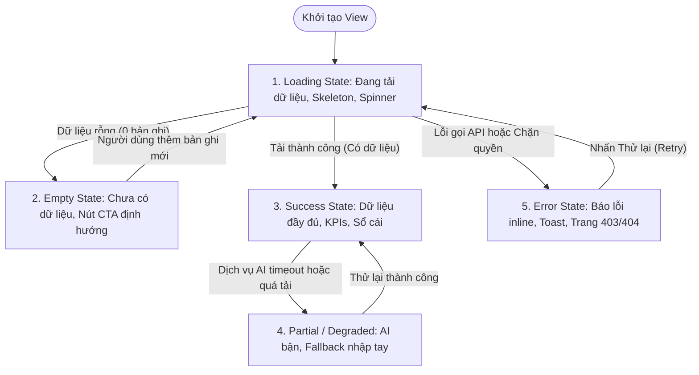

# KIẾN TRÚC THÔNG TIN & THIẾT KẾ VIEW TOÀN DIỆN (INFORMATION ARCHITECTURE - IA)
## Dự án: Hệ thống Quản trị & Phân tích Dấu chân Carbon cho Gia đình/Văn phòng nhỏ (Personal & Micro-Office Carbon Ledger)

> **Căn cứ tài liệu:** [spec.md](../spec.md), [docs/01-PRD.md](01-PRD.md), [docs/03-use-cases.md](03-use-cases.md), [docs/04-user-stories.md](04-user-stories.md)  
> **Tham chiếu đồ họa:** [image/sitemap.png](image/sitemap.png)  
> **Phiên bản:** 3.1 (Chuẩn hóa toàn diện Danh mục Screen ID, Route, Screen Hierarchy, UI/UX State Contract và Screen-to-API Mapping Matrix)  
> **Nhánh phát triển:** `docs/information-architecture` (Git Worktree)

---

## 📋 MỤC LỤC TỔNG QUAN

1. [Master Screen Catalog (Danh mục Toàn bộ Màn hình Chuẩn hóa)](#-1-master-screen-catalog-danh-mục-màn-hình-chuẩn-hóa)
2. [Screen Hierarchy (Cấu trúc Phân cấp Màn hình)](#-2-screen-hierarchy-cấu-trúc-phân-cấp-màn-hình)
3. [UI/UX State Contract & Interaction Rules](#-3-uiux-state-contract--interaction-rules)
4. [Screen-to-API Mapping Matrix (Ánh xạ Giao diện - API Operations)](#-4-screen-to-api-mapping-matrix)
5. [Đặc tả Chi tiết Giao diện & Thành phần Tương tác (View Specifications)](#-5-đặc-tả-chi-tiết-giao-diện--thành-phần-tương-tác)
6. [Ma trận Phân quyền Truy cập Màn hình (RBAC Matrix)](#-6-ma-trận-phân-quyền-truy-cập-màn-hình-rbac-matrix)

---

## 🗂️ 1. MASTER SCREEN CATALOG (DANH MỤC MÀN HÌNH CHUẨN HÓA)

Hệ thống được chuẩn hóa toàn diện thành **26 Màn hình & Giao diện tương tác** (bao gồm Full Pages, Modals, Drawers và Error Views). 100% các view đều được cấp phát **Screen ID duy nhất**, **Route định danh rõ ràng**, **hình thức hiển thị (Presentation)**, **User Story ánh xạ trực tiếp** và **trạng thái triển khai**.

| Screen ID | Tên Màn hình / Modal | Hình thức (Presentation) | Đường dẫn Route (URL Path) | Stories Relate | Trạng thái (Scope) |
|:---|:---|:---:|:---|:---|:---:|
| **SCR-AUTH-01** | Đăng nhập & Đăng ký (Login & Register) | Full Page | `/auth/login` `/auth/register` | `US-WS-001` | MVP Sprint 1 |
| **SCR-AUTH-02** | Quên & Đặt lại Mật khẩu (Password Recovery) | Full Page | `/auth/forgot-password` `/auth/reset-password` | `US-WS-001` | MVP Sprint 1 |
| **SCR-WS-01** | Chọn Không gian làm việc (Workspace Switcher) | Full Page | `/workspaces` | `US-WS-001` | MVP Sprint 1 |
| **SCR-WS-MODAL-01** | Modal Khởi tạo & Cấu hình Workspace mới | Modal Overlay | `/workspaces?modal=create` `/admin/workspaces?modal=create` | `US-WS-001` `US-WS-002` | MVP Sprint 1 |
| **SCR-WS-JOIN-01** | Màn hình Gửi Yêu cầu Gia nhập bằng mã mời | Full Page | `/workspaces/join` | `US-WS-003` | MVP Sprint 1 |
| **SCR-DASH-01** | Dashboard Trung tâm & Giám sát Ngân sách | Full Page | `/workspace/[id]/dashboard` | `US-BG-002` `US-BG-003` | MVP Sprint 2 |
| **SCR-LEDGER-01** | Sổ cái Phát thải & Xuất Excel (Emission Ledger) | Full Page | `/workspace/[id]/ledger` | `US-CL-006` | MVP Sprint 2 |
| **SCR-LEDGER-DETAIL-01** | Modal Xem Chi tiết Bản ghi Phát thải & Vết duyệt | Modal Overlay | `/workspace/[id]/ledger?logId=[logId]` | `US-CL-006` | MVP Sprint 2 |
| **SCR-EMISSION-ADD-01** | Modal Thêm Phát thải Đa kênh (3 Tabs Ingestion) | Modal Overlay | `/workspace/[id]/ledger?action=add` | `US-CL-001` `US-CL-003` `US-CL-004` | Sprint 1-3 |
| **SCR-AI-PREVIEW-01** | Modal Kiểm chứng Dữ liệu AI Vision (Human-in-the-loop) | Modal Overlay | `/workspace/[id]/ledger?action=ai-preview` | `US-CL-003` | MVP Sprint 3 |
| **SCR-EXCEL-PREVIEW-01** | Modal Xem trước & Xác thực Nạp File Excel | Modal Overlay | `/workspace/[id]/ledger?action=excel-preview` | `US-CL-004` | MVP Sprint 2 |
| **SCR-APPROVE-01** | Hàng đợi Kiểm duyệt Sổ cái (Approval Queue) | Full Page | `/workspace/[id]/approvals` | `US-CL-005` | MVP Sprint 2 |
| **SCR-APPROVE-REJECT-01** | Modal Nhập Lý do Từ chối Phát thải (Reject Modal) | Modal Overlay | `/workspace/[id]/approvals?reject=[logId]` | `US-CL-005` | MVP Sprint 2 |
| **SCR-INSIGHT-01** | Báo cáo AI Insight & Kế hoạch Cắt giảm (Xuất PDF) | Full Page | `/workspace/[id]/insights` | `US-AI-001` `US-AI-002` | MVP Sprint 3 |
| **SCR-SETTING-01** | Cài đặt Workspace (Thông số nền, Ngân sách, Thành viên) | Full Page (3 Tabs) | `/workspace/[id]/settings` | `US-WS-002` `US-WS-003` `US-BG-001` | Sprint 1-2 |
| **SCR-INVITE-MODAL-01** | Modal Tạo & Quản lý Mã mời Gia nhập (Invite Modal) | Modal Overlay | `/workspace/[id]/settings?modal=invite` | `US-WS-003` | MVP Sprint 1 |
| **SCR-JOIN-REJECT-01** | Modal Từ chối Yêu cầu Gia nhập Thành viên | Modal Overlay | `/workspace/[id]/settings?rejectJoin=[reqId]` | `US-WS-003` | MVP Sprint 1 |
| **SCR-PROFILE-01** | Hồ sơ Cá nhân, Đóng góp & Cài đặt Thông báo | Full Page | `/profile` | `US-BG-003` | MVP Sprint 2 |
| **SCR-NOTIF-01** | Trung tâm Thông báo Cảnh báo & Trạng thái duyệt | Drawer / Page | `/workspace/[id]/notifications` `Drawer Overlay` | `US-BG-003` `US-CL-005` | MVP Sprint 2 |
| **SCR-ADM-DASH-01** | Dashboard Quản trị Hệ thống & Giám sát Chi phí AI | Full Page | `/admin/dashboard` | `US-SA-001` | MVP Sprint 1 |
| **SCR-ADM-FACTOR-01** | Quản lý Dữ liệu Chuẩn Hệ số Phát thải Quốc gia | Full Page | `/admin/emission-factors` | `US-SA-001` | MVP Sprint 1 |
| **SCR-ADM-FACTOR-MODAL-01**| Modal Thêm/Sửa Hệ số Phát thải Quy chuẩn | Modal Overlay | `/admin/emission-factors?action=edit` | `US-SA-001` | MVP Sprint 1 |
| **SCR-ADM-TENANT-01** | Quản lý Danh sách Workspace (Tenants Management) | Full Page | `/admin/workspaces` | `US-WS-001` | MVP Sprint 1 |
| **SCR-ADM-AUDIT-01** | Cấu hình Tham số AI & Nhật ký Kiểm toán Hệ thống | Full Page | `/admin/settings` | `US-AI-001` | MVP Sprint 3 |
| **SCR-ERR-403** | Màn hình Từ chối Truy cập (403 Forbidden) | Full Page | `/403` | Toàn hệ thống | MVP Sprint 1 |
| **SCR-ERR-404** | Màn hình Không tìm thấy Trang (404 Not Found) | Full Page | `/404` | Toàn hệ thống | MVP Sprint 1 |

---

## 🌳 2. SCREEN HIERARCHY (CẤU TRÚC PHÂN CẤP MÀN HÌNH)

### 2.1. Sơ đồ Phân cấp Cây Giao diện (Mermaid Screen Hierarchy)

```mermaid
graph TD
    Root["Root Application (Session & Context Provider)"] --> L1_Auth["1. Khối Xác thực & Tenant Onboarding"]
    Root --> L1_Core["2. Khối Ứng dụng Không gian làm việc (Workspace App)"]
    Root --> L1_Admin["3. Khối Cổng Quản trị Hệ thống (System Admin Backoffice)"]
    Root --> L1_Error["4. Khối Xử lý Sự cố & Điều hướng (System Error Shell)"]

    %% Khối 1: Auth & Onboarding
    L1_Auth --> SCR_AUTH_01["SCR-AUTH-01: Đăng nhập / Đăng ký (/auth/login, /auth/register)"]
    L1_Auth --> SCR_AUTH_02["SCR-AUTH-02: Quên / Đặt lại Mật khẩu (/auth/forgot-password)"]
    L1_Auth --> SCR_WS_01["SCR-WS-01: Chọn Workspace (/workspaces)"]
    SCR_WS_01 -.->|"Kích hoạt Modal"| SCR_WS_MODAL_01["SCR-WS-MODAL-01: Khởi tạo & Cấu hình Workspace Modal"]
    SCR_WS_01 --> SCR_WS_JOIN_01["SCR-WS-JOIN-01: Màn hình Gửi Yêu cầu Gia nhập (/workspaces/join)"]

    %% Khối 2: Workspace App
    L1_Core --> SCR_DASH_01["SCR-DASH-01: Dashboard Trung tâm (/workspace/:id/dashboard)"]
    L1_Core --> SCR_LEDGER_01["SCR-LEDGER-01: Sổ cái Phát thải (/workspace/:id/ledger)"]
    L1_Core --> SCR_APPROVE_01["SCR-APPROVE-01: Hàng đợi Kiểm duyệt (/workspace/:id/approvals)"]
    L1_Core --> SCR_INSIGHT_01["SCR-INSIGHT-01: Báo cáo AI & Kế hoạch (/workspace/:id/insights)"]
    L1_Core --> SCR_SETTING_01["SCR-SETTING-01: Cài đặt Workspace (/workspace/:id/settings)"]
    L1_Core --> SCR_PROFILE_01["SCR-PROFILE-01: Hồ sơ Cá nhân (/profile)"]
    L1_Core -.->|"Kích hoạt Drawer"| SCR_NOTIF_01["SCR-NOTIF-01: Trung tâm Thông báo (Notification Drawer)"]

    %% Sub-views & Modals của Sổ cái
    SCR_LEDGER_01 -.->|"Click dòng dữ liệu"| SCR_LEDGER_DETAIL_01["SCR-LEDGER-DETAIL-01: Modal Chi tiết & Vết duyệt"]
    SCR_LEDGER_01 -.->|"Nút Thêm / FAB"| SCR_EMISSION_ADD_01["SCR-EMISSION-ADD-01: Modal Thêm Phát thải 3 Tabs"]
    SCR_EMISSION_ADD_01 --> SCR_AI_PREVIEW_01["SCR-AI-PREVIEW-01: Modal Kiểm chứng AI Vision"]
    SCR_EMISSION_ADD_01 --> SCR_EXCEL_PREVIEW_01["SCR-EXCEL-PREVIEW-01: Modal Xem trước Import Excel"]

    %% Modals của Duyệt & Cài đặt
    SCR_APPROVE_01 -.->|"Click Từ chối"| SCR_APPROVE_REJECT_01["SCR-APPROVE-REJECT-01: Modal Nhập Lý do Từ chối"]
    SCR_SETTING_01 -.->|"Nút Tạo mã mời"| SCR_INVITE_MODAL_01["SCR-INVITE-MODAL-01: Modal Quản lý Mã mời"]
    SCR_SETTING_01 -.->|"Nút Từ chối đơn"| SCR_JOIN_REJECT_01["SCR-JOIN-REJECT-01: Modal Từ chối Gia nhập"]

    %% Khối 3: Admin Backoffice
    L1_Admin --> SCR_ADM_DASH_01["SCR-ADM-DASH-01: Dashboard Quản trị Hệ thống (/admin/dashboard)"]
    L1_Admin --> SCR_ADM_FACTOR_01["SCR-ADM-FACTOR-01: Quản lý Hệ số Quy chuẩn (/admin/emission-factors)"]
    SCR_ADM_FACTOR_01 -.->|"Nút Thêm/Sửa"| SCR_ADM_FACTOR_MODAL_01["SCR-ADM-FACTOR-MODAL-01: Modal Thêm/Sửa Hệ số"]
    L1_Admin --> SCR_ADM_TENANT_01["SCR-ADM-TENANT-01: Quản lý Workspace Tenants (/admin/workspaces)"]
    SCR_ADM_TENANT_01 -.->|"Tạo Tenant"| SCR_WS_MODAL_01
    L1_Admin --> SCR_ADM_AUDIT_01["SCR-ADM-AUDIT-01: Cấu hình AI & Nhật ký Kiểm toán (/admin/settings)"]

    %% Khối 4: Error Pages
    L1_Error --> SCR_ERR_403["SCR-ERR-403: 403 Forbidden (/403)"]
    L1_Error --> SCR_ERR_404["SCR-ERR-404: 404 Not Found (/404)"]
```

### 2.2. Bảng Phân cấp Theo Cấp độ Giao diện (Level Hierarchy Table)

| Cấp độ (Level) | Khái niệm & Trách nhiệm | Danh sách Màn hình / Thành phần | Quy tắc Hiển thị & Điều hướng |
|:---:|---|---|---|
| **Level 0** | **Global Layout & Context Shell** | Root App Context, Auth State Provider, Workspace Switcher Context, Toast & Modal Provider | Duy trì trạng thái phiên làm việc (Session), chuyển đổi ngữ cảnh `[workspaceId]`. |
| **Level 1** | **Root Layout Shells** | 1. `AuthShell`: Bố cục tối giản, thẻ trung tâm. 2. `AppShell`: Sidebar menu trái, Header trên, FAB góc phải dưới mobile. 3. `AdminShell`: Header màu than chì riêng biệt kèm huy hiệu System Admin. 4. `ErrorShell`: Giao diện toàn màn hình không có sidebar. | Phân tách không gian bảo mật giữa Người dùng cuối và System Admin; ngăn ngừa rò rỉ dữ liệu chéo tenant. |
| **Level 2** | **Trang Chính (Primary Pages)** | `SCR-AUTH-01`, `SCR-AUTH-02`, `SCR-WS-01`, `SCR-WS-JOIN-01`, `SCR-DASH-01`, `SCR-LEDGER-01`, `SCR-APPROVE-01`, `SCR-INSIGHT-01`, `SCR-SETTING-01`, `SCR-PROFILE-01`, `SCR-ADM-DASH-01`, `SCR-ADM-FACTOR-01`, `SCR-ADM-TENANT-01`, `SCR-ADM-AUDIT-01`. | Gắn trực tiếp với thanh điều hướng chính (Navigation Bar); hỗ trợ định tuyến trình duyệt đầy đủ. |
| **Level 3** | **Phân đoạn / Tabs lồng nhau (Sub-Views)** | - Tabs trong `SCR-EMISSION-ADD-01`: Quét AI, Nhập tay, Nạp Excel. - Tabs trong `SCR-SETTING-01`: Cấu hình nền, Ngân sách tháng, Quản lý thành viên. - Tabs trong `SCR-ADM-AUDIT-01`: Cấu hình Model AI, Nhật ký thao tác. | Duy trì trạng thái chuyển tab trên URL thông qua query parameters (ví dụ: `?tab=budget`). |
| **Level 4** | **Lớp phủ / Modals / Drawers (Overlay Dialogs)** | `SCR-WS-MODAL-01`, `SCR-LEDGER-DETAIL-01`, `SCR-EMISSION-ADD-01`, `SCR-AI-PREVIEW-01`, `SCR-EXCEL-PREVIEW-01`, `SCR-APPROVE-REJECT-01`, `SCR-INVITE-MODAL-01`, `SCR-JOIN-REJECT-01`, `SCR-NOTIF-01`, `SCR-ADM-FACTOR-MODAL-01`. | Lớp phủ làm mờ nền (backdrop blur); khóa cuộn trang nền (`overflow: hidden`); hỗ trợ phím `Esc` và nút đóng `X`. |

### 2.3. Quy tắc Điều hướng & Phân cấp Breadcrumbs
- **Cấu trúc Breadcrumbs chuẩn:**
  - `Trang chủ Workspace`: `[Tên Workspace] > Dashboard`
  - `Sổ cái`: `[Tên Workspace] > Sổ cái phát thải`
  - `Kiểm duyệt`: `[Tên Workspace] > Hàng đợi kiểm duyệt`
  - `Cài đặt`: `[Tên Workspace] > Cài đặt > [Tên Tab]`
  - `Admin`: `Cổng Quản trị > [Tên Phân hệ]`
- **Nguyên tắc chuyển ngữ cảnh (Workspace Context Switch):**
  - Khi người dùng đổi Workspace tại Header hoặc Switcher (`SCR-WS-01`), toàn bộ bộ nhớ đệm (Cache) của trang hiện tại sẽ được vô hiệu hóa và nạp mới theo `[new_workspace_id]`.
  - Nếu người dùng chuyển sang workspace mà họ chỉ có quyền `Editor`, hệ thống tự động ẩn menu `Approval Queue` và `Settings` để tránh lỗi phân quyền.

---

## 🎨 3. UI/UX STATE CONTRACT & INTERACTION RULES

Nhằm đảm bảo trải nghiệm người dùng nhất quán, giảm thiểu sai sót nạp liệu và duy trì tính ổn định của hệ thống, mọi màn hình bắt buộc phải tuân thủ nghiêm ngặt **Hợp đồng 5 Cung bậc Trạng thái (5 Core UI States Contract)** và **6 Quy tắc Tương tác Cốt lõi (Core UX Rules)**.

### 3.1. Hợp đồng 5 Cung bậc Trạng thái UI (The 5 Core UI States Contract)

| Cung bậc Trạng thái | Tiêu chuẩn Kỹ thuật UI | Thành phần Giao diện Bắt buộc | Hành vi Trải nghiệm (UX Behavior) |
|:---|---|---|---|
| **1. Loading State** (Đang nạp) | - Tuyệt đối không để màn hình trắng. - Không dịch chuyển bố cục (CLS < 0.1). | - **Skeleton Placeholders:** Giả lập khung hình chữ nhật mờ cho các thẻ KPI, biểu đồ và dòng bảng. - **Button Spinner:** Vô hiệu hóa nút và hiện icon xoay tròn khi form đang submit. | Tránh người dùng nhấp đúp (Double click submit); người dùng nhận biết hệ thống đang xử lý tác vụ ngầm. |
| **2. Empty State** (Chưa có dữ liệu) | - Không hiển thị bảng trống trơn hoặc số `0` trơ trọi. - Trình bày thân thiện, mang tính hướng dẫn. | - Hình ảnh minh họa vector nhẹ nhàng (Empty illustration). - Dòng thông điệp rõ nghĩa (ví dụ: *"Chưa có dữ liệu phát thải tháng này"*). - **Primary CTA Button:** Nút nổi bật dẫn đến hành động khởi đầu (ví dụ: `+ Ghi nhận phát thải đầu tiên`). | Biến không gian trống thành cơ hội Onboarding người dùng tiếp tục hành trình trải nghiệm. |
| **3. Success / Ideal State** (Lý tưởng) | - Hiển thị đầy đủ thông tin chuẩn hóa. - Định dạng số liệu rõ ràng kèm đơn vị tính chuẩn. | - Số liệu định dạng phân tách hàng nghìn (ví dụ: `1,250.50 kg CO2e`). - Huy hiệu trạng thái duyệt màu chuẩn (Xanh lá: Approved; Vàng cam: Pending; Đỏ: Rejected). - Phân trang rõ ràng (20 dòng/trang). | Mang lại cảm giác minh bạch, chuyên nghiệp và giúp người dùng nắm bắt nhanh hiện trạng năng lượng. |
| **4. Partial / Degraded State** (Suy giảm một phần) | - Xử lý suy giảm êm dịu (Graceful Degradation) khi dịch vụ phụ trợ gặp sự cố. | - Banner cảnh báo màu vàng nhạt đầu trang. - Hiển thị nút chuyển đổi dự phòng (Fallback Option): *"Dịch vụ AI đang bận. Bạn vui lòng sử dụng biểu mẫu Nhập tay hoặc tải file Excel"*. | Không làm gián đoạn toàn bộ ứng dụng khi AI Vision hoặc LLM bị chạm hạn mức hoặc timeout. |
| **5. Error / Failure State** (Gặp sự cố lỗi) | - Thông báo lỗi chuẩn xác theo ngữ cảnh, không hiện mã stack-trace kỹ thuật. | - **Inline Field Errors:** Dòng chữ đỏ ngay dưới ô nhập liệu cho lỗi Validation (422). - **Toast Alert:** Góc phải trên cho lỗi máy chủ (500) kèm Request ID. - **Error View (403/404):** Minh họa thân thiện kèm nút "Quay lại trang chủ". | Giúp người dùng hiểu rõ nguyên nhân bị lỗi và cung cấp ngay lối thoát (Recovery Path) để xử lý. |

### 3.2. Bộ Quy tắc Tương tác & Trải nghiệm Người dùng (Interaction Rules & Guardrails)

#### Quy tắc 1: Xem trước Quy đổi Tức thì (Immediate Conversion Preview)
- **Áp dụng tại:** Tab 2 Khai báo Thủ công (`SCR-EMISSION-ADD-01`).
- **Quy tắc:** Khi người dùng đang gõ sản lượng tiêu thụ (ví dụ nhập `15` km hoặc `250` kWh), giao diện **tự động tính toán và hiển thị ngay tức thì** lượng phát thải quy đổi tương ứng (ví dụ: `≈ 1.55 kg CO2e`) kèm công thức minh bạch ($15 \times 0.1033$).
- **Mục đích UX:** Cung cấp phản hồi thời gian thực, giúp người dùng nhận thức ngay tác động môi trường của từng hành vi trước khi nhấn nút nạp.

#### Quy tắc 2: Kiểm chứng Bắt buộc Con người tham gia (Human-in-the-Loop Verification)
- **Áp dụng tại:** Tab 1 Quét AI Vision và Tab 3 Nạp File Excel (`SCR-EMISSION-ADD-01`).
- **Quy tắc:** Tuyệt đối **không tự động ghi thẳng dữ liệu vào Sổ cái** sau khi AI quét xong hoặc sau khi đọc file Excel. Bắt buộc mở Modal Xem trước (`SCR-AI-PREVIEW-01` hoặc `SCR-EXCEL-PREVIEW-01`):
  - Cho phép người dùng đối chiếu ảnh hóa đơn gốc với số kWh/m3 do AI bóc tách.
  - Cho phép chỉnh sửa lại trực tiếp các ô số liệu nếu AI nhận diện sai lệch.
  - Hiển thị bảng phân loại các dòng Excel hợp lệ và các dòng lỗi định dạng trước khi bấm xác nhận nạp.

#### Quy tắc 3: Bảo vệ Thao tác Phá hủy & Bắt buộc Nhập Lý do (Destructive Action Guardrail)
- **Áp dụng tại:** Từ chối yêu cầu nạp phát thải, Từ chối duyệt thành viên gia nhập, Gỡ thành viên và Xóa Workspace.
- **Quy tắc:** Mọi thao tác từ chối hoặc xóa bỏ dữ liệu đều **bắt buộc mở Modal xác nhận**. Riêng đối với thao tác Từ chối (Reject), Reviewer **bắt buộc phải nhập Lý do từ chối** (độ dài tối thiểu 5 ký tự) trước khi nút "Xác nhận từ chối" được kích hoạt sáng lên.

#### Quy tắc 4: Phản ứng Trực quan Đổi màu theo Ngưỡng Cảnh báo (Threshold Visual Reactivity)
- **Áp dụng tại:** Dashboard Trung tâm (`SCR-DASH-01`) và Notification Drawer (`SCR-NOTIF-01`).
- **Quy tắc:** Hệ thống tự động thay đổi màu sắc thị giác của Banner cảnh báo và Thanh tiến độ ngân sách theo 3 cấp độ:
  1. **An toàn ($< 85\%$ ngân sách):** Thanh tiến độ màu Xanh lá (`#10B981`). Không có banner cảnh báo.
  2. **Cảnh báo sớm ($\ge 85\%$ đến $< 100\%$ ngân sách):** Banner trên cùng Dashboard tự động đổi sang màu Vàng Cam (`#F59E0B`) với thông điệp: *"⚠️ Chú ý: Đã sử dụng [X]% ngân sách phát thải tháng!"*, đồng thời bắn Notification đến toàn bộ thành viên.
  3. **Vượt trần Báo động ($\ge 100\%$ ngân sách):** Banner tự động chuyển sang màu Đỏ Đậm (`#EF4444`) với thông điệp: *"🚨 Nguy cấp: Đã vượt trần ngân sách phát thải (+[Y] kg CO2e)!"*.

#### Quy tắc 5: Ẩn/Hiện Giao diện theo Phân quyền Thực tế (Role-Based UI Rendering)
- **Áp dụng tại:** Toàn bộ các màn hình và thanh điều hướng.
- **Quy tắc:** Giao diện áp dụng cơ chế **"Ẩn hoàn toàn thành phần không có quyền"** thay vì chỉ làm mờ (disable):
  - Thành viên (Editor): Không nhìn thấy mục menu "Approval Queue", không nhìn thấy nút "Phê duyệt/Từ chối" trên sổ cái, không nhìn thấy Tab "Ngân sách tháng" trong Cài đặt Workspace.
  - Nếu Editor cố tình gõ trực tiếp URL `/workspace/[id]/approvals` trên thanh địa chỉ trình duyệt, hệ thống lập tức kích hoạt Route Guard và chuyển hướng sang màn hình `SCR-ERR-403`.

#### Quy tắc 6: Thích ứng Thiết bị & Điểm chạm Cảm ứng (Touch Target & Responsiveness)
- **Áp dụng tại:** Giao diện Mobile & Tablet.
- **Quy tắc:**
  - Kích thước vùng bấm tối thiểu cho mọi nút thao tác là $44 \times 44 \text{ px}$ (chuẩn WCAG 2.1 AA).
  - Trên màn hình nhỏ ($< 768\text{px}$): Sidebar chuyển đổi thành Bottom Navigation Bar; Nút thêm phát thải được ghim ở góc phải dưới dạng **Floating Action Button (FAB)** nổi bật; Bảng Sổ cái tự động chuyển đổi từ dạng Table nhiều cột sang dạng Thẻ danh sách (Card List view) vuốt dọc mượt mà.

---

## 🔗 4. SCREEN-TO-API MAPPING MATRIX

Bảng dưới đây ánh xạ chi tiết từng Màn hình / Modal với các API RESTful Operations tương ứng, xác định rõ HTTP Method, Endpoint, Trigger nghiệp vụ và phân quyền truy cập.

| Screen ID | Thành phần / Thao tác UI (Action Trigger) | HTTP Method & Endpoint | Mục đích Nghiệp vụ & Payload chính | Phân quyền (RBAC) |
|:---|---|---|---|:---:|
| **SCR-AUTH-01** | Form Đăng nhập thường | `POST /api/v1/auth/login` | Xác thực Email + Password, trả về JWT Access/Refresh Token. | Public |
| **SCR-AUTH-01** | Form Đăng ký tài khoản mới | `POST /api/v1/auth/register` | Đăng ký tài khoản mới (Họ tên, Email, Mật khẩu $\ge 8$ ký tự). | Public |
| **SCR-AUTH-01** | Nút "Đăng nhập Google" | `POST /api/v1/auth/google` | Trao đổi Google OAuth Authorization Code, tạo session. | Public |
| **SCR-AUTH-02** | Nút "Gửi mã xác nhận" | `POST /api/v1/auth/forgot-password` | Gửi email chứa link đặt lại mật khẩu hoặc OTP khôi phục. | Public |
| **SCR-AUTH-02** | Form Nhập Mật khẩu mới | `POST /api/v1/auth/reset-password` | Xác thực token khôi phục và ghi đè mật khẩu mới. | Public |
| **SCR-WS-01** | Tải trang Chọn Workspace | `GET /api/v1/workspaces/my-workspaces` | Lấy danh sách Workspace người dùng đang là thành viên kèm vai trò. | Authenticated |
| **SCR-WS-MODAL-01**| Nút "Tạo Workspace" | `POST /api/v1/workspaces` | Tạo Workspace mới (`name`, `workspace_type`). Gán Reviewer cho người tạo. | Auth / Admin |
| **SCR-WS-MODAL-01**| Nút "Lưu thông số nền" | `POST /api/v1/workspaces/{id}/baselines` | Cập nhật số người thường trú (`member_count`) và diện tích (`floor_area_m2`). | Reviewer / Admin |
| **SCR-WS-JOIN-01** | Nhập mã mời 6 ký tự | `GET /api/v1/workspaces/invite-lookup?code={code}` | Xem trước thông tin Workspace (Tên, Loại hình, Tên Reviewer) trước khi gửi đơn. | Authenticated |
| **SCR-WS-JOIN-01** | Nút "Gửi yêu cầu tham gia"| `POST /api/v1/workspaces/join-requests` | Tạo bản ghi yêu cầu tham gia ở trạng thái `PENDING` trong bảng join requests. | Authenticated |
| **SCR-DASH-01** | Tải dữ liệu Dashboard | `GET /api/v1/workspaces/{id}/dashboard/summary?period=2026-10` | Lấy tổng phát thải tháng, so sánh tháng trước, chỉ số kg CO2e/người và kg CO2e/m². | Reviewer / Editor |
| **SCR-DASH-01** | Biểu đồ Đường Xu hướng Tích lũy | `GET /api/v1/workspaces/{id}/dashboard/charts/trend?period=2026-10` | Lấy chuỗi thời gian phát thải tích lũy so với hạn ngạch tháng (Target line) và mốc cảnh báo 85%. | Reviewer / Editor |
| **SCR-DASH-01** | Biểu đồ Phân rã Cơ cấu Danh mục | `GET /api/v1/workspaces/{id}/dashboard/charts/breakdown?period=2026-10` | Lấy tỷ trọng % phát thải phân rã theo các nhóm hoạt động (Điện, Nước, Di chuyển, Gas LPG...) vẽ biểu đồ Donut. | Reviewer / Editor |
| **SCR-DASH-01** | Widget Hoạt động gần nhất | `GET /api/v1/workspaces/{id}/logs?limit=5&sort=desc` | Lấy 5 bản ghi phát sinh mới nhất hiển thị trên trang chủ. | Reviewer / Editor |
| **SCR-LEDGER-01** | Tải danh sách Sổ cái | `GET /api/v1/workspaces/{id}/logs?page=1&limit=20&status={}&category={}` | Truy vấn danh sách bản ghi phát thải có phân trang, bộ lọc thời gian và trạng thái duyệt. | Reviewer / Editor |
| **SCR-LEDGER-01** | Nút "Xuất Excel" | `GET /api/v1/workspaces/{id}/logs/export-excel` | Tạo và tải về file `.xlsx` toàn bộ dữ liệu sổ cái theo bộ lọc hiện tại. | Reviewer / Editor |
| **SCR-LEDGER-DETAIL-01**| Click dòng xem chi tiết | `GET /api/v1/workspaces/{id}/logs/{logId}` | Lấy chi tiết bản ghi: người nạp, thời gian, hệ số áp dụng, vết duyệt, ảnh minh chứng. | Reviewer / Editor |
| **SCR-LEDGER-DETAIL-01**| Nút "Xóa bản ghi" | `DELETE /api/v1/workspaces/{id}/logs/{logId}` | Xóa bản ghi (Editor chỉ được xóa bản Draft của mình; Reviewer xóa được mọi bản ghi). | Reviewer / Editor |
| **SCR-EMISSION-ADD-01**| Tab 1: Upload ảnh hóa đơn | `POST /api/v1/workspaces/{id}/ai/scan-bill` | Gửi file ảnh (multipart/form-data) lên dịch vụ Multimodal Vision để bóc tách thông số. | Reviewer / Editor |
| **SCR-EMISSION-ADD-01**| Tải danh mục hệ số quy đổi| `GET /api/v1/emission-factors/categories` | Lấy danh mục hoạt động sinh hoạt (điện, nước, xăng, gas) và hệ số chuẩn để tính nhẩm. | Reviewer / Editor |
| **SCR-EMISSION-ADD-01**| Tab 2: Nút "Gửi bản ghi" | `POST /api/v1/workspaces/{id}/logs/manual` | Lưu phát thải thủ công (Editor tạo -> `pending_review`; Reviewer tạo -> `approved`). | Reviewer / Editor |
| **SCR-AI-PREVIEW-01** | Nút "Xác nhận kết quả AI" | `POST /api/v1/workspaces/{id}/logs/ai-confirm` | Xác nhận và ghi nhận số liệu sau khi người dùng kiểm chứng/chỉnh sửa dữ liệu bóc tách. | Reviewer / Editor |
| **SCR-EXCEL-PREVIEW-01**| Nút "Tải file mẫu Excel" | `GET /api/v1/workspaces/{id}/logs/excel-template` | Tải file mẫu `.xlsx` có sẵn danh mục và cột dữ liệu chuẩn hóa. | Reviewer / Editor |
| **SCR-EXCEL-PREVIEW-01**| Tải file lên kiểm tra | `POST /api/v1/workspaces/{id}/logs/excel-preview` | Đọc file Excel, validate định dạng từng dòng và trả về kết quả số dòng hợp lệ/lỗi. | Reviewer / Editor |
| **SCR-EXCEL-PREVIEW-01**| Nút "Xác nhận nạp file" | `POST /api/v1/workspaces/{id}/logs/excel-import` | Thực hiện nạp hàng loạt các dòng hợp lệ vào cơ sở dữ liệu (`batch insert`). | Reviewer / Editor |
| **SCR-APPROVE-01** | Tải danh sách Chờ duyệt | `GET /api/v1/workspaces/{id}/approvals/pending` | Lấy danh sách toàn bộ các yêu cầu nạp dữ liệu đang ở trạng thái `pending_review`. | Reviewer Only |
| **SCR-APPROVE-01** | Nút "Phê duyệt (Accept)" | `POST /api/v1/workspaces/{id}/approvals/{logId}/accept` | Chuyển trạng thái sang `approved`, cộng số kg CO2e vào ngân sách và sổ cái chính thức. | Reviewer Only |
| **SCR-APPROVE-01** | Nút "Duyệt hàng loạt" | `POST /api/v1/workspaces/{id}/approvals/bulk-accept` | Phê duyệt đồng thời danh sách các log IDs được chọn qua checkbox. | Reviewer Only |
| **SCR-APPROVE-REJECT-01**| Nút "Xác nhận Từ chối" | `POST /api/v1/workspaces/{id}/approvals/{logId}/reject` | Chuyển trạng thái sang `rejected`, lưu bắt buộc `rejection_reason` và gửi thông báo. | Reviewer Only |
| **SCR-INSIGHT-01** | Tải Báo cáo AI hiện tại | `GET /api/v1/workspaces/{id}/ai-reports/current` | Lấy nội dung báo cáo nhận định xu hướng và danh sách hành động cắt giảm tháng này. | Reviewer / Editor |
| **SCR-INSIGHT-01** | Nút "Phân tích lại ngay" | `POST /api/v1/workspaces/{id}/ai-reports/generate-manual` | Kích hoạt AI sinh báo cáo phân tích mới theo yêu cầu tức thì (ngoài lịch Cronjob). | Reviewer Only |
| **SCR-INSIGHT-01** | Nút "Xuất file PDF Báo cáo"| `GET /api/v1/workspaces/{id}/ai-reports/{reportId}/export-pdf` | Tạo và tải file PDF báo cáo đồ họa chuyên nghiệp chuẩn in ấn. | Reviewer Only |
| **SCR-INSIGHT-01** | Form Thiết lập Mục tiêu Cắt giảm | `POST /api/v1/workspaces/{id}/reduction-plans/generate` | Thiết lập mục tiêu giảm % và tầm nhìn thời gian (số tháng) -> AI sinh Lộ trình Cắt giảm từng tháng. | Reviewer Only |
| **SCR-INSIGHT-01** | Tải Lộ trình Cắt giảm Hiện tại | `GET /api/v1/workspaces/{id}/reduction-plans/current` | Lấy chi tiết kế hoạch lộ trình cắt giảm theo từng tháng đang áp dụng. | Reviewer / Editor |
| **SCR-INSIGHT-01** | Nút "Xuất PDF Lộ trình" | `GET /api/v1/workspaces/{id}/reduction-plans/{planId}/export-pdf` | Xuất Kế hoạch Lộ trình Cắt giảm Phát thải (Roadmap) ra file PDF chuẩn in ấn. | Reviewer Only |
| **SCR-SETTING-01** | Tab 1: Cập nhật thông số nền | `PUT /api/v1/workspaces/{id}/baselines` | Cập nhật lại số người thường trú và diện tích sàn sử dụng. | Reviewer Only |
| **SCR-SETTING-01** | Tab 1: Đổi tên / Xóa WS | `PATCH /api/v1/workspaces/{id}` `DELETE /api/v1/workspaces/{id}` | Đổi tên Workspace hoặc giải tán/xóa vĩnh viễn không gian làm việc. | Reviewer Only |
| **SCR-SETTING-01** | Tab 2: Thiết lập Ngân sách | `PUT /api/v1/workspaces/{id}/budgets` | Thiết lập hạn ngạch ngân sách tháng (`target_emission`), hệ thống tự tính mốc 85%. | Reviewer Only |
| **SCR-SETTING-01** | Tab 3: Danh sách Thành viên | `GET /api/v1/workspaces/{id}/members` | Lấy danh sách thành viên hiện tại kèm vai trò (`Reviewer`/`Editor`) và ngày tham gia. | Reviewer Only |
| **SCR-SETTING-01** | Tab 3: Gỡ thành viên | `DELETE /api/v1/workspaces/{id}/members/{userId}` | Xóa thành viên ra khỏi Workspace, thu hồi toàn bộ quyền truy cập. | Reviewer Only |
| **SCR-INVITE-MODAL-01**| Nút "Tạo mã mời mới" | `POST /api/v1/workspaces/{id}/invite-codes` | Sinh mã mời ngẫu nhiên 6 ký tự, có thời hạn hiệu lực 7 ngày. | Reviewer Only |
| **SCR-SETTING-01** | Tab 3: Danh sách xin gia nhập | `GET /api/v1/workspaces/{id}/join-requests` | Lấy danh sách các đơn yêu cầu tham gia workspace đang ở trạng thái `PENDING`. | Reviewer Only |
| **SCR-SETTING-01** | Nút "Chấp thuận gia nhập" | `POST /api/v1/workspaces/{id}/join-requests/{requestId}/accept` | Chấp thuận đơn, tự động thêm user vào `workspace_members` với vai trò `Editor`. | Reviewer Only |
| **SCR-JOIN-REJECT-01** | Nút "Từ chối gia nhập" | `POST /api/v1/workspaces/{id}/join-requests/{requestId}/reject` | Từ chối đơn xin gia nhập kèm lý do từ chối cụ thể. | Reviewer Only |
| **SCR-PROFILE-01** | Tải thông tin cá nhân | `GET /api/v1/users/me` | Lấy thông tin tài khoản, email, avatar và ngày khởi tạo tài khoản. | Authenticated |
| **SCR-PROFILE-01** | Nút "Lưu hồ sơ / Đổi pass" | `PATCH /api/v1/users/me` | Cập nhật họ tên, avatar hoặc đổi mật khẩu đăng nhập. | Authenticated |
| **SCR-PROFILE-01** | Thống kê đóng góp cá nhân | `GET /api/v1/users/me/contributions?workspaceId={id}` | Lấy tổng số bản ghi và tổng số kg CO2e do cá nhân người dùng nạp vào workspace. | Authenticated |
| **SCR-PROFILE-01** | Cài đặt nhận thông báo | `PUT /api/v1/users/me/notification-preferences` | Bật/tắt nhận chuông thông báo ngưỡng 85%/100% và thông báo kết quả phê duyệt. | Authenticated |
| **SCR-NOTIF-01** | Tải danh sách Thông báo | `GET /api/v1/notifications?limit=20` | Lấy danh sách thông báo in-app (Cảnh báo ngân sách, Kết quả duyệt đơn) của user. | Authenticated |
| **SCR-NOTIF-01** | Đánh dấu đã đọc | `PATCH /api/v1/notifications/{id}/read` | Cập nhật trạng thái thông báo thành đã đọc (`is_read = true`). | Authenticated |
| **SCR-NOTIF-01** | Đánh dấu tất cả là đã đọc | `POST /api/v1/notifications/mark-all-read` | Đánh dấu toàn bộ thông báo của người dùng thành đã đọc trong 1 click. | Authenticated |
| **SCR-ADM-DASH-01** | Tải KPI Quản trị Hệ thống | `GET /api/v1/admin/dashboard/kpis` | Lấy tổng số Workspaces, Tổng người dùng đăng ký, Tổng lượng phát thải toàn hệ thống. | System Admin |
| **SCR-ADM-DASH-01** | Biểu đồ Chi phí & Quota AI | `GET /api/v1/admin/dashboard/ai-usage` | Lấy số lượt gọi Multimodal Vision API và LLM API theo ngày để kiểm soát chi phí. | System Admin |
| **SCR-ADM-FACTOR-01** | Danh sách Hệ số Chuẩn | `GET /api/v1/admin/emission-factors` | Lấy danh sách các hệ số phát thải quy chuẩn quốc gia (EVN, IPCC, xăng dầu). | System Admin |
| **SCR-ADM-FACTOR-MODAL-01**| Nút "Lưu Hệ số Quy chuẩn"| `POST /api/v1/admin/emission-factors` `PUT /api/v1/admin/emission-factors/{id}` | Thêm mới hoặc chỉnh sửa giá trị hệ số phát thải quy chuẩn (áp dụng cho giao dịch mới).| System Admin |
| **SCR-ADM-TENANT-01** | Danh sách Workspace Tenants| `GET /api/v1/admin/workspaces?page=1&limit=20` | Danh sách toàn bộ Workspaces trên hệ thống kèm email chủ sở hữu và trạng thái. | System Admin |
| **SCR-ADM-TENANT-01** | Nút "Khóa / Mở khóa WS" | `PATCH /api/v1/admin/workspaces/{id}/status` | Khóa tạm thời hoặc kích hoạt lại Workspace vi phạm chính sách hoạt động. | System Admin |
| **SCR-ADM-AUDIT-01** | Danh sách Nhật ký Kiểm toán | `GET /api/v1/admin/audit-logs?page=1&limit=50` | Tra cứu lịch sử các thao tác can thiệp hệ thống của System Admin có kèm timestamp. | System Admin |
| **SCR-ADM-AUDIT-01** | Cấu hình Tham số Dịch vụ AI| `GET /api/v1/admin/ai-config` `PUT /api/v1/admin/ai-config` | Cấu hình API Key, Prompt template cho AI Vision Parser và AI Insight Generator. | System Admin |

---

## 📱 5. ĐẶC TẢ CHI TIẾT GIAO DIỆN & THÀNH PHẦN TƯƠNG TÁC

---

### KHỐI 1: XÁC THỰC & KHỞI TẠO TENANT (AUTH & ONBOARDING)

#### 1.1. `SCR-AUTH-01`: Đăng nhập & Đăng ký (Login & Register)
- **Đường dẫn (Route):** `/auth/login`, `/auth/register`
- **Presentation:** Full Page
- **Đối tượng:** Tất cả người dùng vãng lai và thành viên hệ thống.
- **Thành phần giao diện (UI Components):**
  - Chuyển tab mượt mà: "Đăng nhập" / "Đăng ký".
  - Trường nhập: Email (kiểm tra regex định dạng RFC 5322), Mật khẩu (nút icon bật/tắt hiển thị ký tự).
  - Tùy chọn: "Ghi nhớ đăng nhập" (Remember Me - kéo dài token 30 ngày).
  - Nút bấm chính: "Đăng nhập" / "Tạo tài khoản".
  - Nút Đăng nhập xã hội: "Đăng nhập một chạm bằng tài khoản Google (SSO)".
  - Liên kết: "Quên mật khẩu?" chuyển hướng đến `SCR-AUTH-02`.
- **Hành vi & Phản hồi:** Hiển thị lỗi inline nếu thông tin không hợp lệ. Đăng nhập thành công chuyển hướng đến `SCR-WS-01 Workspace Switcher`.

#### 1.2. `SCR-AUTH-02`: Quên & Đặt lại Mật khẩu (Password Recovery)
- **Đường dẫn (Route):** `/auth/forgot-password`, `/auth/reset-password`
- **Presentation:** Full Page
- **Thành phần giao diện:** Form gửi link/mã OTP khôi phục qua email; Form nhập mật khẩu mới và xác nhận mật khẩu mới (kiểm tra độ mạnh: tối thiểu 8 ký tự, có chữ hoa, chữ thường và số).

#### 1.3. `SCR-WS-01`: Màn hình Chọn Không gian làm việc (Workspace Switcher)
- **Đường dẫn (Route):** `/workspaces`
- **Presentation:** Full Page
- **Thành phần giao diện:**
  - Danh sách dạng lưới thẻ (Cards Grid) hiển thị các Workspace người dùng đang trực thuộc: Tên Workspace, Loại hình (Hộ gia đình 🏠 / Văn phòng nhỏ 🏢), Huy hiệu vai trò (`Reviewer` hoặc `Editor`), Số thành viên.
  - Nút nổi bật: **"Tạo Không gian làm việc mới"** (mở Modal `SCR-WS-MODAL-01`).
  - Nút phụ: **"Tham gia bằng mã mời"** (chuyển hướng sang `SCR-WS-JOIN-01`).
- **Hành vi tương tác:** Nhấp vào thẻ Workspace sẽ nạp ngữ cảnh của Workspace đó và chuyển hướng đến `SCR-DASH-01 Dashboard`.

#### 1.4. `SCR-WS-MODAL-01`: Modal Khởi tạo & Cấu hình Workspace Mới
- **Kích hoạt từ:** Nút "Tạo Workspace" tại `SCR-WS-01` hoặc Cổng Quản trị `SCR-ADM-TENANT-01`.
- **Presentation:** Modal Overlay (Độ rộng Medium 560px)
- **Quyền hạn:** Trưởng nhóm gia đình/văn phòng (Reviewer) và System Admin.
- **Thành phần nhập liệu (Form Fields):**
  - Tên Không gian làm việc (Bắt buộc, 3 - 50 ký tự).
  - Loại hình hoạt động: Radio button chọn `Hộ gia đình` hoặc `Văn phòng nhỏ`.
  - **Thông số nền ban đầu (Baseline Parameters - US-WS-002):**
    - Số lượng thành viên thường trú / nhân viên (Số nguyên $> 0$, ví dụ: `4`).
    - Diện tích mặt sàn sử dụng (Số thực $> 0 \text{ } m^2$, ví dụ: `85.5`).
  - Nút bấm: "Hủy bỏ" và "Tạo Không gian làm việc".
- **Hậu điều kiện:** Khởi tạo thành công, tự động cấp quyền `Reviewer` cho người tạo và mở thẳng Dashboard của Workspace vừa tạo.

#### 1.5. `SCR-WS-JOIN-01`: Màn hình Gửi Yêu cầu Gia nhập bằng Mã mời
- **Đường dẫn (Route):** `/workspaces/join`
- **Presentation:** Full Page
- **Thành phần giao diện:**
  - Ô nhập mã mời: 6 ký tự chữ và số (ví dụ: `CARB26`).
  - Thẻ thông tin Xem trước Workspace (tự động nạp khi nhập đủ 6 ký tự hợp lệ): Tên Workspace, Loại hình, Tên Trưởng nhóm Reviewer.
  - Nút bấm: **"Gửi yêu cầu tham gia"**.
- **Quy tắc an toàn (Security Guardrail):**
  - Tạo bản ghi trạng thái `PENDING`. Người dùng hoàn toàn chưa có quyền truy cập vào dữ liệu Workspace cho đến khi được Reviewer bấm "Chấp thuận" tại `SCR-SETTING-01`.

---

### KHỐI 2: ỨNG DỤNG KHÔNG GIAN LÀM VIỆC CỐT LÕI (WORKSPACE APP)

#### 2.1. `SCR-DASH-01`: Dashboard Trung tâm & Giám sát Ngân sách Thời gian thực
- **Đường dẫn (Route):** `/workspace/[id]/dashboard`
- **Presentation:** Full Page
- **Quyền hạn:** Reviewer & Editor.
- **Bố cục giao diện (Layout):**
  - **Header Điều hướng:** Dropdown chọn Tháng/Năm; Icon Chuông thông báo (mở `SCR-NOTIF-01`); Menu tài khoản.
  - **Banner Phản xạ Ngưỡng Trực quan (Threshold Alert Banner):**
    - *Màu vàng cam (Warning $\ge 85\%$):* Hiển thị cảnh báo sớm khi lượng phát thải đạt 85% ngân sách.
    - *Màu đỏ đậm (Alert $\ge 100\%$):* Báo động đỏ khi phát thải vượt trần ngân sách (+X kg CO2e).
  - **Hàng Thẻ Chỉ số KPI Cốt lõi (Metric Cards):**
    - *Thẻ 1:* Tổng phát thải tháng hiện tại ($\text{kg CO}_2\text{e}$) kèm % tăng/giảm so với tháng trước.
    - *Thẻ 2:* Ngân sách còn lại & Thanh tiến độ đổi màu (Xanh / Vàng / Đỏ).
    - *Thẻ 3 (Chuẩn hóa người):* $\text{kg CO}_2\text{e}/\text{người}$ (Tổng phát thải / Số thành viên).
    - *Thẻ 4 (Chuẩn hóa diện tích):* $\text{kg CO}_2\text{e}/m^2$ (Tổng phát thải / Diện tích sàn $m^2$).
  - **Khu vực Đồ thị Trực quan (Charts):**
    - Biểu đồ xu hướng lũy kế ngày trong tháng so sánh với đường trần ngân sách (Line/Bar Chart).
    - Biểu đồ cơ cấu phát thải theo 4 danh mục: Điện, Nước, Di chuyển, Nấu nướng Gas (Donut Chart).
  - **Widget Hoạt động Gần nhất (Recent Logs):** Danh sách 5 phát sinh mới nhất kèm nút dẫn sang `SCR-LEDGER-01`.
  - **Floating Action Button (FAB):** Nút tròn nổi góc phải dưới mobile để mở nhanh `SCR-EMISSION-ADD-01`.

#### 2.2. `SCR-LEDGER-01`: Sổ cái Phát thải & Xuất Dữ liệu Excel
- **Đường dẫn (Route):** `/workspace/[id]/ledger`
- **Presentation:** Full Page
- **Quyền hạn:** Reviewer & Editor.
- **Thành phần giao diện:**
  - **Thanh công cụ Toolbar:** Lọc theo khoảng ngày, lọc danh mục, lọc người nạp, lọc Trạng thái duyệt (`Tất cả`, `Đã duyệt`, `Chờ duyệt`, `Từ chối`).
  - Nút hành động: **"Xuất Excel (.xlsx)"** và **"+ Thêm bản ghi"**.
  - **Bảng dữ liệu Sổ cái (Data Grid):**
    - Cột 1: Ngày phát sinh.
    - Cột 2: Thành viên ghi nhận (Avatar + Tên).
    - Cột 3: Danh mục & Phân loại chi tiết (ví dụ: *Xe máy xăng 110cc*).
    - Cột 4: Sản lượng tiêu thụ thực tế (ví dụ: *15 km*, *250 kWh*).
    - Cột 5: Lượng phát thải quy chuẩn ($\text{kg CO}_2\text{e}$).
    - Cột 6: Nguồn nạp (Icon: Nhập tay ✍️, Quét AI 🤖, File Excel 📊).
    - Cột 7: Trạng thái duyệt (Huy hiệu Xanh: Đã duyệt; Huy hiệu Vàng: Chờ duyệt; Huy hiệu Đỏ: Bị từ chối).
    - Cột 8: Hành động (Xem chi tiết mở `SCR-LEDGER-DETAIL-01`, Xóa bản ghi).
  - Phân trang chuẩn 20 dòng/trang.

#### 2.3. `SCR-LEDGER-DETAIL-01`: Modal Xem Chi tiết Bản ghi Phát thải & Vết duyệt
- **Kích hoạt từ:** Nhấp vào dòng dữ liệu trên Sổ cái `SCR-LEDGER-01`.
- **Presentation:** Modal Overlay (Độ rộng 600px)
- **Thành phần hiển thị:**
  - Thông tin bản ghi: Mã định danh Log ID, Ngày phát sinh, Danh mục, Sản lượng, Lượng phát thải tính toán.
  - **Thông tin Vết duyệt (Audit Trail):** Người tạo đơn, Thời gian tạo, Trạng thái phê duyệt, Người duyệt (Reviewer), Thời gian duyệt, Lý do từ chối (nếu bị Reject).
  - Ảnh minh chứng / Hóa đơn đính kèm (hỗ trợ zoom xem chi tiết).
  - Nút "Xóa bản ghi" (có modal xác nhận bảo vệ).

#### 2.4. `SCR-EMISSION-ADD-01`: Modal Thêm Phát thải Đa phương thức (3-in-1 Ingestion)
- **Kích hoạt từ:** Nút "+ Thêm bản ghi" trên Sổ cái hoặc nút FAB trên Dashboard.
- **Presentation:** Modal Overlay (Độ rộng Lớn 720px) với 3 Tabs chuyển đổi:
  - **Tab 1: Quét Hóa đơn / Công tơ bằng AI Vision (Tiện ích Phụ - Sprint 3):**
    - Vùng Drag & Drop upload ảnh hoặc nút mở Camera smartphone ($< 5\text{MB}$, JPG/PNG).
    - Nút "Quét & Phân tích bằng AI" -> Mở Modal kiểm chứng `SCR-AI-PREVIEW-01`.
  - **Tab 2: Khai báo Thủ công (Luồng chính - Sprint 1):**
    - Dropdown Danh mục chính & Phân loại cụ thể (Xe máy 110cc, Xe ô tô, Điện, Nước, Gas LPG).
    - Ô nhập sản lượng tiêu thụ định lượng.
    - Bộ chọn ngày phát sinh (Datepicker $\le$ ngày hiện tại).
    - **Ô quy đổi thời gian thực:** Tự động tính nhẩm hiển thị ngay số `xx.xx kg CO2e` khi đang gõ.
    - Ô ghi chú và nút đính kèm ảnh minh chứng.
    - Nút submit: "Gửi phê duyệt" (Editor) hoặc "Lưu sổ cái" (Reviewer).
  - **Tab 3: Nạp Hàng loạt qua File mẫu Excel (Luồng chính - Sprint 2):**
    - Nút tải file template chuẩn `.xlsx`.
    - Vùng kéo thả file Excel đã điền dữ liệu -> Mở Modal xem trước `SCR-EXCEL-PREVIEW-01`.

#### 2.5. `SCR-AI-PREVIEW-01`: Modal Kiểm chứng Dữ liệu AI Vision (Human-in-the-Loop)
- **Kích hoạt từ:** Sau khi AI hoàn tất bóc tách dữ liệu ảnh tại Tab 1 của `SCR-EMISSION-ADD-01`.
- **Presentation:** Modal Overlay (Chia 2 cột: Cột trái ảnh gốc, Cột phải form chỉnh sửa)
- **Thành phần kiểm chứng:**
  - Khung xem ảnh hóa đơn gốc có công cụ phóng to/thu nhỏ.
  - Các ô dữ liệu do AI nhận diện: Loại dịch vụ, Sản lượng tiêu thụ (kWh hoặc $m^3$), Kỳ tiêu thụ, Số tiền.
  - **Quy tắc UX:** Toàn bộ các trường dữ liệu đều cho phép người dùng click sửa đổi trực tiếp nếu AI đọc sai lệch.
  - Nút hành động: "Hủy bỏ" và "Xác nhận & Lưu bản ghi".

#### 2.6. `SCR-EXCEL-PREVIEW-01`: Modal Xem trước & Xác thực Nạp File Excel
- **Kích hoạt từ:** Sau khi tải file Excel lên tại Tab 3 của `SCR-EMISSION-ADD-01`.
- **Presentation:** Modal Overlay (Bảng rộng 800px)
- **Thành phần giao diện:**
  - Thẻ tóm tắt: Tổng số dòng đọc được, Số dòng hợp lệ (Xanh lá), Số dòng lỗi định dạng (Đỏ kèm nguyên nhân như sai ngày, âm số lượng).
  - Tổng lượng phát thải ước tính của toàn bộ file ($kg\text{ }CO_2e$).
  - Nút tùy chọn: "Chỉ nạp các dòng hợp lệ và bỏ qua dòng lỗi".
  - Nút "Xác nhận Nạp hàng loạt".

#### 2.7. `SCR-APPROVE-01`: Hàng đợi Kiểm duyệt Sổ cái (Approval Queue)
- **Đường dẫn (Route):** `/workspace/[id]/approvals`
- **Presentation:** Full Page
- **Quyền hạn:** Dành riêng cho Trưởng nhóm (Reviewer).
- **Thành phần giao diện:**
  - Thẻ tóm tắt số lượng yêu cầu đang chờ duyệt (`PENDING`).
  - Danh sách thẻ yêu cầu kiểm duyệt: Tên & avatar Editor, Thời điểm gửi, Danh mục, Sản lượng, Số kg CO2e tạm tính, Ảnh hóa đơn đính kèm thu nhỏ, Ghi chú của thành viên.
  - Hộp kiểm Checkbox ở từng dòng để hỗ trợ "Phê duyệt hàng loạt (Bulk Approve)".
  - Nút thao tác trực tiếp:
    - Nút Xanh: **"Phê duyệt (Accept)"** -> Bản ghi chuyển sang `Approved` ngay lập tức.
    - Nút Đỏ: **"Từ chối (Reject)"** -> Mở Modal `SCR-APPROVE-REJECT-01`.

#### 2.8. `SCR-APPROVE-REJECT-01`: Modal Nhập Lý do Từ chối Phát thải
- **Kích hoạt từ:** Nhấn nút "Từ chối" tại `SCR-APPROVE-01`.
- **Presentation:** Modal Overlay (Độ rộng 480px)
- **Thành phần giao diện:**
  - Tóm tắt bản ghi chuẩn bị từ chối (Tên thành viên, Danh mục, Sản lượng).
  - Ô nhập văn bản bắt buộc: **Lý do từ chối** (Textarea, tối thiểu 5 ký tự, ví dụ: *"Ảnh hóa đơn bị mờ, không đọc được số kWh"*).
  - Nút "Hủy bỏ" và Nút nổi bật đỏ: "Xác nhận Từ chối".

#### 2.9. `SCR-INSIGHT-01`: Báo cáo AI Insight & Kế hoạch Cắt giảm Xanh (Xuất PDF)
- **Đường dẫn (Route):** `/workspace/[id]/insights`
- **Presentation:** Full Page
- **Quyền hạn:** Reviewer (Toàn quyền xem, thiết lập mục tiêu & xuất PDF); Editor (Xem tóm tắt).
- **Thành phần giao diện:**
  - Bộ chọn chu kỳ Tháng/Quý.
  - Nút thao tác: "Kích hoạt Phân tích Lại ngay" và **"Xuất Báo cáo PDF"** (tải file PDF chuẩn đồ họa vector).
  - **Phần 1: Nhận định Xu hướng (Executive Summary):** Đoạn văn bản tự nhiên do LLM phân tích sâu sắc các hành vi tiêu dùng tăng đột biến trong kỳ.
  - **Phần 2: Khuyến nghị Cắt giảm Nhanh (Quick Wins Action Plan):**
    - Các thẻ khuyến nghị cụ thể cho kỳ hiện tại (ví dụ: *Chuyển sang đi tàu điện 3 ngày/tuần* $\rightarrow$ Giảm `-18.00 kg CO2e/tháng`).
    - Tổng tiềm năng cắt giảm định lượng tức thì.
  - **Phần 3: Thiết lập Mục tiêu & Lộ trình Cắt giảm Cá nhân hóa Dài hạn (Personalized Reduction Roadmap):**
    - Form thiết lập mục tiêu: Ô nhập tỷ lệ cắt giảm mong muốn (ví dụ: `15%`), Dropdown chọn tầm nhìn thời gian (`3 tháng`, `6 tháng`, `12 tháng`), Hộp kiểm chọn nhóm phát thải trọng tâm ưu tiên.
    - Nút hành động nổi bật: **"AI Sinh Lộ trình Cắt giảm (Generate Roadmap)"**.
    - **Bảng/Timeline Lộ trình Từng Tháng (Month-by-Month Roadmap):**
      - Mốc từng tháng: Tháng 1, Tháng 2, Tháng 3... kèm hạn ngạch mục tiêu ($kg\text{ }CO_2e$) và % giảm lũy kế.
      - Danh sách hành động định lượng cụ thể của tháng đó (Action Items, tiềm năng giảm $kg\text{ }CO_2e$, mức độ ưu tiên).
      - Thước đo đối chiếu tiến độ thực tế đạt được so với lộ trình đề ra (Actual vs Target).
    - Nút thao tác: **"Xuất Kế hoạch Lộ trình ra PDF"** (file tài liệu chuyên biệt phục vụ cam kết xanh).

#### 2.10. `SCR-SETTING-01`: Cài đặt Không gian làm việc (Workspace Settings)
- **Đường dẫn (Route):** `/workspace/[id]/settings`
- **Presentation:** Full Page với 3 Tabs quản trị
- **Quyền hạn:** Dành riêng cho Trưởng nhóm (Reviewer).
- **Chi tiết 3 Tabs:**
  - **Tab 1: Cấu hình chung & Thông số nền:** Cập nhật Tên Workspace, Loại hình, Số thành viên thường trú, Diện tích sàn $m^2$. Khu vực nguy hiểm: Giải tán / Xóa Workspace.
  - **Tab 2: Quản lý Ngân sách Carbon:** Chọn tháng, Nhập trần hạn ngạch mục tiêu ($kg\text{ }CO_2e$), Xem ngưỡng cảnh báo sớm cố định 85%, Xem lịch sử ngân sách các tháng trước.
  - **Tab 3: Quản lý Thành viên & Đơn xin gia nhập:**
    - Khu vực Mã mời: Nút "Tạo mã mời mới" mở `SCR-INVITE-MODAL-01`.
    - Danh sách Đơn xin gia nhập chờ duyệt: Tên, Email, Ngày gửi $\rightarrow$ Nút "Chấp thuận" hoặc "Từ chối" (mở `SCR-JOIN-REJECT-01`).
    - Danh sách Thành viên hiện tại: Tên, Email, Vai trò, Ngày tham gia $\rightarrow$ Nút gỡ thành viên.

#### 2.11. `SCR-INVITE-MODAL-01`: Modal Tạo & Quản lý Mã mời Gia nhập
- **Kích hoạt từ:** Tab 3 trong Cài đặt Workspace `SCR-SETTING-01`.
- **Presentation:** Modal Overlay (Độ rộng 450px)
- **Thành phần giao diện:**
  - Khung hiển thị Mã mời 6 ký tự cỡ chữ lớn (ví dụ: `CARB26`).
  - Nút bấm: "Sao chép mã" và "Sao chép link mời trực tiếp".
  - Thông tin hiệu lực: "Mã có hiệu lực trong 7 ngày (hết hạn vào ngày dd/mm/yyyy)".
  - Nút "Tạo mã mới" (vô hiệu hóa mã cũ).

#### 2.12. `SCR-JOIN-REJECT-01`: Modal Từ chối Yêu cầu Gia nhập Thành viên
- **Kích hoạt từ:** Nhấn nút "Từ chối" tại danh sách đơn xin gia nhập trong `SCR-SETTING-01`.
- **Presentation:** Modal Overlay (Độ rộng 480px)
- **Thành phần giao diện:** Form xác nhận từ chối kèm ô nhập **Lý do từ chối** bắt buộc trước khi chuyển trạng thái đơn sang `REJECTED`.

#### 2.13. `SCR-PROFILE-01`: Hồ sơ Cá nhân, Đóng góp & Cài đặt Thông báo
- **Đường dẫn (Route):** `/profile`
- **Presentation:** Full Page
- **Đối tượng:** Tất cả người dùng đã đăng nhập.
- **Thành phần giao diện:**
  - Thông tin tài khoản: Họ tên, Email, Ảnh đại diện (Upload avatar), Đổi mật khẩu.
  - **Thống kê Đóng góp Cá nhân (Personal Contribution Stats):** Tổng số bản ghi đã nạp; Tổng số $kg\text{ }CO_2e$ bản thân đóng góp; Tỷ lệ % đóng góp trên tổng phát thải của cả hộ gia đình/văn phòng.
  - **Tùy chỉnh Thông báo:** Checkbox Bật/Tắt chuông in-app cho Cảnh báo ngân sách 85%/100% và Kết quả phê duyệt yêu cầu.

#### 2.14. `SCR-NOTIF-01`: Trung tâm Thông báo Cảnh báo & Trạng thái Duyệt
- **Kích hoạt từ:** Biểu tượng Chuông trên Header của Dashboard hoặc truy cập `/workspace/[id]/notifications`.
- **Presentation:** Slide-over Drawer từ mép phải màn hình (hoặc Full Page trên Mobile).
- **Thành phần giao diện:**
  - Bộ lọc: `Tất cả` và `Chưa đọc`.
  - Nút "Đánh dấu tất cả là đã đọc".
  - Danh sách tin thông báo theo thứ tự thời gian: Tin cảnh báo ngân sách màu vàng 85%, Tin báo động đỏ vượt trần 100%, Tin duyệt thành công kèm tick xanh, Tin từ chối kèm icon đỏ và lý do.

---

### KHỐI 3: CỔNG QUẢN TRỊ HỆ THỐNG (SYSTEM ADMIN BACKOFFICE)

#### 3.1. `SCR-ADM-DASH-01`: Dashboard Quản trị Hệ thống & Giám sát Chi phí AI
- **Đường dẫn (Route):** `/admin/dashboard`
- **Presentation:** Full Page
- **Quyền hạn:** Chỉ Quản trị viên Hệ thống (`is_system_admin = true`).
- **Thành phần giao diện:**
  - Thẻ KPI toàn hệ thống: Tổng số Workspace hoạt động, Tổng số người dùng đăng ký, Tổng lượng phát thải tích lũy toàn bộ nền tảng.
  - Biểu đồ Giám sát Gọi API & Chi phí AI: Lịch sử số request gọi Multimodal Vision API và LLM API theo ngày (giúp kiểm soát quota và dự toán chi phí AI).

#### 3.2. `SCR-ADM-FACTOR-01`: Quản lý Dữ liệu Chuẩn Hệ số Phát thải Quốc gia
- **Đường dẫn (Route):** `/admin/emission-factors`
- **Presentation:** Full Page
- **Thành phần giao diện:**
  - Bảng Master Data Hệ số phát thải: Nhóm hoạt động (Điện, Nước, Di chuyển, Gas), Đơn vị tính, Hệ số chuẩn quy đổi ($kg\text{ }CO_2e/\text{đơn vị}$), Nguồn công bố (EVN, IPCC, Bộ TN&MT), Ngày cập nhật.
  - Nút "Thêm hệ số mới" và nút "Sửa" mở Modal `SCR-ADM-FACTOR-MODAL-01`.

#### 3.3. `SCR-ADM-FACTOR-MODAL-01`: Modal Thêm / Chỉnh sửa Hệ số Phát thải
- **Kích hoạt từ:** Bảng hệ số chuẩn `SCR-ADM-FACTOR-01`.
- **Presentation:** Modal Overlay (Độ rộng 540px)
- **Thành phần giao diện:** Form nhập tên danh mục, đơn vị tính, giá trị hệ số mới, tài liệu nguồn tham chiếu.
- **Quy tắc bảo toàn dữ liệu:** Hệ số mới cập nhật chỉ áp dụng cho các giao dịch phát sinh từ thời điểm cập nhật trở về sau, không làm thay đổi các số liệu lịch sử đã chốt sổ.

#### 3.4. `SCR-ADM-TENANT-01`: Quản lý Danh sách Workspace (Tenants Management)
- **Đường dẫn (Route):** `/admin/workspaces`
- **Presentation:** Full Page
- **Thành phần giao diện:**
  - Nút hành động nổi bật: **"Khởi tạo Workspace mới"** (mở `SCR-WS-MODAL-01`).
  - Bảng danh sách toàn bộ Tenants: Tên Workspace, Email Chủ sở hữu, Loại hình, Số thành viên, Tổng phát thải lũy kế, Trạng thái (Hoạt động / Tạm khóa).
  - Thao tác: Nút Cấu hình, Nút Khóa / Mở khóa Workspace vi phạm điều khoản.

#### 3.5. `SCR-ADM-AUDIT-01`: Cấu hình Tham số AI & Nhật ký Kiểm toán Hệ thống
- **Đường dẫn (Route):** `/admin/settings`
- **Presentation:** Full Page với 2 Tabs
- **Chi tiết 2 Tabs:**
  - **Tab 1: Cấu hình Dịch vụ AI:** Quản lý Model Name (Gemini 1.5 Pro / Flash), Cấu hình API Key, Prompt template trích xuất hóa đơn và Prompt sinh báo cáo khuyến nghị.
  - **Tab 2: Nhật ký Kiểm toán (Audit Logs):** Bảng ghi nhận lịch sử các can thiệp nhạy cảm của System Admin (thời gian, IP, hành động sửa hệ số, khóa workspace).

---

### KHỐI 4: HỆ THỐNG MÀN HÌNH SỰ CỐ & ĐIỀU HƯỚNG LỖI (SYSTEM ERROR PAGES)

#### 4.1. `SCR-ERR-403`: Màn hình Từ chối Quyền Truy cập (403 Forbidden)
- **Đường dẫn (Route):** `/403`
- **Presentation:** Full Page (Error Shell)
- **Kích hoạt khi:** Thành viên (Editor) cố tình truy cập các URL quản trị như `/workspace/[id]/approvals` hoặc người dùng cố truy cập trái phép vào dữ liệu của một Workspace khác mà mình không phải là thành viên.
- **Thành phần giao diện:** Hình minh họa khóa bảo mật, Thông điệp: *"Bạn không có quyền truy cập vào khu vực này"*, Nút hành động: "Quay lại Không gian làm việc của bạn".

#### 4.2. `SCR-ERR-404`: Màn hình Không tìm thấy Trang (404 Not Found)
- **Đường dẫn (Route):** `/404`
- **Presentation:** Full Page (Error Shell)
- **Kích hoạt khi:** Người dùng nhập sai URL hoặc Workspace ID / Log ID không tồn tại trên hệ thống.
- **Thành phần giao diện:** Hình minh họa 404 thân thiện, Nút hành động: "Về Trang chủ".

---

## 🔐 6. MA TRẬN PHÂN QUYỀN TRUY CẬP MÀN HÌNH (RBAC MATRIX)

Bảng tổng hợp quyền hạn truy cập đối với toàn bộ 26 Màn hình & Modal trong hệ thống:

| Screen ID | Tên Màn hình / Modal | Khách vãng lai | Quản trị Hệ thống (System Admin) | Trưởng nhóm (Reviewer) | Thành viên (Editor) |
|:---|---|:---:|:---:|:---:|:---:|
| **SCR-AUTH-01** | Đăng nhập / Đăng ký | ✅ | ✅ | ✅ | ✅ |
| **SCR-AUTH-02** | Quên / Đặt lại Mật khẩu | ✅ | ✅ | ✅ | ✅ |
| **SCR-WS-01** | Chọn Workspace | ❌ | ❌ | ✅ | ✅ |
| **SCR-WS-MODAL-01** | Modal Khởi tạo Workspace | ❌ | ✅ | ✅ | ❌ |
| **SCR-WS-JOIN-01** | Gửi Yêu cầu Gia nhập bằng mã | ❌ | ❌ | ❌ | ✅ |
| **SCR-DASH-01** | Dashboard Trung tâm | ❌ | ❌ | ✅ (Toàn diện) | ✅ (Xem chung) |
| **SCR-LEDGER-01** | Sổ cái Phát thải & Xuất Excel | ❌ | ❌ | ✅ (Toàn quyền) | ✅ (Xem & xuất) |
| **SCR-LEDGER-DETAIL-01**| Modal Chi tiết Bản ghi | ❌ | ❌ | ✅ (Toàn quyền) | ✅ (Xem & sửa draft) |
| **SCR-EMISSION-ADD-01** | Modal Thêm Phát thải 3 Tabs | ❌ | ❌ | ✅ (Tự duyệt) | ✅ (Tạo Draft) |
| **SCR-AI-PREVIEW-01** | Modal Kiểm chứng AI Vision | ❌ | ❌ | ✅ | ✅ |
| **SCR-EXCEL-PREVIEW-01**| Modal Xem trước Nạp Excel | ❌ | ❌ | ✅ | ✅ |
| **SCR-APPROVE-01** | Hàng đợi Kiểm duyệt Sổ cái | ❌ | ❌ | ✅ (Accept/Reject) | ❌ (Chặn 403) |
| **SCR-APPROVE-REJECT-01**| Modal Nhập Lý do Từ chối | ❌ | ❌ | ✅ | ❌ |
| **SCR-INSIGHT-01** | Báo cáo AI & Xuất file PDF | ❌ | ❌ | ✅ (Toàn quyền) | ✅ (Xem tóm tắt) |
| **SCR-SETTING-01** | Cài đặt Không gian làm việc | ❌ | ❌ | ✅ | ❌ (Chặn 403) |
| **SCR-INVITE-MODAL-01** | Modal Quản lý Mã mời | ❌ | ❌ | ✅ | ❌ |
| **SCR-JOIN-REJECT-01** | Modal Từ chối Gia nhập | ❌ | ❌ | ✅ | ❌ |
| **SCR-PROFILE-01** | Hồ sơ Cá nhân & Đóng góp | ❌ | ✅ | ✅ | ✅ |
| **SCR-NOTIF-01** | Trung tâm Thông báo Drawer | ❌ | ❌ | ✅ | ✅ |
| **SCR-ADM-DASH-01** | Dashboard Quản trị Hệ thống | ❌ | ✅ | ❌ (Chặn 403) | ❌ (Chặn 403) |
| **SCR-ADM-FACTOR-01** | Quản lý Hệ số Quy chuẩn | ❌ | ✅ | ❌ | ❌ |
| **SCR-ADM-FACTOR-MODAL-01**| Modal Sửa Hệ số Chuẩn | ❌ | ❌ | ✅ | ❌ |
| **SCR-ADM-TENANT-01** | Quản lý Workspace Tenants | ❌ | ✅ | ❌ | ❌ |
| **SCR-ADM-AUDIT-01** | Cấu hình AI & Audit Logs | ❌ | ✅ | ❌ | ❌ |
| **SCR-ERR-403** | Trang 403 Forbidden | ✅ | ✅ | ✅ | ✅ |
| **SCR-ERR-404** | Trang 404 Not Found | ✅ | ✅ | ✅ | ✅ |

---

*Tài liệu Kiến trúc Thông tin & Đặc tả View này đồng bộ 100% với [spec.md](../spec.md), [docs/01-PRD.md](01-PRD.md), [docs/03-use-cases.md](03-use-cases.md) và [docs/04-user-stories.md](04-user-stories.md).*
