# KẾ HOẠCH TRIỂN KHAI & PHÁT HÀNH MVP (6 TUẦN)
## Dự án: Hệ thống Quản trị & Phân tích Dấu chân Carbon cho Gia đình/Văn phòng nhỏ (Personal & Micro-Office Carbon Ledger)

> **Căn cứ tài liệu:** [spec.md](file:///home/datnguyen-nuoa/PMDC-BATCH4-DATNT250/spec.md), [docs/use-cases.md](file:///home/datnguyen-nuoa/PMDC-BATCH4-DATNT250/docs/use-cases.md), [docs/user-stories.md](file:///home/datnguyen-nuoa/PMDC-BATCH4-DATNT250/docs/user-stories.md)  
> **Thời gian:** 6 tuần (3 Sprints x 2 tuần)  
> **Nền tảng công nghệ:** **Backend:** Java Spring Boot | **Frontend:** React + Vite | **Database:** PostgreSQL  
> **Tổng nỗ lực ước tính:** 44 Story Points (SP)  

---

## 🎯 1. MỤC TIÊU PHÁT HÀNH MVP (MVP RELEASE GOALS)

Phiên bản khả dụng tối thiểu (MVP - Minimum Viable Product) được thiết kế nhằm đạt được 4 mục tiêu cốt lõi trong khung thời gian 6 tuần:

1. **Tự động hóa tính toán phát thải trên hoạt động người dùng nhập liệu có cấu trúc:** Giải quyết nỗi đau người dùng phải tự tra cứu danh mục, hệ số và tính toán bằng tay. Cung cấp cơ chế nhập liệu có kiến trúc và dễ dàng theo dõi. Hai phương thức nạp chính là **Khai báo thủ công** (sinh hoạt lẻ thường nhật, $\le 20-30\text{s}$/activity) và **Nạp file mẫu Excel chuẩn** (nạp hàng loạt định kỳ, xử lý 100 activities $\le 5\text{s}$). Phương thức **Quét ảnh bằng AI Vision** được định vị là tiện ích phụ và là **ưu tiên sau cùng**, chỉ triển khai khi việc nạp bằng tay và Excel đã hoàn thành và hoạt động ổn định.
2. **Quy trình kiểm duyệt minh bạch:** Tách bạch vai trò Thành viên (Editor nạp dữ liệu ở trạng thái Draft) và Trưởng nhóm (Reviewer phê duyệt Accept/Reject kèm lý do) trước khi chính thức ghi sổ.
3. **Kiểm soát ngân sách & Cảnh báo tức thì:** Hỗ trợ cài đặt trần hạn ngạch tháng, tính toán các chỉ số chuẩn hóa quy mô ($\text{kg CO}_2\text{e}/\text{người}$, $\text{kg CO}_2\text{e}/m^2$) và tự động bắn Notification cảnh báo tới toàn bộ thành viên khi chạm ngưỡng $85\%$ hoặc vượt trần $100\%$.
4. **Hỗ trợ đề xuất phương án cắt giảm cá nhân hóa từ AI & Phản hồi nhanh:** Chạy tác vụ Cronjob định kỳ phân tích dữ liệu tiêu thụ, đề xuất phương án cắt giảm (Reduction Plan) cá nhân hóa từ AI (hỗ trợ gợi ý giải pháp định lượng khả thi chứ không trực tiếp can thiệp cắt giảm emission), và hỗ trợ xuất báo cáo ra file PDF chuẩn in ấn phản hồi nhanh trong $\le 3-5\text{ giây}$.

---

## 🛠️ 2. KIẾN TRÚC KỸ THUẬT MVP (TECH STACK ALIGNMENT)

| Lớp kiến trúc | Công nghệ triển khai | Vai trò & Mục đích sử dụng trong MVP |
|---|---|---|
| **Frontend** | **React + Vite**, TailwindCSS | Xây dựng Single Page Application (SPA / PWA) với tốc độ đóng gói cực nhanh của Vite; giao diện Mobile-First Responsive tối ưu chụp ảnh hóa đơn và duyệt nhanh trên smartphone. |
| **Backend** | **Java Spring Boot (3.x)** | Xây dựng RESTful API chuẩn mực; Spring Security + JWT cho xác thực và RBAC; Spring Data JPA quản lý thực thể sổ cái; Spring Validation kiểm tra dữ liệu đầu vào. |
| **Database** | **PostgreSQL** | Cơ sở dữ liệu quan hệ đảm bảo toàn vẹn giao dịch (ACID) của bảng `emission_logs`, quản lý đa người thuê (Multi-tenant Workspace). |
| **AI Integration** | **Google Gemini 1.5 Flash / Claude 3.5 Sonnet API** | Spring RestClient / WebClient gọi Multimodal API để bóc tách hóa đơn JSON và Generative AI phân tích bất thường sinh báo cáo. |
| **Background Tasks** | **Spring Scheduler (`@Scheduled`)** | Thiết lập Cronjob chạy tự động vào 23:59 ngày cuối tuần hoặc cuối tháng để kích hoạt module AI Report. |
| **File Processing** | **Apache POI & OpenPDF / iText** | Xử lý đọc, validate và ánh xạ file mẫu Excel trên Java Backend; kết xuất tài liệu báo cáo đồ họa chuẩn PDF. |

---

## 🚀 3. SƠ ĐỒ KẾ HOẠCH PHÁT HÀNH 3 SPRINTS (6 TUẦN)

> [!IMPORTANT]
> **ƯU TIÊN PHÁT HÀNH (RELEASE PRIORITIES):**
> - **Sprint 1 & Sprint 2:** Ưu tiên số một là xây dựng nền tảng và hoàn thiện 2 luồng nạp chính là **Khai báo thủ công (Manual)** và **Nạp hàng loạt bằng file mẫu Excel (Excel Template Import)** cùng cơ chế kiểm duyệt sổ cái và cảnh báo ngưỡng 85%.
> - **Sprint 3:** Tập trung vào AI Insight đề xuất phương án cắt giảm cá nhân hóa và xuất file PDF (phản hồi $\le 3-5\text{s}$). Tính năng Quét hóa đơn/công tơ AI Vision (`US-CL-003`) là **luồng phụ và là ưu tiên sau cùng**, chỉ triển khai khi hai luồng nạp chính đã hoàn thành và hoạt động ổn định.

```mermaid
flowchart LR
    subgraph Sprint1["Sprint 1: Onboarding, Hệ chuẩn & Nạp thủ công [CHÍNH] (Tuần 1 - 2 | 16 SP)"]
        direction TB
        S1_1["US-WS-001: Khởi tạo Workspace (2 SP)"]
        S1_2["US-WS-002: Khai báo Thông số nền m², người (3 SP)"]
        S1_3["US-WS-003: Mời Editor vào Workspace (3 SP)"]
        S1_4["US-SA-001: Quản lý Hệ số Quy chuẩn (System Admin) (3 SP)"]
        S1_5["US-CL-001: Khai báo Thủ công Draft [Luồng chính] (3 SP)"]
        S1_6["US-CL-002: Tự động Quy đổi kg CO2e (2 SP)"]
    end

    subgraph Sprint2["Sprint 2: Excel Import [CHÍNH], Phê duyệt & Cảnh báo 85% (Tuần 3 - 4 | 18 SP)"]
        direction TB
        S2_1["US-CL-004: Import File mẫu Excel với Preview [Luồng chính] (4 SP)"]
        S2_2["US-CL-005: Phê duyệt Request (Reviewer Accept/Reject) (3 SP)"]
        S2_3["US-CL-006: Lịch sử Sổ cái & Trạng thái duyệt (3 SP)"]
        S2_4["US-BG-001: Cài đặt Ngân sách & Ngưỡng 85% (2 SP)"]
        S2_5["US-BG-002: Dashboard & Chỉ số Chuẩn hóa m²/người (3 SP)"]
        S2_6["US-BG-003: Bắn Notification Cảnh báo 85% (3 SP)"]
    end

    subgraph Sprint3["Sprint 3: AI Insight, Báo cáo PDF & Quét AI Vision [ƯU TIÊN SAU CÙNG] (Tuần 5 - 6 | 13 SP)"]
        direction TB
        S3_1["US-AI-001: Cronjob AI Insight Cá nhân hóa (5 SP)"]
        S3_2["US-AI-002: Xuất Báo cáo Kế hoạch ra PDF <= 3-5s (3 SP)"]
        S3_3["US-CL-003: AI Vision Quét Hóa đơn [Ưu tiên sau cùng] (5 SP)"]
    end

    Sprint1 --> Sprint2 --> Sprint3
```

---

## 📅 4. CHI TIẾT TỪNG SPRINT (SPRINT BREAKDOWN)

### SPRINT 1: NỀN TẢNG, HỆ THỐNG QUY CHUẨN & NẠP THỦ CÔNG [LUỒNG CHÍNH] (TUẦN 1 - TUẦN 2)
- **Mục tiêu Sprint (Sprint Goal):** Khởi tạo khung dự án Spring Boot + React Vite, hoàn thiện phân hệ xác thực, quản lý Workspace, thiết lập hệ số phát thải chuẩn quốc gia và cho phép thành viên nạp hoạt động thủ công ở trạng thái Draft với thời gian nạp trung bình $\le 20-30\text{s}$ / activity.
- **Nỗ lực cam kết:** 16 Story Points.

| Mã US | Tên User Story | Vai trò | SP | Sản phẩm bàn giao (Deliverables) |
|:---:|---|---|:---:|---|
| **US-WS-001** | Khởi tạo & Cấu hình Workspace | Reviewer / System Admin | 2 | API CRUD & Cấu hình Workspace; Màn hình tạo Workspace (React Vite). |
| **US-WS-002** | Khai báo thông số nền ($m^2$, số người) | Reviewer | 3 | Bảng `workspace_baselines`; Form nhập số người và diện tích. |
| **US-WS-003** | Mời thành viên & Phê duyệt yêu cầu gia nhập | Reviewer / Editor | 3 | API sinh mã mời 6 ký tự; Bảng `workspace_join_requests`; Gửi Join Request & Màn hình duyệt thành viên (Accept/Reject) của Reviewer. |
| **US-SA-001** | Quản lý & Cập nhật Hệ số chuẩn quốc gia | System Admin | 3 | Bảng `standard_emission_factors`; Cổng cập nhật hệ số của System Admin. |
| **US-CL-001** | Khai báo phát thải thủ công (Draft) [Chính] | Editor | 3 | Form nạp thủ công sinh hoạt lẻ (xe máy, gas...); tự tính toán preview kg CO2e; lưu `pending_review`. |
| **US-CL-002** | Tự động quy đổi mức tiêu thụ ra kg CO2e | Editor / Reviewer | 2 | Engine tính toán quy đổi $\text{kg CO}_2\text{e} = \text{Sản lượng} \times \text{Hệ số}$ (Spring Boot + React). |

---

### SPRINT 2: EXCEL IMPORT [LUỒNG CHÍNH], HÀNG ĐỢI DUYỆT & CẢNH BÁO 85% (TUẦN 3 - TUẦN 4)
- **Mục tiêu Sprint (Sprint Goal):** Hoàn thiện quy trình kiểm duyệt (Approval Queue), hỗ trợ nạp dữ liệu hàng loạt bằng file mẫu Excel với thời gian xử lý file 100 dòng $\le 5\text{s}$, xây dựng Dashboard hiển thị chỉ số chuẩn hóa và cơ chế bắn Notification cảnh báo tự động khi chạm ngưỡng $85\%$.
- **Nỗ lực cam kết:** 18 Story Points.

| Mã US | Tên User Story | Vai trò | SP | Sản phẩm bàn giao (Deliverables) |
|:---:|---|---|:---:|---|
| **US-CL-004** | Nạp dữ liệu qua file mẫu Excel [Chính] | Editor / Reviewer | 4 | Tải template Excel; Backend Apache POI parse dữ liệu $\le 5\text{s}$ cho 100 dòng; Màn hình Preview đối chiếu trước khi lưu. |
| **US-CL-005** | Kiểm duyệt & Phê duyệt request phát thải | Reviewer | 3 | Màn hình Hàng đợi duyệt (Approval Queue); chức năng Phê duyệt (Accept) hoặc Từ chối (Reject kèm lý do). |
| **US-CL-006** | Tra cứu lịch sử sổ cái và trạng thái duyệt | Editor / Reviewer | 3 | Bảng Sổ cái Data Grid; bộ lọc trạng thái `Chờ duyệt / Đã duyệt / Từ chối`; Nút xuất Excel. |
| **US-BG-001** | Thiết lập Ngân sách tháng & Ngưỡng 85% | Reviewer | 2 | API cấu hình `carbon_budgets`; Form cài đặt trần hạn ngạch tháng. |
| **US-BG-002** | Dashboard theo dõi tiến độ & chỉ số chuẩn hóa | Editor / Reviewer | 3 | Dashboard React: Thẻ KPI, Thanh tiến độ %, chỉ số $\text{CO}_2\text{e}/\text{người}$ và $\text{CO}_2\text{e}/m^2$, Biểu đồ Donut/Line. |
| **US-BG-003** | Bắn Notification cảnh báo ngưỡng 85% & 100% | Editor / Reviewer | 3 | Logic kiểm tra ngưỡng tự động; Bắn Notification chuông (In-app) đến toàn thể thành viên; Banner đổi màu (Vàng/Đỏ). |

---

### SPRINT 3: AI INSIGHT, BÁO CÁO PDF & QUÉT AI VISION [ƯU TIÊN SAU CÙNG] (TUẦN 5 - TUẦN 6)
- **Mục tiêu Sprint (Sprint Goal):** Thiết lập AI Insight linh hoạt (chạy tự động theo lịch cấu hình hoặc kích hoạt bằng tay on-demand) phân tích bất thường sinh kế hoạch cắt giảm định lượng cá nhân hóa, kết xuất báo cáo PDF chuẩn in ấn phản hồi nhanh trong $\le 3-5\text{s}$, tích hợp AI Vision quét hóa đơn/công tơ (tiện ích phụ - ưu tiên sau cùng) và kiểm thử tích hợp toàn diện.
- **Nỗ lực cam kết:** 13 Story Points.

| Mã US | Tên User Story | Vai trò | SP | Sản phẩm bàn giao (Deliverables) |
|:---:|---|---|:---:|---|
| **US-AI-001** | AI Insight linh hoạt (Lịch tự động hoặc Bằng tay) & Kế hoạch cắt giảm | Reviewer | 5 | Cấu hình lịch tự động (tuần/tháng/tắt) hoặc kích hoạt bằng tay On-demand; Gom nhóm dữ liệu; Prompt LLM sinh gợi ý cá nhân hóa định lượng. |
| **US-AI-002** | Xuất Báo cáo Phân tích & Kế hoạch ra PDF | Reviewer | 3 | Module OpenPDF / iText tạo file PDF đồ họa sắc nét; phản hồi tải xuống $\le 3-5\text{s}$ từ Dashboard. |
| **US-CL-003** | Quét hóa đơn / công tơ bằng AI Vision [Ưu tiên sau cùng] | Editor / Reviewer | 5 | Tiện ích phụ: Tích hợp Multimodal API (Gemini); Popup Preview xem trước và chỉnh sửa số liệu trước khi lưu; chỉ triển khai khi Sprint 1 và Sprint 2 đã hoàn tất ổn định. |

---

## 📋 5. TIÊU CHÍ CHẤT LƯỢNG (QUALITY CRITERIA)

### 5.1. Định nghĩa Sẵn sàng (Definition of Ready - DoR)
Một User Story chỉ được đưa vào Sprint Backlog khi:
- Story tuân thủ đầy đủ 6 tiêu chí **INVEST**.
- Đã xác định rõ Persona (Reviewer, Editor hoặc System Admin).
- Có tối thiểu 3 kịch bản **Acceptance Criteria** chuẩn Gherkin (`Given - When - Then`).
- Đã ước lượng Story Points và không vượt quá 5 SP (nếu > 5 SP phải tách nhỏ).

### 5.2. Định nghĩa Hoàn thành (Definition of Done - DoD)
Một User Story chỉ được tính là hoàn thành khi:
- Mã nguồn Java Spring Boot tuân thủ kiến trúc phân tầng (Controller -> Service -> Repository -> Entity/DTO).
- Giao diện React + Vite hoàn thành các tương tác UI/UX, hỗ trợ Mobile-First Responsive.
- Có đầy đủ Unit Test cho các logic nghiệp vụ (quy đổi số học, kiểm tra ngưỡng $85\%$, validation).
- Đã kiểm thử và vượt qua 100% các kịch bản Acceptance Criteria (Happy path, Edge case, Negative path).
- Code được review và merge vào nhánh `main` mà không gây lỗi tích hợp.

---

## ⚠️ 6. QUẢN TRỊ RỦI RO DỰ ÁN (RISK MANAGEMENT)

| Rủi ro tiềm ẩn | Mức độ | Chiến lược giảm thiểu (Mitigation Strategy) |
|---|:---:|---|
| **Độ trễ và giới hạn gọi Multimodal AI API (Vision Parser)** | Trung bình | Resize và tối ưu dung lượng ảnh phía client trước khi upload; sử dụng prompt có cấu trúc JSON Schema chặt chẽ; cung cấp tùy chọn nhập tay fallback nếu AI timeout. |
| **File Excel người dùng upload sai định dạng cấu trúc** | Cao | Cung cấp file template mẫu `.xlsx` chuẩn tải về; Backend Apache POI kiểm tra định dạng từng dòng và hiển thị bảng Preview đánh dấu lỗi đỏ rõ ràng trước khi ghi vào database. |
| **Trượt tiến độ do tích hợp nhiều phân hệ** | Trung bình | Giới hạn nghiêm ngặt phạm vi In-Scope; ưu tiên hoàn thành luồng thủ công và phê duyệt trong Sprint 1 và Sprint 2 trước khi tích hợp các tính năng AI nâng cao ở Sprint 3. |

---

*Tài liệu Kế hoạch Triển khai MVP được đồng bộ hóa với [README.md](file:///home/datnguyen-nuoa/PMDC-BATCH4-DATNT250/README.md), [spec.md](file:///home/datnguyen-nuoa/PMDC-BATCH4-DATNT250/spec.md) và [docs/user-stories.md](file:///home/datnguyen-nuoa/PMDC-BATCH4-DATNT250/docs/user-stories.md).*
