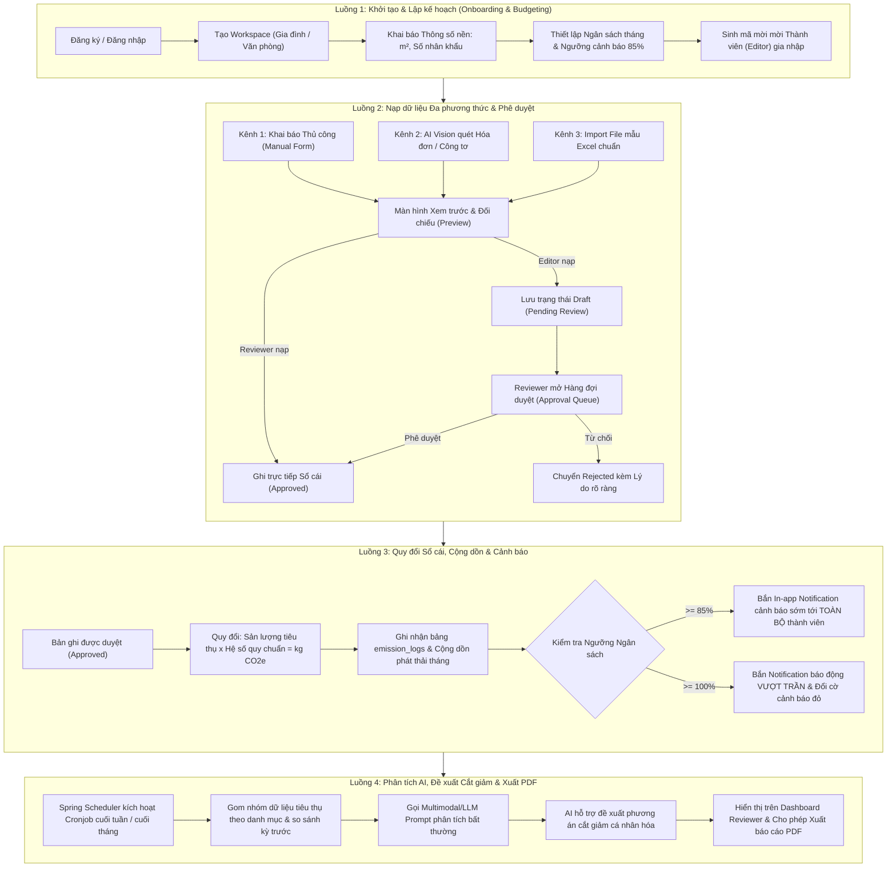
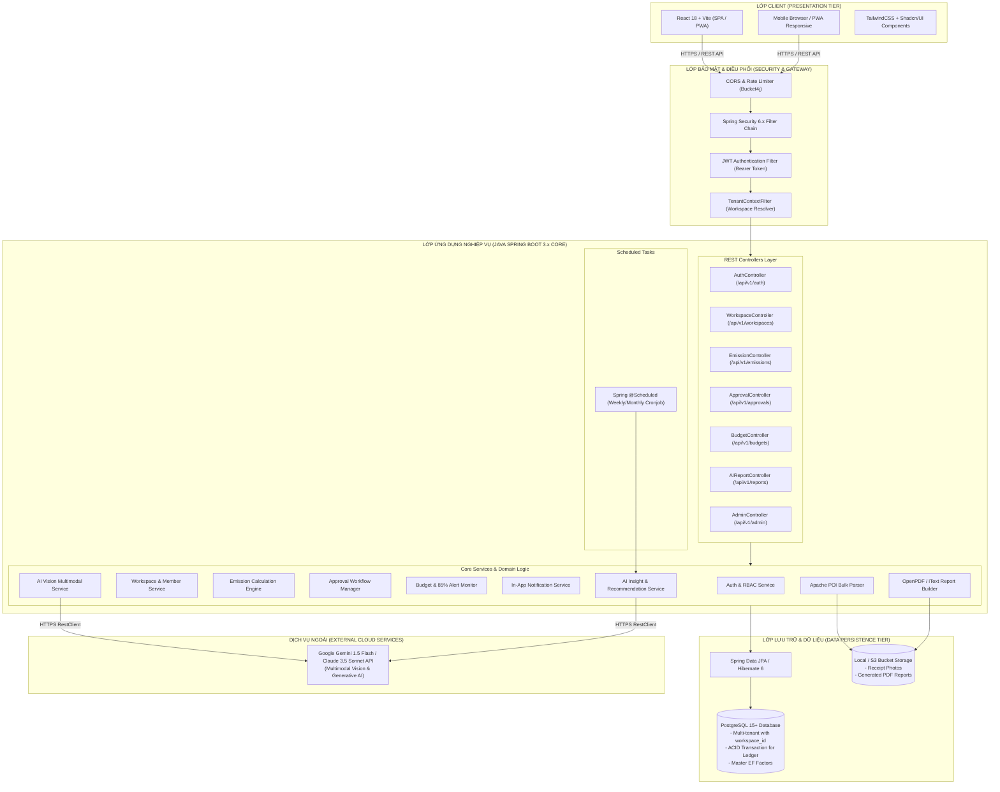
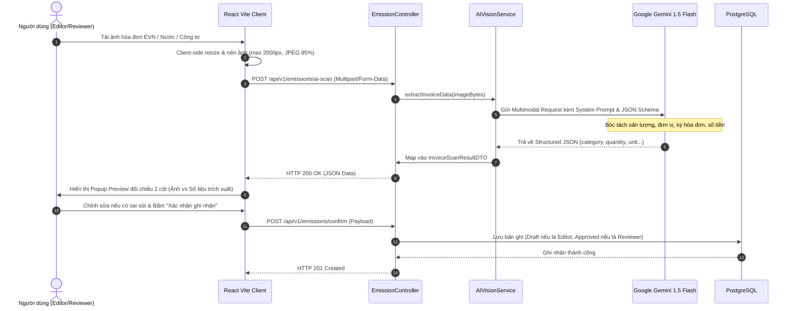
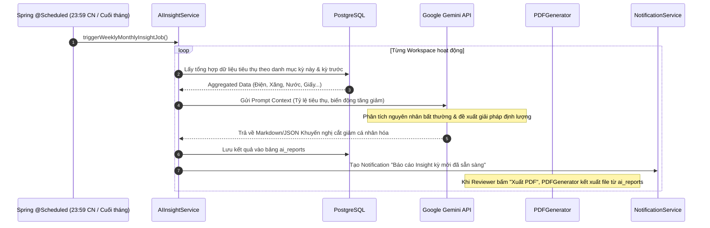
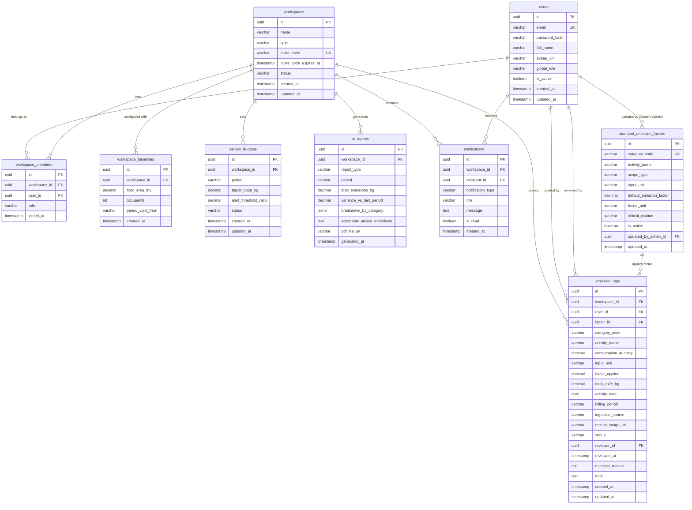

# TÀI LIỆU YÊU CẦU SẢN PHẨM (PRODUCT REQUIREMENTS DOCUMENT - PRD)

# Hệ thống Quản trị & Phân tích Dấu chân Carbon cho Gia đình/Văn phòng nhỏ
## (Personal & Micro-Office Carbon Ledger)

> **Mã tài liệu:** `PRD-POL-2026-V1.0`  
> **Phiên bản:** `1.0.0 (Proposed Draft)`  
> **Nhánh phát triển (Git Worktree):** [`docs/prd`](file:///home/datnguyen-nuoa/PMDC-BATCH4-DATNT250-prd)  
> **Thời gian triển khai:** 6 tuần (3 Sprints $\times$ 2 tuần) | Tổng Story Points: 44 SP  
> **Tài liệu căn cứ:** [spec.md](file:///home/datnguyen-nuoa/PMDC-BATCH4-DATNT250/spec.md), [docs/MVP.md](file:///home/datnguyen-nuoa/PMDC-BATCH4-DATNT250/docs/MVP.md), [docs/activity-supported.md](file:///home/datnguyen-nuoa/PMDC-BATCH4-DATNT250/docs/activity-supported.md), [docs/use-cases.md](file:///home/datnguyen-nuoa/PMDC-BATCH4-DATNT250/docs/usecase/use-cases.md), [docs/user-stories.md](file:///home/datnguyen-nuoa/PMDC-BATCH4-DATNT250/docs/user-stories.md), [docs/information-architecture.md](file:///home/datnguyen-nuoa/PMDC-BATCH4-DATNT250/docs/information-architecture/information-architecture.md)

---

> [!IMPORTANT]
> **THÔNG BÁO DÀNH CHO NGƯỜI DUYỆT (REVIEWER CALLOUT):**  
> Tài liệu PRD này tổng hợp và chuẩn hóa toàn bộ các đặc tả nghiệp vụ, use cases, user stories và tiêu chí nghiệm thu (AC) của hệ thống.  
> Căn cứ theo yêu cầu của bạn, hai phân phần trọng yếu:
> 1. **Mục 6: Thiết kế Kiến trúc Hệ thống Tổng thể (High-Level Architecture & Technical Design)**
> 2. **Mục 7: Thiết kế Cơ sở Dữ liệu Chi tiết (Database System Design & Data Model)**  
> 
> Đã được xây dựng chi tiết với các sơ đồ Mermaid, bảng trường dữ liệu, ràng buộc quan hệ, cơ chế phân lập Multi-tenant và danh sách các điểm quyết định kỹ thuật (Trade-offs / Decision Points) để **bạn xem xét, đánh giá và phê duyệt (review)** trước khi triển khai code.

---

## MỤC LỤC TỔNG QUAN

1. [Tổng quan Dự án & Bối cảnh Nghiệp vụ (Executive Summary)](#1-tổng-quan-dự-án--bối-cảnh-nghiệp-vụ)
2. [Phạm vi Dự án (Project Scope Boundaries)](#2-phạm-vi-dự-án-project-scope-boundaries)
3. [Mô hình Người dùng & Ma trận Phân quyền (Roles & RBAC Matrix)](#3-mô-hình-người-dùng--ma-trận-phân-quyền-roles--rbac-matrix)
4. [Các Luồng Hoạt động Cốt lõi & Quy trình Nghiệp vụ (Core Workflows)](#4-các-luồng-hoạt-động-cốt-lõi--quy-trình-nghiệp-vụ-core-workflows)
5. [Đặc tả Yêu cầu Tính năng Chi tiết (Functional Requirements)](#5-đặc-tả-yêu-cầu-tính-năng-chi-tiết-functional-requirements)
6. [🔥 [REVIEW REQUIRED] Thiết kế Kiến trúc Hệ thống Tổng thể (High-Level Architecture)](#6-review-required-thiết-kế-kiến-trúc-hệ-thống-tổng-thể-high-level-architecture)
7. [🔥 [REVIEW REQUIRED] Thiết kế Cơ sở Dữ liệu Chi tiết (Database System Design)](#7-review-required-thiết-kế-cơ-sở-dữ-liệu-chi-tiết-database-system-design)
8. [Yêu cầu Phi chức năng & Tiêu chuẩn Kỹ thuật (Non-Functional Requirements)](#8-yêu-cầu-phi-chức-năng--tiêu-chuẩn-kỹ-thuật-non-functional-requirements)
9. [Lộ trình Phát triển 3 Sprints (MVP Release Plan & Backlog Mapping)](#9-lộ-trình-phát-triển-3-sprints-mvp-release-plan--backlog-mapping)
10. [Quản trị Rủi ro & Chiến lược Giảm thiểu (Risk Management)](#10-quản-trị-rủi-ro--chiến-lược-giảm-thiểu-risk-management)
11. [Danh mục Điểm Thảo luận Cần Phê duyệt (Reviewer Action Items)](#11-danh-mục-điểm-thảo-luận-cần-phê-duyệt-reviewer-action-items)

---

## 1. TỔNG QUAN DỰ ÁN & BỐI CẢNH NGHIỆP VỤ

### 1.1. Bối cảnh & Nỗi đau Thị trường (Problem Statement)
Tại Việt Nam, cam kết phát thải ròng bằng 0 (Net Zero 2050) đang thúc đẩy nhận thức chuyển đổi xanh mạnh mẽ. Tuy nhiên, ở cấp độ vi mô (**Hộ gia đình** và **Văn phòng nhỏ/Startup 5–30 người**), việc theo dõi và giảm thiểu phát thải khí nhà kính (GHG) gặp phải các trở ngại lớn:
1. **Rào cản ghi chép thủ công:** Người dùng nhanh chóng nản lòng khi phải nhập từng số công tơ, hóa đơn tiền điện hay chuyến đi.
2. **Thiếu hệ số phát thải chuẩn hóa và minh bạch:** Không có cơ sở tính toán đáng tin cậy theo quy chuẩn Bộ TN&MT (nay là Bộ Nông nghiệp & Môi trường) hoặc GHG Protocol/DEFRA.
3. **Thiếu cơ chế kiểm duyệt sổ cái:** Trong tập thể hoặc gia đình, không có sự phân định giữa người nạp dữ liệu và người kiểm soát chi tiêu/ngân sách phát thải, dẫn đến dữ liệu rác, trùng lặp hoặc thiếu tin cậy.
4. **Thiếu cảnh báo chủ động và kế hoạch hành động cụ thể:** Đa phần ứng dụng chỉ dừng ở thống kê khô khan, không đưa ra được hành động cắt giảm khả thi và định lượng cụ thể.

### 1.2. Tầm nhìn Sản phẩm (Product Vision)
**Personal & Micro-Office Carbon Ledger** là nền tảng quản trị và sổ cái dấu chân carbon số hóa dành cho Hộ gia đình và Văn phòng nhỏ, giúp:
- **Tự động hóa nạp dữ liệu:** Bóc tách tức thì hóa đơn tiền điện EVN, hóa đơn nước và số đo công tơ qua **Multimodal AI Vision**.
- **Minh bạch hóa dòng dữ liệu:** Thiết lập cơ chế **Approval Queue** phân định giữa người nạp (Editor - Draft) và người duyệt (Reviewer - Approved).
- **Kiểm soát hạn ngạch phát thải:** Đặt Target ngân sách tháng, chuẩn hóa chỉ số theo quy mô ($\text{kg CO}_2\text{e}/\text{người}$, $\text{kg CO}_2\text{e}/m^2$) và tự động bắn cảnh báo sớm ở ngưỡng **85%** và **100%**.
- **Cố vấn hành động thông minh từ AI:** Định kỳ cuối tuần/tháng, AI phân tích dữ liệu, phát hiện bất thường và **hỗ trợ đề xuất phương án cắt giảm cá nhân hóa** (hệ thống cố vấn định lượng chứ không tự can thiệp cắt giảm phát thải vật lý), hỗ trợ kết xuất báo cáo PDF chuẩn in ấn.

### 1.3. Mục tiêu Đo lường Thành công (Key Success Metrics)
| Chỉ số (KPI) | Mục tiêu MVP (6 tuần) | Phương pháp đo lường |
|---|---|---|
| **Thời gian nạp dữ liệu** | Giảm $\ge 70\%$ thời gian so với nhập tay | Đo lường thời gian từ lúc mở camera/tải ảnh hóa đơn đến khi bấm xác nhận |
| **Độ chính xác quy đổi phát thải** | $100\%$ tuân thủ hệ số quy chuẩn | Đối chiếu kết quả nhân: $\text{Activity Data} \times \text{Emission Factor}$ |
| **Tỷ lệ phê duyệt request** | $100\%$ giao dịch của Editor được duyệt/từ chối rõ ràng | Báo cáo trạng thái trong `emission_logs` |
| **Độ tin cậy của cảnh báo** | $100\%$ cảnh báo $\ge 85\%$ được gửi tức thì | Kiểm tra trigger notification khi tổng phát thải vượt ngưỡng |
| **Độ ổn định hệ thống** | Tỷ lệ thành công API $\ge 99.5\%$, P95 response $< 500\text{ms}$ | Backend APM logs & Spring Boot Actuator |

---

## 2. PHẠM VI DỰ ÁN (PROJECT SCOPE BOUNDARIES)

```mermaid
flowchart TD
    subgraph IN_SCOPE["PHẠM VI THỰC HIỆN (IN-SCOPE - 6 TUẦN MVP)"]
        direction TB
        IN1["Mô hình Multi-tenant Workspace: Hộ gia đình & Văn phòng nhỏ"]
        IN2["Phân quyền 3 vai trò: System Admin, Reviewer, Editor"]
        IN3["8 Nhóm hoạt động chuẩn Scope 1, 2, 3 (Điện, Gas, Xăng xe, Rác, Nước, Giấy, Máy bay)"]
        IN4["3 Phương thức nạp dữ liệu: Thủ công, AI Vision OCR Hóa đơn/Công tơ, Excel Template"]
        IN5["Quy trình kiểm duyệt Sổ cái: Draft -> Pending Review -> Accept/Reject"]
        IN6["Ngân sách tháng, Chuẩn hóa kg CO2e/người & kg CO2e/m², Cảnh báo 85% & 100%"]
        IN7["Cronjob AI Insight định kỳ đề xuất phương án cắt giảm cá nhân hóa & Xuất file PDF"]
    end

    subgraph OUT_SCOPE["NGOÀI PHẠM VI (OUT-OF-SCOPE)"]
        direction TB
        OUT1["Không tích hợp thiết bị phần cứng IoT hoặc Smart Meter đo dòng trực tiếp"]
        OUT2["Không tính toán phát thải Scope 3 chuỗi cung ứng mở rộng doanh nghiệp phức tạp"]
        OUT3["Không tích hợp cổng thanh toán giao dịch tiền tệ hay mua bán sàn tín chỉ Carbon"]
        OUT4["Không tự động cào dữ liệu (web scraping) các trang web điện lực bên ngoài"]
        OUT5["Không xây dựng ứng dụng di động Native (sử dụng Web Mobile-First PWA)"]
    end
```



---

## 3. MÔ HÌNH NGƯỜI DÙNG & MA TRẬN PHÂN QUYỀN (ROLES & RBAC MATRIX)

### 3.1. Danh mục 3 Vai trò (Personas)
1. **Trưởng nhóm Gia đình / Văn phòng (Reviewer / Workspace Admin):**
   - Người chịu trách nhiệm quản lý Workspace, cấu hình diện tích mặt sàn ($m^2$), số người và cài đặt ngân sách trần phát thải tháng.
   - Có toàn quyền kiểm duyệt (Accept / Reject kèm lý do) các request ghi nhận do Thành viên gửi lên.
   - Khi tự mình nạp dữ liệu, bản ghi được tự động phê duyệt (`Approved`) ghi thẳng vào sổ cái.
   - Tiếp nhận báo cáo phân tích AI định kỳ và xuất file PDF Kế hoạch cắt giảm.
2. **Thành viên Gia đình / Văn phòng (Editor / Workspace Member):**
   - Thành viên tham gia vào Workspace thông qua mã mời (Invite Code).
   - Nạp các hoạt động phát thải cá nhân qua 3 phương thức: Thủ công, AI Vision hoặc File mẫu Excel.
   - Mọi bản ghi do Editor tạo mặc định ở trạng thái **`Draft / Chờ duyệt (Pending Review)`**.
   - Xem Dashboard chung, nhận Notification cảnh báo ngưỡng 85% và theo dõi lịch sử trạng thái các request do mình tạo.
3. **Quản trị viên Hệ thống (System Admin):**
   - Quản trị danh mục và giá trị các **Hệ số phát thải chuẩn (Standard Emission Factors)** theo quy định Nhà nước (Bộ TN&MT, EVN, DEFRA, IPCC).
   - Có toàn quyền khởi tạo, phân bổ và quản trị danh mục các Workspace (Multi-tenant) phục vụ cấu hình ban đầu và hỗ trợ kỹ thuật.
   - Giám sát nhật ký kiểm toán (Audit Logs) và tình trạng tích hợp AI API.

### 3.2. Ma trận Phân quyền Chức năng Chi tiết (Detailed RBAC Matrix)

| Nhóm chức năng | Quyền hạn / Thao tác | System Admin | Trưởng nhóm (Reviewer) | Thành viên (Editor) |
|---|---|:---:|:---:|:---:|
| **Quản lý Workspace** | Khởi tạo Workspace mới | ✅ | ✅ | ❌ |
| | Cấu hình thông số nền ($m^2$, số người) | ❌ | ✅ | ❌ |
| | Sinh mã mời & Quản lý danh sách thành viên | ❌ | ✅ | ❌ |
| | Tham gia Workspace bằng mã mời | ❌ | ❌ | ✅ |
| **Nạp dữ liệu Sổ cái** | Khai báo thủ công (Manual Entry) | ❌ | ✅ (Ghi sổ trực tiếp) | ✅ (Trạng thái Draft) |
| | Quét hóa đơn/công tơ bằng AI Vision | ❌ | ✅ (Ghi sổ trực tiếp) | ✅ (Trạng thái Draft) |
| | Nạp dữ liệu qua File mẫu Excel | ❌ | ✅ (Ghi sổ trực tiếp) | ✅ (Trạng thái Draft) |
| **Kiểm duyệt Sổ cái** | Xem hàng đợi duyệt (Approval Queue) | ❌ | ✅ | ❌ |
| | Phê duyệt (Accept) hoặc Từ chối (Reject) | ❌ | ✅ | ❌ |
| | Tra cứu Lịch sử Sổ cái & Xuất file Excel | ❌ | ✅ (Toàn bộ) | ✅ (Toàn bộ & Lọc của tôi) |
| **Ngân sách & Giám sát**| Thiết lập Target hạn ngạch tháng & mốc 85% | ❌ | ✅ | ❌ |
| | Xem Dashboard & Chỉ số $\text{CO}_2\text{e}/\text{người}$, $/m^2$ | ❌ | ✅ | ✅ |
| | Nhận In-App Notification cảnh báo 85% & 100% | ❌ | ✅ | ✅ |
| **AI Insight & Báo cáo**| Kích hoạt/Tiếp nhận AI Insight từ Cronjob | ❌ | ✅ | ❌ |
| | Xuất Báo cáo Kế hoạch cắt giảm ra file PDF | ❌ | ✅ | ❌ |
| **Quản trị Hệ thống** | CRUD Danh mục Hệ số chuẩn Master Data | ✅ | ❌ | ❌ |
| | Quản lý danh mục toàn bộ Workspace (Tenants) | ✅ | ❌ | ❌ |
| | Xem Audit Logs & Cấu hình AI Engine | ✅ | ❌ | ❌ |

---

## 4. CÁC LUỒNG HOẠT ĐỘNG CỐT LÕI & QUY TRÌNH NGHIỆP VỤ (CORE WORKFLOWS)



---

## 5. ĐẶC TẢ YÊU CẦU TÍNH NĂNG CHI TIẾT (FUNCTIONAL REQUIREMENTS)

### 5.1. Phân hệ 1: Quản trị Workspace & Thông số nền (Onboarding)
- **Mã User Stories:** [`US-WS-001`](file:///home/datnguyen-nuoa/PMDC-BATCH4-DATNT250/docs/user-stories.md#US-WS-001), [`US-WS-002`](file:///home/datnguyen-nuoa/PMDC-BATCH4-DATNT250/docs/user-stories.md#US-WS-002), [`US-WS-003`](file:///home/datnguyen-nuoa/PMDC-BATCH4-DATNT250/docs/user-stories.md#US-WS-003) | **Use Cases:** `UC01`, `UC02`, `UC03`
- **Chức năng nghiệp vụ:**
  - Khởi tạo Workspace mới với tên đại diện (3–50 ký tự), loại hình (`HOME`: Hộ gia đình hoặc `OFFICE`: Văn phòng nhỏ).
  - Khai báo thông số nền mặt sàn ($m^2 > 0$) và số lượng nhân khẩu/nhân viên ($\text{occupants} \ge 1$).
  - Tự động tính toán các chỉ số cường độ phát thải chuẩn hóa:
    $$\text{Chỉ số theo nhân khẩu} = \frac{\text{Tổng kg CO}_2\text{e}}{\text{Số người}} \quad (\text{kg CO}_2\text{e}/\text{người})$$
    $$\text{Chỉ số theo diện tích} = \frac{\text{Tổng kg CO}_2\text{e}}{\text{Diện tích mặt sàn}} \quad (\text{kg CO}_2\text{e}/m^2)$$
  - Cơ chế sinh mã mời ngẫu nhiên 6 ký tự viết hoa/số (`alphanumeric`), có thời hạn hiệu lực (mặc định 7 ngày), cho phép Reviewer thu hồi hoặc tạo lại mã mới.
  - Cho phép Quản trị viên Hệ thống (`System Admin`) khởi tạo và quản lý toàn bộ các Workspace trên hệ thống qua giao diện riêng.

### 5.2. Phân hệ 2: Danh mục Hoạt động Phát thải & Hệ số Quy chuẩn (Master Data)
- **Mã User Stories:** [`US-SA-001`](file:///home/datnguyen-nuoa/PMDC-BATCH4-DATNT250/docs/user-stories.md#US-SA-001), [`US-CL-002`](file:///home/datnguyen-nuoa/PMDC-BATCH4-DATNT250/docs/user-stories.md#US-CL-002) | **Use Cases:** `UC12`
- **Quy chuẩn hỗ trợ 8 hoạt động cốt lõi:**

| Mã danh mục | Tên hoạt động | Đơn vị tính | Scope | Hệ số mặc định (Default EF) | Nguồn trích dẫn quy chuẩn |
|---|---|:---:|:---:|---|---|
| `ELEC_GRID` | Điện lưới sinh hoạt/văn phòng | **kWh** | Scope 2 | **`0.6187`** $\text{kg CO}_2\text{e}/\text{kWh}$ | **Công văn 1232/BNNMT-BĐKH (BCT)**, EPA, IEA |
| `FUEL_LPG` | Đốt gas LPG nấu ăn | **kg** | Scope 1 | **`2.9394`** $\text{kg CO}_2\text{e}/\text{kg}$ *(2939.36 kg/tấn)* | **UK DEFRA 2026** / **IPCC Guidelines** |
| `FUEL_DIESEL` | Dầu Diesel máy phát điện | **Lít** | Scope 1 | **`2.6870`** $\text{kg CO}_2\text{e}/\text{Lít}$ | **IPCC Guidelines** / **UK DEFRA** |
| `MOBILITY` | Di chuyển xe máy / Ô tô | **km** | Scope 1 & 3 | Theo kích cỡ động cơ / loại nhiên liệu | **UK DEFRA 2026** *(Mục 4.4 activity-supported)* |
| `WASTE_LANDFILL` | Rác thải sinh hoạt chôn lấp | **kg** | Scope 3 | **`0.004465`** $\text{kg CO}_2\text{e}/\text{kg}$ | **UK DEFRA 2026** / **US EPA WARM** |
| `WATER_SUPPLY_TREAT`| Cung cấp & xử lý nước sạch | **$m^3$** | Scope 3 | **`0.19130`** $\text{kg CO}_2\text{e}/m^3$ | **UK DEFRA 2026** / **US EPA** |
| `OFFICE_PAPER` | Giấy in văn phòng | **kg** | Scope 3 | **`1.2500`** $\text{kg CO}_2\text{e}/\text{kg}$ | **UK DEFRA** / **US EPA** |
| `TRAVEL_FLIGHT` | Du lịch & Đi lại bằng máy bay | **p.km** | Scope 3 | Economy: **`0.10916`**, Business: **`0.31656`** | **UK DEFRA 2026** / **ICAO Flight Method** |

### 5.3. Phân hệ 3: Đa kênh Nạp dữ liệu Sổ cái (Data Ingestion)
- **Mã User Stories:** [`US-CL-001`](file:///home/datnguyen-nuoa/PMDC-BATCH4-DATNT250/docs/user-stories.md#US-CL-001), [`US-CL-003`](file:///home/datnguyen-nuoa/PMDC-BATCH4-DATNT250/docs/user-stories.md#US-CL-003), [`US-CL-004`](file:///home/datnguyen-nuoa/PMDC-BATCH4-DATNT250/docs/user-stories.md#US-CL-004) | **Use Cases:** `UC04`, `UC05`, `UC06`
- **Kênh 1 - Nhập thủ công (Manual Entry):** Form nạp nhanh các hoạt động lẻ (quãng đường đi xe máy, đổ dầu máy phát, thay bình gas 12kg). Tự động tính nháp kg CO2e ngay trên giao diện trước khi submit.
- **Kênh 2 - AI Vision Quét hóa đơn & Công tơ (AI Vision OCR):**
  - Người dùng tải ảnh chụp hóa đơn tiền điện EVN, hóa đơn nước, vé máy bay hoặc công tơ thực tế (hỗ trợ JPG, PNG, HEIC tối đa 10MB).
  - Backend tích hợp Google Gemini 1.5 Flash / Claude 3.5 Sonnet với Structured Prompt & JSON Schema bắt buộc bóc tách:
    ```json
    {
      "activity_category": "ELEC_GRID",
      "consumption_quantity": 245.5,
      "unit": "kWh",
      "billing_period": "2026-10",
      "invoice_amount_vnd": 612000,
      "confidence_score": 0.96
    }
    ```
  - Modal Preview hiển thị đối chiếu 2 cột: Ảnh chụp bên trái và các trường dữ liệu AI trích xuất bên phải cho phép người dùng kiểm tra, chỉnh sửa sai sót trước khi xác nhận lưu.
- **Kênh 3 - Nhập file mẫu Excel hàng loạt (Excel Template Import):**
  - Hệ thống cung cấp template `.xlsx` chuẩn (chứa danh mục thả xuống Data Validation tránh sai chính tả).
  - Backend sử dụng Apache POI đọc và validate dữ liệu từng dòng (kiểm tra kiểu số, ngày tháng hợp lệ, danh mục tồn tại).
  - Bảng Preview hiển thị danh sách dòng hợp lệ (màu xanh) và dòng lỗi (đánh dấu đỏ kèm mô tả nguyên nhân). Cho phép người dùng bỏ qua dòng lỗi hoặc tải lại file chuẩn.

### 5.4. Phân hệ 4: Hàng đợi Kiểm duyệt Sổ cái (Approval Queue)
- **Mã User Stories:** [`US-CL-005`](file:///home/datnguyen-nuoa/PMDC-BATCH4-DATNT250/docs/user-stories.md#US-CL-005), [`US-CL-006`](file:///home/datnguyen-nuoa/PMDC-BATCH4-DATNT250/docs/user-stories.md#US-CL-006) | **Use Cases:** `UC07`, `UC08`
- **Cơ chế phân luồng trạng thái:**
  - `DRAFT / PENDING_REVIEW`: Tạo bởi Thành viên (Editor). Bản ghi **chưa được tính** vào tổng phát thải Workspace và chưa làm giảm ngân sách tháng.
  - `APPROVED`: Tạo trực tiếp bởi Reviewer hoặc được Reviewer phê duyệt từ hàng đợi. Chính thức ghi nhận vào sổ cái và kích hoạt kiểm tra ngân sách.
  - `REJECTED`: Bị Reviewer từ chối (bắt buộc nhập lý do từ chối tối thiểu 5 ký tự). Thành viên nhận được thông báo để chỉnh sửa hoặc tạo lại.
- **Tính năng Hàng đợi duyệt:** Reviewer có thể lọc theo người gửi, lọc theo loại hoạt động, xem ảnh đính kèm (hóa đơn), duyệt đơn lẻ hoặc duyệt hàng loạt (Bulk Accept).

### 5.5. Phân hệ 5: Quản trị Ngân sách, Dashboard & Hệ thống Cảnh báo
- **Mã User Stories:** [`US-BG-001`](file:///home/datnguyen-nuoa/PMDC-BATCH4-DATNT250/docs/user-stories.md#US-BG-001), [`US-BG-002`](file:///home/datnguyen-nuoa/PMDC-BATCH4-DATNT250/docs/user-stories.md#US-BG-002), [`US-BG-003`](file:///home/datnguyen-nuoa/PMDC-BATCH4-DATNT250/docs/user-stories.md#US-BG-003) | **Use Cases:** `UC09`, `UC10`
- **Thiết lập Target:** Reviewer đặt hạn ngạch phát thải tối đa cho tháng (ví dụ: $350\text{ kg CO}_2\text{e}$).
- **Dashboard Trung tâm:**
  - 4 Thẻ KPI: Tổng phát thải tháng hiện tại, % Đã tiêu thụ so với ngân sách, Chỉ số $\text{CO}_2\text{e}/\text{người}$, Chỉ số $\text{CO}_2\text{e}/m^2$.
  - Biểu đồ Donut phân bổ phát thải theo nhóm hoạt động (Điện chiếm bao nhiêu %, Xăng chiếm bao nhiêu %).
  - Biểu đồ đường (Line Chart) xu hướng phát thải qua các ngày trong tháng.
  - Thanh tiến độ động (Budget Progress Bar) đổi màu trực quan: Xanh lá ($< 70\%$), Vàng cam ($70\% - 84\%$), Cam đậm ($\ge 85\%$), Đỏ ($\ge 100\%$).
- **Cơ chế Cảnh báo tức thì (In-App Notification):**
  - Khi một bản ghi được Approved đẩy tổng phát thải vượt ngưỡng $\ge 85\%$, hệ thống tự động sinh thông báo cảnh báo sớm màu cam tới **toàn bộ thành viên** trong Workspace.
  - Khi vượt trần $\ge 100\%$, hệ thống sinh thông báo báo động màu đỏ và treo Banner cảnh báo nổi bật trên Dashboard.

### 5.6. Phân hệ 6: AI Insight, Đề xuất Phương án Cắt giảm Cá nhân hóa & Báo cáo PDF
- **Mã User Stories:** [`US-AI-001`](file:///home/datnguyen-nuoa/PMDC-BATCH4-DATNT250/docs/user-stories.md#US-AI-001), [`US-AI-002`](file:///home/datnguyen-nuoa/PMDC-BATCH4-DATNT250/docs/user-stories.md#US-AI-002) | **Use Cases:** `UC11`
- **Tác vụ nền tự động (Background Cronjob):**
  - Chạy vào 23:59 ngày Chủ nhật hàng tuần và ngày cuối cùng mỗi tháng thông qua Spring Boot `@Scheduled`.
  - Gom nhóm dữ liệu, tính tỷ lệ tăng giảm so với kỳ trước (Period-over-Period).
- **Cơ chế AI Reasoning:**
  - Truyền ngữ cảnh dữ liệu vào LLM để nhận diện nhóm hoạt động có mức phát thải bất thường.
  - AI sinh **Đề xuất phương án cắt giảm cá nhân hóa** mang tính định lượng khả thi cao (ví dụ: *"Hoạt động sử dụng xe máy cá nhân tháng này tăng 45% (chiếm 120 kg CO2e). Nếu chuyển 2 nhân sự sang đi xe buýt điện VinBus hoặc metro 3 ngày/tuần, văn phòng có thể giảm thiểu dự kiến 28.5 kg CO2e vào tháng tới"*).
  > [!NOTE]
  > Hệ thống đóng vai trò số hóa, phân tích và đưa ra khuyến nghị thông minh hỗ trợ người dùng ra quyết định; AI đề xuất phương án tối ưu chứ **không trực tiếp can thiệp vật lý cắt giảm emission**.
- **Xuất Báo cáo PDF (Reduction Plan PDF Export):**
  - Backend sử dụng OpenPDF / iText tạo file PDF đồ họa vector chuyên nghiệp gồm: Tiêu đề báo cáo, thông tin Workspace, biểu đồ cấu cấu phát thải, bảng kê chi tiết và danh mục các giải pháp AI khuyến nghị.

---

## 6. [REVIEW REQUIRED] THIẾT KẾ KIẾN TRÚC HỆ THỐNG TỔNG THỂ (HIGH-LEVEL ARCHITECTURE)

> [!IMPORTANT]
> **PHẦN NÀY ĐƯỢC ĐẶT Ở TRẠNG THÁI CHỜ PHÊ DUYỆT (PENDING REVIEW).**  
> Dưới đây là kiến trúc hệ thống đề xuất nhằm đáp ứng tiêu chí hiệu năng, bảo mật, khả năng mở rộng và hoàn thành trong khung thời gian 6 tuần của dự án MVP.

### 6.1. Sơ đồ Kiến trúc Tổng thể (High-Level Topology Diagram)



### 6.2. Mô hình Đa người thuê (Multi-tenancy Architecture Design)
- **Phương án lựa chọn:** **Shared Database, Shared Schema with Discriminator Column (`workspace_id`)**.
- **Lý do lựa chọn:**
  - Tối ưu hóa tuyệt đối tài nguyên hệ thống, phù hợp hoàn hảo với quy mô Hộ gia đình và Doanh nghiệp vi mô (hàng nghìn workspace vẫn hoạt động mượt mà trên 1 cụm PostgreSQL dung lượng vừa phải).
  - Khởi tạo tenant mới tức thì trong $< 500\text{ms}$ (chỉ cần insert 1 dòng vào bảng `workspaces`), không cần chạy DDL Migration tốn kém thời gian như phương án Schema-per-tenant.
  - Phù hợp với khung thời gian triển khai 6 tuần mà vẫn đảm bảo tính an toàn dữ liệu.
- **Cơ chế Cách ly & Bảo mật Tenant (Data Isolation Mechanism):**
  1. `TenantContext`: Khi request đến, `TenantContextFilter` đọc Header `X-Workspace-Id`, kiểm tra người dùng hiện tại có thuộc `workspace_members` của Workspace này hay không.
  2. `ThreadLocal`: Lưu `currentWorkspaceId` vào `TenantContextHolder`.
  3. `JPA Specification / Hibernate Filter`: Mọi truy vấn đọc/ghi dữ liệu vào bảng `emission_logs`, `carbon_budgets`, `ai_reports` tự động kèm điều kiện `WHERE workspace_id = :currentWorkspaceId`.

### 6.3. Luồng Xử lý AI Vision & Bóc tách Hóa đơn (AI Vision Pipeline)



### 6.4. Luồng Chạy Cronjob AI Insight & Xuất Báo cáo PDF



### 6.5. Các Điểm Cần Reviewer Đánh giá về Kiến trúc (Architecture Review Points)
1. **Mô hình Multi-tenant Discriminator Column:** Bạn có đồng ý với giải pháp dùng `workspace_id` kết hợp Spring Security Filter & Hibernate Filter để cách ly dữ liệu, thay vì tạo Schema riêng cho từng gia đình?
2. **Xử lý AI Vision đồng bộ (Synchronous Preview):** Hiện tại hệ thống để luồng quét ảnh AI chạy đồng bộ qua REST API (Gemini 1.5 Flash phản hồi trong 2–3 giây). Điều này giúp người dùng có ngay popup preview đối chiếu. Bạn có muốn đổi sang cơ chế bất đồng bộ (Queue/Polling) không? (Khuyến nghị giữ Synchronous vì Gemini 1.5 Flash rất nhanh và trải nghiệm UX liền mạch).
3. **Lưu trữ tệp tin:** Giai đoạn MVP 6 tuần sẽ lưu ảnh hóa đơn và file PDF tạm thời trên Local File System có gắn Volume Docker (hoặc MinIO/AWS S3 thông qua interface `StorageService`). Bạn có yêu cầu bắt buộc cấu hình S3 ngay từ Sprint 1 không?

---

## 7. [REVIEW REQUIRED] THIẾT KẾ CƠ SỞ DỮ LIỆU CHI TIẾT (DATABASE SYSTEM DESIGN)

> [!IMPORTANT]
> **PHẦN NÀY ĐƯỢC ĐẶT Ở TRẠNG THÁI CHỜ PHÊ DUYỆT (PENDING REVIEW).**  
> Dưới đây là lược đồ cơ sở dữ liệu quan hệ (PostgreSQL) được thiết kế chuẩn hóa bậc 3 (3NF), tối ưu cho tính toàn vẹn giao dịch ACID của sổ cái carbon, hỗ trợ đầy đủ 4 luồng hoạt động cốt lõi và 8 nhóm hoạt động phát thải.

### 7.1. Sơ đồ Thực thể Quan hệ (Entity Relationship Diagram - ERD)



### 7.2. Đặc tả Chi tiết Các Bảng Dữ liệu (Table Specifications)

#### 1. Bảng `users` (Tài khoản người dùng toàn hệ thống)
Quản lý thông tin định danh và tài khoản đăng nhập.
- `id`: `UUID PRIMARY KEY DEFAULT gen_random_uuid()`
- `email`: `VARCHAR(255) NOT NULL UNIQUE` (được đánh index B-Tree để tìm kiếm tức thời)
- `password_hash`: `VARCHAR(255) NULL` (mã hóa chuẩn BCrypt/Argon2; cho phép null nếu đăng nhập hoàn toàn qua Google OAuth)
- `full_name`: `VARCHAR(100) NOT NULL`
- `avatar_url`: `VARCHAR(500) NULL`
- `global_role`: `VARCHAR(20) NOT NULL DEFAULT 'USER'` (`SYSTEM_ADMIN`, `USER`)
- `is_active`: `BOOLEAN NOT NULL DEFAULT true`
- `created_at`: `TIMESTAMPTZ NOT NULL DEFAULT CURRENT_TIMESTAMP`
- `updated_at`: `TIMESTAMPTZ NOT NULL DEFAULT CURRENT_TIMESTAMP`

#### 2. Bảng `workspaces` (Không gian làm việc / Tenants)
Lưu trữ định danh không gian làm việc của Hộ gia đình hoặc Văn phòng nhỏ.
- `id`: `UUID PRIMARY KEY DEFAULT gen_random_uuid()`
- `name`: `VARCHAR(100) NOT NULL` (Tên đại diện, ví dụ "Gia đình An", "Văn phòng TechHub")
- `type`: `VARCHAR(20) NOT NULL` (`HOME`, `OFFICE`)
- `invite_code`: `VARCHAR(10) NULL UNIQUE` (Mã mời 6 ký tự ngẫu nhiên)
- `invite_code_expires_at`: `TIMESTAMPTZ NULL`
- `status`: `VARCHAR(20) NOT NULL DEFAULT 'ACTIVE'` (`ACTIVE`, `ARCHIVED`)
- `created_at`: `TIMESTAMPTZ NOT NULL DEFAULT CURRENT_TIMESTAMP`
- `updated_at`: `TIMESTAMPTZ NOT NULL DEFAULT CURRENT_TIMESTAMP`

#### 3. Bảng `workspace_members` (Thành viên tham gia Workspace & Vai trò)
Xác lập quan hệ người dùng thuộc Workspace và phân định vai trò `Reviewer` hay `Editor`.
- `id`: `UUID PRIMARY KEY DEFAULT gen_random_uuid()`
- `workspace_id`: `UUID NOT NULL REFERENCES workspaces(id) ON DELETE CASCADE`
- `user_id`: `UUID NOT NULL REFERENCES users(id) ON DELETE CASCADE`
- `role`: `VARCHAR(20) NOT NULL` (`REVIEWER`, `EDITOR`)
- `joined_at`: `TIMESTAMPTZ NOT NULL DEFAULT CURRENT_TIMESTAMP`
- **Ràng buộc:** `UNIQUE (workspace_id, user_id)`

#### 4. Bảng `workspace_baselines` (Thông số nền diện tích & nhân khẩu)
Lưu thông số phục vụ công thức chuẩn hóa $\text{CO}_2\text{e}/\text{người}$ và $\text{CO}_2\text{e}/m^2$.
- `id`: `UUID PRIMARY KEY DEFAULT gen_random_uuid()`
- `workspace_id`: `UUID NOT NULL REFERENCES workspaces(id) ON DELETE CASCADE`
- `floor_area_m2`: `NUMERIC(10, 2) NOT NULL CHECK (floor_area_m2 > 0)`
- `occupants`: `INT NOT NULL CHECK (occupants >= 1)`
- `period_valid_from`: `VARCHAR(7) NOT NULL` (Định dạng `YYYY-MM`)
- `created_at`: `TIMESTAMPTZ NOT NULL DEFAULT CURRENT_TIMESTAMP`

#### 5. Bảng `standard_emission_factors` (Master Data Hệ số Quy chuẩn Quốc gia)
Chỉ có `SYSTEM_ADMIN` được phép cập nhật.
- `id`: `UUID PRIMARY KEY DEFAULT gen_random_uuid()`
- `category_code`: `VARCHAR(50) NOT NULL UNIQUE` (`ELEC_GRID`, `FUEL_LPG`, `FUEL_DIESEL`, `MOBILITY`, `WASTE_LANDFILL`, `WATER_SUPPLY_TREAT`, `OFFICE_PAPER`, `TRAVEL_FLIGHT`)
- `activity_name`: `VARCHAR(100) NOT NULL`
- `scope_type`: `VARCHAR(10) NOT NULL` (`SCOPE_1`, `SCOPE_2`, `SCOPE_3`)
- `input_unit`: `VARCHAR(20) NOT NULL` (`kWh`, `kg`, `Lít`, `km`, `m3`, `p.km`)
- `default_emission_factor`: `NUMERIC(12, 6) NOT NULL CHECK (default_emission_factor >= 0)`
- `factor_unit`: `VARCHAR(50) NOT NULL DEFAULT 'kg CO2e/unit'`
- `official_citation`: `TEXT NOT NULL` (Ví dụ: "Công văn 1232/BNNMT-BĐKH", "UK DEFRA 2026")
- `is_active`: `BOOLEAN NOT NULL DEFAULT true`
- `updated_by_admin_id`: `UUID NULL REFERENCES users(id)`
- `updated_at`: `TIMESTAMPTZ NOT NULL DEFAULT CURRENT_TIMESTAMP`

#### 6. Bảng `carbon_budgets` (Hạn ngạch Ngân sách Phát thải Tháng)
- `id`: `UUID PRIMARY KEY DEFAULT gen_random_uuid()`
- `workspace_id`: `UUID NOT NULL REFERENCES workspaces(id) ON DELETE CASCADE`
- `period`: `VARCHAR(7) NOT NULL` (Định dạng `YYYY-MM`, ví dụ: `2026-10`)
- `target_co2e_kg`: `NUMERIC(12, 2) NOT NULL CHECK (target_co2e_kg > 0)`
- `alert_threshold_ratio`: `NUMERIC(3, 2) NOT NULL DEFAULT 0.85` (Ngưỡng cảnh báo sớm 85%)
- `status`: `VARCHAR(20) NOT NULL DEFAULT 'ACTIVE'`
- `created_at`: `TIMESTAMPTZ NOT NULL DEFAULT CURRENT_TIMESTAMP`
- `updated_at`: `TIMESTAMPTZ NOT NULL DEFAULT CURRENT_TIMESTAMP`
- **Ràng buộc:** `UNIQUE (workspace_id, period)`

#### 7. Bảng `emission_logs` (Sổ cái Ghi nhận Phát thải & Trạng thái Phê duyệt)
Bảng cốt lõi của toàn bộ ứng dụng, lưu trữ chi tiết từng giao dịch tiêu thụ năng lượng.
- `id`: `UUID PRIMARY KEY DEFAULT gen_random_uuid()`
- `workspace_id`: `UUID NOT NULL REFERENCES workspaces(id) ON DELETE CASCADE`
- `user_id`: `UUID NOT NULL REFERENCES users(id)` (Người tạo bản ghi)
- `factor_id`: `UUID NOT NULL REFERENCES standard_emission_factors(id)`
- `category_code`: `VARCHAR(50) NOT NULL`
- `activity_name`: `VARCHAR(100) NOT NULL`
- `consumption_quantity`: `NUMERIC(12, 3) NOT NULL CHECK (consumption_quantity >= 0)`
- `input_unit`: `VARCHAR(20) NOT NULL`
- `factor_applied`: `NUMERIC(12, 6) NOT NULL` (Lưu cứng hệ số tại thời điểm ghi nhận để đảm bảo tính bất biến của sổ cái kế toán carbon)
- `total_co2e_kg`: `NUMERIC(12, 4) NOT NULL` ($\text{consumption\_quantity} \times \text{factor\_applied}$)
- `activity_date`: `DATE NOT NULL`
- `billing_period`: `VARCHAR(7) NOT NULL` (Định dạng `YYYY-MM` để nhóm vào ngân sách)
- `ingestion_source`: `VARCHAR(20) NOT NULL` (`MANUAL`, `AI_VISION`, `EXCEL_IMPORT`)
- `receipt_image_url`: `VARCHAR(500) NULL` (URL ảnh hóa đơn/công tơ nếu có)
- `status`: `VARCHAR(20) NOT NULL DEFAULT 'PENDING_REVIEW'` (`DRAFT`, `PENDING_REVIEW`, `APPROVED`, `REJECTED`)
- `reviewer_id`: `UUID NULL REFERENCES users(id)` (Người duyệt)
- `reviewed_at`: `TIMESTAMPTZ NULL`
- `rejection_reason`: `TEXT NULL`
- `note`: `TEXT NULL`
- `created_at`: `TIMESTAMPTZ NOT NULL DEFAULT CURRENT_TIMESTAMP`
- `updated_at`: `TIMESTAMPTZ NOT NULL DEFAULT CURRENT_TIMESTAMP`

#### 8. Bảng `notifications` (Thông báo In-app Cảnh báo & Trạng thái)
- `id`: `UUID PRIMARY KEY DEFAULT gen_random_uuid()`
- `workspace_id`: `UUID NOT NULL REFERENCES workspaces(id) ON DELETE CASCADE`
- `recipient_id`: `UUID NOT NULL REFERENCES users(id) ON DELETE CASCADE`
- `notification_type`: `VARCHAR(30) NOT NULL` (`THRESHOLD_85_WARNING`, `THRESHOLD_100_EXCEEDED`, `REQUEST_SUBMITTED`, `REQUEST_APPROVED`, `REQUEST_REJECTED`, `AI_REPORT_READY`)
- `title`: `VARCHAR(200) NOT NULL`
- `message`: `TEXT NOT NULL`
- `is_read`: `BOOLEAN NOT NULL DEFAULT false`
- `created_at`: `TIMESTAMPTZ NOT NULL DEFAULT CURRENT_TIMESTAMP`

#### 9. Bảng `ai_reports` (Báo cáo Phân tích AI & Đề xuất Cắt giảm Định kỳ)
- `id`: `UUID PRIMARY KEY DEFAULT gen_random_uuid()`
- `workspace_id`: `UUID NOT NULL REFERENCES workspaces(id) ON DELETE CASCADE`
- `report_type`: `VARCHAR(20) NOT NULL` (`WEEKLY`, `MONTHLY`)
- `period`: `VARCHAR(10) NOT NULL` (Ví dụ `2026-W44` hoặc `2026-10`)
- `total_emissions_kg`: `NUMERIC(12, 2) NOT NULL`
- `variance_vs_last_period`: `NUMERIC(5, 2) NULL` (Tỷ lệ tăng giảm % so với kỳ trước)
- `breakdown_by_category`: `JSONB NOT NULL` (Cơ cấu phát thải dạng JSON: `{"ELEC_GRID": 65.5, "MOBILITY": 24.2, ...}`)
- `actionable_advice_markdown`: `TEXT NOT NULL` (Khuyến nghị định lượng cá nhân hóa do LLM sinh ra)
- `pdf_file_url`: `VARCHAR(500) NULL` (Đường dẫn tải file PDF nếu đã kết xuất)
- `generated_at`: `TIMESTAMPTZ NOT NULL DEFAULT CURRENT_TIMESTAMP`

### 7.3. Chiến lược Đánh Index (Database Indexing Strategy)
Để đảm bảo Dashboard và Sổ cái phản hồi dưới 100ms khi lượng bản ghi phát thải tăng trưởng, các Composite Index sau được thiết lập:
1. `idx_emission_logs_ws_period_status`: `(workspace_id, billing_period, status)`  
   -> Tối ưu hóa truy vấn cộng dồn tổng phát thải tháng và kiểm tra ngưỡng 85% ngân sách.
2. `idx_emission_logs_ws_created`: `(workspace_id, created_at DESC)`  
   -> Tối ưu hóa hiển thị bảng Sổ cái phân trang và danh sách hoạt động gần đây trên Dashboard.
3. `idx_emission_logs_approval`: `(workspace_id, status)` WHERE `status = 'PENDING_REVIEW'`  
   -> Partial Index giúp Reviewer mở Hàng đợi duyệt tức thời.
4. `idx_notifications_user_unread`: `(recipient_id, is_read, created_at DESC)`  
   -> Tối ưu hiển thị chuông thông báo đỏ cho người dùng.

### 7.4. Các Điểm Cần Reviewer Đánh giá về Database (Database Review Points)
1. **Lưu cứng `factor_applied` tại `emission_logs`:** Thiết kế hiện tại sao chép giá trị `factor_applied` vào từng dòng phát thải tại thời điểm tạo/duyệt. Điều này đảm bảo khi System Admin cập nhật hệ số mới trong tương lai, dữ liệu lịch sử các tháng cũ không bị sai lệch (nguyên tắc bất biến của sổ cái kế toán). Bạn có đồng ý với thiết kế này không?
2. **Kiểu dữ liệu JSONB cho `breakdown_by_category` trong `ai_reports`:** Sử dụng JSONB của PostgreSQL giúp lưu cấu trúc linh hoạt của báo cáo phân tích mà không cần tạo thêm bảng quan hệ phụ. Bạn có tán thành cách tiếp cận này không?
3. **Cơ chế Soft Delete vs Hard Delete:** Khi xóa một dòng phát thải ở trạng thái Draft, hệ thống cho phép Hard Delete; nhưng khi bản ghi đã Approved thì chỉ cho phép điều chỉnh bằng cách tạo giao dịch đảo ngược (Reverse entry) hoặc đổi trạng thái. Bạn có yêu cầu thêm trường `deleted_at` cho tất cả các bảng không?

---

## 8. YÊU CẦU PHI CHỨC NĂNG & TIÊU CHUẨN KỸ THUẬT (NON-FUNCTIONAL REQUIREMENTS)

### 8.1. Hiệu năng & Khả năng Đáp ứng (Performance)
- **Thời gian phản hồi API chuẩn:** $P95 < 300\text{ms}$ cho các thao tác CRUD thông thường; $P99 < 800\text{ms}$.
- **Thời gian xử lý AI Vision:** Phản hồi JSON bóc tách từ ảnh chụp $< 3.5\text{ giây}$ (bao gồm client-side image compression).
- **Tải dữ liệu Dashboard:** Tải toàn bộ thẻ KPI và đồ thị trong vòng $< 1\text{ giây}$ trên đường truyền di động 4G tiêu chuẩn.
- **Tốc độ đọc file Excel:** Parse và validate 500 dòng dữ liệu Excel trong vòng $< 1.5\text{ giây}$ bằng Apache POI Streaming API.

### 8.2. Bảo mật & An toàn Dữ liệu (Security & Compliance)
- **Xác thực & Ủy quyền:** Chuẩn JWT (JSON Web Token) với thời gian hết hạn Access Token là 15 phút, Refresh Token là 7 ngày; lưu trữ an toàn trong `HttpOnly Secure Cookie` để chống XSS.
- **Mã hóa Mật khẩu:** Chuẩn Argon2id hoặc BCrypt với Work Factor $\ge 12$.
- **Bảo mật Multi-tenant:** 100% các API liên quan đến dữ liệu Workspace bắt buộc phải đi qua kiểm tra quyền truy cập ở tầng Spring Security (`@PreAuthorize("@workspaceSecurity.hasAccess(authentication, #workspaceId)")`).
- **Phòng chống tấn công:**
  - Chống SQL Injection tuyệt đối nhờ Spring Data JPA Hibernate Parameterized Queries.
  - Chống CSRF thông qua SameSite Cookie và JWT Bearer.
  - Giới hạn tần suất gọi API (Rate Limiting): 60 requests/phút cho các API thông thường, 10 requests/phút cho API scan AI Vision.

### 8.3. Trải nghiệm Người dùng & Tương thích (Usability & Compatibility)
- **Mobile-First Responsive PWA:** Tối ưu hóa hoàn toàn cho màn hình di động smartphone (viewport 360px – 430px) để người dùng thuận tiện chụp ảnh công tơ/hóa đơn ngay tại hiện trường.
- **Hiển thị trực quan:** Đồ thị biểu diễn phân bổ màu sắc rõ nét, trực quan; hệ thống hỗ trợ Dark Mode và Light Mode mượt mà thông qua TailwindCSS.

---

## 9. LỘ TRÌNH PHÁT TRIỂN 3 SPRINTS (MVP RELEASE PLAN & BACKLOG MAPPING)

Dự án được phân bổ trong **6 tuần** tương ứng với **3 Sprints (2 tuần/Sprint)** với tổng khối lượng ước tính là **44 Story Points (SP)**:

```mermaid
flowchart LR
    subgraph Sprint1["Sprint 1: Nền tảng, Quản trị Hệ chuẩn & Nạp Thủ công (Tuần 1 - 2 | 16 SP)"]
        direction TB
        S1_1["US-WS-001: Khởi tạo & Cấu hình Workspace (2 SP)"]
        S1_2["US-WS-002: Khai báo Thông số nền m², người (3 SP)"]
        S1_3["US-WS-003: Mời Editor vào Workspace (3 SP)"]
        S1_4["US-SA-001: Quản lý Hệ số Quy chuẩn (System Admin) (3 SP)"]
        S1_5["US-CL-001: Khai báo Thủ công Draft (Editor) (3 SP)"]
        S1_6["US-CL-002: Engine Quy đổi tự động kg CO2e (2 SP)"]
    end

    subgraph Sprint2["Sprint 2: Excel Bulk, Hàng đợi Duyệt & Cảnh báo 85% (Tuần 3 - 4 | 18 SP)"]
        direction TB
        S2_1["US-CL-004: Import File mẫu Excel với Preview (4 SP)"]
        S2_2["US-CL-005: Kiểm duyệt Request (Reviewer Accept/Reject) (3 SP)"]
        S2_3["US-CL-006: Sổ cái & Lịch sử Trạng thái Duyệt (3 SP)"]
        S2_4["US-BG-001: Cài đặt Ngân sách Tháng & Mốc 85% (2 SP)"]
        S2_5["US-BG-002: Dashboard & Chỉ số Chuẩn hóa m²/người (3 SP)"]
        S2_6["US-BG-003: In-App Notification Cảnh báo 85% & 100% (3 SP)"]
    end

    subgraph Sprint3["Sprint 3: AI Vision Quét Hóa đơn & Báo cáo PDF (Tuần 5 - 6 | 13 SP)"]
        direction TB
        S3_1["US-CL-003: AI Vision Quét Hóa đơn/Công tơ (5 SP)"]
        S3_2["US-AI-001: Cronjob AI Insight Đề xuất Cắt giảm (5 SP)"]
        S3_3["US-AI-002: Kết xuất Báo cáo Kế hoạch ra PDF (3 SP)"]
    end

    Sprint1 --> Sprint2 --> Sprint3
```



### 9.1. Tiêu chí Chất lượng (Definition of Ready & Definition of Done)
- **Definition of Ready (DoR):** Story thỏa mãn 6 tiêu chí INVEST; có đầy đủ Persona; có tối thiểu 3 kịch bản Acceptance Criteria viết theo cấu trúc `Given - When - Then` (Happy path, Edge case, Negative path); độ phức tạp $\le 5\text{ SP}$.
- **Definition of Done (DoD):** Code tuân thủ kiến trúc phân tầng Spring Boot; UI React Vite Responsive; có Unit Test phủ $\ge 80\%$ logic tính toán và kiểm tra ngưỡng; vượt qua 100% các ca kiểm thử AC; code review và merge vào nhánh chính không gây xung đột.

---

## 10. QUẢN TRỊ RỦI RO & CHIẾN LƯỢC GIẢM THIỂU (RISK MANAGEMENT)

| Rủi ro tiềm ẩn | Mức độ | Khả năng xảy ra | Chiến lược giảm thiểu (Mitigation Strategy) |
|---|:---:|:---:|---|
| **Độ trễ hoặc gián đoạn API AI Vision khi quét hóa đơn** | Cao | Trung bình | Tự động resize/nén ảnh phía client; áp dụng Fallback: nếu AI lỗi/timeout sau 8 giây, tự động mở form nhập tay với các giá trị mặc định để người dùng không bị tắc nghẽn. |
| **Người dùng tải file Excel sai định dạng mẫu** | Cao | Cao | Bắt buộc tải file template mẫu `.xlsx`; Backend Apache POI kiểm tra nghiêm ngặt kiểu dữ liệu từng cột; hiển thị bảng Preview đánh dấu đỏ chính xác dòng lỗi kèm giải thích. |
| **Rò rỉ dữ liệu giữa các Workspace (Multi-tenant Leak)** | Cực cao | Thấp | Kiểm tra bảo mật kép: vừa kiểm tra quyền ở Spring Security Filter, vừa tự động gán điều kiện `workspace_id` trong toàn bộ câu lệnh JPA Hibernate; viết Unit/Integration test chuyên biệt cho multi-tenancy. |
| **Trượt tiến độ khung thời gian 6 tuần** | Trung bình | Trung bình | Tuân thủ nghiêm ngặt phạm vi In-Scope; hoàn thiện trọn vẹn luồng nạp thủ công và quy trình phê duyệt trong Sprint 1 và Sprint 2 trước khi kết nối AI ở Sprint 3. |

---

## 11. DANH MỤC ĐIỂM THẢO LUẬN CẦN PHÊ DUYỆT (REVIEWER ACTION ITEMS)

Để chuyển từ giai đoạn Thiết kế sang Triển khai mã nguồn (Implementation), kính mời bạn (Reviewer) xem xét và cho ý kiến phản hồi về các câu hỏi kỹ thuật trọng tâm sau:

1. **Về Kiến trúc Multi-tenancy (Mục 6.2):**  
   - Bạn có đồng thuận với mô hình **Shared Database, Shared Schema with Discriminator Column (`workspace_id`)** kết hợp Spring Security & JPA Filter để đảm bảo triển khai nhanh trong 6 tuần và dễ bảo trì?
2. **Về Trải nghiệm AI Vision Ingestion (Mục 6.3):**  
   - Cơ chế quét hóa đơn AI Vision hiện tại thiết kế theo dạng **đồng bộ (Synchronous HTTP)** trả về kết quả trong 2–3 giây để người dùng đối chiếu trên Modal Preview trước khi lưu. Bạn có thấy cơ chế này đáp ứng tốt trải nghiệm người dùng không?
3. **Về Lược đồ Cơ sở Dữ liệu (Mục 7.2):**  
   - Bảng `emission_logs` đã lưu cứng `factor_applied` tại thời điểm duyệt. Bạn có cần bổ sung trường dữ liệu nào khác (ví dụ: tiền tệ thanh toán, nhà cung cấp điện lực cụ thể) không?
4. **Về Kế hoạch Phát hành 3 Sprints (Mục 9):**  
   - Phân bổ 16 SP (Sprint 1), 18 SP (Sprint 2) và 13 SP (Sprint 3) có phù hợp với nguồn lực và kỳ vọng tiến độ của bạn không?

---
*Tài liệu PRD này được đề xuất trên nhánh worktree [`docs/prd`](file:///home/datnguyen-nuoa/PMDC-BATCH4-DATNT250-prd) và sẵn sàng để tích hợp sau khi hoàn tất phiên thảo luận và phê duyệt.*
