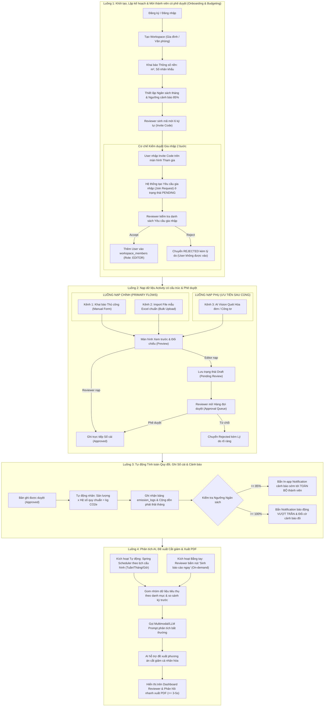
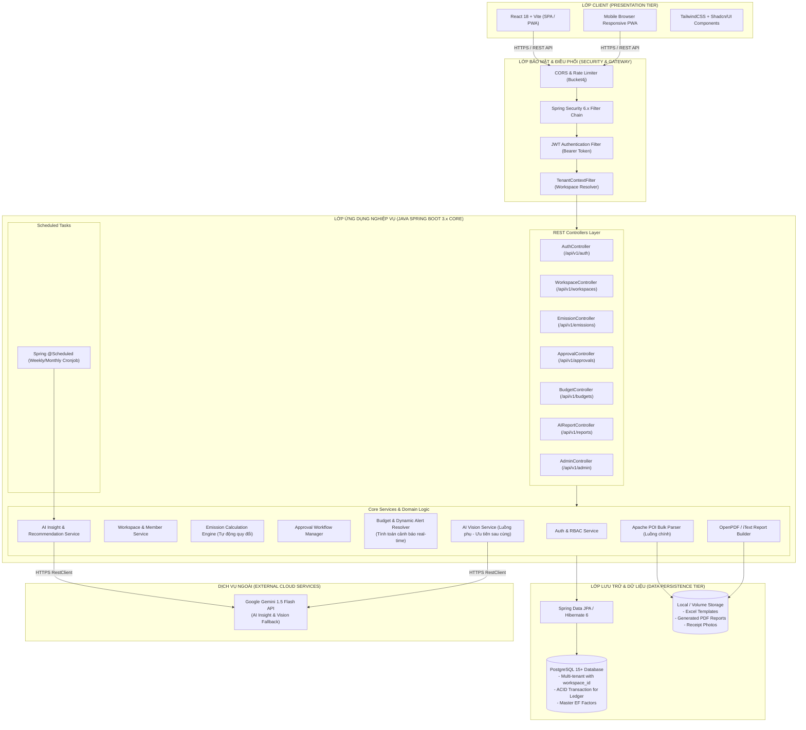
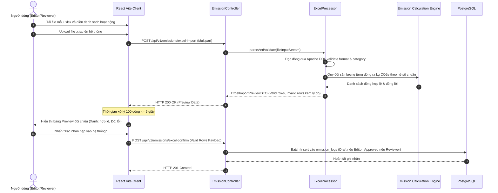
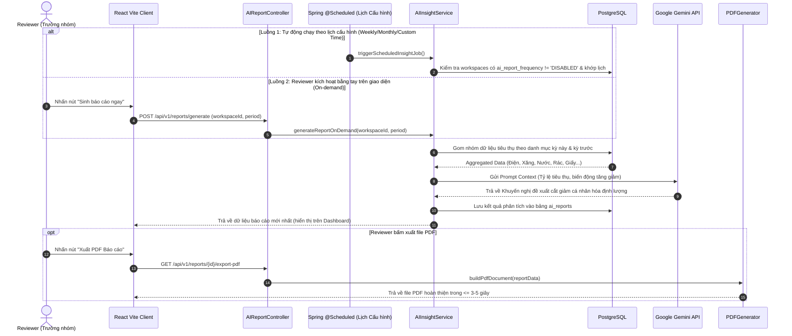
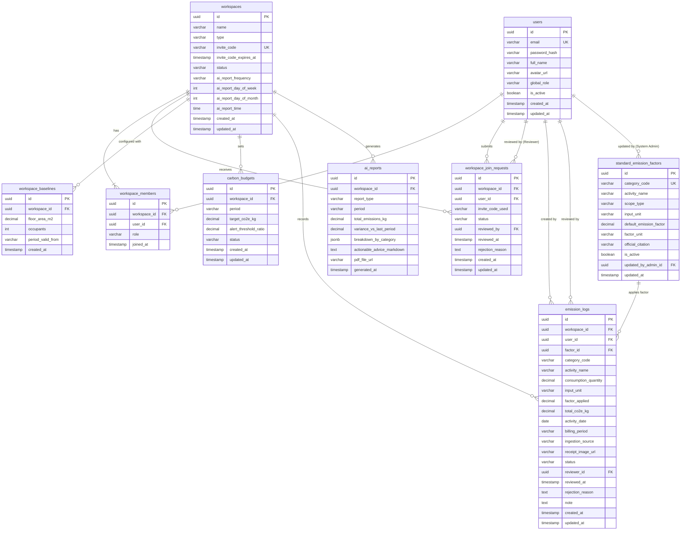

# TÀI LIỆU YÊU CẦU SẢN PHẨM (PRODUCT REQUIREMENTS DOCUMENT - PRD)

# Hệ thống Quản trị & Phân tích Dấu chân Carbon cho Gia đình/Văn phòng nhỏ
## (Personal & Micro-Office Carbon Ledger)

> **Mã tài liệu:** `PRD-POL-2026-V1.2`  
> **Phiên bản:** `1.2.0 (Official Approved PRD)`  
> **Trạng thái:** `Đã Phê Duyệt (Approved by Reviewer)`  
> **Nhánh phát triển (Git Worktree):** [`docs/prd`](file:///home/datnguyen-nuoa/PMDC-BATCH4-DATNT250-prd)  
> **Thời gian triển khai:** 6 tuần (3 Sprints $\times$ 2 tuần) | Tổng Story Points: 44 SP  
> **Tài liệu căn cứ:** [spec.md](file:///home/datnguyen-nuoa/PMDC-BATCH4-DATNT250-prd/spec.md), [docs/MVP.md](file:///home/datnguyen-nuoa/PMDC-BATCH4-DATNT250-prd/docs/MVP.md), [docs/activity-supported.md](file:///home/datnguyen-nuoa/PMDC-BATCH4-DATNT250-prd/docs/activity-supported.md), [docs/use-cases.md](file:///home/datnguyen-nuoa/PMDC-BATCH4-DATNT250-prd/docs/usecase/use-cases.md), [docs/user-stories.md](file:///home/datnguyen-nuoa/PMDC-BATCH4-DATNT250-prd/docs/user-stories.md), [docs/information-architecture.md](file:///home/datnguyen-nuoa/PMDC-BATCH4-DATNT250-prd/docs/information-architecture/information-architecture.md)

---

## MỤC LỤC TỔNG QUAN

1. [Tổng quan Dự án & Bối cảnh Nghiệp vụ (Executive Summary)](#1-tổng-quan-dự-án--bối-cảnh-nghiệp-vụ)
2. [Phạm vi Dự án (Project Scope Boundaries)](#2-phạm-vi-dự-án-project-scope-boundaries)
3. [Mô hình Người dùng & Ma trận Phân quyền (Roles & RBAC Matrix)](#3-mô-hình-người-dùng--ma-trận-phân-quyền-roles--rbac-matrix)
4. [Các Luồng Hoạt động Cốt lõi & Quy trình Nghiệp vụ (Core Workflows)](#4-các-luồng-hoạt-động-cốt-lõi--quy-trình-nghiệp-vụ-core-workflows)
5. [Đặc tả Yêu cầu Tính năng Chi tiết (Functional Requirements)](#5-đặc-tả-yêu-cầu-tính-năng-chi-tiết-functional-requirements)
6. [Thiết kế Kiến trúc Hệ thống Tổng thể (High-Level Architecture)](#6-thiết-kế-kiến-trúc-hệ-thống-tổng-thể-high-level-architecture)
7. [Thiết kế Cơ sở Dữ liệu Chi tiết (Database System Design)](#7-thiết-kế-cơ-sở-dữ-liệu-chi-tiết-database-system-design)
8. [Yêu cầu Phi chức năng & Tiêu chuẩn Kỹ thuật (Non-Functional Requirements)](#8-yêu-cầu-phi-chức-năng--tiêu-chuẩn-kỹ-thuật-non-functional-requirements)
9. [Lộ trình Phát triển 3 Sprints (MVP Release Plan & Backlog Mapping)](#9-lộ-trình-phát-triển-3-sprints-mvp-release-plan--backlog-mapping)
10. [Quản trị Rủi ro & Chiến lược Giảm thiểu (Risk Management)](#10-quản-trị-rủi-ro--chiến-lược-giảm-thiểu-risk-management)
11. [Tổng hợp Các Quyết định Thiết kế Đã Được Phê duyệt (Approved Design Decisions & Sign-Off)](#11-tổng-hợp-các-quyết-định-thiết-kế-đã-được-phê-duyệt-approved-design-decisions--sign-off)

---

## 1. TỔNG QUAN DỰ ÁN & BỐI CẢNH NGHIỆP VỤ

### 1.1. Bối cảnh & Nỗi đau Thị trường (Problem Statement)
Tại Việt Nam, cam kết phát thải ròng bằng 0 (Net Zero 2050) đang thúc đẩy nhận thức chuyển đổi xanh mạnh mẽ. Tuy nhiên, ở cấp độ vi mô (**Hộ gia đình** và **Văn phòng nhỏ/Startup 5–30 người**), việc theo dõi và kiểm soát phát thải khí nhà kính (GHG) gặp phải các rào cản và nỗi đau cốt lõi sau:
1. **Gánh nặng tra cứu và tính toán thủ công:** Người dùng phải tự mình tìm kiếm và tra cứu từng danh mục hoạt động (category), đối chiếu các hệ số phát thải quy chuẩn tương ứng từ các văn bản phân tán (Bộ TN&MT, EVN, DEFRA, IPCC), sau đó tự thực hiện các phép tính nhân chia và tổng hợp số liệu bằng tay. Quá trình này gây nản lòng, tốn nhiều thời gian và rất dễ dẫn đến sai sót số học.
2. **Thiếu công cụ quản trị có kiến trúc và dễ theo dõi:** Không có một hệ thống sổ cái tập trung giúp người dùng ghi nhận các hoạt động sinh hoạt/vận hành hàng ngày một cách có cấu trúc, phân loại rõ ràng theo từng nhóm phát thải để dễ dàng theo dõi xu hướng biến động theo thời gian.
3. **Thiếu cơ chế kiểm duyệt sổ cái:** Trong tập thể văn phòng hoặc gia đình, không có sự phân định giữa người nạp dữ liệu và người kiểm soát hạn ngạch phát thải, dẫn đến dữ liệu rác, trùng lặp hoặc thiếu tin cậy.
4. **Thiếu cảnh báo chủ động và kế hoạch hành động cụ thể:** Đa phần chỉ dừng lại ở việc ước tính khô khan, không có trần ngân sách để cảnh báo sớm khi chi tiêu năng lượng quá mức, và thiếu kế hoạch hành động cụ thể, khả thi để cắt giảm.

### 1.2. Tầm nhìn Sản phẩm (Product Vision)
**Personal & Micro-Office Carbon Ledger** là nền tảng quản trị và sổ cái dấu chân carbon số hóa dành cho Hộ gia đình và Văn phòng nhỏ.

> [!NOTE]
> Hệ thống **không hướng tới việc tự động nạp hóa dữ liệu** (không đặt nặng AI scanning làm trọng tâm), mà tập trung vào **tự động hóa tính toán dấu chân carbon dựa theo những hoạt động mà người dùng nhập liệu vào hệ thống một cách có kiến trúc và dễ dàng theo dõi**:

- **Cung cấp luồng nhập liệu có kiến trúc và dễ theo dõi:** Hỗ trợ **2 phương thức nạp dữ liệu chính**:
  1. **Nhập thủ công (Manual Entry):** Tối ưu cho các hoạt động sinh hoạt thường nhật (đi xe máy, nấu gas, đổ dầu máy phát).
  2. **Nạp file mẫu Excel chuẩn (Excel Template Import):** Tối ưu cho việc nạp hàng loạt dữ liệu định kỳ (hóa đơn tháng, tổng hợp công tác).
- **Tự động quy đổi và tính toán phát thải chính xác:** Hệ thống tự động ánh xạ hoạt động người dùng nhập vào bảng Hệ số phát thải quy chuẩn (Standard Emission Factors) để tính ra chỉ số $\text{kg CO}_2\text{e}$ chuẩn mực ngay lập tức:
  $$\text{Lượng phát thải } (\text{kg CO}_2\text{e}) = \text{Sản lượng tiêu thụ (Activity Data)} \times \text{Hệ số phát thải (Emission Factor)}$$
- **Minh bạch hóa dòng dữ liệu:** Thiết lập cơ chế **Approval Queue** phân định giữa người nạp (Editor - Draft) và người duyệt (Reviewer - Approved).
- **Kiểm soát hạn ngạch phát thải:** Đặt Target ngân sách tháng, chuẩn hóa chỉ số theo quy mô ($\text{kg CO}_2\text{e}/\text{người}$, $\text{kg CO}_2\text{e}/m^2$) và tự động bắn cảnh báo sớm ở ngưỡng **85%** và **100%**.
- **Cố vấn hành động thông minh từ AI (Tự động theo lịch hoặc Kích hoạt bằng tay):** Hỗ trợ Reviewer cấu hình lịch tự động sinh báo cáo theo chu kỳ (Tuần / Tháng, chọn ngày và giờ cụ thể) hoặc tắt tự động (Disabled); đồng thời luôn sẵn sàng nút bấm "Sinh báo cáo ngay" (On-demand) để Reviewer tự kích hoạt bất kỳ lúc nào. AI phân tích dữ liệu, phát hiện bất thường và hỗ trợ đề xuất phương án cắt giảm cá nhân hóa định lượng khả thi, hỗ trợ kết xuất báo cáo PDF chuẩn in ấn.
- **Quét ảnh bằng AI Vision (Luồng phụ - Ưu tiên sau cùng):** Được định vị là một **tiện ích bổ trợ phụ (Secondary / Nice-to-have)** nhằm hỗ trợ bóc tách hóa đơn/công tơ; **ưu tiên triển khai sau cùng** khi hai phương thức nạp chính (bằng tay và Excel) đã hoàn thiện và hoạt động ổn định.

### 1.3. Mục tiêu Đo lường Thành công (Key Success Metrics)
| Chỉ số (KPI) | Mục tiêu MVP (6 tuần) | Phương pháp đo lường |
|---|---|---|
| **Thời gian nạp trung bình 1 activity (Nhập tay)** | $\le 20-30\text{ giây}$ / hoạt động | Đo lường thời gian từ khi người dùng mở form nạp thủ công đến khi gửi bản ghi thành công |
| **Tốc độ xử lý nạp hàng loạt (Import Excel)** | Xử lý và preview file 100 activities $\le 5\text{ giây}$ *(trung bình $\le 0.05\text{s}$ / activity)* | Thời gian backend Apache POI đọc, validate dữ liệu và trả về bảng Preview trên giao diện |
| **Thời gian phản hồi Kế hoạch cắt giảm & Báo cáo** | $\le 3-5\text{ giây}$ | Thời gian hệ thống tổng hợp dữ liệu, nhận phản hồi đề xuất từ AI và kết xuất file PDF báo cáo |
| **Độ chính xác quy đổi phát thải** | $100\%$ tuân thủ hệ số quy chuẩn | Đối chiếu kết quả tự động tính: $\text{Activity Data} \times \text{Emission Factor}$ |
| **Tỷ lệ phê duyệt request** | $100\%$ giao dịch của Editor được duyệt/từ chối rõ ràng | Báo cáo trạng thái giao dịch trong bảng `emission_logs` |
| **Độ tin cậy của cảnh báo ngân sách** | $100\%$ cảnh báo $\ge 85\%$ được gửi tức thì | Kiểm tra trigger notification gửi đến toàn bộ thành viên khi tổng phát thải chạm ngưỡng |
| **Độ ổn định hệ thống** | Tỷ lệ thành công API $\ge 99.5\%$, P95 response $< 300\text{ms}$ | Backend APM logs & Spring Boot Actuator |

---

## 2. PHẠM VI DỰ ÁN (PROJECT SCOPE BOUNDARIES)

```mermaid
flowchart TD
    subgraph IN_SCOPE["PHẠM VI THỰC HIỆN (IN-SCOPE - 6 TUẦN MVP)"]
        direction TB
        IN1["Mô hình Multi-tenant Workspace: Hộ gia đình & Văn phòng nhỏ"]
        IN2["Phân quyền 3 vai trò: System Admin, Reviewer, Editor"]
        IN3["8 Nhóm hoạt động chuẩn Scope 1, 2, 3 (Điện, Gas, Xăng xe, Rác, Nước, Giấy, Máy bay)"]
        IN4["Luồng nạp chính: Nhập thủ công & Import file mẫu Excel chuẩn"]
        IN5["Luồng nạp phụ: Quét hóa đơn/công tơ bằng AI Vision (Ưu tiên sau cùng)"]
        IN6["Tự động quy đổi kg CO2e theo hệ số chuẩn & Quy trình kiểm duyệt Sổ cái"]
        IN7["Ngân sách tháng, Chuẩn hóa kg CO2e/người & kg CO2e/m², Cảnh báo 85% & 100%"]
        IN8["Cấu hình lịch tự động hoặc kích hoạt sinh báo cáo AI bằng tay (On-demand) & Xuất file PDF"]
    end

    subgraph OUT_SCOPE["NGOÀI PHẠM VI (OUT-OF-SCOPE)"]
        direction TB
        OUT1["Không tích hợp thiết bị phần cứng IoT hoặc Smart Meter đo dòng trực tiếp"]
        OUT2["Không tính toán phát thải Scope 3 chuỗi cung ứng mở rộng doanh nghiệp phức tạp"]
        OUT3["Không tích hợp cổng thanh toán giao dịch tiền tệ hay mua bán sàn tín chỉ Carbon"]
        OUT4["Không tự động cào dữ liệu (web scraping) các trang web điện lực bên ngoài"]
        OUT5["Không xây dựng ứng dụng di động Native (sử dụng Web Mobile-First Responsive PWA)"]
    end
```

---

## 3. MÔ HÌNH NGƯỜI DÙNG & MA TRẬN PHÂN QUYỀN (ROLES & RBAC MATRIX)

### 3.1. Danh mục 3 Vai trò (Personas)
1. **Trưởng nhóm Gia đình / Văn phòng (Reviewer / Workspace Admin):**
   - Quản trị Workspace, cấu hình diện tích mặt sàn ($m^2$), số nhân khẩu và cài đặt hạn ngạch ngân sách phát thải tháng.
   - Có toàn quyền kiểm duyệt (`Accept` / `Reject` kèm lý do) các request nạp hoạt động do Thành viên gửi lên.
   - Khi tự nạp dữ liệu (bằng tay hoặc Excel), bản ghi được tự động phê duyệt (`Approved`) ghi thẳng vào sổ cái.
   - Tiếp nhận báo cáo phân tích AI định kỳ và xuất file PDF Kế hoạch cắt giảm.
2. **Thành viên Gia đình / Văn phòng (Editor / Workspace Member):**
   - Tham gia vào Workspace thông qua mã mời (Invite Code).
   - Nạp các hoạt động phát thải cá nhân qua 2 phương thức chính: **Thủ công** hoặc **File mẫu Excel** (và tiện ích phụ AI Vision khi khả dụng).
   - Mọi bản ghi do Editor tạo mặc định ở trạng thái **`Draft / Chờ duyệt (Pending Review)`**.
   - Xem Dashboard chung, nhận Notification cảnh báo ngưỡng 85% và theo dõi lịch sử trạng thái các request do mình tạo.
3. **Quản trị viên Hệ thống (System Admin):**
   - Quản trị danh mục và cấu hình các **Hệ số phát thải chuẩn (Standard Emission Factors)** theo quy định Nhà nước (Bộ TN&MT, EVN, DEFRA, IPCC).
   - Có toàn quyền khởi tạo, phân bổ và quản trị danh mục các Workspace (Multi-tenant) phục vụ thiết lập ban đầu và hỗ trợ kỹ thuật.
   - Giám sát nhật ký kiểm toán (Audit Logs).

### 3.2. Ma trận Phân quyền Chức năng Chi tiết (Detailed RBAC Matrix)

| Nhóm chức năng | Quyền hạn / Thao tác | System Admin | Trưởng nhóm (Reviewer) | Thành viên (Editor) |
|---|---|:---:|:---:|:---:|
| **Quản lý Workspace** | Khởi tạo Workspace mới | ✅ | ✅ | ❌ |
| | Cấu hình thông số nền ($m^2$, số người) | ❌ | ✅ | ❌ |
| | Sinh mã mời (Invite Code) | ❌ | ✅ | ❌ |
| | Gửi Yêu cầu gia nhập bằng mã mời (Join Request) | ❌ | ❌ | ✅ |
| | Phê duyệt / Từ chối Yêu cầu gia nhập (Accept/Reject Join Request) | ❌ | ✅ | ❌ |
| | Quản lý danh sách thành viên (Xóa, Đổi vai trò) | ❌ | ✅ | ❌ |
| **Nạp dữ liệu Sổ cái** | **Khai báo thủ công (Manual Entry) [Luồng chính]** | ❌ | ✅ (Ghi sổ trực tiếp) | ✅ (Trạng thái Draft) |
| | **Nạp dữ liệu qua File mẫu Excel [Luồng chính]** | ❌ | ✅ (Ghi sổ trực tiếp) | ✅ (Trạng thái Draft) |
| | Quét hóa đơn/công tơ bằng AI Vision [Luồng phụ] | ❌ | ✅ (Ghi sổ trực tiếp) | ✅ (Trạng thái Draft) |
| **Kiểm duyệt Sổ cái** | Xem hàng đợi duyệt (Approval Queue) | ❌ | ✅ | ❌ |
| | Phê duyệt (Accept) hoặc Từ chối (Reject) | ❌ | ✅ | ❌ |
| | Tra cứu Lịch sử Sổ cái & Xuất file Excel | ❌ | ✅ (Toàn bộ) | ✅ (Toàn bộ & Lọc của tôi) |
| **Ngân sách & Giám sát**| Thiết lập Target hạn ngạch tháng & mốc 85% | ❌ | ✅ | ❌ |
| | Xem Dashboard & Chỉ số $\text{CO}_2\text{e}/\text{người}$, $/m^2$ | ❌ | ✅ | ✅ |
| | Nhận In-App Notification cảnh báo 85% & 100% | ❌ | ✅ | ✅ |
| **AI Insight & Báo cáo**| Cấu hình lịch tự động & Kích hoạt sinh báo cáo bằng tay (On-demand) | ❌ | ✅ | ❌ |
| | Xuất Báo cáo Kế hoạch cắt giảm ra file PDF | ❌ | ✅ | ❌ |
| **Quản trị Hệ thống** | CRUD Danh mục Hệ số chuẩn Master Data | ✅ | ❌ | ❌ |
| | Quản lý danh mục toàn bộ Workspace (Tenants) | ✅ | ❌ | ❌ |
| | Xem Audit Logs & Cấu hình Hệ thống | ✅ | ❌ | ❌ |

---

## 4. CÁC LUỒNG HOẠT ĐỘNG CỐT LÕI & QUY TRÌNH NGHIỆP VỤ (CORE WORKFLOWS)

---

## 5. ĐẶC TẢ YÊU CẦU TÍNH NĂNG CHI TIẾT (FUNCTIONAL REQUIREMENTS)

### 5.1. Phân hệ 1: Quản trị Workspace & Thông số nền (Onboarding)
- **Mã User Stories:** [`US-WS-001`](file:///home/datnguyen-nuoa/PMDC-BATCH4-DATNT250-prd/docs/user-stories.md#US-WS-001), [`US-WS-002`](file:///home/datnguyen-nuoa/PMDC-BATCH4-DATNT250-prd/docs/user-stories.md#US-WS-002), [`US-WS-003`](file:///home/datnguyen-nuoa/PMDC-BATCH4-DATNT250-prd/docs/user-stories.md#US-WS-003) | **Use Cases:** `UC01`, `UC02`, `UC03`
- **Chức năng nghiệp vụ:**
  - Khởi tạo Workspace mới với tên đại diện (3–50 ký tự), loại hình (`HOME`: Hộ gia đình hoặc `OFFICE`: Văn phòng nhỏ).
  - Khai báo thông số nền mặt sàn ($m^2 > 0$) và số lượng nhân khẩu/nhân viên ($\text{occupants} \ge 1$).
  - Tự động tính toán các chỉ số cường độ phát thải chuẩn hóa:
    $$\text{Chỉ số theo nhân khẩu} = \frac{\text{Tổng kg CO}_2\text{e}}{\text{Số người}} \quad (\text{kg CO}_2\text{e}/\text{người})$$
    $$\text{Chỉ số theo diện tích} = \frac{\text{Tổng kg CO}_2\text{e}}{\text{Diện tích mặt sàn}} \quad (\text{kg CO}_2\text{e}/m^2)$$
  - **Cơ chế Mời & Gia nhập có Phê duyệt 2 lớp (Two-step Join Approval Flow):**
    - **Bước 1 (Sinh mã):** Reviewer sinh mã mời ngẫu nhiên 6 ký tự (`alphanumeric`, ví dụ `CARB26`, hiệu lực 7 ngày).
    - **Bước 2 (Gửi yêu cầu gia nhập):** Thành viên nhập mã mời tại màn hình tham gia. Hệ thống kiểm tra tính hợp lệ và **tạo bản ghi Yêu cầu gia nhập (`workspace_join_requests`) ở trạng thái `PENDING`**, KHÔNG cho phép thành viên truy cập ngay vào Workspace để ngăn chặn việc người ngoài chủ đích hoặc dò mã gia nhập trái phép.
    - **Bước 3 (Kiểm duyệt gia nhập):** Reviewer nhận danh sách yêu cầu chờ duyệt tại mục Quản lý Thành viên, xem thông tin người xin vào (Họ tên, Email) và tiến hành **Chấp thuận (Accept)** hoặc **Từ chối (Reject)**:
      - *Khi Chấp thuận:* Hệ thống chính thức thêm người dùng vào bảng `workspace_members` với vai trò `EDITOR`.
      - *Khi Từ chối:* Đánh dấu `REJECTED` (kèm lý do), người dùng không thể xem hay tương tác với dữ liệu của Workspace.
  - Cho phép Quản trị viên Hệ thống (`System Admin`) khởi tạo và quản lý toàn bộ các Workspace trên hệ thống.

### 5.2. Phân hệ 2: Danh mục Hoạt động & Hệ số Quy chuẩn (Master Data)
- **Mã User Stories:** [`US-SA-001`](file:///home/datnguyen-nuoa/PMDC-BATCH4-DATNT250-prd/docs/user-stories.md#US-SA-001), [`US-CL-002`](file:///home/datnguyen-nuoa/PMDC-BATCH4-DATNT250-prd/docs/user-stories.md#US-CL-002) | **Use Cases:** `UC12`
- **Quy chuẩn hỗ trợ 8 hoạt động cốt lõi:**
  1. `ELEC_GRID`: Điện lưới sinh hoạt/văn phòng (**kWh**), Scope 2, Hệ số **`0.6187`** $\text{kg CO}_2\text{e}/\text{kWh}$ (Công văn 1232/BNNMT-BĐKH).
  2. `FUEL_LPG`: Đốt gas LPG nấu ăn (**kg**), Scope 1, Hệ số **`2.9394`** $\text{kg CO}_2\text{e}/\text{kg}$ (UK DEFRA 2026 / IPCC).
  3. `FUEL_DIESEL`: Dầu Diesel máy phát điện (**Lít**), Scope 1, Hệ số **`2.6870`** $\text{kg CO}_2\text{e}/\text{Lít}$ (IPCC / DEFRA).
  4. `MOBILITY`: Di chuyển xe máy / Ô tô (**km**), Scope 1 & 3, Hệ số phân cấp theo loại xe và nhiên liệu (DEFRA 2026).
  5. `WASTE_LANDFILL`: Rác thải sinh hoạt chôn lấp (**kg**), Scope 3, Hệ số **`0.004465`** $\text{kg CO}_2\text{e}/\text{kg}$ (DEFRA 2026 / EPA WARM).
  6. `WATER_SUPPLY_TREAT`: Cung cấp & xử lý nước sạch (**$m^3$**), Scope 3, Hệ số **`0.19130`** $\text{kg CO}_2\text{e}/m^3$ (DEFRA 2026 / EPA).
  7. `OFFICE_PAPER`: Giấy in văn phòng (**kg**), Scope 3, Hệ số **`1.3436`** $\text{kg CO}_2\text{e}/\text{kg}$ (tương đương **`1343.59114`** $\text{kg CO}_2\text{e}/\text{tấn}$ theo UK DEFRA 2026).
  8. `TRAVEL_FLIGHT`: Du lịch & Đi lại bằng máy bay (**p.km**), Scope 3, Economy: **`0.10916`**, Business: **`0.31656`** (DEFRA 2026 / ICAO).

### 5.3. Phân hệ 3: Nhập liệu Hoạt động có Cấu trúc (Activity Ingestion)
- **Mã User Stories:** [`US-CL-001`](file:///home/datnguyen-nuoa/PMDC-BATCH4-DATNT250-prd/docs/user-stories.md#US-CL-001), [`US-CL-004`](file:///home/datnguyen-nuoa/PMDC-BATCH4-DATNT250-prd/docs/user-stories.md#US-CL-004), [`US-CL-003`](file:///home/datnguyen-nuoa/PMDC-BATCH4-DATNT250-prd/docs/user-stories.md#US-CL-003) | **Use Cases:** `UC04`, `UC06`, `UC05`

#### A. [LUỒNG CHÍNH] Kênh 1: Khai báo Thủ công (Manual Entry)
- Form nhập nhanh gọn, có cấu trúc: Chọn danh mục hoạt động qua Dropdown, nhập sản lượng tiêu thụ, chọn đơn vị đo lường.
- Hệ thống tự động tính toán tức thì lượng phát thải quy đổi $\text{kg CO}_2\text{e}$ ngay trên form trước khi người dùng nhấn submit.
- **Thời gian nạp trung bình 1 activity:** Mục tiêu $\le 20-30\text{ giây}$.

#### B. [LUỒNG CHÍNH] Kênh 2: Nạp file mẫu Excel hàng loạt (Excel Template Import)
- Hệ thống cung cấp template `.xlsx` chuẩn (chứa danh mục thả xuống Data Validation tránh sai chính tả).
- Backend sử dụng Apache POI đọc và validate dữ liệu từng dòng (kiểm tra kiểu số, ngày tháng hợp lệ, danh mục tồn tại).
- Bảng Preview hiển thị danh sách dòng hợp lệ (màu xanh) và dòng lỗi (đánh dấu đỏ kèm mô tả nguyên nhân). Cho phép người dùng bỏ qua dòng lỗi hoặc tải lại file chuẩn.
- **Tốc độ xử lý:** Xử lý và preview file 100 activities trong vòng $\le 5\text{ giây}$ (trung bình $\le 0.05\text{ giây / activity}$).

#### C. [LUỒNG PHỤ - ƯU TIÊN SAU CÙNG] Kênh 3: AI Vision Quét hóa đơn & Công tơ
> [!NOTE]
> Tính năng này là **tiện ích phụ và là ưu tiên sau cùng**, chỉ triển khai khi Kênh 1 (Nhập tay) và Kênh 2 (Import Excel) đã hoạt động trơn tru.
- Cho phép người dùng tải ảnh chụp hóa đơn tiền điện EVN, hóa đơn nước hoặc mặt số công tơ.
- Multimodal AI bóc tách JSON và hiển thị Popup Preview 2 cột để đối chiếu với ảnh chụp trước khi bấm lưu.

### 5.4. Phân hệ 4: Hàng đợi Kiểm duyệt Sổ cái (Approval Queue)
- **Mã User Stories:** [`US-CL-005`](file:///home/datnguyen-nuoa/PMDC-BATCH4-DATNT250-prd/docs/user-stories.md#US-CL-005), [`US-CL-006`](file:///home/datnguyen-nuoa/PMDC-BATCH4-DATNT250-prd/docs/user-stories.md#US-CL-006) | **Use Cases:** `UC07`, `UC08`
- **Cơ chế phân luồng trạng thái:**
  - `DRAFT / PENDING_REVIEW`: Tạo bởi Thành viên (Editor). Bản ghi **chưa được tính** vào tổng phát thải Workspace và chưa làm giảm ngân sách tháng.
  - `APPROVED`: Tạo trực tiếp bởi Reviewer hoặc được Reviewer phê duyệt từ hàng đợi. Chính thức ghi nhận vào sổ cái và kích hoạt kiểm tra ngân sách.
  - `REJECTED`: Bị Reviewer từ chối (bắt buộc nhập lý do từ chối tối thiểu 5 ký tự).
- **Tính năng Hàng đợi duyệt:** Reviewer có thể lọc theo người gửi, lọc theo loại hoạt động, duyệt đơn lẻ hoặc duyệt hàng loạt (Bulk Accept).

### 5.5. Phân hệ 5: Quản trị Ngân sách, Dashboard & Hệ thống Cảnh báo
- **Mã User Stories:** [`US-BG-001`](file:///home/datnguyen-nuoa/PMDC-BATCH4-DATNT250-prd/docs/user-stories.md#US-BG-001), [`US-BG-002`](file:///home/datnguyen-nuoa/PMDC-BATCH4-DATNT250-prd/docs/user-stories.md#US-BG-002), [`US-BG-003`](file:///home/datnguyen-nuoa/PMDC-BATCH4-DATNT250-prd/docs/user-stories.md#US-BG-003) | **Use Cases:** `UC09`, `UC10`
- **Thiết lập Target:** Reviewer đặt hạn ngạch phát thải tối đa cho tháng (ví dụ: $350\text{ kg CO}_2\text{e}$).
- **Dashboard Trung tâm:**
  - 4 Thẻ KPI: Tổng phát thải tháng hiện tại, % Đã tiêu thụ so với ngân sách, Chỉ số $\text{CO}_2\text{e}/\text{người}$, Chỉ số $\text{CO}_2\text{e}/m^2$.
  - Biểu đồ Donut phân bổ phát thải theo nhóm hoạt động (Điện %, Xăng %, Nước %...).
  - Biểu đồ đường (Line Chart) xu hướng phát thải qua các ngày trong tháng.
  - Thanh tiến độ động (Budget Progress Bar) đổi màu: Xanh ($< 70\%$), Vàng cam ($70\% - 84\%$), Cam đậm ($\ge 85\%$), Đỏ ($\ge 100\%$).
- **Cơ chế Cảnh báo tức thì (In-App Notification):**
  - Khi một bản ghi được Approved đẩy tổng phát thải vượt ngưỡng $\ge 85\%$, hệ thống tự động sinh thông báo cảnh báo sớm màu cam tới **toàn bộ thành viên** trong Workspace.
  - Khi vượt trần $\ge 100\%$, hệ thống sinh thông báo báo động màu đỏ và treo Banner cảnh báo nổi bật trên Dashboard.

### 5.6. Phân hệ 6: AI Insight, Đề xuất Phương án Cắt giảm Cá nhân hóa & Báo cáo PDF
- **Mã User Stories:** [`US-AI-001`](file:///home/datnguyen-nuoa/PMDC-BATCH4-DATNT250-prd/docs/user-stories.md#US-AI-001), [`US-AI-002`](file:///home/datnguyen-nuoa/PMDC-BATCH4-DATNT250-prd/docs/user-stories.md#US-AI-002) | **Use Cases:** `UC11`
- **Cơ chế Sinh Báo cáo Linh hoạt (Lịch Tự động hoặc Kích hoạt Bằng tay):**
  - **Tùy biến Cấu hình Lịch Tự động (Scheduled Cronjob):**
    - Reviewer có thể thiết lập lịch chạy tự động trong phần Cài đặt Workspace (`Workspace Settings`):
      - *Tần suất (`ai_report_frequency`):* Chọn `DISABLED` (Tắt tự động), `WEEKLY` (Hàng tuần) hoặc `MONTHLY` (Hàng tháng).
      - *Ngày thực thi:* Nếu chọn Hàng tuần, Reviewer chọn thứ trong tuần (`ai_report_day_of_week`: Thứ Hai đến Chủ Nhật). Nếu chọn Hàng tháng, Reviewer chọn ngày trong tháng (`ai_report_day_of_month`: Ngày 1 đến 31, hoặc Ngày cuối cùng của tháng `-1`).
      - *Giờ thực thi (`ai_report_time`):* Cho phép chọn khung giờ chạy tác vụ nền (mặc định `23:59:00`).
    - Khi đến lịch hẹn, Spring Boot `@Scheduled` tự động gom nhóm dữ liệu kỳ và gọi LLM phân tích.
  - **Kích hoạt Bằng tay Tức thời (On-demand Manual Trigger):**
    - Nếu Reviewer tắt tự động hoặc muốn xem ngay báo cáo giữa kỳ, hệ thống cung cấp nút bấm **"Sinh báo cáo ngay"** trên giao diện Báo cáo AI (`POST /api/v1/reports/generate`).
    - Hệ thống tổng hợp dữ liệu lũy kế tính đến thời điểm hiện tại và gọi AI sinh báo cáo tức thì mà không cần chờ đến lịch cronjob.
- **Cơ chế AI Reasoning & Đề xuất Cắt giảm:**
  - AI phát hiện nhóm hoạt động có mức phát thải bất thường và hỗ trợ đề xuất phương án cắt giảm cá nhân hóa mang tính định lượng (ví dụ: chuyển 2 nhân viên sang đi xe buýt điện 3 ngày/tuần giúp giảm thiểu dự kiến 28.5 kg CO2e).
  - **Thời gian phản hồi kế hoạch cắt giảm / xuất báo cáo:** Mục tiêu $\le 3-5\text{ giây}$.
  - Hỗ trợ xuất file báo cáo Kế hoạch cắt giảm (Reduction Plan) ra định dạng PDF chuẩn in ấn qua OpenPDF / iText.

---

## 6. THIẾT KẾ KIẾN TRÚC HỆ THỐNG TỔNG THỂ (HIGH-LEVEL ARCHITECTURE)

### 6.1. Sơ đồ Kiến trúc Tổng thể (High-Level Topology Diagram)

### 6.2. Mô hình Đa người thuê (Multi-tenancy Architecture Design)
- **Phương án lựa chọn:** **Shared Database, Shared Schema with Discriminator Column (`workspace_id`)**.
- **Cơ chế Cách ly Tenant:**
  1. `TenantContext`: `TenantContextFilter` đọc Header `X-Workspace-Id`, xác thực người dùng hiện tại có thuộc `workspace_members` của Workspace này hay không.
  2. `ThreadLocal`: Lưu `currentWorkspaceId` vào `TenantContextHolder`.
  3. `JPA Specification / Hibernate Filter`: Mọi truy vấn đọc/ghi dữ liệu vào bảng `emission_logs`, `carbon_budgets`, `ai_reports` tự động kèm điều kiện `WHERE workspace_id = :currentWorkspaceId`.

### 6.3. Luồng Xử lý Nạp File Mẫu Excel [Luồng chính] (Excel Bulk Ingestion Pipeline)

### 6.4. Luồng Sinh Báo cáo AI Insight (Tự động theo Lịch hoặc Kích hoạt Bằng tay) & Xuất PDF

### 6.5. Các Quyết định Kiến trúc Đã Được Phê duyệt (Approved Architecture Decisions)
1. **Ưu tiên Luồng nạp:** Tập trung tối đa vào hiệu năng và độ ổn định của hai luồng chính: Nhập tay ($\le 20-30\text{s}$) và Import Excel ($\le 5\text{s}$ cho 100 rows). Đưa AI Vision xuống thành luồng phụ ở Sprint 3, chỉ thực hiện khi nạp tay và Excel đã hoàn thiện.
2. **Cơ chế Multi-tenancy:** Mô hình **Shared Database, Shared Schema with Discriminator Column (`workspace_id`)** kết hợp Spring Security Filter (`TenantContextFilter`) và Hibernate Filter / JPA Specification đảm bảo cách ly dữ liệu tuyệt đối giữa các Workspace.
3. **Cơ chế Báo cáo AI Linh hoạt:** Hỗ trợ Reviewer tùy biến cấu hình lịch tự động (Hàng tuần, Hàng tháng hoặc Tắt/Disabled) với ngày/giờ tự chọn, đồng thời luôn hỗ trợ kích hoạt sinh báo cáo bằng tay on-demand tức thời, kết xuất báo cáo PDF chuẩn in ấn trong $\le 3-5\text{ giây}$.

---

## 7. THIẾT KẾ CƠ SỞ DỮ LIỆU CHI TIẾT (DATABASE SYSTEM DESIGN)

Lược đồ cơ sở dữ liệu quan hệ (PostgreSQL) dưới đây được thiết kế chuẩn hóa 3NF, phục vụ trọn vẹn việc tính toán tự động dựa trên hoạt động người dùng nạp vào và đảm bảo tính bất biến của sổ cái carbon.

### 7.1. Sơ đồ Thực thể Quan hệ (Entity Relationship Diagram - ERD)

### 7.2. Đặc tả Chi tiết Các Bảng Dữ liệu (Table Specifications)

#### 1. Bảng `users` (Tài khoản người dùng toàn hệ thống)
- `id`: `UUID PRIMARY KEY DEFAULT gen_random_uuid()`
- `email`: `VARCHAR(255) NOT NULL UNIQUE` (được đánh index B-Tree)
- `password_hash`: `VARCHAR(255) NULL` (mã hóa chuẩn BCrypt/Argon2; cho phép null nếu đăng nhập Google OAuth)
- `full_name`: `VARCHAR(100) NOT NULL`
- `avatar_url`: `VARCHAR(500) NULL`
- `global_role`: `VARCHAR(20) NOT NULL DEFAULT 'USER'` (`SYSTEM_ADMIN`, `USER`)
- `is_active`: `BOOLEAN NOT NULL DEFAULT true`
- `created_at`: `TIMESTAMPTZ NOT NULL DEFAULT CURRENT_TIMESTAMP`
- `updated_at`: `TIMESTAMPTZ NOT NULL DEFAULT CURRENT_TIMESTAMP`

#### 2. Bảng `workspaces` (Không gian làm việc / Tenants)
- `id`: `UUID PRIMARY KEY DEFAULT gen_random_uuid()`
- `name`: `VARCHAR(100) NOT NULL`
- `type`: `VARCHAR(20) NOT NULL` (`HOME`, `OFFICE`)
- `invite_code`: `VARCHAR(10) NULL UNIQUE`
- `invite_code_expires_at`: `TIMESTAMPTZ NULL`
- `status`: `VARCHAR(20) NOT NULL DEFAULT 'ACTIVE'` (`ACTIVE`, `ARCHIVED`)
- `ai_report_frequency`: `VARCHAR(20) NOT NULL DEFAULT 'MONTHLY'` (`DISABLED`, `WEEKLY`, `MONTHLY`)
- `ai_report_day_of_week`: `INT NULL CHECK (ai_report_day_of_week BETWEEN 1 AND 7)` (1 = Thứ Hai, 7 = Chủ Nhật; áp dụng khi frequency là `WEEKLY`)
- `ai_report_day_of_month`: `INT NULL CHECK (ai_report_day_of_month BETWEEN -1 AND 31)` (-1: ngày cuối cùng của tháng, 1..31: ngày cụ thể; áp dụng khi frequency là `MONTHLY`)
- `ai_report_time`: `TIME NOT NULL DEFAULT '23:59:00'` (Thời điểm trong ngày tác vụ nền chạy)
- `created_at`: `TIMESTAMPTZ NOT NULL DEFAULT CURRENT_TIMESTAMP`
- `updated_at`: `TIMESTAMPTZ NOT NULL DEFAULT CURRENT_TIMESTAMP`

#### 3. Bảng `workspace_members` (Thành viên tham gia Workspace & Vai trò)
- `id`: `UUID PRIMARY KEY DEFAULT gen_random_uuid()`
- `workspace_id`: `UUID NOT NULL REFERENCES workspaces(id) ON DELETE CASCADE`
- `user_id`: `UUID NOT NULL REFERENCES users(id) ON DELETE CASCADE`
- `role`: `VARCHAR(20) NOT NULL` (`REVIEWER`, `EDITOR`)
- `joined_at`: `TIMESTAMPTZ NOT NULL DEFAULT CURRENT_TIMESTAMP`
- **Ràng buộc:** `UNIQUE (workspace_id, user_id)`

#### 4. Bảng `workspace_join_requests` (Yêu cầu Tham gia Workspace Chờ duyệt)
Quản lý luồng kiểm duyệt gia nhập 2 bước, bảo vệ an toàn cho Workspace tránh việc người lạ tùy tiện vào khi có mã code.
- `id`: `UUID PRIMARY KEY DEFAULT gen_random_uuid()`
- `workspace_id`: `UUID NOT NULL REFERENCES workspaces(id) ON DELETE CASCADE`
- `user_id`: `UUID NOT NULL REFERENCES users(id) ON DELETE CASCADE` (Người dùng xin gia nhập)
- `invite_code_used`: `VARCHAR(10) NOT NULL` (Mã mời đã nhập)
- `status`: `VARCHAR(20) NOT NULL DEFAULT 'PENDING'` (`PENDING`, `APPROVED`, `REJECTED`)
- `reviewed_by`: `UUID NULL REFERENCES users(id)` (Reviewer thực hiện duyệt/từ chối)
- `reviewed_at`: `TIMESTAMPTZ NULL`
- `rejection_reason`: `TEXT NULL`
- `created_at`: `TIMESTAMPTZ NOT NULL DEFAULT CURRENT_TIMESTAMP`
- `updated_at`: `TIMESTAMPTZ NOT NULL DEFAULT CURRENT_TIMESTAMP`
- **Ràng buộc:** Unique Partial Index `(workspace_id, user_id)` WHERE `status = 'PENDING'` (Mỗi người dùng chỉ được có tối đa 1 yêu cầu chờ duyệt tại một Workspace).

#### 5. Bảng `workspace_baselines` (Thông số nền diện tích & nhân khẩu)
- `id`: `UUID PRIMARY KEY DEFAULT gen_random_uuid()`
- `workspace_id`: `UUID NOT NULL REFERENCES workspaces(id) ON DELETE CASCADE`
- `floor_area_m2`: `NUMERIC(10, 2) NOT NULL CHECK (floor_area_m2 > 0)`
- `occupants`: `INT NOT NULL CHECK (occupants >= 1)`
- `period_valid_from`: `VARCHAR(7) NOT NULL` (Định dạng `YYYY-MM`)
- `created_at`: `TIMESTAMPTZ NOT NULL DEFAULT CURRENT_TIMESTAMP`

#### 6. Bảng `standard_emission_factors` (Master Data Hệ số Quy chuẩn Quốc gia)
- `id`: `UUID PRIMARY KEY DEFAULT gen_random_uuid()`
- `category_code`: `VARCHAR(50) NOT NULL UNIQUE` (`ELEC_GRID`, `FUEL_LPG`, `FUEL_DIESEL`, `MOBILITY`, `WASTE_LANDFILL`, `WATER_SUPPLY_TREAT`, `OFFICE_PAPER`, `TRAVEL_FLIGHT`)
- `activity_name`: `VARCHAR(100) NOT NULL`
- `scope_type`: `VARCHAR(10) NOT NULL` (`SCOPE_1`, `SCOPE_2`, `SCOPE_3`)
- `input_unit`: `VARCHAR(20) NOT NULL`
- `default_emission_factor`: `NUMERIC(12, 6) NOT NULL CHECK (default_emission_factor >= 0)`
- `factor_unit`: `VARCHAR(50) NOT NULL DEFAULT 'kg CO2e/unit'`
- `official_citation`: `TEXT NOT NULL`
- `is_active`: `BOOLEAN NOT NULL DEFAULT true`
- `updated_by_admin_id`: `UUID NULL REFERENCES users(id)`
- `updated_at`: `TIMESTAMPTZ NOT NULL DEFAULT CURRENT_TIMESTAMP`

#### 7. Bảng `carbon_budgets` (Hạn ngạch Ngân sách Phát thải Tháng)
- `id`: `UUID PRIMARY KEY DEFAULT gen_random_uuid()`
- `workspace_id`: `UUID NOT NULL REFERENCES workspaces(id) ON DELETE CASCADE`
- `period`: `VARCHAR(7) NOT NULL` (Định dạng `YYYY-MM`, ví dụ: `2026-10`)
- `target_co2e_kg`: `NUMERIC(12, 2) NOT NULL CHECK (target_co2e_kg > 0)`
- `alert_threshold_ratio`: `NUMERIC(3, 2) NOT NULL DEFAULT 0.85`
- `status`: `VARCHAR(20) NOT NULL DEFAULT 'ACTIVE'`
- `created_at`: `TIMESTAMPTZ NOT NULL DEFAULT CURRENT_TIMESTAMP`
- `updated_at`: `TIMESTAMPTZ NOT NULL DEFAULT CURRENT_TIMESTAMP`
- **Ràng buộc:** `UNIQUE (workspace_id, period)`

#### 8. Bảng `emission_logs` (Sổ cái Ghi nhận Phát thải & Trạng thái Phê duyệt)
- `id`: `UUID PRIMARY KEY DEFAULT gen_random_uuid()`
- `workspace_id`: `UUID NOT NULL REFERENCES workspaces(id) ON DELETE CASCADE`
- `user_id`: `UUID NOT NULL REFERENCES users(id)` (Người tạo bản ghi)
- `factor_id`: `UUID NOT NULL REFERENCES standard_emission_factors(id)`
- `category_code`: `VARCHAR(50) NOT NULL`
- `activity_name`: `VARCHAR(100) NOT NULL`
- `consumption_quantity`: `NUMERIC(12, 3) NOT NULL CHECK (consumption_quantity >= 0)`
- `input_unit`: `VARCHAR(20) NOT NULL`
- `factor_applied`: `NUMERIC(12, 6) NOT NULL` (Lưu cứng hệ số tại thời điểm ghi nhận để đảm bảo tính bất biến của sổ cái)
- `total_co2e_kg`: `NUMERIC(12, 4) NOT NULL` (Giá trị quy đổi: `consumption_quantity` $\times$ `factor_applied`)
- `activity_date`: `DATE NOT NULL`
- `billing_period`: `VARCHAR(7) NOT NULL` (Định dạng `YYYY-MM`)
- `ingestion_source`: `VARCHAR(20) NOT NULL` (`MANUAL`, `EXCEL_IMPORT`, `AI_VISION`)
- `receipt_image_url`: `VARCHAR(500) NULL`
- `status`: `VARCHAR(20) NOT NULL DEFAULT 'PENDING_REVIEW'` (`DRAFT`, `PENDING_REVIEW`, `APPROVED`, `REJECTED`)
- `reviewer_id`: `UUID NULL REFERENCES users(id)`
- `reviewed_at`: `TIMESTAMPTZ NULL`
- `rejection_reason`: `TEXT NULL`
- `note`: `TEXT NULL`
- `created_at`: `TIMESTAMPTZ NOT NULL DEFAULT CURRENT_TIMESTAMP`
- `updated_at`: `TIMESTAMPTZ NOT NULL DEFAULT CURRENT_TIMESTAMP`

#### 9. Bảng `ai_reports` (Báo cáo Phân tích AI & Đề xuất Cắt giảm Định kỳ)
- `id`: `UUID PRIMARY KEY DEFAULT gen_random_uuid()`
- `workspace_id`: `UUID NOT NULL REFERENCES workspaces(id) ON DELETE CASCADE`
- `report_type`: `VARCHAR(20) NOT NULL` (`WEEKLY`, `MONTHLY`)
- `period`: `VARCHAR(10) NOT NULL` (Ví dụ `2026-W44` hoặc `2026-10`)
- `total_emissions_kg`: `NUMERIC(12, 2) NOT NULL`
- `variance_vs_last_period`: `NUMERIC(5, 2) NULL`
- `breakdown_by_category`: `JSONB NOT NULL`
- `actionable_advice_markdown`: `TEXT NOT NULL`
- `pdf_file_url`: `VARCHAR(500) NULL`
- `generated_at`: `TIMESTAMPTZ NOT NULL DEFAULT CURRENT_TIMESTAMP`

> [!TIP]
> **Quyết định Tinh gọn Database Schema (Theo Review):**  
> Bảng `notifications` được **loại bỏ hoàn toàn khỏi thiết kế CSDL**.  
> **Lý do:** Frontend hoàn toàn tự động tính toán được các trạng thái và loại thông báo (`notification_type`) theo thời gian thực (Real-time Dynamic Derivation) dựa trực tiếp trên trạng thái dữ liệu có sẵn từ Dashboard API:
> - *Cảnh báo ngưỡng 85% / 100%:* Tính theo tỷ lệ `current_emissions / budget_target` từ `carbon_budgets` & `emission_logs`.
> - *Yêu cầu chờ duyệt:* Đếm số lượng bản ghi `status = 'PENDING_REVIEW'` trong `emission_logs` của Workspace.
> - *Kết quả duyệt của cá nhân:* Lọc các bản ghi `user_id = :currentUser` có `status IN ('APPROVED', 'REJECTED')` mới nhất.
> - *Báo cáo AI mới:* Kiểm tra sự tồn tại của bản ghi trong `ai_reports` cho kỳ gần nhất.  
> 
> Giải pháp này giúp loại bỏ hoàn toàn việc lưu trữ các bản ghi thông báo trùng lặp/dư thừa, tránh rủi ro lệch đồng bộ (out-of-sync) và tối ưu hóa hiệu năng cơ sở dữ liệu.

### 7.3. Chiến lược Đánh Index (Database Indexing Strategy)
1. `idx_emission_logs_ws_period_status`: `(workspace_id, billing_period, status)` -> Tối ưu hóa tính tổng phát thải tháng và kiểm tra ngưỡng 85%.
2. `idx_emission_logs_ws_created`: `(workspace_id, created_at DESC)` -> Tối ưu hóa hiển thị Sổ cái phân trang.
3. `idx_emission_logs_approval`: `(workspace_id, status)` WHERE `status = 'PENDING_REVIEW'` -> Partial Index cho Hàng đợi duyệt tức thời.
4. `idx_ws_join_requests_pending`: `(workspace_id, status)` WHERE `status = 'PENDING'` -> Partial Index giúp Reviewer tải danh sách Yêu cầu gia nhập Workspace tức thời (< 50ms).

### 7.4. Các Quyết định Thiết kế CSDL Đã Được Phê duyệt (Approved Database Design Decisions)
1. **Loại bỏ Bảng `notifications`:** Chuyển sang mô hình Frontend tự động tính toán trạng thái cảnh báo theo thời gian thực (Real-time Dynamic Derivation) từ dữ liệu Dashboard/Sổ cái, tránh dư thừa lưu trữ và lệch pha đồng bộ.
2. **Bổ sung Bảng `workspace_join_requests`:** Thiết lập quy trình kiểm duyệt gia nhập 2 bước chặt chẽ: Khi người dùng nhập Invite Code, hệ thống tạo bản ghi `PENDING` và yêu cầu Reviewer duyệt (`Accept`/`Reject`) trước khi thêm vào `workspace_members`, ngăn chặn triệt để nguy cơ người ngoài chủ đích hoặc dò mã gia nhập trái phép.
3. **Tích hợp Cấu hình Lịch Báo cáo AI vào Bảng `workspaces`:** Lưu trữ `ai_report_frequency`, `ai_report_day_of_week`, `ai_report_day_of_month`, `ai_report_time` trực tiếp tại bảng `workspaces`, hỗ trợ Reviewer chủ động chọn chu kỳ chạy tự động hoặc tắt đi, kết hợp API kích hoạt thủ công on-demand.
4. **Bảo toàn Tính Bất biến của Sổ cái:** Lưu cứng `factor_applied` tại `emission_logs` tại thời điểm ghi nhận, ngăn chặn việc cập nhật hệ số trong tương lai làm sai lệch số liệu lịch sử của sổ cái phát thải.

---

## 8. YÊU CẦU PHI CHỨC NĂNG & TIÊU CHUẨN KỸ THUẬT (NON-FUNCTIONAL REQUIREMENTS)

### 8.1. Hiệu năng & Khả năng Đáp ứng (Performance)
- **Thời gian nạp trung bình 1 activity (Nhập tay):** $\le 20-30\text{s}$.
- **Tốc độ đọc và preview file Excel:** Parse và validate 100 dòng dữ liệu Excel trong vòng $\le 5\text{ giây}$ (trung bình $\le 0.05\text{s}$ / activity) bằng Apache POI Streaming API.
- **Thời gian phản hồi Kế hoạch cắt giảm & Xuất báo cáo PDF:** $\le 3-5\text{ giây}$.
- **Thời gian phản hồi API chuẩn:** $P95 < 300\text{ms}$ cho các thao tác CRUD thông thường.
- **Tải dữ liệu Dashboard:** Tải toàn bộ thẻ KPI và đồ thị trong vòng $< 1\text{ giây}$.

### 8.2. Bảo mật & An toàn Dữ liệu (Security & Compliance)
- **Xác thực & Ủy quyền:** Chuẩn JWT (JSON Web Token); HttpOnly Secure Cookie chống XSS.
- **Mã hóa Mật khẩu:** Chuẩn Argon2id hoặc BCrypt với Work Factor $\ge 12$.
- **Bảo mật Multi-tenant:** 100% các API liên quan đến dữ liệu Workspace bắt buộc kiểm tra phân quyền tại tầng Spring Security (`@PreAuthorize("@workspaceSecurity.hasAccess(authentication, #workspaceId)")`).
- **Phòng chống tấn công:** Parameterized Queries chống SQL Injection, SameSite chống CSRF, Rate Limiting bảo vệ API.

### 8.3. Trải nghiệm Người dùng & Tương thích (Usability & Compatibility)
- **Mobile-First Responsive PWA:** Tối ưu hóa cho màn hình di động smartphone (viewport 360px – 430px) để dễ dàng nhập liệu và duyệt request.
- **Giao diện trực quan:** Hỗ trợ Dark Mode / Light Mode mượt mà qua TailwindCSS.

---

## 9. LỘ TRÌNH PHÁT TRIỂN 3 SPRINTS (MVP RELEASE PLAN & BACKLOG MAPPING)

Dự án được phân bổ trong **6 tuần** tương ứng với **3 Sprints (2 tuần/Sprint)** với tổng khối lượng ước tính là **44 Story Points (SP)**.

> [!IMPORTANT]
> **THỨ TỰ ƯU TIÊN TRIỂN KHAI:**  
> - **Sprint 1 & Sprint 2:** Tập trung hoàn thiện 100% hai luồng nạp chính là **Khai báo thủ công** và **Import File mẫu Excel**, cùng quy trình kiểm duyệt Sổ cái và cơ chế cảnh báo 85%.  
> - **Sprint 3:** Tập trung vào AI Insight đề xuất cắt giảm và xuất báo cáo PDF. Tính năng Quét hóa đơn/công tơ AI Vision (`US-CL-003`) là **tiện ích phụ và là ưu tiên sau cùng**, chỉ triển khai khi nạp tay và import Excel đã hoạt động hoàn toàn ổn định.

```mermaid
flowchart LR
    subgraph Sprint1["Sprint 1: Nền tảng, Quản trị Hệ chuẩn & Nạp Thủ công [CHÍNH] (Tuần 1 - 2 | 16 SP)"]
        direction TB
        S1_1["US-WS-001: Khởi tạo & Cấu hình Workspace (2 SP)"]
        S1_2["US-WS-002: Khai báo Thông số nền m², người (3 SP)"]
        S1_3["US-WS-003: Mời Editor vào Workspace (3 SP)"]
        S1_4["US-SA-001: Quản lý Hệ số Quy chuẩn (System Admin) (3 SP)"]
        S1_5["US-CL-001: Khai báo Thủ công Draft [Luồng chính] (3 SP)"]
        S1_6["US-CL-002: Engine Tự động Quy đổi kg CO2e (2 SP)"]
    end

    subgraph Sprint2["Sprint 2: Excel Bulk [CHÍNH], Hàng đợi Duyệt & Cảnh báo 85% (Tuần 3 - 4 | 18 SP)"]
        direction TB
        S2_1["US-CL-004: Import File mẫu Excel với Preview [Luồng chính] (4 SP)"]
        S2_2["US-CL-005: Kiểm duyệt Request (Reviewer Accept/Reject) (3 SP)"]
        S2_3["US-CL-006: Sổ cái & Lịch sử Trạng thái Duyệt (3 SP)"]
        S2_4["US-BG-001: Cài đặt Ngân sách Tháng & Mốc 85% (2 SP)"]
        S2_5["US-BG-002: Dashboard & Chỉ số Chuẩn hóa m²/người (3 SP)"]
        S2_6["US-BG-003: In-App Notification Cảnh báo 85% & 100% (3 SP)"]
    end

    subgraph Sprint3["Sprint 3: AI Insight, Báo cáo PDF & Quét AI Vision [ƯU TIÊN SAU CÙNG] (Tuần 5 - 6 | 13 SP)"]
        direction TB
        S3_1["US-AI-001: Cronjob AI Insight Đề xuất Cắt giảm (5 SP)"]
        S3_2["US-AI-002: Kết xuất Báo cáo Kế hoạch ra PDF <= 3-5s (3 SP)"]
        S3_3["US-CL-003: AI Vision Quét Hóa đơn [Ưu tiên sau cùng] (5 SP)"]
    end

    Sprint1 --> Sprint2 --> Sprint3
```

### 9.1. Tiêu chí Chất lượng (Definition of Ready & Definition of Done)
- **Definition of Ready (DoR):** Story thỏa mãn 6 tiêu chí INVEST; có đầy đủ Persona; có tối thiểu 3 kịch bản Acceptance Criteria viết theo cấu trúc `Given - When - Then` (Happy path, Edge case, Negative path); độ phức tạp $\le 5\text{ SP}$.
- **Definition of Done (DoD):** Code tuân thủ kiến trúc phân tầng Spring Boot; UI React Vite Responsive; có Unit Test phủ $\ge 80\%$ logic tính toán và kiểm tra ngưỡng; vượt qua 100% các ca kiểm thử AC; code review và merge vào nhánh chính không gây xung đột.

---

## 10. QUẢN TRỊ RỦI RO & CHIẾN LƯỢC GIẢM THIỂU (RISK MANAGEMENT)

| Rủi ro tiềm ẩn | Mức độ | Khả năng xảy ra | Chiến lược giảm thiểu (Mitigation Strategy) |
|---|:---:|:---:|---|
| **Người dùng tải file Excel sai định dạng cấu trúc** | Cao | Cao | Bắt buộc tải file template mẫu `.xlsx` chuẩn; Backend Apache POI kiểm tra nghiêm ngặt kiểu dữ liệu từng cột; hiển thị bảng Preview đánh dấu đỏ chính xác dòng lỗi kèm giải thích để người dùng chỉnh sửa trước khi xác nhận. |
| **Độ trễ hoặc gián đoạn API AI Vision** | Thấp | Trung bình | AI Vision được định vị là luồng phụ, ưu tiên sau cùng. Nếu AI gặp lỗi hoặc timeout, người dùng luôn có sẵn 2 luồng chính (nhập tay và import Excel) hoạt động độc lập và ổn định, không làm gián đoạn nghiệp vụ. |
| **Rò rỉ dữ liệu giữa các Workspace (Multi-tenant Leak)** | Cực cao | Thấp | Kiểm tra bảo mật kép: vừa kiểm tra quyền ở Spring Security Filter, vừa tự động gán điều kiện `workspace_id` trong toàn bộ câu lệnh JPA Hibernate; viết Unit/Integration test chuyên biệt cho multi-tenancy. |
| **Trượt tiến độ khung thời gian 6 tuần** | Trung bình | Trung bình | Ưu tiên dồn toàn lực hoàn thiện luồng thủ công và import Excel trong Sprint 1 và Sprint 2; chỉ thực hiện AI Vision khi hai luồng chính đã nghiệm thu hoàn tất. |

---

## 11. TỔNG HỢP CÁC QUYẾT ĐỊNH THIẾT KẾ ĐÃ ĐƯỢC PHÊ DUYỆT (APPROVED DESIGN DECISIONS & SIGN-OFF)

Toàn bộ các nội dung về định vị sản phẩm, luồng nghiệp vụ, kiến trúc kỹ thuật và thiết kế cơ sở dữ liệu đã được **Reviewer chính thức phê duyệt (Approved)** với các quyết định then chốt:

1. **Định vị Sản phẩm & Nỗi đau Cốt lõi (Đã Phê duyệt):**
   - Xác định rào cản lớn nhất của người dùng là việc phải tự tra cứu danh mục, hệ số phát thải và tự tính toán/tổng hợp bằng tay gây nản lòng và tốn thời gian.
   - Sản phẩm không hướng tới việc tự động nạp hóa dữ liệu qua AI, mà tập trung vào **tự động tính toán phát thải dựa trên hoạt động người dùng nhập liệu một cách có kiến trúc và dễ dàng theo dõi**.
2. **Phân cấp Luồng Nạp & Metrics Hiệu năng (Đã Phê duyệt):**
   - **Luồng nạp chính:** Khai báo thủ công (thời gian nạp trung bình 1 activity $\le 20-30\text{s}$) và Nạp hàng loạt qua file mẫu Excel (thời gian xử lý và preview file 100 dòng $\le 5\text{s}$).
   - **Luồng nạp phụ:** Quét ảnh hóa đơn/công tơ bằng AI Vision được xếp là tiện ích phụ và là **ưu tiên sau cùng** ở Sprint 3, chỉ triển khai khi 2 luồng nạp chính đã hoạt động ổn định.
   - Thời gian phản hồi kế hoạch cắt giảm / xuất báo cáo PDF: $\le 3-5\text{s}$.
3. **Kiến trúc Hệ thống High-Level & Multi-tenancy (Đã Phê duyệt):**
   - Sử dụng kiến trúc Multi-tenancy mô hình **Shared Database, Shared Schema with Discriminator Column (`workspace_id`)** kết hợp Spring Security Filter (`TenantContextFilter`) và Hibernate Filter / JPA Specification đảm bảo cách ly tenant tuyệt đối.
4. **Cơ chế Báo cáo AI Linh hoạt (Tự động & Thủ công On-demand) (Đã Phê duyệt):**
   - Cho phép Reviewer tùy biến cấu hình lịch tự động sinh báo cáo trong phần Cài đặt Workspace (`Workspace Settings`): Tần suất (`DISABLED`, `WEEKLY`, `MONTHLY`), chọn thứ/ngày trong kỳ và giờ thực thi cụ thể.
   - Luôn hỗ trợ Reviewer kích hoạt sinh báo cáo tức thời bằng tay (On-demand) qua nút bấm "Sinh báo cáo ngay" (`POST /api/v1/reports/generate`) mà không phải chờ cronjob.
5. **Cơ sở Dữ liệu Quan hệ Tinh gọn & Bất biến (Đã Phê duyệt):**
   - **Loại bỏ bảng `notifications`:** Frontend tự động tính toán trạng thái và hiển thị thông báo theo thời gian thực (Real-time Dynamic Derivation) từ dữ liệu Dashboard/Sổ cái, tránh dư thừa và lệch pha đồng bộ.
   - **Bổ sung bảng `workspace_join_requests`:** Thiết lập cơ chế kiểm duyệt gia nhập 2 bước (Two-step Join Approval Flow), ngăn chặn triệt để việc người ngoài tùy tiện hoặc dò mã vào Workspace.
   - **Tích hợp cấu hình lịch báo cáo AI vào bảng `workspaces`:** Lưu trữ `ai_report_frequency`, `ai_report_day_of_week`, `ai_report_day_of_month`, `ai_report_time`.
   - **Lưu cứng `factor_applied` tại `emission_logs`:** Bảo đảm tính bất biến tuyệt đối của sổ cái kế toán carbon kể cả khi Master Data hệ số thay đổi trong tương lai.

---
*Tài liệu PRD Phiên bản 1.2.0 đã được hoàn thiện, phê duyệt trọn vẹn và sẵn sàng cho giai đoạn thực thi Sprint 1.*
