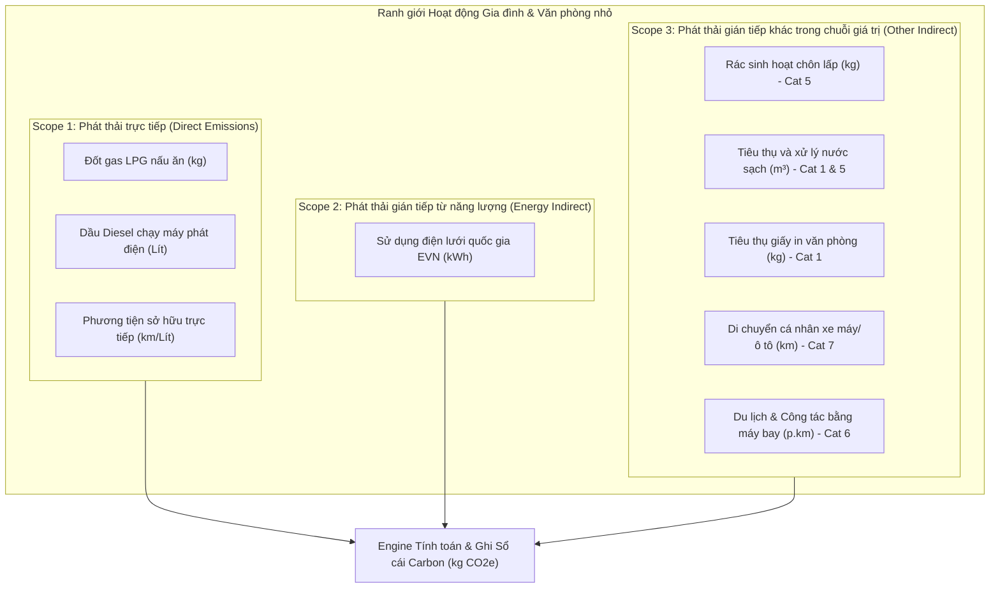
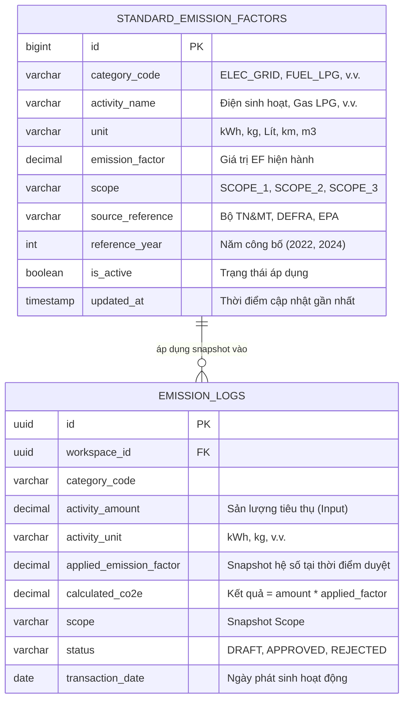
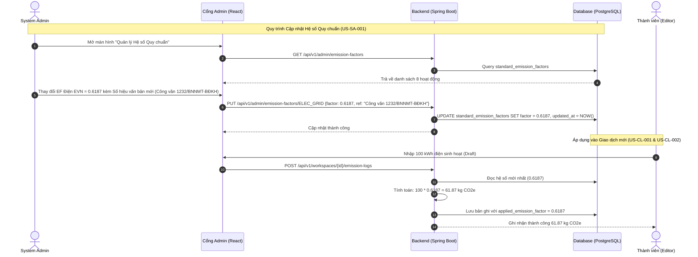

# DANH MỤC CÁC HOẠT ĐỘNG PHÁT THẢI ĐƯỢC HỖ TRỢ & HỆ SỐ PHÁT THẢI QUY CHUẨN

## (Supported Activities & Standard Emission Factors Specification)

### Dự án: Hệ thống Quản trị & Phân tích Dấu chân Carbon cho Gia đình/Văn phòng nhỏ (Personal & Micro-Office Carbon Ledger)

> **Căn cứ tài liệu kỹ thuật & nghiệp vụ:**
>
> - [spec.md](file:///home/datnguyen-nuoa/PMDC-BATCH4-DATNT250/spec.md): Mục 4 - Mô hình Dữ liệu và Công thức Tính toán Dấu chân Carbon
> - [docs/user-stories.md](file:///home/datnguyen-nuoa/PMDC-BATCH4-DATNT250/docs/user-stories.md): `US-CL-001` (Nạp thủ công), `US-CL-002` (Quy đổi kg CO2e tự động), `US-SA-001` (Quản lý hệ số quy chuẩn của System Admin)
> - [docs/MVP.md](file:///home/datnguyen-nuoa/PMDC-BATCH4-DATNT250/docs/MVP.md): Danh mục phân bổ Sprint 1 và Cấu trúc cơ sở dữ liệu `standard_emission_factors`
>
> **Tiêu chuẩn kiểm kê khí nhà kính tuân thủ:**
>
> - **GHG Protocol Corporate Accounting and Reporting Standard** (WRI / WBCSD)
> - **GHG Protocol Scope 2 Guidance** & **Corporate Value Chain (Scope 3) Standard**
> - **ISO 14064-1:2018** (Quy chuẩn kỹ thuật định lượng và báo cáo phát thải khí nhà kính cấp tổ chức)

---

## 📌 1. TỔNG QUAN & MỤC TIÊU TÀI LIỆU (PURPOSE & SCOPE)

Trong mô hình kiểm kê phát thải khí nhà kính dành cho **Hộ gia đình** và **Văn phòng nhỏ**, việc xác định chính xác danh mục hoạt động phát sinh phát thải và áp dụng đúng hệ số phát thải quy chuẩn (Emission Factor - EF) đóng vai trò quyết định đến độ tin cậy và giá trị pháp lý/kiểm toán của sổ cái carbon.

Tài liệu này được lập ra nhằm:

1. **Chuẩn hóa danh mục hoạt động:** Định nghĩa chính xác 8 hoạt động phát sinh carbon cốt lõi mà hệ thống hỗ trợ ghi nhận qua 3 kênh: Nhập thủ công sinh hoạt (`US-CL-001`), Quét hóa đơn/vé điện tử/công tơ AI OCR (`US-CL-003`) và Import bảng tính Excel (`US-CL-005`). Bao gồm toàn diện từ sinh hoạt gia đình, vận hành văn phòng đến du lịch/công tác hàng không.
2. **Quy định đơn vị tính đầu vào (Input Units):** Đồng bộ hóa đơn vị đo lường trực quan với người dùng ($kWh, kg, Lít, km, m^3, \text{hành khách-km}$) và bảng quy đổi cho các đơn vị đóng gói thương mại (Bình gas 12kg, Ram giấy A4, Chặng bay khứ hồi).
3. **Phân loại Scope nghiêm ngặt:** Phân định rõ ràng ranh giới Scope 1 (Trực tiếp), Scope 2 (Gián tiếp qua điện mua ngoài) và Scope 3 (Chuỗi giá trị: rác thải, nước sạch, vật tư, di chuyển cá nhân và du lịch/công tác hàng không).
4. **Cung cấp cơ sở pháp lý & khoa học trích dẫn:** Minh bạch hóa nguồn gốc các Hệ số phát thải khuyến nghị từ các cơ quan thẩm quyền quốc gia (**Bộ TN&MT Việt Nam**) và các tổ chức khí hậu quốc tế hàng đầu (**IPCC, ICAO, UK DEFRA/DESNZ, US EPA, IEA**).
5. **Cấu hình dữ liệu nền tảng cho Engine tính toán:** Thiết lập bộ thông số mặc định (Default Baseline Factors) cho bảng cơ sở dữ liệu `standard_emission_factors` phục vụ công thức quy đổi tự động:
   $$\text{Lượng phát thải } (\text{kg CO}_2\text{e}) = \text{Sản lượng tiêu thụ (Activity Data)} \times \text{Hệ số phát thải (Emission Factor)}$$

---

## 🌐 2. TỔNG QUAN PHÂN LOẠI THEO CHUẨN GHG PROTOCOL

- **Scope 1 (Phát thải trực tiếp):** Bắt nguồn từ các hoạt động đốt cháy nhiên liệu tại chỗ thuộc quyền sở hữu hoặc kiểm soát trực tiếp của hộ gia đình/văn phòng nhỏ (bếp gas nấu nướng, máy phát điện dự phòng khi mất điện, phương tiện thuộc sở hữu văn phòng).
- **Scope 2 (Phát thải năng lượng gián tiếp):** Phát thải sinh ra từ quá trình sản xuất điện năng mà hộ gia đình hoặc văn phòng tiêu thụ từ lưới điện quốc gia (EVN).
- **Scope 3 (Phát thải gián tiếp khác):** Các phát thải xảy ra trong chuỗi giá trị ngược dòng (Upstream) hoặc xuôi dòng (Downstream), bao gồm cung cấp và xử lý nước sạch, xử lý chôn lấp rác thải sinh hoạt, khai thác sản xuất giấy in văn phòng, phương tiện di chuyển cá nhân của thành viên/nhân viên đi làm (Commuting), và các chuyến bay du lịch/công tác đường dài (Business Travel & Tourism).

---

## 📊 3. BẢNG TỔNG HỢP CÁC HOẠT ĐỘNG ĐƯỢC HỖ TRỢ (MASTER ACTIVITY MATRIX)

Bảng tổng hợp dưới đây đặc tả đầy đủ 8 hoạt động hỗ trợ trong hệ thống, bao gồm mã định danh hệ thống, đơn vị đo, phân loại Scope, nguồn trích dẫn và hệ số quy đổi mặc định:

|  STT  | Nhóm hoạt động       | Hoạt động chi tiết       | Mã danh mục (Category Code) |  Đơn vị tính (Input Unit)   |        Phân loại Scope        | Nguồn hệ số phát thải (EF) khuyến nghị                         |                                                                                 Hệ số phát thải mặc định (Default EF)                                                                                  | Khí nhà kính quy đổi |
| :---: | -------------------- | ------------------------ | :-------------------------: | :-------------------------: | :---------------------------: | -------------------------------------------------------------- | :----------------------------------------------------------------------------------------------------------------------------------------------------------------------------------------------------: | :------------------: |
| **1** | **Điện năng**        | Sử dụng điện lưới        |         `ELEC_GRID`         |           **kWh**           |          **Scope 2**          | **Công văn 1232/BNNMT-BĐKH (BCT chủ trì)** / **EPA** / **IEA** |                                                                              **`0.6187`** kg CO₂e/kWh _(Lưới điện 2024)_                                                                               |    CO₂, CH₄, N₂O     |
| **2** | **Nhiên liệu**       | Đốt gas (LPG) nấu ăn     |         `FUEL_LPG`          |     **kg** hoặc **Tấn**     |          **Scope 1**          | **UK DEFRA 2026** / **IPCC Guidelines**                        |                                                                **`2939.36095`** kg CO₂e/tấn _(tương đương **`2.9394`** kg CO₂e/kg)_                                                                 |    CO₂, CH₄, N₂O     |
| **3** | **Nhiên liệu**       | Dầu Diesel chạy máy phát |        `FUEL_DIESEL`        |           **Lít**           |          **Scope 1**          | **IPCC Guidelines** / **UK DEFRA**                             |                                                                                       **`2.75541`** kg CO₂e/Lít                                                                                        |    CO₂, CH₄, N₂O     |
| **4** | **Di chuyển**        | Xe máy / Ô tô cá nhân    |         `MOBILITY`          |           **km**            |        **Scope 1 & 3**        | **UK DEFRA 2026** (Theo Size & Nhiên liệu)                     |                                                              **`[ Định nghĩa mục 4.4]`** _(Đơn vị: kg CO₂e/km - Để trống để nhập tay)_                                                              |    CO₂, CH₄, N₂O     |
| **5** | **Rác thải**         | Rác sinh hoạt chôn lấp   |      `WASTE_LANDFILL`       |     **kg** hoặc **Tấn**     |          **Scope 3**          | **UK DEFRA 2026** / **US EPA WARM**                            |                                                                **`4.465358`** kg CO₂e/tấn _(tương đương **`0.004465`** kg CO₂e/kg)_                                                                 |       CH₄, CO₂       |
| **6** | **Nước**             | Tiêu thụ và xử lý nước   |    `WATER_SUPPLY_TREAT`     |  **m³** hoặc **Triệu Lít**  |          **Scope 3**          | **UK DEFRA 2026** / **US EPA**                                 |                                                                **`0.19130`** kg CO₂e/m³ _(tương đương **`191.30156`** kg/triệu Lít)_                                                                |       CO₂, CH₄       |
| **7** | **Vật tư**           | Tiêu thụ giấy in         |       `OFFICE_PAPER`        |     **kg** hoặc **Tấn**     |          **Scope 3**          | **UK DEFRA 2026** / **US EPA**                                 |                                                                **`1343.59114`** kg CO₂e/tấn _(tương đương **`1.3436`** kg CO₂e/kg)_                                                                 |         CO₂          |
| **8** | **Du lịch & Đi lại** | Di chuyển bằng máy bay   |       `TRAVEL_FLIGHT`       | **p.km** hoặc **Chặng bay** | **Scope 3 (Cat 6)** & Cá nhân | **UK DEFRA 2026** / **ICAO** / **US EPA**                      | Theo hạng ghế (DEFRA 2026): • Economy: **`0.10916`** kg CO₂e/p.km • Premium Economy: **`0.17465`** kg CO₂e/p.km • Business: **`0.31656`** kg CO₂e/p.km • First: **`0.43663`** kg CO₂e/p.km |       CO₂ + RF       |

---

## 🔬 4. CHI TIẾT TỪNG NHÓM HOẠT ĐỘNG & CĂN CỨ TRÍCH DẪN NGUỒN HỆ SỐ

### 4.1. Nhóm Điện năng: Sử dụng điện lưới quốc gia (`ELEC_GRID`)

- **Đặc tả hoạt động:** Điện năng thương phẩm được tiêu thụ tại địa điểm của hộ gia đình hoặc văn phòng nhỏ lấy từ lưới điện xoay chiều hạ thế qua công tơ đo đếm của Tập đoàn Điện lực Việt Nam (EVN).
- **Phân loại Scope:** **Scope 2** (Phát thải gián tiếp từ sản xuất năng lượng mua ngoài) theo _GHG Protocol Scope 2 Guidance_.
- **Đơn vị đo lường:**
  - Đơn vị chuẩn: Kilowatt-giờ (**kWh**).
  - Kênh nạp dữ liệu: Nhập số đo công tơ/hóa đơn tiền điện (Thủ công), Quét ảnh hóa đơn EVN / công tơ cơ/điện tử bằng AI Vision (`US-CL-003`), hoặc Import Excel (`US-CL-005`).
- **Nguồn trích dẫn hệ số phát thải khuyến nghị:**
  1. **Cơ quan quản lý Nhà nước Việt Nam (Bộ TN&MT / Bộ Nông nghiệp & Môi trường - Cục Biến đổi khí hậu):**
     - _Văn bản trích dẫn mới nhất:_ **Công văn số 1232/BNNMT-BĐKH ngày 30/09/2026** (Bộ Công Thương chủ trì tính toán) về việc công bố Hệ số phát thải của lưới điện Việt Nam năm 2024. _(Tham chiếu lịch sử: Công văn 263/BĐKH-TTBĐKH ngày 12/04/2022 và Quyết định số 2626/QĐ-BTNMT ngày 10/10/2022)_.
     - _Giá trị công bố áp dụng:_ **`0.6187` $\text{kg CO}_2\text{e/kWh}$** (tương đương $0.6187\text{ tCO}_2/\text{MWh}$). Đây là hệ số chuẩn quốc gia mới nhất được cập nhật vào hệ thống.
  2. **US EPA (Cơ quan Bảo vệ Môi trường Hoa Kỳ):**
     - _Văn bản trích dẫn:_ **EPA eGRID** (Emissions & Generation Resource Integrated Database) và **EPA GHG Emission Factors Hub** (Bảng _Electricity: US National Average_).
     - _Phạm vi áp dụng:_ Dự phòng cho trường hợp Workspace đặt cấu hình vị trí tại khu vực Bắc Mỹ hoặc so sánh đối chuẩn quốc tế ($\approx 0.370 - 0.410\text{ kg CO}_2\text{e/kWh}$).
  3. **IEA (Cơ quan Năng lượng Quốc tế):**
     - _Tài liệu trích dẫn:_ **IEA Emission Factors Database** (Báo cáo thường niên về _CO2 Emissions from Fuel Combustion_). Cung cấp ma trận hệ số lưới điện cho hơn 150 quốc gia.
- **Công thức tính toán:**
  $$\text{Phát thải } (\text{kg CO}_2\text{e}) = \text{Điện tiêu thụ (kWh)} \times 0.6187$$

---

### 4.2. Nhóm Nhiên liệu: Đốt gas (LPG) nấu ăn (`FUEL_LPG`)

- **Đặc tả hoạt động:** Tiêu thụ Khí dầu mỏ hóa lỏng (LPG - thành phần chính gồm Propane $\text{C}_3\text{H}_8$ và Butane $\text{C}_4\text{H}_{10}$) phục vụ bếp nấu sinh hoạt gia đình, căn-tin văn phòng hoặc bình gas mini.
- **Phân loại Scope:** **Scope 1** (Phát thải trực tiếp từ đốt cháy nhiên liệu cố định - Stationary Combustion).
- **Đơn vị đo lường:**
  - Đơn vị chuẩn: Kilogram (**kg**) hoặc Tấn (**Tonne**).
  - Đơn vị phụ hỗ trợ quy đổi: Bình gas gia dụng tiêu chuẩn $12\text{ kg}$ ($1\text{ bình} = 12\text{ kg} \rightarrow 12 \times 2.93936095 \approx \mathbf{35.2723\text{ kg CO}_2\text{e}}$); bình mini $0.22\text{ kg}$.
- **Nguồn trích dẫn hệ số phát thải khuyến nghị:**
  1. **UK DEFRA / DESNZ 2026 (Vương quốc Anh):**
     - _Tài liệu trích dẫn:_ **UK Government GHG Conversion Factors for Company Reporting (DEFRA 2026)**, Bảng _Fuel properties - Gaseous fuels: LPG_.
     - _Giá trị công bố chuẩn:_
       - Tính theo tấn: **`2939.36095` $\text{kg CO}_2\text{e/tấn LPG}$**.
       - Quy đổi theo kg: $\frac{2939.36095}{1000} \approx \mathbf{2.93936\text{ kg CO}_2\text{e/kg LPG}}$ (làm tròn $2.9394\text{ kg CO}_2\text{e/kg}$).
  2. **IPCC (Ban Liên chính phủ về Biến đổi Khí hậu):**
     - _Tài liệu trích dẫn:_ **2006 IPCC Guidelines for National Greenhouse Gas Inventories**, Volume 2: Energy, Chapter 2 (Stationary Combustion), Bảng 2.2 và Bảng 2.3.
     - _Hệ số cơ sở:_ Nhiệt trị ròng (NCV) của LPG là $47.3\text{ TJ/Gg}$, hệ số phát thải nhiệt mặc định là $63,100\text{ kg CO}_2/\text{TJ}$ cộng với phát thải $\text{CH}_4$ và $\text{N}_2\text{O}$.
- **Công thức tính toán:**
  - _Tính theo kg:_
    $$\text{Phát thải } (\text{kg CO}_2\text{e}) = \text{Khối lượng gas (kg)} \times 2.93936$$
  - _Tính theo tấn:_
    $$\text{Phát thải } (\text{kg CO}_2\text{e}) = \text{Khối lượng gas (tấn)} \times 2939.36095$$

---

### 4.3. Nhóm Nhiên liệu: Dầu Diesel chạy máy phát điện (`FUEL_DIESEL`)

- **Đặc tả hoạt động:** Tiêu thụ dầu DO (Diesel Oil - hàm lượng lưu huỳnh 0.05%S hoặc 0.001%S) dùng để chạy máy phát điện dự phòng tại văn phòng nhỏ hoặc tổ dân phố khi xảy ra sự cố gián đoạn nguồn điện lưới.
- **Phân loại Scope:** **Scope 1** (Phát thải trực tiếp từ thiết bị đốt cố định).
- **Đơn vị đo lường:**
  - Đơn vị chuẩn: **Lít** (hoặc quy đổi từ kg theo khối lượng riêng trung bình $\approx 0.84\text{ kg/Lít}$).
- **Nguồn trích dẫn hệ số phát thải khuyến nghị:**
  1. **IPCC (Intergovernmental Panel on Climate Change):**
     - _Tài liệu trích dẫn:_ **2006 IPCC Guidelines**, Volume 2: Energy, Chapter 2 (Stationary Combustion - Gas/Diesel Oil).
     - _Giá trị cơ sở:_ Hệ số phát thải nhiệt mặc định là $74,100\text{ kg CO}_2/\text{TJ}$, quy đổi theo tỷ trọng dầu diesel thương phẩm đạt xấp xỉ $2.68\text{ - }2.70\text{ kg CO}_2\text{e/Lít}$.
  2. **UK DEFRA / DESNZ:**
     - _Tài liệu trích dẫn:_ **UK GHG Conversion Factors for Company Reporting**, Bảng _Liquid fuels: Gas oil / 100% mineral diesel_.
     - _Giá trị công bố:_ **$2.6870\text{ kg CO}_2\text{e/Lít}$** (bao gồm Direct GHG: $\text{CO}_2 = 2.658\text{ kg}$, $\text{CH}_4 = 0.001\text{ kg}$, $\text{N}_2\text{O} = 0.028\text{ kg CO}_2\text{e}$).
  3. **US EPA:**
     - _Tài liệu trích dẫn:_ **EPA GHG Emission Factors Hub**, Bảng _Stationary Combustion - Distillate Fuel Oil No. 2_. Hệ số $10.21\text{ kg CO}_2/\text{gallon} \approx 2.696\text{ kg CO}_2/\text{Lít}$.
- **Công thức tính toán:**
  $$\text{Phát thải } (\text{kg CO}_2\text{e}) = \text{Thể tích dầu tiêu thụ (Lít)} \times 2.6870$$

---

### 4.4. Nhóm Di chuyển: Xe máy / Ô tô cá nhân (`MOBILITY`)

- **Đặc tả hoạt động:** Di chuyển của thành viên gia đình hoặc lộ trình đi lại hàng ngày giữa nơi ở và văn phòng của nhân viên (Employee Commuting), cũng như đi công tác bằng phương tiện đường bộ.
- **Phân loại Scope:**
  - **Scope 1:** Nếu phương tiện thuộc quyền sở hữu đứng tên văn phòng/công ty và công ty trực tiếp thanh toán tiền nhiên liệu.
  - **Scope 3 (Category 7: Employee Commuting / Category 6: Business Travel):** Áp dụng cho phương tiện thuộc sở hữu cá nhân của thành viên/nhân viên dùng để đi làm hoặc công việc chung của văn phòng. (Đối với Workspace Hộ gia đình, được tính chung vào dấu chân sinh hoạt tổng thể).
- **Đơn vị đo lường:** Kilomet (**km**).
- **Phương pháp luận phân loại theo UK DEFRA 2026:**
  - Hệ số phát thải phương tiện đường bộ theo **DEFRA 2026** được chuẩn hóa phân tầng theo **Kích cỡ phương tiện (Size: Small / Medium / Large / Average)**.
  - Riêng đối với **Ô tô (Passenger Cars)**, hệ số được tách bạch thành 2 nhánh động cơ chính: **Nhiên liệu Xăng (Petrol)** và **Nhiên liệu Dầu (Diesel)**.
- **Bảng khung danh mục cấu hình hệ số (Để trống để người dùng/System Admin tự nhập tay):**

|  STT   | Loại phương tiện       |    Phân hạng Kích cỡ (Size)    |  Loại Nhiên liệu  | Đơn vị tính | Hệ số phát thải DEFRA 2026 (kg CO₂e/km) | Trạng thái cấu hình                 |
| :----: | ---------------------- | :----------------------------: | :---------------: | :---------: | :-------------------------------------: | ----------------------------------- |
| **1**  | **Xe máy (Motorbike)** |       **Small** (<125cc)       |   Xăng (Petrol)   |   **km**    |         `[ ________________ ]`          | _Để trống - Người dùng tự nhập tay_ |
| **2**  | **Xe máy (Motorbike)** |    **Medium** (125 - 500cc)    |   Xăng (Petrol)   |   **km**    |         `[ ________________ ]`          | _Để trống - Người dùng tự nhập tay_ |
| **3**  | **Xe máy (Motorbike)** |       **Large** (>500cc)       |   Xăng (Petrol)   |   **km**    |         `[ ________________ ]`          | _Để trống - Người dùng tự nhập tay_ |
| **4**  | **Xe máy (Motorbike)** | **Average** (Trung bình chung) |   Xăng (Petrol)   |   **km**    |         `[ ________________ ]`          | _Để trống - Người dùng tự nhập tay_ |
| **5**  | **Ô tô con (Car)**     |       **Small** (Cỡ nhỏ)       | **Petrol (Xăng)** |   **km**    |         `[ ________________ ]`          | _Để trống - Người dùng tự nhập tay_ |
| **6**  | **Ô tô con (Car)**     |     **Medium** (Cỡ trung)      | **Petrol (Xăng)** |   **km**    |         `[ ________________ ]`          | _Để trống - Người dùng tự nhập tay_ |
| **7**  | **Ô tô con (Car)**     |    **Large** (Cỡ lớn / SUV)    | **Petrol (Xăng)** |   **km**    |         `[ ________________ ]`          | _Để trống - Người dùng tự nhập tay_ |
| **8**  | **Ô tô con (Car)**     | **Average** (Trung bình chung) | **Petrol (Xăng)** |   **km**    |         `[ ________________ ]`          | _Để trống - Người dùng tự nhập tay_ |
| **9**  | **Ô tô con (Car)**     |       **Small** (Cỡ nhỏ)       | **Diesel (Dầu)**  |   **km**    |         `[ ________________ ]`          | _Để trống - Người dùng tự nhập tay_ |
| **10** | **Ô tô con (Car)**     |     **Medium** (Cỡ trung)      | **Diesel (Dầu)**  |   **km**    |         `[ ________________ ]`          | _Để trống - Người dùng tự nhập tay_ |
| **11** | **Ô tô con (Car)**     |    **Large** (Cỡ lớn / SUV)    | **Diesel (Dầu)**  |   **km**    |         `[ ________________ ]`          | _Để trống - Người dùng tự nhập tay_ |
| **12** | **Ô tô con (Car)**     | **Average** (Trung bình chung) | **Diesel (Dầu)**  |   **km**    |         `[ ________________ ]`          | _Để trống - Người dùng tự nhập tay_ |

> _Ghi chú vận hành:_ Khung 12 tham số trên đã được khởi tạo sẵn trong cấu trúc bảng `standard_emission_factors`. System Admin có toàn quyền nhập tay giá trị kg CO₂e/km tương ứng qua giao diện Quản lý Hệ số Quy chuẩn (`US-SA-001`).

- **Công thức tính toán:**
  $$\text{Phát thải } (\text{kg CO}_2\text{e}) = \text{Quãng đường (km)} \times EF_{\text{loại xe & size}} (\text{kg CO}_2\text{e/km})$$

---

### 4.5. Nhóm Rác thải: Rác sinh hoạt chôn lấp (`WASTE_LANDFILL`)

- **Đặc tả hoạt động:** Lượng rác thải rắn sinh hoạt hỗn hợp (Municipal Solid Waste - MSW) phát sinh từ sinh hoạt của hộ gia đình và hoạt động văn phòng (bao gồm bao bì, thực phẩm thừa, chất thải hữu cơ không phân loại) được xe thu gom chuyển về các bãi chôn lấp tập trung.
- **Cơ chế phát thải:** Quá trình phân hủy kỵ khí của các hợp chất hữu cơ trong điều kiện thiếu oxy tại bãi chôn lấp sinh ra khí nhà kính nguy hại là Khí Methane ($\text{CH}_4$, có thế năng làm nóng toàn cầu GWP cao gấp 28 lần $\text{CO}_2$ theo IPCC AR5).
- **Phân loại Scope:** **Scope 3 (Category 5: Waste Generated in Operations)** theo _GHG Protocol Corporate Value Chain Standard_.
- **Đơn vị đo lường:** Kilogram (**kg**) hoặc Tấn (**Tonne**).
- **Nguồn trích dẫn hệ số phát thải khuyến nghị:**
  1. **UK DEFRA 2026 (Vương quốc Anh):**
     - _Tài liệu trích dẫn:_ **UK Government GHG Conversion Factors for Company Reporting (DEFRA 2026)**, Bảng _Waste disposal - Commercial and industrial waste / Municipal waste to landfill_.
     - _Giá trị công bố chuẩn:_
       - Tính theo tấn: **`4.465358` $\text{kg CO}_2\text{e/tấn rác}$**.
       - Quy đổi theo kg: $\frac{4.465358}{1000} \approx \mathbf{0.004465358\text{ kg CO}_2\text{e/kg rác}}$ (làm tròn $0.004465\text{ kg CO}_2\text{e/kg}$).
  2. **US EPA (Cơ quan Bảo vệ Môi trường Hoa Kỳ):**
     - _Tài liệu trích dẫn:_ **US EPA WARM (Waste Reduction Model)** và **EPA GHG Emission Factors Hub**.
  3. **IPCC Guidelines:**
     - _Tài liệu trích dẫn:_ **2006 IPCC Guidelines for National GHG Inventories**, Volume 5: Waste, Chapter 3 (Solid Waste Disposal).
- **Công thức tính toán:**
  - _Tính theo kg:_
    $$\text{Phát thải } (\text{kg CO}_2\text{e}) = \text{Khối lượng rác (kg)} \times 0.004465$$
  - _Tính theo tấn:_
    $$\text{Phát thải } (\text{kg CO}_2\text{e}) = \text{Khối lượng rác (tấn)} \times 4.465358$$

---

### 4.6. Nhóm Nước: Tiêu thụ và xử lý nước sạch (`WATER_SUPPLY_TREAT`)

- **Đặc tả hoạt động:** Khối lượng nước sạch sử dụng từ hệ thống cấp nước sinh hoạt/đô thị (Sawaco, Viwaco, mạng lưới cấp nước sinh hoạt). Bao gồm năng lượng tiêu thụ tại nhà máy nước để bơm hút xử lý hóa chất sạch, truyền tải qua đường ống, và công đoạn thu gom xử lý nước thải sinh hoạt sau sử dụng.
- **Phân loại Scope:** **Scope 3 (Category 1: Purchased Goods and Services & Category 5: Waste generated in operations)** theo _GHG Protocol_.
- **Đơn vị đo lường:** Mét khối (**$m^3$**) hoặc Triệu Lít (**Million Litres**).
  - Quy đổi: $1\text{ million litres} = 1,000\text{ }m^3$.
  - Kênh nạp: Quét hóa đơn tiền nước bằng AI Vision (`US-CL-003`) hoặc nhập thủ công số mét khối trên đồng hồ đo nước.
- **Nguồn trích dẫn hệ số phát thải khuyến nghị:**
  1. **UK DEFRA 2026 (Vương quốc Anh):**
     - _Tài liệu trích dẫn:_ **UK Government GHG Conversion Factors for Company Reporting (DEFRA 2026)**, Bảng _Water supply and Water treatment_.
     - _Giá trị công bố chuẩn:_
       - Mỗi mét khối ($m^3$): **`0.19130` $\text{kg CO}_2\text{e/}m^3$**.
       - Mỗi triệu lít (Million litres): **`191.30156` $\text{kg CO}_2\text{e / million litres}$** ($1,000 \times 0.19130156 \approx 191.30156\text{ kg CO}_2\text{e}$).
  2. **US EPA:**
     - _Tài liệu trích dẫn:_ **EPA Energy and Carbon Footprint of Water Supply and Wastewater Facilities**.
- **Công thức tính toán:**
  - _Tính theo $m^3$:_
    $$\text{Phát thải } (\text{kg CO}_2\text{e}) = \text{Lượng nước } (m^3) \times 0.19130$$
  - _Tính theo triệu lít:_
    $$\text{Phát thải } (\text{kg CO}_2\text{e}) = \text{Lượng nước (triệu lít)} \times 191.30156$$

---

### 4.7. Nhóm Vật tư: Tiêu thụ giấy in văn phòng (`OFFICE_PAPER`)

- **Đặc tả hoạt động:** Tiêu thụ giấy in trắng khổ A4/A3 phục vụ in ấn tài liệu, hợp đồng, photocopy tại văn phòng nhỏ hoặc làm việc tại gia đình.
- **Cơ chế phát thải:** Phát thải vòng đời từ thượng nguồn (Cradle-to-Gate), bao gồm khai thác gỗ, vận chuyển nguyên liệu, tẩy trắng bột giấy bằng hóa chất và vận hành máy nghiền giấy công nghiệp.
- **Phân loại Scope:** **Scope 3 (Category 1: Purchased Goods and Services)** theo _GHG Protocol_.
- **Đơn vị đo lường:**
  - Đơn vị chuẩn: Kilogram (**kg**).
  - Đơn vị phụ trực quan: **Ram (Ream) giấy A4** (Quy cách 500 tờ/ram):
    - _Giấy A4 định lượng 70 gsm (g/$m^2$):_ 1 tờ $A4 = 0.21 \times 0.297\text{ m} = 0.06237\text{ m}^2$. Trọng lượng 1 tờ $= 4.366\text{ g}$. Trọng lượng 1 ram (500 tờ) $\approx \mathbf{2.18\text{ kg}}$.
    - _Giấy A4 định lượng 80 gsm:_ Trọng lượng 1 tờ $= 4.99\text{ g}$. Trọng lượng 1 ram (500 tờ) $\approx \mathbf{2.49\text{ kg}}$.
- **Nguồn trích dẫn hệ số phát thải khuyến nghị:**
  1. **UK DEFRA 2026 / DESNZ:**
     - _Tài liệu trích dẫn:_ **UK GHG Conversion Factors for Company Reporting 2026**, Bảng _Material use: Paper and board_ (Mục: _Paper and board: paper_).
     - _Hệ số phát thải chính thức:_ **`1343.59114` $\text{kg CO}_2\text{e}/\text{tấn}$** (tương đương **`1.34359114` $\text{kg CO}_2\text{e}/\text{kg}$**, làm tròn hiển thị: **`1.3436` $\text{kg CO}_2\text{e}/\text{kg}$**).
     - _Giá trị chuẩn lựa chọn mặc định trong dự án:_ **`1343.59114` $\text{kg CO}_2\text{e}/\text{tấn}$** (tương đương **`1.3436` $\text{kg CO}_2\text{e}/\text{kg}$**).
  2. **US EPA (WARM Model):**
     - _Tài liệu trích dẫn:_ **US EPA Waste Reduction Model - Office Paper Documentation**. Phát thải vòng đời sản xuất giấy văn phòng dao động $1.11 - 1.30\text{ kg CO}_2\text{e/kg}$.
- **Công thức tính toán:**
  - _Tính theo khối lượng (kg):_
    $$\text{Phát thải } (\text{kg CO}_2\text{e}) = \text{Khối lượng giấy (kg)} \times 1.3436$$
  - _Tính theo số ram giấy A4 (định lượng 70 gsm, trọng lượng ~2.18 kg/ram):_
    $$\text{Phát thải } (\text{kg CO}_2\text{e}) = \text{Số ram} \times 2.18\text{ kg} \times 1.3436 \approx \text{Số ram} \times 2.929\text{ kg CO}_2\text{e}$$
  - _Tính theo số ram giấy A4 (định lượng 80 gsm, trọng lượng ~2.49 kg/ram):_
    $$\text{Phát thải } (\text{kg CO}_2\text{e}) = \text{Số ram} \times 2.49\text{ kg} \times 1.3436 \approx \text{Số ram} \times 3.346\text{ kg CO}_2\text{e}$$

---

### 4.8. Nhóm Du lịch & Đi lại: Di chuyển bằng máy bay (`TRAVEL_FLIGHT`)

- **Đặc tả hoạt động:** Hoạt động di chuyển bằng đường hàng không thương mại phục vụ các chuyến đi du lịch nghỉ dưỡng gia đình, về quê dịp lễ tết, hoặc các chuyến đi công tác xa (Business Trip), tham dự hội thảo, du lịch tập thể (Team building/Retreat) của văn phòng nhỏ.
- **Phân loại Scope:**
  - **Scope 3 (Category 6: Business Travel):** Áp dụng cho văn phòng nhỏ khi công ty thanh toán vé máy bay cho nhân viên đi công tác hoặc tổ chức kỳ nghỉ/du lịch thường niên.
  - **Dấu chân Carbon Du lịch Cá nhân / Hộ gia đình:** Áp dụng cho Workspace Hộ gia đình. (Hàng không là nguồn phát thải tập trung có quy mô đột biến: chỉ 1 chuyến du lịch khứ hồi bằng máy bay có thể tạo ra lượng phát thải bằng cả 3 - 6 tháng tiêu thụ điện sinh hoạt của cả gia đình).
- **Đơn vị đo lường:**
  - Đơn vị cơ sở: **Hành khách-kilomet (p.km - passenger.km)**.
  - Đơn vị tiện ích theo nghiệp vụ: **Chặng bay (Lượt bay / Tuyến bay)**. Người dùng chỉ cần chọn sân bay khởi hành - sân bay đến và số lượng vé, hệ thống tự động ánh xạ cự ly đại viên (Great Circle Distance - GCD) cộng bù hao phí không lưu $8\%$ (theo tiêu chuẩn ICAO).
- **Cơ chế phát thải & Hiệu ứng Bức xạ Tầng cao (Radiative Forcing - RF):**
  - Động cơ máy bay phản lực đốt dầu Jet-A1 xả khí thải ở độ cao hành trình 9,000 - 12,000 m (tầng đối lưu trên và bình lưu dưới).
  - Ngoài $\text{CO}_2$, khí xả còn sinh ra hơi nước $\text{H}_2\text{O}$ ngưng tụ tạo thành các vệt khói trắng (contrails) và kích thích hình thành mây ti nhân tạo (cirrus clouds) giữ nhiệt, cùng khí $\text{NO}_x$ làm thay đổi cân bằng ozone tầng đối lưu.
  - Theo nghiên cứu của **IPCC** và hướng dẫn của **UK DEFRA**, tổng tác động làm ấm khí hậu (Radiative Forcing) thực tế cao gấp **$1.7\text{ - }1.9$ lần** so với việc chỉ tính riêng khí $\text{CO}_2$. Do đó, hệ thống mặc định áp dụng bộ hệ số chuẩn **"With RF"** để bảo đảm tính trung thực và toàn diện của dấu chân sinh thái.
- **Nguồn trích dẫn hệ số phát thải khuyến nghị:**
  1. **UK DEFRA 2026 (Vương quốc Anh):**
     - _Tài liệu trích dẫn:_ **UK Government GHG Conversion Factors for Company Reporting (DEFRA 2026)**, Bảng _Business travel - air_.
     - _Hệ số phát thải chuẩn hóa theo từng hạng vé (Cabin Class) tính trên passenger.km (p.km - đã bao gồm Radiative Forcing):_
       - **Hạng Phổ thông (Economy class):** **`0.10916` $\text{kg CO}_2\text{e / p.km}$**
       - **Hạng Phổ thông đặc biệt (Premium economy class):** **`0.17465` $\text{kg CO}_2\text{e / p.km}$**
       - **Hạng Thương gia (Business class):** **`0.31656` $\text{kg CO}_2\text{e / p.km}$**
       - **Hạng Nhất (First class):** **`0.43663` $\text{kg CO}_2\text{e / p.km}$**
  2. **ICAO (Tổ chức Hàng không Dân dụng Quốc tế - Liên Hợp Quốc):**
     - _Tài liệu trích dẫn:_ **ICAO Carbon Emissions Calculator (ICEC) Methodology**. Phương pháp luận chuẩn hóa toàn cầu về phân bổ nhiên liệu bay theo tải trọng hành khách và hàng hóa khoang bụng (belly freight).
  3. **US EPA:**
     - _Tài liệu trích dẫn:_ **EPA GHG Emission Factors Hub**, Bảng _Scope 3 Category 6: Business Travel - Commercial Air Travel_.

- **Bảng tra cứu quy đổi nhanh các chặng du lịch phổ biến tại Việt Nam (Route Lookup Matrix theo DEFRA 2026):**

| Tuyến bay (Origin ⇄ Destination)           | Khoảng cách 1 chiều | Cự ly khứ hồi | Phát thải Khứ hồi / Khách (Hạng Phổ thông: `0.10916`) | Phát thải Khứ hồi / Khách (Hạng Thương gia: `0.31656`) | Tương đương điện lưới 2024 (`0.6187`) |
| ------------------------------------------ | :-----------------: | :-----------: | :---------------------------------------------------: | :----------------------------------------------------: | :-----------------------------------: |
| **Hà Nội (HAN) ⇄ TP. Hồ Chí Minh (SGN)**   |     ≈ 1,160 km      |   2,320 km    |         2,320 × 0.10916 = **253.25 kg CO₂e**          |          2,320 × 0.31656 = **734.42 kg CO₂e**          |            ≈ 409 kWh điện             |
| **Hà Nội (HAN) ⇄ Đà Nẵng (DAD)**           |      ≈ 630 km       |   1,260 km    |         1,260 × 0.10916 = **137.54 kg CO₂e**          |          1,260 × 0.31656 = **398.87 kg CO₂e**          |            ≈ 222 kWh điện             |
| **TP. Hồ Chí Minh (SGN) ⇄ Phú Quốc (PQC)** |      ≈ 300 km       |    600 km     |           600 × 0.10916 = **65.50 kg CO₂e**           |           600 × 0.31656 = **189.94 kg CO₂e**           |            ≈ 106 kWh điện             |
| **Hà Nội / TP.HCM ⇄ Bangkok (BKK)**        |     ≈ 1,300 km      |   2,600 km    |         2,600 × 0.10916 = **283.82 kg CO₂e**          |          2,600 × 0.31656 = **823.06 kg CO₂e**          |            ≈ 459 kWh điện             |
| **Hà Nội / TP.HCM ⇄ Tokyo / Seoul**        |     ≈ 3,600 km      |   7,200 km    |         7,200 × 0.10916 = **785.95 kg CO₂e**          |         7,200 × 0.31656 = **2,279.23 kg CO₂e**         |            ≈ 1.27 MWh điện            |

- **Công thức tính toán:**
  $$\text{Phát thải } (\text{kg CO}_2\text{e}) = \text{Số hành khách} \times \text{Khoảng cách (km)} \times EF_{\text{hạng vé (DEFRA 2026)}} (\text{kg CO}_2\text{e/p.km})$$

---

## 🗄️ 5. THIẾT KẾ CƠ SỞ DỮ LIỆU & CHIẾN LƯỢC SNAPSHOT (DATA SCHEMA ALIGNMENT)

Để đảm bảo tính toàn vẹn và không làm sai lệch báo cáo lịch sử khi System Admin điều chỉnh hệ số phát thải theo chu kỳ năm (`US-SA-001`), cơ sở dữ liệu PostgreSQL thực hiện lưu trữ theo **Chiến lược Snapshot (Snapshot Pattern)**:

### Nguyên tắc bất biến dữ liệu (Data Immutability Principle):

1. **Bảng `standard_emission_factors`:** Chỉ chứa giá trị hiện hành và tham chiếu nguồn. Khi System Admin cập nhật hệ số mới (ví dụ cập nhật điện EVN từ $0.7221$ lên $0.7500$ theo `US-SA-001`), hệ thống ghi nhận thời gian hiệu lực và chỉ áp dụng cho các bản ghi tạo mới kể từ thời điểm đó.
2. **Bảng `emission_logs`:** Mỗi giao dịch khi được Trưởng nhóm (Reviewer) phê duyệt ghi sổ (`US-CL-002`) sẽ sao chép giá trị hệ số tại thời điểm đó vào cột `applied_emission_factor`. Nhờ vậy, khi hệ số quốc gia thay đổi trong tương lai, tổng phát thải và báo cáo của các tháng trong quá khứ hoàn toàn không bị thay đổi sai lệch.

---

## 🔄 6. QUY TRÌNH QUẢN LÝ VÒNG ĐỜI HỆ SỐ PHÁT THẢI (LIFECYCLE WORKFLOW)

---

## 📚 7. DANH MỤC TÀI LIỆU THAM KHẢO CHÍNH THỨC (OFFICIAL CITATIONS)

1. **Cơ quan Quản lý Nhà nước Việt Nam (Bộ TN&MT / Bộ Nông nghiệp & Môi trường / Bộ Công Thương):**
   - **Công văn số 1232/BNNMT-BĐKH ngày 30/09/2026** của Cục Biến đổi khí hậu (Bộ Công Thương chủ trì tính toán) về việc công bố Hệ số phát thải của lưới điện Việt Nam năm 2024 ($0.6187\text{ tCO}_2/\text{MWh} \leftrightarrow 0.6187\text{ kg CO}_2/\text{kWh}$).
   - Quyết định số 2626/QĐ-BTNMT ngày 10/10/2022 về việc ban hành danh mục hệ số phát thải phục vụ kiểm kê khí nhà kính cấp lĩnh vực.
   - Công văn số 263/BĐKH-TTBĐKH ngày 12/04/2022 của Cục Biến đổi khí hậu về hệ số phát thải lưới điện 2020 ($0.7221\text{ tCO}_2/\text{MWh}$).
2. **IPCC (Intergovernmental Panel on Climate Change):**
   - _2006 IPCC Guidelines for National Greenhouse Gas Inventories_ (Volume 2: Energy, Volume 5: Waste). [Truy cập: ipcc-nggip.iges.or.jp](https://www.ipcc-nggip.iges.or.jp/public/2006gl/)
   - _2019 Refinement to the 2006 IPCC Guidelines for National Greenhouse Gas Inventories_.
3. **UK DEFRA / DESNZ 2026 (Vương quốc Anh):**
   - _UK Government GHG Conversion Factors for Company Reporting (DEFRA 2026)_. Cung cấp bộ hệ số chuyển đổi toàn diện cho:
     - Nhiên liệu LPG: $2939.36095\text{ kg CO}_2\text{e/tấn}$ ($2.9394\text{ kg CO}_2\text{e/kg}$).
     - Cấp & thoát nước: $0.19130\text{ kg CO}_2\text{e/}m^3$ ($191.30156\text{ kg CO}_2\text{e/triệu Lít}$).
     - Rác sinh hoạt chôn lấp: $4.465358\text{ kg CO}_2\text{e/tấn}$ ($0.004465\text{ kg CO}_2\text{e/kg}$).
     - Du lịch hàng không: Economy $0.10916$, Premium Economy $0.17465$, Business $0.31656$, First $0.43663\text{ kg CO}_2\text{e/p.km}$.
     - Phương tiện giao thông đường bộ: Phân tầng theo Kích cỡ (Small, Medium, Large, Average) và loại nhiên liệu (Petrol, Diesel).
     - [Truy cập: gov.uk/government/collections/government-conversion-factors-for-company-reporting](https://www.gov.uk/government/collections/government-conversion-factors-for-company-reporting)
4. **US EPA (Cơ quan Bảo vệ Môi trường Hoa Kỳ):**
   - _GHG Emission Factors Hub (March 2024)_. [Truy cập: epa.gov/climateleadership/ghg-emission-factors-hub](https://www.epa.gov/climateleadership/ghg-emission-factors-hub)
   - _EPA WARM (Waste Reduction Model)_ - Quản trị và tính toán giảm thiểu phát thải vòng đời rác thải rắn.
   - _EPA eGRID (Emissions & Generation Resource Integrated Database)_ - Cơ sở dữ liệu lưới điện Hoa Kỳ.
5. **GHG Protocol (WRI & WBCSD):**
   - _A Corporate Accounting and Reporting Standard (Revised Edition)_.
   - _GHG Protocol Scope 2 Guidance (Amendment to the Corporate Standard)_.
   - _Corporate Value Chain (Scope 3) Accounting and Reporting Standard_.
6. **IEA (International Energy Agency):**
   - _IEA Emissions Factors Database (2023 Edition)_ - Báo cáo thường niên về phát thải $\text{CO}_2$ từ đốt nhiên liệu hóa thạch và sản xuất điện năng.
7. **ICAO (Tổ chức Hàng không Dân dụng Quốc tế - International Civil Aviation Organization):**
   - _ICAO Carbon Emissions Calculator (ICEC) Methodology (Version 12/2023)_ - Phương pháp luận chuẩn hóa của Liên Hợp Quốc về phân bổ phát thải khí nhà kính cho hành khách thương mại đường hàng không. [Truy cập: icao.int/environmental-protection/CarbonOffset](https://www.icao.int/environmental-protection/CarbonOffset/Pages/default.aspx)
8. **IATA (Hiệp hội Vận tải Hàng không Quốc tế):**
   - _IATA Recommended Practice 1726 - Passenger CO2 Calculation Methodology_ & Sáng kiến _IATA CO2 Connect_.
   - Khuyến nghị tính toán phát thải kết hợp hệ số bức xạ tầng cao (Radiative Forcing Index) và tải trọng hạng ghế.
