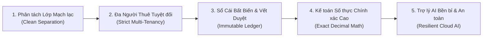
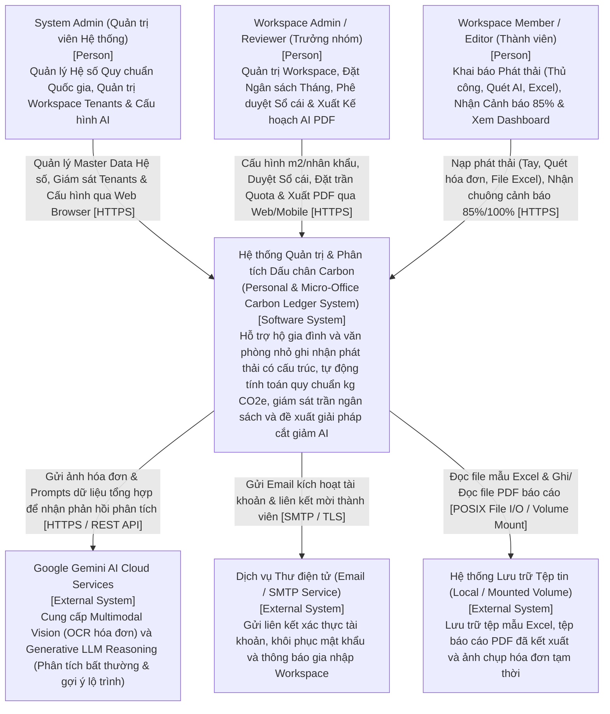
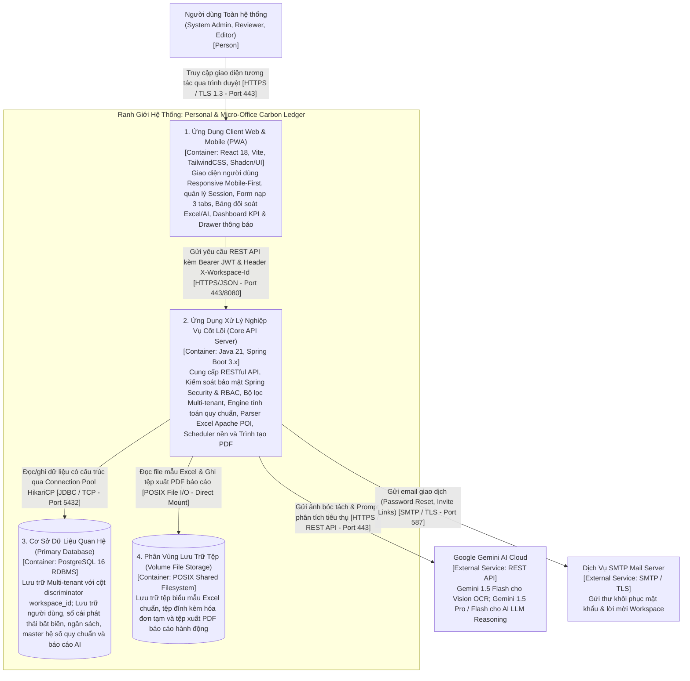
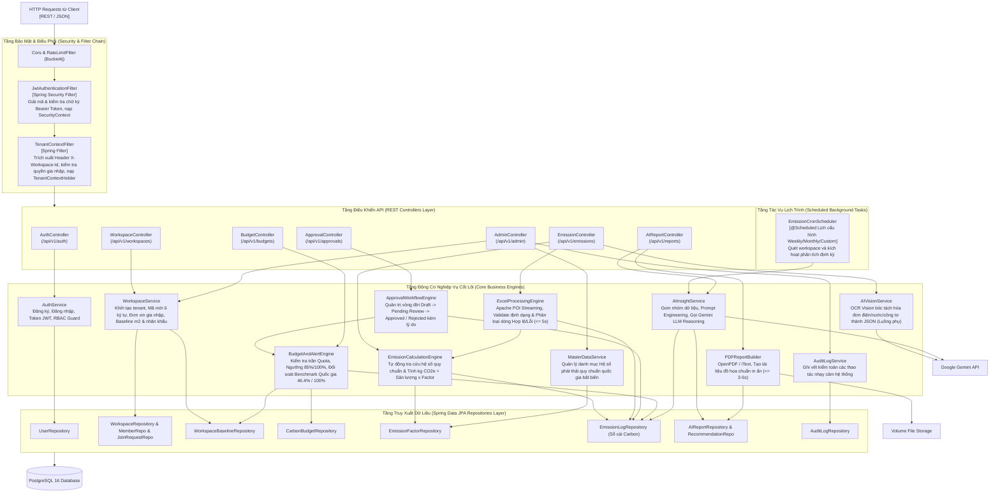
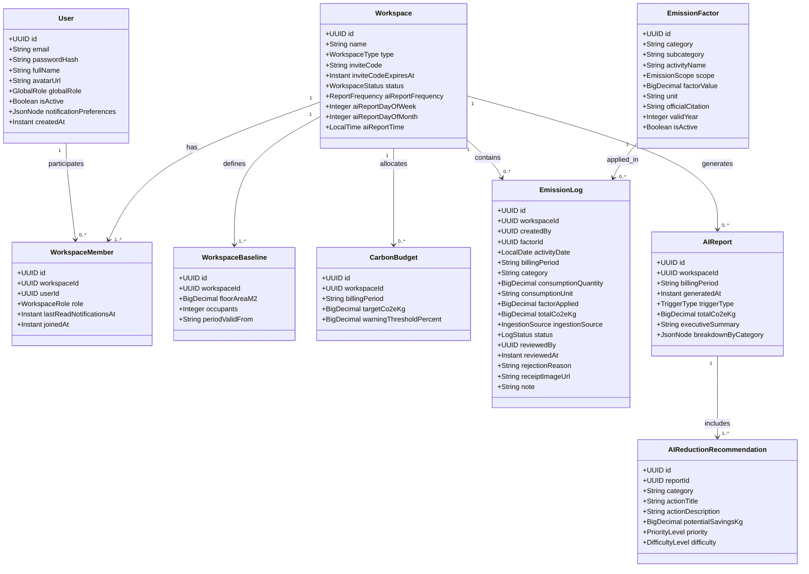
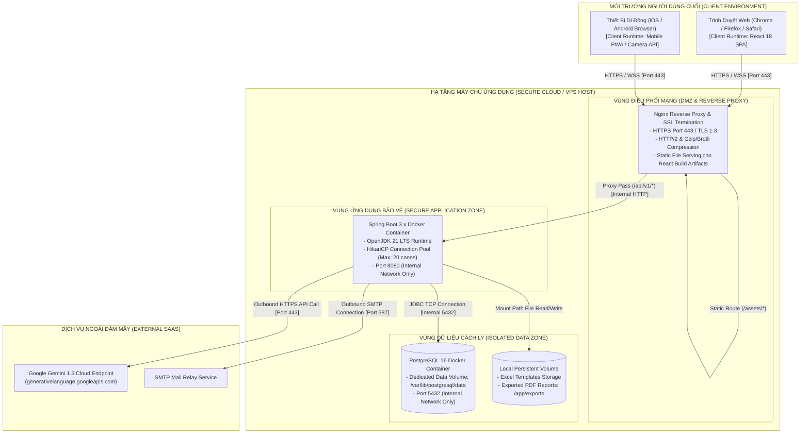

# TÀI LIỆU THIẾT KẾ KIẾN TRÚC THEO MÔ HÌNH C4 (C4 MODEL ARCHITECTURE SPECIFICATION)

## Hệ thống Quản trị & Phân tích Dấu chân Carbon cho Gia đình/Văn phòng nhỏ
### (Personal & Micro-Office Carbon Ledger)

---

## 📑 MỤC LỤC
1. [Tổng quan Kiến trúc & Nguyên lý Thiết kế](#1-tổng-quan-kiến-trúc--nguyên-lý-thiết-kế-architectural-overview--design-principles)
2. [C4 Level 1: Sơ đồ Ngữ cảnh Hệ thống (System Context Diagram)](#2-c4-level-1-sơ-đồ-ngữ-cảnh-hệ-thống-system-context-diagram)
3. [C4 Level 2: Sơ đồ Khối Ứng dụng & Dịch vụ (Container Diagram)](#3-c4-level-2-sơ-đồ-khối-ứng-dụng--dịch-vụ-container-diagram)
4. [C4 Level 3: Sơ đồ Thành phần Chi tiết (Component Diagram)](#4-c4-level-3-sơ-đồ-thành-phần-chi-tiết-component-diagram)
5. [C4 Level 4: Kiến trúc Mã nguồn & Triển khai Vật lý (Code & Deployment Architecture)](#5-c4-level-4-kiến-trúc-mã-nguồn--triển-khai-vật-lý-code--deployment-architecture)
6. [Các Quyết định Kiến trúc Trọng yếu (Architectural Decision Records - ADRs)](#6-các-quyết-định-kiến-trúc-trọng-yếu-architectural-decision-records---adrs)
7. [Tài liệu Liên kết & Đối soát](#7-tài-liệu-liên-kết--đối-soát)

---

## 1. TỔNG QUAN KIẾN TRÚC & NGUYÊN LÝ THIẾT KẾ (ARCHITECTURAL OVERVIEW & DESIGN PRINCIPLES)

### 1.1. Sứ Mệnh & Ranh Giới Hệ Thống
Hệ thống **Personal & Micro-Office Carbon Ledger** được định vị là nền tảng quản trị và cố vấn dữ liệu phát thải số hóa chuyên sâu dành riêng cho nhóm thực thể vi mô: **Hộ gia đình** và **Văn phòng nhỏ**.

> [!IMPORTANT]
> **Ranh giới Vận hành & Trách nhiệm Cốt lõi:**  
> Hệ thống **không hướng tới việc tự động nạp hóa dữ liệu từ thiết bị IoT/công tơ thông minh vật lý** và **không trực tiếp can thiệp/tự động cắt giảm phát thải vật lý**.  
> Trọng tâm của hệ thống là **tự động hóa tính toán quy chuẩn** dựa trên các hoạt động người dùng nhập liệu có cấu trúc, hỗ trợ **đề xuất phương án cắt giảm cá nhân hóa định lượng từ AI** và kiểm soát nghiêm ngặt kỷ luật ghi nhận qua quy trình phê duyệt (Approval Workflow).

### 1.2. Năm Nguyên Lý Kiến Trúc Cốt Lõi (Core Architectural Tenets)

1. **Phân tách Lớp Mạch lạc (Separation of Concerns & Clean Layered Architecture):**
   - Tách biệt tuyệt đối giữa Tầng Trình diễn (Presentation - React Vite SPA/PWA), Tầng Cổng Bảo mật & Điều hướng (Gateway & Security Filters), Tầng Nghiệp vụ Ứng dụng (Core Application Engines) và Tầng Lưu trữ Toàn vẹn (Persistence - PostgreSQL 16 ACID).
2. **Đa Người Thuê Tuyệt đối (Strict Multi-Tenancy Isolation):**
   - Áp dụng mô hình **Shared Database, Shared Schema with Discriminator Column (`workspace_id`)**.
   - Kiểm soát quyền truy cập tenant 2 lớp: `TenantContextFilter` ở cổng HTTP kết hợp Hibernate Filter / JPA Specification trong tầng Data Access, triệt tiêu hoàn toàn rủi ro rò rỉ dữ liệu chéo giữa các hộ gia đình hoặc tổ chức.
3. **Sổ Cái Bất Biến & Vết Duyệt Toàn Vẹn (Immutable Carbon Ledger & Audit Trail):**
   - Mọi bản ghi phát thải khi đã được Trưởng nhóm (Reviewer) phê duyệt (`APPROVED`) sẽ đóng băng vĩnh viễn hệ số quy đổi áp dụng (`factor_applied`) tại thời điểm duyệt.
   - Nghiêm cấm ghi đè hoặc tính toán lại quá khứ khi Quản trị viên cập nhật danh mục hệ số quy chuẩn quốc gia.
4. **Kế toán Phát thải Số thực Chính xác Cao (High-Precision Decimal Mathematics):**
   - Loại trừ hoàn toàn sai số làm tròn dấu phẩy động (IEEE 754 float/double). Toàn bộ sản lượng tiêu thụ, hệ số phát thải, kết quả quy đổi và hạn ngạch trần đều dùng kiểu dữ liệu `NUMERIC(12, 6)` trong CSDL và `java.math.BigDecimal` (phương thức làm tròn `RoundingMode.HALF_UP`) trong mã nguồn Backend.
5. **Trợ lý AI Bền bỉ & Khép kín (Resilient Cloud AI & Human-in-the-Loop):**
   - Luồng AI Vision (quét hóa đơn/công tơ) hoạt động theo nguyên tắc Human-in-the-loop: Dữ liệu bóc tách từ LLM bắt buộc hiển thị trên Modal Popup để người dùng đối chiếu, chỉnh sửa trước khi lưu bản ghi ở trạng thái `Draft`.
   - Luồng AI Reasoning (phân tích bất thường & đề xuất giải pháp) được bảo vệ bằng Circuit Breaker / Timeout ($15\text{s}$) và chạy định kỳ qua Cronjob nền hoặc kích hoạt On-demand.

---

## 2. C4 LEVEL 1: SƠ ĐỒ NGỮ CẢNH HỆ THỐNG (SYSTEM CONTEXT DIAGRAM)

Sơ đồ Ngữ cảnh (System Context) mô tả vị trí của hệ thống trong môi trường vận hành thực tế, các nhóm tác nhân người dùng (Actors) tương tác trực tiếp và các hệ thống dịch vụ đám mây bên ngoài liên kết.

### 2.1. Sơ đồ Mermaid C4 Context

### 2.2. Bảng Danh Mục Tác Nhân & Hệ Thống Tương Tác

| Tên Thực Thể | Phân Loại C4 | Vai Trò & Trách Nhiệm Nghiệp Vụ Chính | Giao Thức & Cơ Chế Trao Đổi |
|---|:---:|---|:---:|
| **System Admin** | Person | Quản lý danh mục Hệ số phát thải quy chuẩn quốc gia (EVN, QĐ 1232/BNNMT-BĐKH, IPCC, ICAO, DEFRA, EPA); quản lý trạng thái tenants; giám sát nhật ký kiểm toán. | HTTPS (Web Browser) / JWT Bearer Token |
| **Workspace Admin (Reviewer)** | Person | Khởi tạo không gian làm việc; thiết lập thông số nền ($m^2$, số người); mời thành viên; thiết lập hạn ngạch tháng & mốc cảnh báo $85\%$; phê duyệt/từ chối nạp phát thải; tùy biến lịch AI hoặc bấm kích hoạt on-demand; xuất PDF kế hoạch cắt giảm. | HTTPS (Web Browser & Mobile PWA) / JWT Bearer Token |
| **Workspace Member (Editor)** | Person | Nạp phát thải qua 3 hình thức (Thủ công lẻ, Quét AI hóa đơn/công tơ, Nạp hàng loạt bằng file mẫu Excel); xem tiến độ hạn ngạch tháng; nhận cảnh báo chạm trần; kiểm tra lịch sử duyệt bản ghi. | HTTPS (Web Browser & Mobile PWA) / JWT Bearer Token |
| **Personal & Micro-Office Carbon Ledger** | Software System | Hệ thống phần mềm cốt lõi chịu trách nhiệm xác thực, xử lý đa người thuê, tính toán tự động kg CO2e, quản lý hàng đợi duyệt, kiểm soát ngưỡng cảnh báo và điều phối báo cáo AI. | Nền tảng trung tâm |
| **Google Gemini AI Cloud** | External System | Cung cấp dịch vụ Gemini 1.5 Flash (bóc tách cấu trúc số liệu từ ảnh hóa đơn) và Gemini 1.5 Pro / Flash (phân tích biến động, đối soát hạn mức quốc gia và gợi ý giải pháp định lượng). | HTTPS / REST API (Gemini SDK / HTTP Client) |
| **Email / SMTP Service** | External System | Dịch vụ gửi thư điện tử giao dịch (Transactional Emails): Xác nhận đăng ký tài khoản, gửi mã OTP/link đặt lại mật khẩu, thư mời tham gia không gian làm việc. | SMTP qua cổng 587 (TLS) / API SendGrid |
| **Local / Volume Storage** | External System | Phân vùng lưu trữ tệp trên đĩa máy chủ (hoặc container volume mount) phục vụ lưu trữ file template Excel, file xuất báo cáo PDF chuẩn in ấn và cache ảnh hóa đơn tạm. | Local File System POSIX / Docker Mount |

---

## 3. C4 LEVEL 2: SƠ ĐỒ KHỐI ỨNG DỤNG & DỊCH VỤ (CONTAINER DIAGRAM)

Sơ đồ Container phóng to ranh giới phần mềm, minh họa các khối ứng dụng thực thi, kho lưu trữ dữ liệu và hạ tầng phân tách bên trong hệ thống.

### 3.1. Sơ đồ Mermaid C4 Container

### 3.2. Bảng Chi Tiết Đặc Tính Kỹ Thuật Từng Container

| Tên Container | Ngăn Xếp Công Nghệ | Vai Trò & Trách Nhiệm Chính | Cơ Chế Bảo Mật & Ràng Buộc Kỹ Thuật |
|---|---|---|---|
| **Frontend Web & Mobile Client (SPA / PWA)** | **React 18, Vite, TailwindCSS, TypeScript / JS, Shadcn/UI, Axios, Lucide Icons, Recharts** | - Cung cấp toàn bộ 26 màn hình tương tác (`SCR-*`). - Quản lý phiên người dùng (JWT trong Web Storage). - Điều phối context không gian làm việc (`workspace_id`). - Hỗ trợ Service Worker PWA cho thao tác chụp ảnh và duyệt nhanh trên mobile. - Tính toán suy diễn trạng thái Notification real-time dựa trên `last_read_notifications_at`. | - Chặn truy cập trái quyền bằng Route Guards phía Client (`SCR-ERR-403`). - Tự động đính kèm Token `Authorization: Bearer <JWT>` và Header `X-Workspace-Id` vào mọi HTTP Request. - Chống tấn công XSS thông qua cơ chế tự động escape ký tự của React. |
| **Core API Application Server** | **Java 21, Spring Boot 3.x, Spring Security 6.x, Spring Data JPA, Spring Scheduler, Apache POI 5.x, OpenPDF 1.3+** | - Điểm tiếp nhận duy nhất cho toàn bộ 21+ RESTful API Endpoints. - Xác thực và phân quyền RBAC 3 vai trò qua Spring Security. - Thực hiện cô lập dữ liệu đa người thuê (`TenantContextFilter`). - Đảm nhiệm Engine tính toán quy chuẩn phát thải ($\text{kg CO}_2\text{e}$). - Phân tích và kiểm chuẩn file mẫu Excel hàng loạt ($\le 5\text{s}$ cho 100 dòng). - Điều phối tác vụ định kỳ Cronjob AI và tạo báo cáo PDF in ấn ($\le 3-5\text{s}$). | - Mã hóa mật khẩu một chiều bằng thuật toán BCrypt. - Stateless Authentication: Kiểm tra tính hợp lệ của JWT Signature trên mỗi request. - Giới hạn tần suất gọi API (Rate Limiting) bằng Bucket4j. - Ràng buộc tính toán bằng kiểu dữ liệu `BigDecimal` chống sai số làm tròn. |
| **Primary Relational Database** | **PostgreSQL 16 RDBMS** | - Lưu trữ toàn bộ 11 bảng dữ liệu chuẩn hóa 3NF. - Đảm bảo toàn vẹn giao dịch ACID cho sổ cái carbon (`emission_logs`). - Hỗ trợ Multi-tenancy dựa trên cột discriminator `workspace_id`. - Tối ưu hóa truy vấn với hệ thống chỉ mục B-Tree, Composite Indexes và Partial Indexes (`WHERE status = 'PENDING_REVIEW'`). - Hỗ trợ lưu trữ dữ liệu bán cấu trúc bằng cột kiểu `JSONB` (`breakdown_by_category`, `notification_preferences`). | - Phân quyền truy cập tài khoản DB theo nguyên tắc đặc quyền tối thiểu (Least Privilege). - Lưu trữ thời gian chuẩn hóa theo `TIMESTAMPTZ` (UTC). - Thiết lập khóa ngoại ràng buộc toàn vẹn quan hệ (`ON DELETE CASCADE` / `RESTRICT`). |
| **Volume File Storage** | **POSIX Local File System / Docker Named Volume** | - Lưu trữ tệp biểu mẫu nạp phát thải Excel chuẩn (`emission_import_template.xlsx`). - Lưu trữ tạm ảnh hóa đơn tải lên trong phiên bóc tách AI Vision. - Lưu trữ tệp PDF báo cáo khuyến nghị cắt giảm sau khi kết xuất để người dùng tải xuống. | - Đặt phân quyền truy cập thư mục ngặt nghèo (`0700` cho tiến trình backend). - Xóa định kỳ tệp tạm (temporary files) sau khi xử lý xong phiên làm việc. - Kiểm tra định dạng tệp (MIME type) và dung lượng tải lên tối đa ($5\text{MB}$ cho ảnh, $10\text{MB}$ cho Excel). |

---

## 4. C4 LEVEL 3: SƠ ĐỒ THÀNH PHẦN CHI TIẾT (COMPONENT DIAGRAM)

Sơ đồ Thành phần phóng to bên trong khối **Core API Application Server (Java Spring Boot 3.x)**, đặc tả các tầng kiến trúc logic, luồng dữ liệu nội bộ và trách nhiệm chuyên biệt của từng engine xử lý.

### 4.1. Sơ đồ Mermaid C4 Component (Java Spring Boot Core)

### 4.2. Bảng Mô Tả Chi Tiết Chức Năng Từng Thành Phần (Component Catalog)

#### 4.2.1. Nhóm Điều Khiển API (REST Controllers)
1. **`AuthController`:** Tiếp nhận yêu cầu đăng nhập, đăng ký tài khoản (Google OAuth2 hoặc mật khẩu), đặt lại mật khẩu và cập nhật tùy chọn thông báo.
2. **`WorkspaceController`:** Xử lý khởi tạo không gian làm việc, chuyển đổi Workspace hiện tại, tạo/tra cứu mã mời 6 ký tự, tiếp nhận và duyệt đơn xin gia nhập.
3. **`EmissionController`:** Tiếp nhận 3 luồng nạp phát thải: Khai báo thủ công lẻ (`POST /emissions`), Tải file mẫu Excel (`POST /excel-import`), Xác nhận nạp hàng loạt (`POST /excel-confirm`), và Quét hóa đơn AI (`POST /ai-vision`).
4. **`ApprovalController`:** Cung cấp danh sách hàng đợi các bản ghi `PENDING_REVIEW` và các action phê duyệt (`POST /accept`) hoặc từ chối kèm lý do (`POST /reject`).
5. **`BudgetController`:** Quản lý trần phát thải tháng, tính toán tỷ lệ tiêu thụ thực tế và gợi ý hạn mức dựa trên National Benchmark.
6. **`AIReportController`:** Cung cấp dữ liệu báo cáo phân tích AI, kích hoạt sinh báo cáo bằng tay On-demand (`POST /generate`) và kết xuất tài liệu PDF (`GET /{id}/export-pdf`).
7. **`AdminController`:** Dành riêng cho Quản trị viên hệ thống để CRUD danh mục Hệ số phát thải chuẩn (`/admin/emission-factors`), quản trị trạng thái Workspace (`/admin/workspaces`), cấu hình Prompt AI và truy vấn Audit Log.

#### 4.2.2. Nhóm Động Cơ Nghiệp Vụ Cốt Lõi (Core Business Engines)
1. **`EmissionCalculationEngine`:**
   - Đảm nhiệm việc tự động quy đổi sản lượng hoạt động ra $\text{kg CO}_2\text{e}$ theo công thức:
     $$\text{Total CO}_2\text{e} (\text{kg}) = \text{Sản lượng tiêu thụ} \times \text{Hệ số phát thải chuẩn quy đổi}$$
   - Tra cứu trực tiếp từ bảng `emission_factors` dựa trên mã danh mục (`category`) và phạm vi tính toán (Scope 1, 2, 3).
   - Đóng băng vĩnh viễn giá trị hệ số tại trường `factor_applied` trên từng dòng ghi nhận của `emission_logs`.
2. **`ExcelProcessingEngine`:**
   - Xử lý đọc tệp bảng tính `.xlsx` qua thư viện Apache POI (chế độ Streaming Event-driven) bảo đảm thời gian xử lý $\le 5\text{s}$ cho 100 dòng dữ liệu.
   - Kiểm tra chặt chẽ định dạng ngày tháng, kiểu dữ liệu số, tính hợp lệ của mã danh mục hoạt động.
   - Tách tệp nạp thành 2 mảng dữ liệu rõ ràng trong `ExcelImportPreviewDTO`: Danh sách dòng hợp lệ (kèm số liệu quy đổi dự kiến) và Danh sách dòng không hợp lệ (kèm thông điệp lỗi chỉ rõ số dòng và cột vi phạm).
3. **`ApprovalWorkflowEngine`:**
   - Kiểm soát chuyển dịch trạng thái bản ghi phát thải:
     - Nếu người nạp là Thành viên (Editor): Bản ghi lưu ở trạng thái `DRAFT` / `PENDING_REVIEW`.
     - Nếu người nạp là Trưởng nhóm (Reviewer): Bản ghi được phê duyệt thẳng `APPROVED`.
   - Khi Reviewer nhấn Từ chối (`Reject`): Bắt buộc nhập lý do từ chối (`rejection_reason`), chuyển trạng thái thành `REJECTED`.
   - Khi Reviewer nhấn Duyệt (`Accept`): Cập nhật trạng thái thành `APPROVED`, kích hoạt `BudgetAndAlertEngine` để kiểm tra tức thời ngưỡng ngân sách.
4. **`BudgetAndAlertEngine`:**
   - Tính toán tổng phát thải đã tích lũy trong tháng đối chiếu với `target_co2e_kg`:
     $$\text{Tỷ lệ sử dụng (\%)} = \left(\frac{\sum \text{total\_co2e\_kg (Approved)}}{\text{target\_co2e\_kg}}\right) \times 100\%$$
   - Khi tỷ lệ đạt $\ge 85\%$: Hệ thống kích hoạt cảnh báo sớm mức Vàng.
   - Khi tỷ lệ đạt $\ge 100\%$: Hệ thống kích hoạt cảnh báo vượt trần mức Đỏ.
   - Tích hợp Engine đối soát Mức tham chiếu Quốc gia (National Benchmark Engine):
     - **Hộ gia đình (Household):** Áp dụng tỷ lệ $46.4\%$ mức phát thải bình quân quốc gia ($3.67\text{ tấn/người/năm} \times 46.4\% = 1.70288\text{ tấn/người/năm} \approx 141.91\text{ kg CO}_2\text{e}/\text{người/tháng}$).
     - **Nơi làm việc (Workplace):** Áp dụng tỷ lệ $100\%$ ($305.83\text{ kg CO}_2\text{e}/\text{người/tháng}$).
5. **`AIInsightService`:**
   - Thu thập và tổng hợp dữ liệu tiêu thụ theo danh mục hoạt động trong kỳ báo cáo (so sánh với kỳ trước liền kề).
   - Xây dựng Context Prompt chứa tỷ lệ cơ cấu phát thải, biến động tăng/giảm và gửi tới Google Gemini REST API.
   - Tiếp nhận phản hồi dạng JSON cấu trúc, lưu kết quả phân tích bất thường và các khuyến nghị đề xuất cắt giảm cá nhân hóa vào bảng `ai_reports` và `ai_reduction_recommendations`.
6. **`PDFReportBuilder`:**
   - Kết xuất tài liệu báo cáo đồ họa trực quan chuẩn in ấn từ dữ liệu phân tích của `ai_reports` sử dụng OpenPDF / iText.
   - Tối ưu hóa render bảng biểu và biểu đồ tóm tắt, bảo đảm thời gian phản hồi xuất file PDF trong $\le 3-5\text{ giây}$.

---

## 5. C4 LEVEL 4: KIẾN TRÚC MÃ NGUỒN & TRIỂN KHAI VẬT LÝ (CODE & DEPLOYMENT ARCHITECTURE)

### 5.1. Sơ Đồ Thực Thể Miền Nghiệp Vụ Cốt Lõi (Core Domain Model Class Diagram)

Mô hình lớp miền thể hiện cấu trúc đối tượng dữ liệu trong mã nguồn Java Spring Boot với kiểu dữ liệu `BigDecimal` chuẩn mực:

### 5.2. Các Mẫu Thiết Kế Phần Mềm Áp Dụng (Software Design Patterns)

1. **Template Method Pattern (`BaseIngestionProcessor`):**
   - Định nghĩa khung xương thuật toán nạp phát thải: `validateInput()` $\rightarrow$ `lookupFactor()` $\rightarrow$ `calculateCo2e()` $\rightarrow$ `determineInitialStatus()` $\rightarrow$ `saveToLedger()`. Các lớp con (`ManualIngestionProcessor`, `ExcelIngestionProcessor`, `VisionIngestionProcessor`) triển khai chi tiết từng bước nạp tương ứng.
2. **Strategy Pattern (`EmissionCalculationStrategy`):**
   - Đóng gói các công thức tính toán và làm tròn theo từng Scope (Scope 1 phát thải trực tiếp từ đốt nhiên liệu, Scope 2 phát thải gián tiếp từ điện lưới, Scope 3 phát thải chuỗi cung ứng vật tư & du lịch).
3. **Specification Pattern (`MultiTenantSpecification`):**
   - Kết hợp các mệnh đề lọc truy vấn động trong Spring Data JPA, luôn tiêm điều kiện `root.get("workspaceId").equals(TenantContext.getCurrentWorkspaceId())` vào mọi câu lệnh `SELECT`, `UPDATE`, `DELETE`.
4. **State Pattern (`EmissionRecordState`):**
   - Quản trị chuyển đổi trạng thái của bản ghi phát thải từ `DRAFT` $\rightarrow$ `PENDING_REVIEW` $\rightarrow$ `APPROVED` hoặc `REJECTED`, ngăn chặn việc sửa đổi dữ liệu khi đã được duyệt.

### 5.3. Sơ Đồ Triển Khai Hạ Tầng Vật Lý (Deployment Diagram)

Hệ thống được đóng gói container hóa (Docker) và triển khai trên hạ tầng máy chủ bảo mật:

---

## 6. CÁC QUYẾT ĐỊNH KIẾN TRÚC TRỌNG YẾU (ARCHITECTURAL DECISION RECORDS - ADRs)

### ADR-01: Kiến Trúc Đa Người Thuê (Multi-Tenancy Strategy)
- **Bối cảnh:** Hệ thống phục vụ đồng thời hàng ngàn Hộ gia đình và Văn phòng nhỏ với yêu cầu cô lập dữ liệu tuyệt đối nhưng cần tối ưu hóa chi phí máy chủ và độ phức tạp vận hành.
- **Quyết định:** Áp dụng mô hình **Shared Database, Shared Schema with Discriminator Column (`workspace_id`)**.
- **Biện pháp Bảo vệ:**
  1. `TenantContextFilter` bắt buộc kiểm tra Header `X-Workspace-Id` đối chiếu với bảng `workspace_members`.
  2. Spring Data JPA Specification tiêm tự động `workspace_id = :currentTenantId` vào mọi câu truy vấn.
- **Hệ quả:** Dễ dàng triển khai, chi phí tài nguyên tối thiểu, khả năng backup tập trung, nhưng đòi hỏi kỷ luật lập trình cao ở tầng truy vấn dữ liệu.

### ADR-02: Tính Bất Biến Của Sổ Cái Carbon (Carbon Ledger Immutability)
- **Bối cảnh:** Danh mục hệ số phát thải quy chuẩn quốc gia có thể thay đổi hàng năm theo thông tư của Bộ TN&MT hoặc EVN. Nếu tính toán động bằng cách join với bảng `emission_factors`, các số liệu phát thải của các tháng trong quá khứ sẽ bị sai lệch khi hệ số được cập nhật.
- **Quyết định:** Lưu đứt đoạn giá trị hệ số tại thời điểm duyệt vào cột `factor_applied NUMERIC(12, 6)` trên bảng `emission_logs`.
- **Hệ quả:** Bản ghi phát thải khi đã được phê duyệt sẽ đóng băng vĩnh viễn kết quả tính toán, bảo đảm tính toàn vẹn kiểm toán lịch sử phát thải.

### ADR-03: Kỹ Thuật Xử Lý Nạp File Mẫu Excel Hiệu Năng Cao
- **Bối cảnh:** Luồng nạp Excel là một trong hai luồng nạp chính (cùng với nạp tay), yêu cầu xử lý 100 dòng phát thải trong thời gian $\le 5\text{ giây}$.
- **Quyết định:** Sử dụng Apache POI với cơ chế đọc tuần tự Streaming, thực hiện xác thực logic toàn bộ dòng trong bộ nhớ và trả về `ExcelImportPreviewDTO` chia tách dòng hợp lệ / dòng lỗi trước khi thực hiện batch insert vào PostgreSQL.
- **Hệ quả:** Người dùng nắm rõ tình trạng dữ liệu trước khi lưu chính thức; loại bỏ rủi ro nghẽn I/O và sập bộ nhớ heap khi file có nhiều dòng.

### ADR-04: Cơ Chế Báo Cáo AI Linh Hoạt & Xuất PDF Tức Thời
- **Bối cảnh:** Người dùng cần linh hoạt giữa việc nhận báo cáo tự động định kỳ hoặc bấm nút sinh báo cáo tức thời để nộp/báo cáo nhanh.
- **Quyết định:** Tích hợp cả hai cơ chế: Spring Scheduler quét cấu hình `ai_report_frequency` (Hàng tuần, Hàng tháng hoặc Tắt) kết hợp API endpoint On-demand trigger. Trình tạo PDF sử dụng OpenPDF với template được biên dịch sẵn, đảm bảo thời gian xuất file $\le 3-5\text{ giây}$.
- **Hệ quả:** Trải nghiệm người dùng mượt mà, linh hoạt kiểm soát chi phí gọi API Google Gemini và đáp ứng hoàn hảo tiêu chuẩn thời gian phản hồi.

---

## 7. TÀI LIỆU LIÊN KẾT & ĐỐI SOÁT

Tài liệu Thiết kế Kiến trúc C4 này được xây dựng và chuẩn hóa trên cơ sở đối soát 100% với toàn bộ hệ thống tài liệu đặc tả của dự án:
- **Tài liệu Yêu cầu Sản phẩm:** [docs/01-PRD.md](../01-PRD.md)
- **Tài liệu Kiến trúc Thông tin:** [docs/09-information-architecture.md](../09-information-architecture.md)
- **Tài liệu Đặc tả API RESTful:** [docs/api-schema/api-schema.md](../api-schema/api-schema.md)
- **Tài liệu Mức Phát Thải Tham Chiếu:** [docs/emission-reference-benchmark.md](../emission-reference-benchmark.md)
- **Danh mục Hoạt động & Hệ số Quy chuẩn:** [docs/activity-supported.md](../activity-supported.md)
- **Danh mục 12 Use Cases:** [docs/03-use-cases.md](../03-use-cases.md)
- **Danh mục 15 User Stories:** [docs/04-user-stories.md](../04-user-stories.md)
- **Kế hoạch Triển khai MVP 6 Tuần:** [docs/02-MVP.md](../02-MVP.md)
- **File Bảng Kiểm Chuẩn Kiến Trúc C4:** [docs/c4-documentation/c4-verification-checklist.md](c4-verification-checklist.md)
