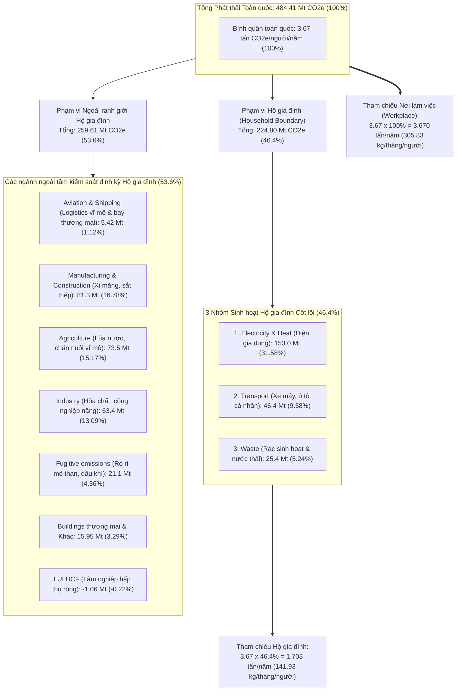
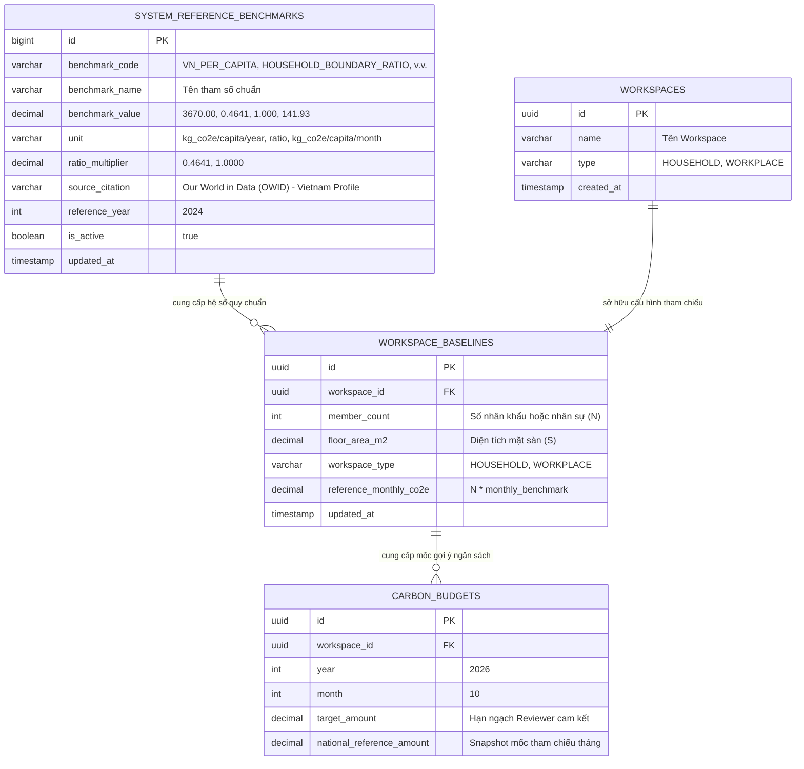
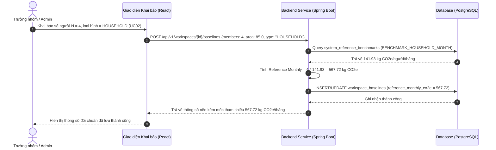

# QUY ĐỊNH & PHƯƠNG PHÁP LUẬN XÁC ĐỊNH MỨC PHÁT THẢI THAM CHIẾU QUỐC GIA
## (National Emission Reference Benchmark Specification)
### Phương pháp luận & Nguồn gốc Dữ liệu Xác định Tham số Phát thải Tham chiếu cho Hộ gia đình (46,4%) & Văn phòng (100%)

```
Dự án: Hệ thống Quản trị & Phân tích Dấu chân Carbon cho Gia đình/Văn phòng nhỏ (Personal & Micro-Office Carbon Ledger)
Tài liệu Kỹ thuật: Quy định Nguồn gốc & Phương pháp luận Xác định Mức phát thải Tham chiếu (Reference Benchmark Derivation)
Trạng thái: Hoàn thiện & Sẵn sàng Triển khai (Approved Specification)
Phiên bản: 2.0.0
Ngày cập nhật: 30/10/2026
```

> **Căn cứ tài liệu kỹ thuật & nghiệp vụ liên quan:**
> - [spec.md](file:///home/datnguyen-nuoa/PMDC-BATCH4-DATNT250/spec.md): Mục 3.1 - Luồng Khởi tạo & Lập kế hoạch, Mục 4 - Mô hình Dữ liệu và Công thức Tính toán
> - [docs/activity-supported.md](file:///home/datnguyen-nuoa/PMDC-BATCH4-DATNT250/docs/activity-supported.md): Danh mục Hoạt động Phát thải & Hệ số Phát thải Quy chuẩn (Scope 1, 2, 3)
> - [docs/usecase/use-cases.md](file:///home/datnguyen-nuoa/PMDC-BATCH4-DATNT250/docs/usecase/use-cases.md): `UC02` (Thông số nền), `UC09` (Thiết lập Ngân sách tháng), `UC11` (AI Insight)
> - [docs/user-stories.md](file:///home/datnguyen-nuoa/PMDC-BATCH4-DATNT250/docs/user-stories.md): `US-WS-002` (Khai báo thông số nền), `US-BG-001` (Gợi ý hạn ngạch ngân sách)
>
> **Nguồn trích dẫn dữ liệu quốc tế & quy chuẩn pháp lý:**
> - **Our World in Data (OWID):** Vietnam: CO2 and Greenhouse Gas Emissions Country Profile ([ourworldindata.org/profile/co2/vietnam](https://ourworldindata.org/profile/co2/vietnam))
> - **Climate Watch / WRI (World Resources Institute):** Vietnam National Greenhouse Gas Inventory by Sector
> - **GHG Protocol Corporate Standard & Scope 3 Guidance** (WRI / WBCSD)
> - **Bộ Tài nguyên và Môi trường Việt Nam (MONRE):** Báo cáo Cập nhật Đóng góp do quốc gia tự quyết định (NDC) & Báo cáo Kiểm kê Quốc gia Khí nhà kính

---

## 📌 1. TỔNG QUAN & MỤC TIÊU TÀI LIỆU (EXECUTIVE OVERVIEW & PURPOSE)

Trong bài toán kiểm soát dấu chân carbon vi mô tại **Hộ gia đình (Household)** và **Văn phòng nhỏ (Micro-Office / Workplace)**, nếu chỉ đo lường số lượng tuyệt đối ($\text{kg CO}_2\text{e}$) thì người dùng rất khó hình dung mức phát thải của mình là **cao hay thấp, lãng phí hay tiết kiệm** so với mức trung bình của xã hội. Do đó, hệ thống cần một bộ **Thông số Tham chiếu Khách quan (Reference Benchmarks)** làm thước đo đối chuẩn chuẩn mực.

> [!NOTE]
> **Phạm vi trọng tâm của tài liệu này:**  
> Tài liệu này **chỉ tập trung giải thích và định nghĩa nguồn gốc, cơ sở dữ liệu khoa học và phương pháp luận tính toán** các con số reference trong hệ thống.  
> Các cơ chế cảnh báo nghiệp vụ (như ngưỡng cảnh báo sớm 85%, báo động vượt trần 100%, hay quy tắc bắn notification) thuộc phạm vi đặc tả của [spec.md](file:///home/datnguyen-nuoa/PMDC-BATCH4-DATNT250/spec.md), [docs/usecase/use-cases.md](file:///home/datnguyen-nuoa/PMDC-BATCH4-DATNT250/docs/usecase/use-cases.md) (`UC10`) và [docs/user-stories.md](file:///home/datnguyen-nuoa/PMDC-BATCH4-DATNT250/docs/user-stories.md) (`US-BG-003`), không nằm trong tài liệu này.

### Mục tiêu cốt lõi:

1. **Minh bạch hóa nguồn gốc dữ liệu:** Xác lập nguồn dữ liệu phát thải quốc gia từ **Our World in Data** ($3.67\text{ tấn CO}_2\text{e/người/năm}$) và Viện Tài nguyên Thế giới (WRI).
2. **Luận giải phương pháp luận phân bổ ranh giới (Operational Boundary):**
   - Giải thích cơ sở khoa học xác định tỷ lệ **$46,4\%$** cho **Hộ gia đình** dựa trên 3 nhóm sinh hoạt định kỳ cốt lõi: Điện & Nhiệt, Giao thông đường bộ nội địa, và Rác thải sinh hoạt (loại trừ nhóm `Aviation and shipping` do tính chất logistics vĩ mô và không mang tính định kỳ hàng tháng).
   - Giải thích cơ sở áp dụng **$100\%$** mức kinh tế quốc gia cho **Văn phòng / Nơi làm việc** theo chuẩn kiểm kê doanh nghiệp quốc tế GHG Protocol.
3. **Quy định công thức toán học & bảng tra cứu quy chuẩn:** Chuẩn hóa công thức tính toán mức phát thải tham chiếu hàng tháng theo số lượng thành viên ($N$) và loại hình không gian.
4. **Đặc tả cấu trúc dữ liệu Master Data:** Định nghĩa cấu trúc lưu trữ hằng số trong bảng `system_reference_benchmarks` và cách tính toán tự động trong `workspace_baselines`.

---

## 🌐 2. DỮ LIỆU PHÁT THẢI QUỐC GIA VIỆT NAM & PHÂN TÍCH TỶ TRỌNG (DATA SOURCE & SECTORAL ANALYSIS)

### 2.1. Nguồn dữ liệu chính thống

Căn cứ theo hồ sơ phát thải khí nhà kính quốc gia Việt Nam được tổng hợp và phân tích bởi **Our World in Data** (dựa trên cơ sở dữ liệu Climate Watch và Viện Tài nguyên Thế giới - WRI):

- **Mức phát thải trung bình toàn quốc:**
  $$\text{National Per Capita GHG Emissions} = 3.67 \text{ tấn CO}_2\text{e/người/năm} \quad (3,670\text{ kg CO}_2\text{e/người/năm})$$
- **Tổng lượng phát thải khí nhà kính toàn bộ nền kinh tế:** $\sim 484.41 \text{ triệu tấn CO}_2\text{e/năm}$ ($\text{Mt CO}_2\text{e}$).

### 2.2. Bảng phân bổ cơ cấu phát thải theo từng ngành / lĩnh vực tại Việt Nam

Hệ sinh thái phát thải quốc gia bao gồm toàn bộ 11 danh mục/lĩnh vực hoạt động kinh tế, xã hội và công nghiệp:

| STT | Danh mục phát thải (GHG Sector) | Lượng phát thải ($\text{Mt CO}_2\text{e}$) | Tỷ trọng toàn quốc (%) | Bản chất hoạt động & Ranh giới trách nhiệm | Khả năng kiểm soát định kỳ của Hộ gia đình |
| :---: | :---| :---: | :---: | :---| :---: |
| **1** | **Electricity and heat (Điện & Nhiệt năng)** | **153.00** | **$31.58\%$** | Sản xuất điện than, khí, thủy điện phục vụ dân sinh & sản xuất. | ✅ **Thuộc sinh hoạt cốt lõi (Điện gia dụng)** |
| **2** | Manufacturing and construction (Chế tạo & Xây dựng) | 81.30 | $16.78\%$ | Sản xuất xi măng, sắt thép, gạch ngói, công trình hạ tầng quốc gia. | ❌ Ngoài ranh giới hộ gia đình |
| **3** | Agriculture (Nông nghiệp) | 73.50 | $15.17\%$ | Trồng lúa nước sinh khí $\text{CH}_4$, chăn nuôi gia súc, phân bón. | ❌ Sản xuất lương thực vĩ mô |
| **4** | Industry (Công nghiệp chế biến & Hóa chất) | 63.40 | $13.09\%$ | Hóa chất, lọc dầu, luyện kim màu, dệt may công nghiệp. | ❌ Sản xuất quy mô công nghiệp |
| **5** | **Transport (Giao thông đường bộ & nội địa)** | **46.40** | **$9.58\%$** | Xe máy cá nhân, xe ô tô, xe buýt, giao thông đô thị. | ✅ **Thuộc sinh hoạt cốt lõi (Đi lại cá nhân)** |
| **6** | **Waste (Chất thải sinh hoạt & Nước thải)** | **25.40** | **$5.24\%$** | Bãi chôn lấp rác đô thị sinh metan, xử lý bùn thải nước sinh hoạt. | ✅ **Thuộc sinh hoạt cốt lõi (Rác & Nước thải)** |
| **7** | Fugitive emissions (Phát thải rò rỉ nhiên liệu) | 21.10 | $4.36\%$ | Khí rò rỉ khi khai thác mỏ than, giàn khoan dầu khí ngoài khơi. | ❌ Thượng nguồn công nghiệp khai khoáng |
| **8** | Other fuel combustion (Đốt nhiên liệu khác) | 8.34 | $1.72\%$ | Lò đốt sinh khối phụ trợ trong thương mại và tiểu thủ công nghiệp. | ❌ Hoạt động sản xuất chuyên biệt |
| **9** | Buildings (Tòa nhà & Công trình thương mại) | 7.61 | $1.57\%$ | Năng lượng đốt trực tiếp tại các tòa cao ốc thương mại, khách sạn. | ❌ Hạ tầng bất động sản thương mại |
| **10** | Aviation and shipping (Hàng không & Vận tải biển) | 5.42 | $1.12\%$ | Các chuyến bay thương mại nội địa, quốc tế và vận tải hàng hải. | ❌ Ngoài ranh giới Hộ gia đình (Logistics vĩ mô & không định kỳ) |
| **11** | Land-use change and forestry (LULUCF - Lâm nghiệp) | -1.06 | $-0.22\%$ | Rừng tự nhiên hấp thụ carbon (Bể hấp thụ ròng quốc gia). | ❌ Lâm nghiệp quốc gia quản lý |
| | **TỔNG CỘNG TOÀN BỘ DANH MỤC** | **484.41** | **$100.00\%$** | **Toàn bộ nền kinh tế Việt Nam** | |

### 2.3. Xác định Tỷ trọng Nhóm phát thải Hộ gia đình ($46,4\%$)

Khi xem xét các hoạt động sinh hoạt thường nhật mang tính chất tiêu dùng lặp lại định kỳ hàng tháng mà một cá nhân hoặc hộ gia đình trực tiếp chi phối, hệ thống quy định **3 nhóm sinh hoạt cốt lõi**:
1. **Electricity and heat (Điện sinh hoạt & dân dụng):** $153.00\text{ triệu tấn}$
2. **Transport (Giao thông đường bộ cá nhân & nội địa):** $46.40\text{ triệu tấn}$
3. **Waste (Chất thải sinh hoạt & Nước thải):** $25.40\text{ triệu tấn}$

*(Nhóm `Aviation and shipping` $5.42\text{ Mt}$ được tách ra khỏi chuẩn sinh hoạt nền tảng hàng tháng vì hoạt động hàng không và hàng hải chủ yếu phục vụ thương mại, chuỗi cung ứng hàng hóa quốc tế và các chuyến du lịch đột xuất, không đại diện cho mức tiêu dùng nền tảng của các hộ gia đình).*

$$\text{Tổng phát thải 3 nhóm sinh hoạt cốt lõi} = 153.00 + 46.40 + 25.40 = \mathbf{224.80 \text{ triệu tấn CO}_2\text{e}}$$

$$\text{Tỷ trọng phát thải Hộ gia đình} = \frac{224.80\text{ Mt}}{484.41\text{ Mt}} \times 100\% = 46.4070\% \approx \mathbf{46,4\%}$$



---

## ⚖️ 3. LUẬN GIẢI PHƯƠNG PHÁP LUẬN: HOUSEHOLD (46,4%) VS. WORKPLACE (100%)

### 3.1. Ranh giới Hoạt động Hộ gia đình (Household Operational Boundary - 46,4%)

#### A. Căn cứ loại trừ $53,6\%$ còn lại
Một cá nhân trong đời sống gia đình thường nhật không thể chịu trách nhiệm hay trực tiếp cắt giảm phát thải từ:
- Đội tàu hàng hải và các chuyến bay thương mại quốc tế (`Aviation and shipping` - $5.42\text{ Mt}$).
- Các nhà máy xi măng, luyện cán thép, gạch men (`Manufacturing & Construction` - $81.3\text{ Mt}$).
- Hàng triệu hecta đồng ruộng lúa nước hay trang trại đại gia súc (`Agriculture` - $73.5\text{ Mt}$).
- Các tổ hợp lọc hóa dầu, hóa chất cơ bản (`Industry` - $63.4\text{ Mt}$).
- Khí rò rỉ trong lòng đất từ các mỏ than, giàn khoan ngoài khơi (`Fugitive emissions` - $21.1\text{ Mt}$).

#### B. Nguy cơ méo mó nếu áp dụng sai chuẩn 100% cho Hộ gia đình
Nếu hệ thống gán mức bình quân toàn bộ nền kinh tế $3.67\text{ tấn/năm}$ ($305.83\text{ kg CO}_2\text{e/người/tháng}$) làm chuẩn tham chiếu cho hộ gia đình:
- Mức trần bị "thổi phồng" lên **gấp $2.15$ lần** so với mức tiêu thụ dân sinh thực tế.
- Một gia đình 4 người nếu xài điện điều hòa 24/7, chạy ô tô phân khối lớn phát thải tới $800\text{ kg CO}_2\text{e/tháng}$ vẫn thấy mình "thấp hơn mức trung bình" ($4 \times 305.83 = 1,223\text{ kg CO}_2\text{e}$).
- Hậu quả: Mất hoàn toàn ý nghĩa đối chuẩn khách quan và làm sai lệch cơ sở so sánh định lượng.

#### C. Mức chuẩn quy định cho 1 nhân khẩu trong Hộ gia đình
$$\text{Ref}_{\text{Household, Năm}} = 3.67 \text{ tấn} \times 46.407\% = \mathbf{1.70314\text{ tấn CO}_2\text{e/người/năm}} \approx \mathbf{1,703.14\text{ kg CO}_2\text{e/người/năm}}$$

$$\text{Ref}_{\text{Household, Tháng}} = \frac{1,703.14\text{ kg}}{12} \approx \mathbf{141.93\text{ kg CO}_2\text{e/người/tháng}}$$

$$\text{Ref}_{\text{Household, Ngày}} = \frac{141.93\text{ kg}}{30.42\text{ ngày}} \approx \mathbf{4.67\text{ kg CO}_2\text{e/người/ngày}}$$

---

### 3.2. Ranh giới Hoạt động Văn phòng / Nơi làm việc (Workplace Boundary - 100%)

#### A. Bản chất kinh tế của Không gian làm việc
Khác với hộ gia đình tiêu dùng dân sinh, **Văn phòng / Doanh nghiệp nhỏ** là pháp nhân kinh tế trực tiếp tạo ra GDP:
- Một nhân sự tại văn phòng đại diện cho 1 suất lao động trong guồng máy kinh tế, tiêu thụ năng lượng cơ sở hạ tầng thương mại: hệ thống điều hòa trung tâm HVAC công suất lớn chạy liên tục 8-10 tiếng, máy tính cá nhân/máy chủ nội bộ, máy in/photocopy, thang máy, đồ dùng văn phòng phẩm.
- Các hoạt động logistics, vận chuyển hàng mẫu, đi lại công tác phục vụ trực tiếp cho hoạt động kinh doanh.

#### B. Tuân thủ tiêu chuẩn kiểm kê doanh nghiệp quốc tế
Theo chuẩn **GHG Protocol Corporate Standard** và **ISO 14064-1:2018**, ranh giới tổ chức của doanh nghiệp phản ánh trách nhiệm trong hệ sinh thái kinh tế quốc gia. Do đó, mốc đối sánh chuẩn cho 1 nhân sự làm việc được gắn với **$100\%$** mức phát thải trung bình của nền kinh tế:

$$\text{Ref}_{\text{Workplace, Năm}} = 3.67 \text{ tấn} \times 100\% = \mathbf{3.67\text{ tấn CO}_2\text{e/nhân sự/năm}} = \mathbf{3,670\text{ kg CO}_2\text{e/nhân sự/năm}}$$

$$\text{Ref}_{\text{Workplace, Tháng}} = \frac{3,670\text{ kg}}{12} \approx \mathbf{305.83\text{ kg CO}_2\text{e/nhân sự/tháng}}$$

$$\text{Ref}_{\text{Workplace, Ngày}} = \frac{305.83\text{ kg}}{30.42\text{ ngày}} \approx \mathbf{10.05\text{ kg CO}_2\text{e/nhân sự/ngày}}$$

#### C. Đối sánh kép với cường độ diện tích mặt sàn văn phòng ($m^2$)
Hệ thống kết hợp chỉ số tham chiếu diện tích theo chuẩn công trình xanh (EDGE / LEED / ASHRAE 90.1 tại Việt Nam):
- **Cường độ tiêu thụ điện sàn văn phòng tiêu chuẩn:** $15.0 - 20.0\text{ kWh}/m^2/\text{tháng}$.
- **Hệ số tham chiếu mặt sàn văn phòng:**
  $$\text{Ref}_{\text{FloorArea, Tháng}} = 18.0\text{ kWh}/m^2 \times 0.7221\text{ kg CO}_2\text{e/kWh} \approx \mathbf{13.00\text{ kg CO}_2\text{e}/m^2/\text{tháng}}$$

---

## 📐 4. CÔNG THỨC TOÁN HỌC & MA TRẬN QUY ĐỊNH REFERENCE TRONG HỆ THỐNG

### 4.1. Bảng Hằng số Tham chiếu Hệ thống (System Reference Constants)

Hệ thống quản lý tập trung các hằng số quy chuẩn này trong bảng cơ sở dữ liệu `system_reference_benchmarks`:

| Mã tham số | Tên định danh | Giá trị quy chuẩn | Đơn vị tính | Nguồn cơ sở |
|---|---|---|---|---|
| `NAT_PER_CAPITA_ANNUAL` | Phát thải bình quân đầu người toàn quốc | `3670.00` | $\text{kg CO}_2\text{e/người/năm}$ | OWID Vietnam Profile |
| `RATIO_HOUSEHOLD_BOUNDARY` | Tỷ lệ ranh giới Hộ gia đình | `0.4641` | Tỷ lệ ($46,4\%$) | 3 nhóm sinh hoạt cốt lõi / Tổng 11 nhóm |
| `RATIO_WORKPLACE_BOUNDARY` | Tỷ lệ ranh giới Nơi làm việc | `1.0000` | Tỷ lệ ($100,0\%$) | Toàn bộ nền kinh tế lao động |
| `BENCHMARK_HOUSEHOLD_MONTH` | Mức tham chiếu Hộ gia đình tháng | `141.93` | $\text{kg CO}_2\text{e/người/tháng}$ | $3,670 \times 46.407\% / 12$ |
| `BENCHMARK_WORKPLACE_MONTH` | Mức tham chiếu Nơi làm việc tháng | `305.83` | $\text{kg CO}_2\text{e/nhân sự/tháng}$ | $3,670 \times 100\% / 12$ |
| `BENCHMARK_OFFICE_FLOOR_MONTH` | Mức tham chiếu sàn văn phòng tháng | `13.00` | $\text{kg CO}_2\text{e}/m^2/\text{tháng}$ | Chuẩn công trình thương mại VN |

### 4.2. Công thức xác định Reference Baseline cho một Workspace

Khi cấu hình thông số nền cho một Workspace $W$ trong tháng $M$:
- Gọi $T_W \in \{\text{HOUSEHOLD}, \text{WORKPLACE}\}$ là loại hình không gian.
- Gọi $N$ là số lượng thành viên thường trú hoặc nhân sự làm việc (`member_count`).
- Gọi $S$ là diện tích sàn sử dụng tính bằng $m^2$ (`floor_area_m2`).

**Mức phát thải tham chiếu hàng tháng của Workspace ($\text{Ref}_{\text{Workspace}}$):**

$$\text{Ref}_{\text{Workspace}}(W, M) = \begin{cases} N \times 141.93 & \text{nếu } T_W = \text{HOUSEHOLD} \\ N \times 305.83 & \text{nếu } T_W = \text{WORKPLACE} \end{cases} \quad (\text{kg CO}_2\text{e/tháng})$$

### 4.3. Ma trận tra cứu nhanh theo quy mô Workspace

| Loại hình Workspace | Số người ($N$) | Diện tích sàn ($S$) | Mức tham chiếu Tháng ($\text{Ref}$) | Mức tham chiếu Ngày ($\text{Ref}/30$) |
|---|:---:|:---:|:---:|:---:|
| **Hộ gia đình độc thân** | 1 người | $35\text{ }m^2$ | **$141.9\text{ kg CO}_2\text{e}$** | $4.7\text{ kg}$ |
| **Hộ gia đình trẻ** | 2 người | $60\text{ }m^2$ | **$283.9\text{ kg CO}_2\text{e}$** | $9.5\text{ kg}$ |
| **Hộ gia đình tiêu chuẩn** | 4 người | $85\text{ }m^2$ | **$567.7\text{ kg CO}_2\text{e}$** | $18.9\text{ kg}$ |
| **Đại gia đình 3 thế hệ** | 6 người | $130\text{ }m^2$ | **$851.6\text{ kg CO}_2\text{e}$** | $28.4\text{ kg}$ |
| **Văn phòng Khởi nghiệp (Startup)** | 5 người | $50\text{ }m^2$ | **$1,529.2\text{ kg CO}_2\text{e}$** | $51.0\text{ kg}$ |
| **Văn phòng Nhỏ (Micro-Office)** | 10 người | $100\text{ }m^2$ | **$3,058.3\text{ kg CO}_2\text{e}$** | $101.9\text{ kg}$ |
| **Văn phòng Trung bình** | 20 người | $200\text{ }m^2$ | **$6,116.6\text{ kg CO}_2\text{e}$** | $203.9\text{ kg}$ |

---

## 🔗 5. NGUYÊN TẮC CUNG CẤP THAM SỐ THAM CHIẾU CHO CÁC PHÂN HỆ NGHIỆP VỤ

Thông số Reference sau khi được xác định sẽ được cung cấp làm mốc đối chuẩn cho các phân hệ chức năng:

1. **Cung cấp mốc gợi ý cho Quản trị Ngân sách (`UC09`):**  
   Khi Reviewer mở form "Thiết lập Ngân sách tháng", hệ thống lấy giá trị $\text{Ref}_{\text{Workspace}}$ để hiển thị mốc tham khảo đối sánh (ví dụ: hiển thị mốc chuẩn $568\text{ kg CO}_2\text{e}$ cho gia đình 4 người) giúp người dùng có cơ sở số liệu khách quan khi tự quyết định hạn ngạch.
2. **Cung cấp cơ sở tính Chỉ số Cường độ (Carbon Intensity Ratio):**  
   Dashboard sử dụng con số reference để tính toán tỷ lệ so sánh tương đối:
   $$\text{Benchmark Ratio } (\mathcal{R}) = \frac{\text{Tổng kg CO}_2\text{e thực tế trong tháng}}{\text{Ref}_{\text{Workspace}}} \times 100\%$$
3. **Cung cấp Context đối chuẩn cho Module AI Insight (`UC11`):**  
   Khi Cronjob tổng hợp dữ liệu để gửi prompt vào LLM (Gemini/Claude), các tham số đối chuẩn được đẩy vào payload context:
   ```json
   {
     "workspace_type": "HOUSEHOLD",
     "member_count": 4,
     "national_reference_monthly_total": 567.72,
     "national_reference_per_capita": 141.93
   }
   ```
   Nhờ có đối sánh đúng $46,4\%$, AI hiểu rõ ranh giới hộ gia đình và chỉ tập trung phân tích 3 nhóm sinh hoạt cốt lõi (Điện gia dụng, Đi lại bằng xe máy/ô tô, Rác thải).

---

## 🗄️ 6. THIẾT KẾ CƠ SỞ DỮ LIỆU LƯU TRỮ MASTER DATA THAM CHIẾU

### 6.1. Sơ đồ Quan hệ Thực thể (ERD)



### 6.2. Đặc tả Bảng CSDL SQL Chi tiết

#### Bảng `system_reference_benchmarks` (Master Data Quốc gia)
```sql
CREATE TABLE system_reference_benchmarks (
    id BIGSERIAL PRIMARY KEY,
    benchmark_code VARCHAR(50) UNIQUE NOT NULL,
    benchmark_name VARCHAR(150) NOT NULL,
    benchmark_value NUMERIC(10, 4) NOT NULL,
    unit VARCHAR(30) NOT NULL,
    ratio_multiplier NUMERIC(5, 4) DEFAULT 1.0000,
    source_citation VARCHAR(255) NOT NULL,
    reference_year INT NOT NULL,
    is_active BOOLEAN DEFAULT TRUE,
    created_at TIMESTAMP WITH TIME ZONE DEFAULT CURRENT_TIMESTAMP,
    updated_at TIMESTAMP WITH TIME ZONE DEFAULT CURRENT_TIMESTAMP
);

-- Khởi tạo dữ liệu chuẩn xác theo Our World in Data Vietnam
INSERT INTO system_reference_benchmarks 
(benchmark_code, benchmark_name, benchmark_value, unit, ratio_multiplier, source_citation, reference_year)
VALUES
('VN_PER_CAPITA_ANNUAL', 'Mức phát thải bình quân đầu người toàn quốc', 3670.0000, 'kg_co2e/capita/year', 1.0000, 'Our World in Data (OWID) - Vietnam Profile', 2024),
('HOUSEHOLD_BOUNDARY_RATIO', 'Tỷ lệ ranh giới phát thải Hộ gia đình', 0.4641, 'ratio', 0.4641, 'OWID 3 groups: Electricity, Transport, Waste', 2024),
('WORKPLACE_BOUNDARY_RATIO', 'Tỷ lệ ranh giới phát thải Nơi làm việc', 1.0000, 'ratio', 1.0000, 'National Economic Per Capita Basis', 2024),
('HOUSEHOLD_PER_CAPITA_MONTHLY', 'Mức tham chiếu Hộ gia đình mỗi nhân khẩu/tháng', 141.9283, 'kg_co2e/capita/month', 0.4641, '3670 * 46.407% / 12', 2024),
('WORKPLACE_PER_CAPITA_MONTHLY', 'Mức tham chiếu Nơi làm việc mỗi nhân sự/tháng', 305.8333, 'kg_co2e/capita/month', 1.0000, '3670 * 100% / 12', 2024);
```

#### Cập nhật Bảng `workspace_baselines` (Công thức tính tự động)
```sql
ALTER TABLE workspace_baselines 
ADD COLUMN workspace_type VARCHAR(20) NOT NULL DEFAULT 'HOUSEHOLD' CHECK (workspace_type IN ('HOUSEHOLD', 'WORKPLACE')),
ADD COLUMN reference_monthly_co2e NUMERIC(10, 2) GENERATED ALWAYS AS (
    CASE 
        WHEN workspace_type = 'HOUSEHOLD' THEN member_count * 141.93
        WHEN workspace_type = 'WORKPLACE' THEN member_count * 305.83
        ELSE member_count * 141.93
    END
) STORED;
```

### 6.3. Luồng Truy xuất & Khởi tạo Tham số Tham chiếu (Data Retrieval Sequence)



---

## 📚 7. TÀI LIỆU THAM KHẢO & CƠ SỞ TRÍCH DẪN KHOA HỌC (REFERENCES & CITATIONS)

1. **Our World in Data (OWID) - Vietnam Profile:**
   - *URL:* https://ourworldindata.org/profile/co2/vietnam
   - *Dữ liệu trích xuất:* Total greenhouse gas emissions per capita in Vietnam: $3.67\text{ tonnes CO}_2\text{e/year/capita}$.
   - *Phân bổ các ngành:* Climate Watch Data, World Resources Institute (WRI), 2024.
2. **GHG Protocol Standards:**
   - *GHG Protocol Corporate Accounting and Reporting Standard* (Revised Edition) - World Resources Institute (WRI) & World Business Council for Sustainable Development (WBCSD).
   - *Corporate Value Chain (Scope 3) Accounting and Reporting Standard.*
3. **Bộ Tài nguyên và Môi trường Việt Nam (MONRE):**
   - Báo cáo Cập nhật Đóng góp do quốc gia tự quyết định (NDC) của Việt Nam trình Ban thư ký Công ước khung Liên Hợp Quốc về Biến đổi khí hậu (UNFCCC).
   - Quyết định số 2626/QĐ-BTNMT ngày 10/10/2022 về việc công bố danh mục hệ số phát thải phục vụ kiểm kê khí nhà kính.
4. **Tiêu chuẩn Thiết kế Tòa nhà & Công trình Xanh:**
   - QCVN 09:2017/BXD - Quy chuẩn kỹ thuật quốc gia về Các công trình xây dựng sử dụng năng lượng hiệu quả.
   - ASHRAE Standard 90.1 - Energy Standard for Buildings Except Low-Rise Residential Buildings.

---

*Tài liệu Quy định Nguồn gốc & Phương pháp luận Xác định Mức phát thải Tham chiếu này là cơ sở khoa học bất biến để định hình các tham số đối chuẩn cho Dự án Personal & Micro-Office Carbon Ledger.*
