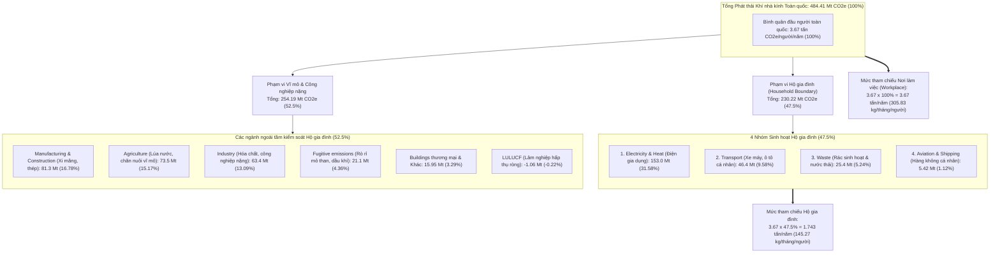
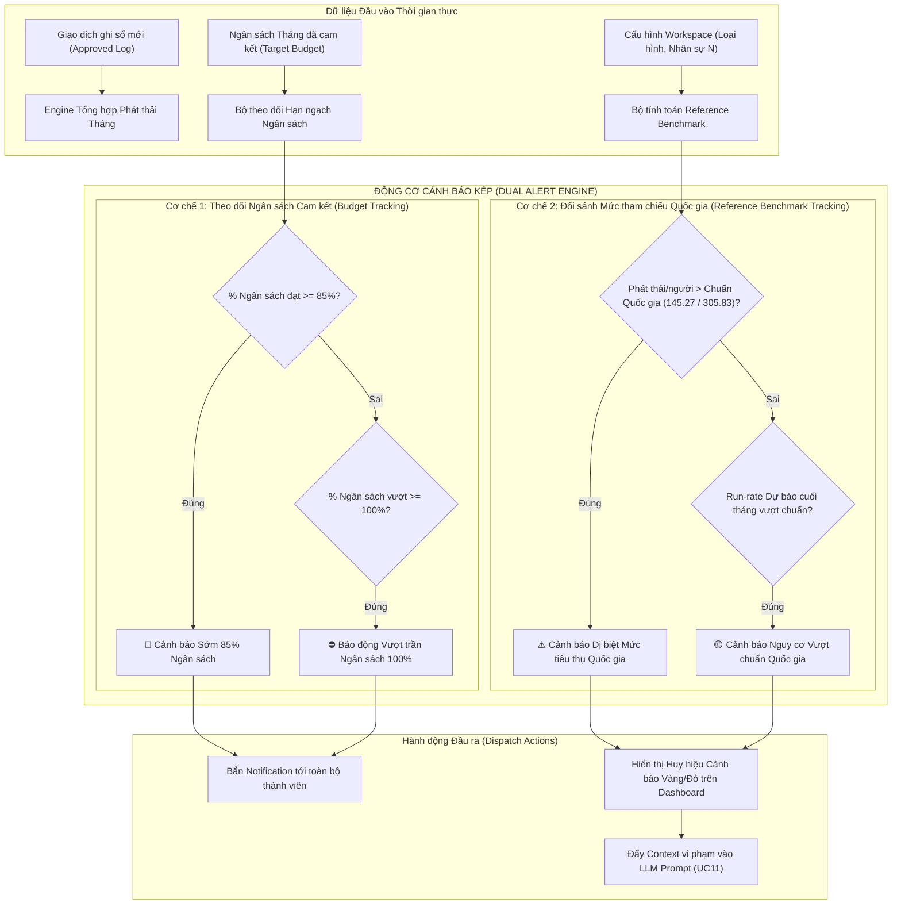
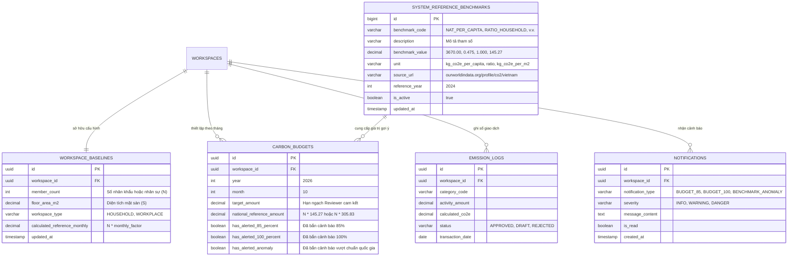
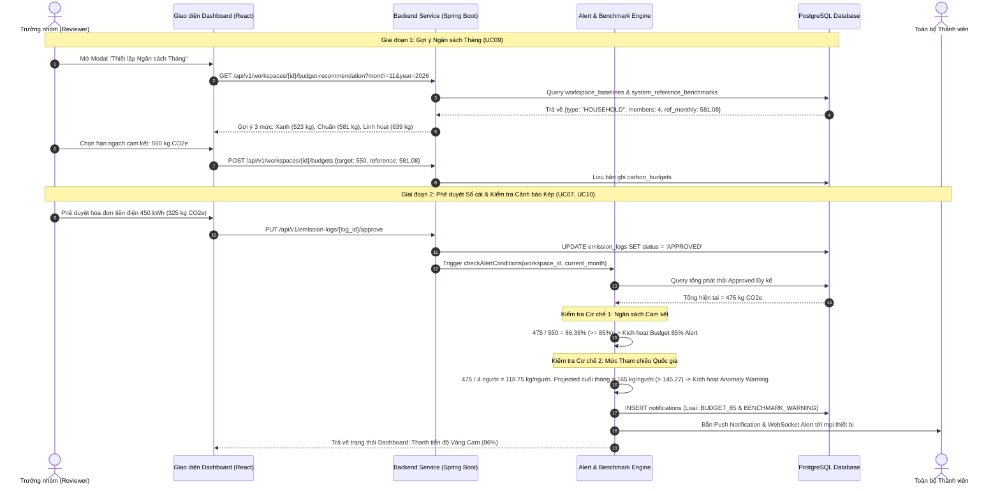

# QUY ĐỊNH & PHƯƠNG PHÁP LUẬN XÁC ĐỊNH MỨC PHÁT THẢI THAM CHIẾU QUỐC GIA
## (National Emission Reference Benchmark Specification)
### Chuẩn đối sánh phát thải Hộ gia đình (47,5%) & Văn phòng (100%) phục vụ Gợi ý Ngân sách, Phân tích Hiệu suất và Kích hoạt Cảnh báo Thông minh

```
Dự án: Hệ thống Quản trị & Phân tích Dấu chân Carbon cho Gia đình/Văn phòng nhỏ (Personal & Micro-Office Carbon Ledger)
Tài liệu Kỹ thuật & Nghiệp vụ: Quy định Mức phát thải Tham chiếu & Thuật toán Cảnh báo
Trạng thái: Hoàn thiện & Sẵn sàng Triển khai (Approved Specification)
Phiên bản: 1.0.0
Ngày ban hành: 30/10/2026
```

> **Căn cứ tài liệu kỹ thuật & nghiệp vụ liên quan:**
> - [spec.md](file:///home/datnguyen-nuoa/PMDC-BATCH4-DATNT250/spec.md): Mục 3 - Luồng Nghiệp vụ Cốt lõi & Mục 4 - Mô hình Dữ liệu và Công thức Tính toán
> - [docs/activity-supported.md](file:///home/datnguyen-nuoa/PMDC-BATCH4-DATNT250/docs/activity-supported.md): Danh mục Hoạt động Phát thải & Hệ số Phát thải Quy chuẩn
> - [docs/usecase/use-cases.md](file:///home/datnguyen-nuoa/PMDC-BATCH4-DATNT250/docs/usecase/use-cases.md): `UC02` (Thông số nền), `UC09` (Ngân sách tháng), `UC10` (Giám sát Dashboard & Alert), `UC11` (AI Insight)
> - [docs/user-stories.md](file:///home/datnguyen-nuoa/PMDC-BATCH4-DATNT250/docs/user-stories.md): `US-WS-002`, `US-BG-001`, `US-DB-002`, `US-AI-001`
>
> **Nguồn trích dẫn dữ liệu quốc tế & quy chuẩn pháp lý:**
> - **Our World in Data (OWID):** Vietnam: CO2 and Greenhouse Gas Emissions Country Profile ([ourworldindata.org/profile/co2/vietnam](https://ourworldindata.org/profile/co2/vietnam))
> - **Climate Watch / WRI (World Resources Institute):** Vietnam National Greenhouse Gas Inventory by Sector
> - **GHG Protocol Corporate Standard & Scope 3 Guidance** (WRI / WBCSD)
> - **Bộ Tài nguyên và Môi trường Việt Nam (MONRE):** Báo cáo Cập nhật Đóng góp do quốc gia tự quyết định (NDC) & Báo cáo Kiểm kê Quốc gia Khí nhà kính

---

## 📌 1. TỔNG QUAN & MỤC TIÊU TÀI LIỆU (EXECUTIVE OVERVIEW & PURPOSE)

Trong bài toán kiểm soát dấu chân carbon vi mô tại **Hộ gia đình (Household)** và **Văn phòng nhỏ (Micro-Office / Workplace)**, nếu chỉ đo lường số lượng tuyệt đối ($\text{kg CO}_2\text{e}$) thì người dùng rất khó hình dung mức phát thải của mình là **cao hay thấp, lãng phí hay tiết kiệm** so với mức trung bình của xã hội. Hơn nữa, khi Trưởng nhóm (Reviewer) bắt đầu tháng mới để đặt hạn ngạch ngân sách (`UC09`), họ thường rơi vào trạng thái lúng túng vì thiếu một con số mốc tham chiếu đáng tin cậy.

Tài liệu này xác lập quy chuẩn kỹ thuật toàn diện nhằm:

1. **Chuẩn hóa cơ sở khoa học & dữ liệu nguồn:** Sử dụng dữ liệu kiểm kê khí nhà kính quốc gia Việt Nam công bố trên nền tảng khoa học toàn cầu **Our World in Data** ($3.67\text{ tấn CO}_2\text{e/người/năm}$).
2. **Luận giải phương pháp luận phân bổ ranh giới hoạt động (Operational Boundary):**
   - Giải thích tại sao một cá nhân trong phạm vi **Hộ gia đình** chỉ gánh chịu và chi phối **$47,5\%$** tổng phát thải bình quân quốc gia (tương đương $145.27\text{ kg CO}_2\text{e/người/tháng}$).
   - Giải thích tại sao một nhân sự trong không gian **Văn phòng làm việc** đối sánh với **$100\%$** mức bình quân của nền kinh tế (tương đương $305.83\text{ kg CO}_2\text{e/người/tháng}$).
3. **Quy định công thức toán học & ma trận tham chiếu hệ thống:** Tự động tính toán mức trần tham chiếu theo quy mô nhân khẩu ($N$) và loại hình không gian làm việc (`HOUSEHOLD` vs `WORKPLACE`).
4. **Đặc tả thuật toán cảnh báo thông minh (Smart Alert Engine):** Thiết lập cơ chế cảnh báo dị biệt (Anomaly Alert) kết hợp với cảnh báo tiến độ ngân sách cam kết ($85\%$ và $100\%$).
5. **Cung cấp ngữ cảnh đối chuẩn (Baseline Grounding) cho AI:** Giúp module LLM Reasoning sinh các khuyến nghị cá nhân hóa chính xác, khả thi và bám sát thực tế sinh hoạt vi mô, triệt tiêu nguy cơ ảo giác (hallucination).

---

## 🌐 2. DỮ LIỆU PHÁT THẢI QUỐC GIA VIỆT NAM & PHÂN TÍCH TỶ TRỌNG (DATA SOURCE & SECTORAL ANALYSIS)

### 2.1. Nguồn dữ liệu chính thống

Căn cứ theo hồ sơ phát thải khí nhà kính quốc gia Việt Nam được tổng hợp và phân tích bởi **Our World in Data** (dựa trên cơ sở dữ liệu Climate Watch và Viện Tài nguyên Thế giới - WRI):

- **Mức phát thải trung bình toàn quốc:**
  $$\text{National Per Capita GHG Emissions} = 3.67 \text{ tấn CO}_2\text{e/người/năm} \quad (3,670\text{ kg CO}_2\text{e/người/năm})$$
- **Tổng lượng phát thải khí nhà kính quốc gia:** $\sim 484.41 \text{ triệu tấn CO}_2\text{e/năm}$ ($\text{Mt CO}_2\text{e}$).

### 2.2. Bảng phân bổ cơ cấu phát thải theo từng ngành / lĩnh vực tại Việt Nam

Hệ sinh thái phát thải quốc gia bao gồm toàn bộ 11 danh mục/lĩnh vực hoạt động kinh tế, xã hội và công nghiệp:

| STT | Danh mục phát thải (GHG Sector) | Lượng phát thải ($\text{Mt CO}_2\text{e}$) | Tỷ trọng toàn quốc (%) | Bản chất hoạt động & Ranh giới trách nhiệm | Khả năng kiểm soát của Hộ gia đình |
| :---: | :---| :---: | :---: | :---| :---: |
| **1** | **Electricity and heat (Điện & Nhiệt năng)** | **153.00** | **$31.58\%$** | Sản xuất điện năng từ than, khí, thủy điện phục vụ dân sinh & sản xuất. | ✅ **Thuộc sinh hoạt (Điện gia dụng)** |
| **2** | Manufacturing and construction (Chế tạo & Xây dựng) | 81.30 | $16.78\%$ | Sản xuất xi măng, sắt thép, gạch ngói, công trình hạ tầng quốc gia. | ❌ Ngoài ranh giới hộ gia đình |
| **3** | Agriculture (Nông nghiệp) | 73.50 | $15.17\%$ | Trồng lúa nước sinh khí $\text{CH}_4$, chăn nuôi gia súc, sử dụng phân bón hóa học. | ❌ Sản xuất lương thực vĩ mô |
| **4** | Industry (Công nghiệp chế biến & Hóa chất) | 63.40 | $13.09\%$ | Hóa chất, lọc hóa dầu, chế biến kim loại màu, dệt may công nghiệp. | ❌ Sản xuất quy mô công nghiệp |
| **5** | **Transport (Giao thông đường bộ & nội địa)** | **46.40** | **$9.58\%$** | Xe máy cá nhân, xe ô tô, xe buýt, vận tải hàng hóa đường bộ. | ✅ **Thuộc sinh hoạt (Đi lại cá nhân)** |
| **6** | **Waste (Chất thải sinh hoạt & Nước thải)** | **25.40** | **$5.24\%$** | Bãi chôn lấp rác thải đô thị sinh khí metan, xử lý bùn thải nước sinh hoạt. | ✅ **Thuộc sinh hoạt (Rác & Nước thải)** |
| **7** | Fugitive emissions (Phát thải rò rỉ nhiên liệu) | 21.10 | $4.36\%$ | Khí rò rỉ trong quá trình khai thác than đá, giàn khoan dầu khí ngoài khơi. | ❌ Thượng nguồn công nghiệp khai khoáng |
| **8** | Other fuel combustion (Đốt nhiên liệu khác) | 8.34 | $1.72\%$ | Lò đốt sinh khối phụ trợ trong thương mại và tiểu thủ công nghiệp. | ❌ Hoạt động sản xuất chuyên biệt |
| **9** | Buildings (Tòa nhà & Công trình thương mại) | 7.61 | $1.57\%$ | Năng lượng đốt trực tiếp tại các tòa nhà cao ốc thương mại, khách sạn. | ❌ Hạ tầng bất động sản thương mại |
| **10** | **Aviation and shipping (Hàng không & Vận tải biển)** | **5.42** | **$1.12\%$** | Các chuyến bay thương mại nội địa, quốc tế và vận tải hàng hải. | ✅ **Thuộc sinh hoạt (Chuyến bay du lịch)** |
| **11** | Land-use change and forestry (LULUCF - Lâm nghiệp) | -1.06 | $-0.22\%$ | Rừng tự nhiên hấp thụ carbon (Bể hấp thụ ròng quốc gia). | ❌ Lâm nghiệp quốc gia quản lý |
| | **TỔNG CỘNG TOÀN QUỐC** | **484.41** | **$100.00\%$** | **Toàn bộ nền kinh tế Việt Nam** | |

### 2.3. Xác định Tỷ trọng Nhóm phát thải Hộ gia đình ($47,5\%$)

Trong 11 danh mục trên, khi xem xét các hoạt động sinh hoạt thường nhật mà một cá nhân hoặc hộ gia đình có thể trực tiếp quyết định, tiêu dùng và kiểm soát, chỉ có **4 nhóm cốt lõi**:

1. **Electricity and heat:** $153.00\text{ triệu tấn}$
2. **Transport:** $46.40\text{ triệu tấn}$
3. **Waste:** $25.40\text{ triệu tấn}$
4. **Aviation and shipping:** $5.42\text{ triệu tấn}$

$$\text{Tổng phát thải của 4 nhóm sinh hoạt} = 153.00 + 46.40 + 25.40 + 5.42 = \mathbf{230.22 \text{ triệu tấn CO}_2\text{e}}$$

$$\text{Tỷ trọng phát thải Hộ gia đình} = \frac{230.22\text{ Mt}}{484.41\text{ Mt}} \times 100\% = 47.5258\% \approx \mathbf{47,5\%}$$



---

## ⚖️ 3. LUẬN GIẢI PHƯƠNG PHÁP LUẬN: HOUSEHOLD (47,5%) VS. WORKPLACE (100%)

### 3.1. Ranh giới Hoạt động Hộ gia đình (Household Operational Boundary - 47,5%)

#### A. Căn cứ loại trừ $52,5\%$ còn lại
Một cá nhân tại nhà không thể chịu trách nhiệm hay trực tiếp giảm phát thải từ:
- Các lò nung clinker xi măng hay nhà máy luyện thép cán nóng (`Manufacturing & Construction` - $81.3\text{ Mt}$).
- Hàng triệu hecta đồng ruộng ngập nước phát sinh khí metan (`Agriculture` - $73.5\text{ Mt}$).
- Các tổ hợp hóa dầu hay nhà máy phân đạm (`Industry` - $63.4\text{ Mt}$).
- Khí đồng hành rò rỉ từ các bể than hay mỏ khí ngoài khơi (`Fugitive emissions` - $21.1\text{ Mt}$).

#### B. Nguy cơ méo mó nếu áp dụng sai chuẩn 100% cho Hộ gia đình
Nếu hệ thống áp dụng con số $3.67\text{ tấn/năm}$ ($305.83\text{ kg CO}_2\text{e/người/tháng}$) làm chuẩn tham chiếu cho hộ gia đình:
- Mức trần bị "thổi phồng" lên **gấp $2.1$ lần** so với mức tiêu thụ dân sinh thực tế.
- Một gia đình 4 người nếu xài điện điều hòa 24/7, chạy ô tô phân khối lớn phát thải tới $800\text{ kg CO}_2\text{e/tháng}$ vẫn thấy mình "thấp hơn mức trung bình" ($4 \times 305.83 = 1,223\text{ kg CO}_2\text{e}$).
- Hậu quả: **Hệ thống cảnh báo sớm bị tê liệt hoàn toàn, triệt tiêu động lực tiết kiệm điện và làm sai lệch thuật toán phân tích của AI.**

#### C. Mức chuẩn quy định cho 1 nhân khẩu trong Hộ gia đình
$$\text{Ref}_{\text{Household, Năm}} = 3.67 \text{ tấn} \times 47.5\% = \mathbf{1.74325\text{ tấn CO}_2\text{e/người/năm}} \approx \mathbf{1,743.25\text{ kg CO}_2\text{e/người/năm}}$$

$$\text{Ref}_{\text{Household, Tháng}} = \frac{1,743.25\text{ kg}}{12} \approx \mathbf{145.27\text{ kg CO}_2\text{e/người/tháng}}$$

$$\text{Ref}_{\text{Household, Ngày}} = \frac{145.27\text{ kg}}{30.42\text{ ngày}} \approx \mathbf{4.78\text{ kg CO}_2\text{e/người/ngày}}$$

---

### 3.2. Ranh giới Hoạt động Văn phòng / Nơi làm việc (Workplace Boundary - 100%)

#### A. Bản chất kinh tế của Không gian làm việc
Khác với hộ gia đình, **Văn phòng / Doanh nghiệp nhỏ** là tế bào kinh tế trực tiếp tham gia vào thị trường cung ứng dịch vụ, hàng hóa và vận hành guồng máy kinh doanh:
- Một nhân sự tại văn phòng đại diện cho 1 suất lao động trong nền kinh tế, sử dụng các tài nguyên công nghiệp và thương mại: máy tính workstation, hệ thống server nội bộ, đường truyền dữ liệu, máy in/photocopy công suất lớn, hệ sinh thái đồ dùng văn phòng phẩm.
- Tòa nhà văn phòng tiêu thụ năng lượng thông gió và làm mát (HVAC) tập trung liên tục trong 8 - 10 tiếng mỗi ngày, hệ thống chiếu sáng tiêu chuẩn thương mại (> 500 Lux), thang máy vận hành tần suất cao.
- Hoạt động logistics, vận chuyển hàng mẫu, di chuyển công tác đối tác, các chuyến bay công vụ phục vụ trực tiếp cho hoạt động tạo ra GDP.

#### B. Tuân thủ tiêu chuẩn kiểm kê doanh nghiệp quốc tế
Theo chuẩn **GHG Protocol Corporate Accounting and Reporting Standard** và **ISO 14064-1:2018**, ranh giới tổ chức của một đơn vị kinh doanh phản ánh đầy đủ trách nhiệm phát thải Scope 1, Scope 2 và Scope 3 liên quan đến hoạt động sản xuất kinh doanh trong nền kinh tế. Do đó, mốc đối sánh chuẩn quốc gia cho 1 vị trí lao động trong giờ làm việc kinh tế được gắn với **$100\%$** mức phát thải trung bình của nền kinh tế:

$$\text{Ref}_{\text{Workplace, Năm}} = 3.67 \text{ tấn} \times 100\% = \mathbf{3.67\text{ tấn CO}_2\text{e/nhân sự/năm}} = \mathbf{3,670\text{ kg CO}_2\text{e/nhân sự/năm}}$$

$$\text{Ref}_{\text{Workplace, Tháng}} = \frac{3,670\text{ kg}}{12} \approx \mathbf{305.83\text{ kg CO}_2\text{e/nhân sự/tháng}}$$

$$\text{Ref}_{\text{Workplace, Ngày}} = \frac{305.83\text{ kg}}{30.42\text{ ngày}} \approx \mathbf{10.05\text{ kg CO}_2\text{e/nhân sự/ngày}}$$

#### C. Đối sánh kép với cường độ diện tích mặt sàn văn phòng ($m^2$)
Để tăng độ tin cậy đối với văn phòng có diện tích lớn nhưng ít người hoặc ngược lại, hệ thống kết hợp chỉ số tham chiếu diện tích theo chuẩn công trình xanh (EDGE / LEED / ASHRAE 90.1 tại Việt Nam):
- **Cường độ tiêu thụ điện sàn văn phòng tiêu chuẩn:** $15.0 - 20.0\text{ kWh}/m^2/\text{tháng}$.
- **Hệ số tham chiếu mặt sàn văn phòng:**
  $$\text{Ref}_{\text{FloorArea, Tháng}} = 18.0\text{ kWh}/m^2 \times 0.7221\text{ kg CO}_2\text{e/kWh} \approx \mathbf{13.00\text{ kg CO}_2\text{e}/m^2/\text{tháng}}$$

---

## 📐 4. CÔNG THỨC TOÁN HỌC & MA TRẬN QUY ĐỊNH REFERENCE TRONG HỆ THỐNG

### 4.1. Bảng Hằng số Tham chiếu Hệ thống (System Reference Constants)

Hệ thống lưu trữ các hằng số quy chuẩn này trong bảng cơ sở dữ liệu `system_reference_benchmarks` và cho phép Quản trị viên Hệ thống (System Admin) cập nhật định kỳ:

| Mã tham số | Tên định danh | Giá trị quy chuẩn | Đơn vị tính | Nguồn cơ sở |
|---|---|---|---|---|
| `NAT_PER_CAPITA_ANNUAL` | Phát thải bình quân đầu người toàn quốc | `3670.00` | $\text{kg CO}_2\text{e/người/năm}$ | OWID Vietnam Profile |
| `RATIO_HOUSEHOLD_BOUNDARY` | Tỷ lệ ranh giới Hộ gia đình | `0.4750` | Tỷ lệ ($47,5\%$) | 4 nhóm sinh hoạt / Tổng 11 nhóm |
| `RATIO_WORKPLACE_BOUNDARY` | Tỷ lệ ranh giới Nơi làm việc | `1.0000` | Tỷ lệ ($100,0\%$) | Toàn bộ nền kinh tế lao động |
| `BENCHMARK_HOUSEHOLD_MONTH` | Mức tham chiếu Hộ gia đình tháng | `145.27` | $\text{kg CO}_2\text{e/người/tháng}$ | $3,670 \times 47.5\% / 12$ |
| `BENCHMARK_WORKPLACE_MONTH` | Mức tham chiếu Nơi làm việc tháng | `305.83` | $\text{kg CO}_2\text{e/nhân sự/tháng}$ | $3,670 \times 100\% / 12$ |
| `BENCHMARK_OFFICE_FLOOR_MONTH` | Mức tham chiếu sàn văn phòng tháng | `13.00` | $\text{kg CO}_2\text{e}/m^2/\text{tháng}$ | Chuẩn công trình thương mại VN |

### 4.2. Công thức xác định Reference Baseline cho một Workspace

Khi khởi tạo hoặc tính toán cho một Workspace $W$ trong tháng $M$:
- Gọi $T_W \in \{\text{HOUSEHOLD}, \text{WORKPLACE}\}$ là loại hình không gian.
- Gọi $N$ là số lượng thành viên thường trú hoặc nhân sự làm việc (`member_count`).
- Gọi $S$ là diện tích sàn sử dụng tính bằng $m^2$ (`floor_area_m2`).

**Mức phát thải tham chiếu hàng tháng của Workspace ($\text{Ref}_{\text{Workspace}}$):**

$$\text{Ref}_{\text{Workspace}}(W, M) = \begin{cases} N \times 145.27 & \text{nếu } T_W = \text{HOUSEHOLD} \\ N \times 305.83 & \text{nếu } T_W = \text{WORKPLACE} \end{cases} \quad (\text{kg CO}_2\text{e/tháng})$$

### 4.3. Ma trận tra cứu nhanh theo quy mô Workspace

| Loại hình | Quy mô ($N$) | Diện tích sàn ($S$) | Mức tham chiếu Tháng ($\text{Ref}$) | Mức tham chiếu Ngày ($\text{Ref}/30$) | Ngưỡng Cảnh báo Sớm $85\%$ |
|---|:---:|:---:|:---:|:---:|:---:|
| **Hộ gia đình độc thân** | 1 người | $35\text{ }m^2$ | **$145.3\text{ kg CO}_2\text{e}$** | $4.8\text{ kg}$ | $123.5\text{ kg}$ |
| **Hộ gia đình trẻ** | 2 người | $60\text{ }m^2$ | **$290.5\text{ kg CO}_2\text{e}$** | $9.7\text{ kg}$ | $247.0\text{ kg}$ |
| **Hộ gia đình tiêu chuẩn** | 4 người | $85\text{ }m^2$ | **$581.1\text{ kg CO}_2\text{e}$** | $19.4\text{ kg}$ | $493.9\text{ kg}$ |
| **Đại gia đình 3 thế hệ** | 6 người | $130\text{ }m^2$ | **$871.6\text{ kg CO}_2\text{e}$** | $29.1\text{ kg}$ | $740.9\text{ kg}$ |
| **Văn phòng Khởi nghiệp (Startup)** | 5 người | $50\text{ }m^2$ | **$1,529.2\text{ kg CO}_2\text{e}$** | $51.0\text{ kg}$ | $1,299.8\text{ kg}$ |
| **Văn phòng Nhỏ (Micro-Office)** | 10 người | $100\text{ }m^2$ | **$3,058.3\text{ kg CO}_2\text{e}$** | $101.9\text{ kg}$ | $2,599.6\text{ kg}$ |
| **Văn phòng Trung bình** | 20 người | $200\text{ }m^2$ | **$6,116.6\text{ kg CO}_2\text{e}$** | $203.9\text{ kg}$ | $5,199.1\text{ kg}$ |

---

## 🚨 5. CƠ CHẾ ỨNG DỤNG REFERENCE TRONG PHÂN TÍCH & TÍNH TOÁN CẢNH BÁO (ALERT ENGINE)

Hệ thống vận hành **Kiến trúc Cảnh báo Kép (Dual Alert Architecture)** gồm hai cơ chế chạy song song và bổ trợ cho nhau:



### 5.1. Cơ chế 1: Cảnh báo theo Ngân sách Cam kết (Committed Target Budget Tracking)

Khi Reviewer đặt hạn ngạch ngân sách tháng (`carbon_budgets.target_amount`), hệ thống theo dõi tỷ lệ phần trăm tích lũy:

$$P_{\text{budget}} = \frac{\sum \text{Approved Emission Logs}}{\text{target\_amount}} \times 100\%$$

- **Ngưỡng 1: Cảnh báo sớm $85\%$:** Khi $P_{\text{budget}} \ge 85\%$ và cờ `has_alerted_85_percent = false`, hệ thống:
  - Bắn Notification đẩy (Web/In-app) tới toàn bộ thành viên trong Workspace:
    > *"⚠️ Gia đình bạn đã sử dụng hết 85% ngân sách carbon tháng này (đã dùng $255/300\text{ kg CO}_2\text{e}$). Hãy kiểm tra lại việc sử dụng máy lạnh và bình nóng lạnh!"*
  - Đổi màu thanh tiến độ Dashboard sang màu Cam (Warning).
  - Cập nhật `has_alerted_85_percent = true`.
- **Ngưỡng 2: Báo động vượt trần $100\%$:** Khi $P_{\text{budget}} \ge 100\%$ và cờ `has_alerted_100_percent = false`, hệ thống:
  - Bắn Notification khẩn cấp:
    > *"🚨 BÁO ĐỘNG: Workspace đã vượt trần ngân sách phát thải tháng (+25 kg CO2e so với hạn ngạch 300 kg)! Dashboard đã chuyển sang trạng thái Đỏ."*
  - Khóa tiến độ, hiển thị Banner Đỏ nguy cấp trên đầu Dashboard.

---

### 5.2. Cơ chế 2: Cảnh báo Dị biệt Tham chiếu Quốc gia (National Benchmark Anomaly Alert)

Cơ chế này hoàn toàn độc lập với việc Reviewer có tự giác đặt ngân sách hay không, đảm bảo hệ thống luôn có một "thước đo khách quan":

#### A. Chỉ số Tỷ lệ Tham chiếu (Benchmark Intensity Ratio - $\mathcal{R}$)

$$\mathcal{R} = \frac{\text{Tổng kg CO}_2\text{e thực tế trong tháng}}{\text{Ref}_{\text{Workspace}}(W, M)} \times 100\%$$

$$\text{Cường độ thực tế mỗi nhân khẩu} = \frac{\text{Tổng kg CO}_2\text{e thực tế}}{N_{\text{members}}} \quad (\text{kg CO}_2\text{e/người})$$

#### B. Ma trận Phân loại Mức độ Xanh (Carbon Performance Tiers)

Dựa trên giá trị của tỷ lệ $\mathcal{R}$, hệ thống xếp hạng hiệu suất Workspace và kích hoạt hiển thị tương ứng:

| Tỷ lệ $\mathcal{R}$ | Phân hạng Hiệu suất | Trạng thái Trực quan | Hành vi Cảnh báo của Hệ thống |
|:---:|:---:|:---:|:---|
| **$\mathcal{R} < 70\%$** | 🌿 **Green Pioneer**<br>(Tiên phong Xanh) | Badge Xanh lá cây đậm<br>Đồ thị mức an toàn | Khen ngợi trên Dashboard, ghi nhận tích cực trong báo cáo AI. |
| **$70\% \le \mathcal{R} \le 100\%$** | ⚖️ **Standard Compliant**<br>(Đạt chuẩn Quốc gia) | Badge Xanh dương<br>Đồ thị cân bằng | Duy trì giám sát bình thường, không kích hoạt cảnh báo dị biệt. |
| **$100\% < \mathcal{R} \le 130\%$** | ⚠️ **Above Benchmark**<br>(Vượt chuẩn Trung bình) | Badge Vàng hổ phách<br>Banner Chú ý | **Kích hoạt Anomaly Warning Alert:** Báo động mức tiêu dùng bình quân đã vượt mức trung bình người Việt Nam cùng phân khúc. |
| **$\mathcal{R} > 130\%$** | 🚨 **Critical Excessive**<br>(Phát thải Nghiêm trọng) | Badge Đỏ thắm<br>Banner Báo động Đỏ | **Kích hoạt Critical Anomaly Alert:** Gửi notification cảnh báo lãng phí nghiêm trọng; tự động đẩy lịch phân tích AI sớm. |

#### C. Thuật toán Cảnh báo Dự báo Sớm (Run-rate Early Anomaly Detection)

Không cần chờ tới ngày 30 cuối tháng mới cảnh báo, hệ thống sử dụng công thức dự phóng tiến độ (Run-rate) vào ngày thứ $d$ của tháng (với $d \ge 7$ để đủ mẫu thống kê):

$$\text{Projected Month Total} = \frac{\sum_{i=1}^d \text{Emission}_i}{d} \times D_{\text{month}}$$

$$\text{Projected Ratio } \mathcal{R}_{\text{proj}} = \frac{\text{Projected Month Total}}{\text{Ref}_{\text{Workspace}}} \times 100\%$$

Nếu vào ngày giữa tháng ($d = 15$) mà $\mathcal{R}_{\text{proj}} > 120\%$, hệ thống tự động bắn cảnh báo dự báo:
> *"🟡 Cảnh báo xu hướng: Với tốc độ tiêu thụ hiện tại ($18\text{ kg CO}_2\text{e/ngày}$), dự kiến cuối tháng hộ gia đình bạn sẽ phát thải $540\text{ kg CO}_2\text{e}$, vượt $16\%$ mức trung bình quốc gia ($465\text{ kg}$). Nhóm Điện sinh hoạt đang chiếm tới $68\%$ tổng lượng dự phóng."*

---

### 5.3. Gợi ý Ngân sách Thông minh khi Reviewer Khởi tạo Tháng mới (`UC09`)

Khi Reviewer mở form "Thiết lập Target Ngân sách Tháng", hệ thống không để trống ô nhập mà tự động tính toán và đưa ra **3 mức lựa chọn khuyến nghị dựa trên Reference Benchmark**:

```
[ Form Thiết lập Ngân sách Carbon Tháng 11 ]
Loại hình: Hộ gia đình | Thành viên: 4 người
Mức chuẩn tham chiếu trung bình Việt Nam: 581 kg CO2e/tháng

Chọn mục tiêu hành động:
( ) 🟢 Mục tiêu Xanh Cam kết (Giảm 10% so với Chuẩn quốc gia):  523 kg CO2e/tháng
( ) 🔵 Mục tiêu Chuẩn Quốc gia (Bằng 100% Chuẩn tham chiếu):    581 kg CO2e/tháng
( ) 🟡 Mục tiêu Chuyển đổi Dần (Cho phép cao hơn 10% chuẩn):   639 kg CO2e/tháng
(•) ⚙️ Tùy chỉnh thủ công: [ 550 ] kg CO2e
```

Việc này giúp Reviewer ngay lập tức có cơ sở định lượng rõ ràng thay vì phải đoán mò một con số phát thải vô căn cứ.

---

## 🤖 6. ỨNG DỤNG REFERENCE TRONG AI INSIGHT & ĐỀ XUẤT PHƯƠNG ÁN CẮT GIẢM (UC11)

### 6.1. Vai trò của Tham chiếu trong việc định hình Prompt LLM

Nếu không có con số Reference ($47,5\%$ cho Household và $100\%$ cho Workplace), khi đẩy dữ liệu vào LLM (Gemini / Claude), mô hình AI rất dễ:
1. Đưa ra so sánh khập khiễng với mức phát thải của các quốc gia phương Tây ($14\text{ tấn/năm}$ tại Mỹ).
2. Nhầm lẫn giữa sinh hoạt hộ gia đình và sản xuất công nghiệp, khuyên người dùng gia đình "hãy giảm tiêu thụ xi măng, hạn chế phân bón hóa học"!

### 6.2. Cấu trúc Context chuẩn đẩy vào AI Engine

Khi Cronjob chạy vào ngày cuối tháng, hệ thống tổng hợp thông số đối chuẩn và đưa vào Context của prompt:

```json
{
  "workspace_context": {
    "type": "HOUSEHOLD",
    "member_count": 4,
    "floor_area_m2": 85.0,
    "national_benchmark_monthly_total": 581.08,
    "national_benchmark_per_capita": 145.27,
    "actual_monthly_total": 680.50,
    "actual_per_capita": 170.13,
    "benchmark_ratio_percent": 117.11,
    "anomaly_status": "ABOVE_BENCHMARK_17_PERCENT"
  },
  "consumption_breakdown": {
    "ELEC_GRID": { "amount_co2e": 442.3, "percentage": 65.0 },
    "TRANS_BIKE_GAS": { "amount_co2e": 149.7, "percentage": 22.0 },
    "WASTE_MUNICIPAL": { "amount_co2e": 54.4, "percentage": 8.0 },
    "FUEL_LPG": { "amount_co2e": 34.1, "percentage": 5.0 }
  }
}
```

### 6.3. Mẫu Khuyến nghị Định lượng do AI sinh ra nhờ có Reference

Nhờ có đối sánh chính xác $47,5\%$, AI đưa ra nhận định sắc bén và gợi ý hành động khả thi:

> **Nhận định từ Cố vấn AI:**
> *"Trong tháng 10, hộ gia đình bạn phát thải trung bình **$170.13\text{ kg CO}_2\text{e/người}$**, cao hơn **$17.1\%$** so với mức trung bình hộ gia đình Việt Nam ($145.27\text{ kg CO}_2\text{e/người}$). Nguyên nhân cốt lõi đến từ việc tiêu thụ điện sinh hoạt vượt định mức ($442.3\text{ kg CO}_2\text{e}$, chiếm $65\%$).*
>
> **Đề xuất kế hoạch hành động cá nhân hóa:**
> 1. *Điều chỉnh nhiệt độ điều hòa phòng khách từ 22°C lên 26°C kết hợp bật quạt trần: Dự kiến tiết kiệm $45\text{ kWh/tháng}$ ($\approx 32.5\text{ kg CO}_2\text{e}$).*
> 2. *Thành viên di chuyển bằng xe máy xăng $110\text{cc}$ có thể đi chung xe hoặc sử dụng xe buýt điện 2 ngày/tuần: Dự kiến cắt giảm $18.4\text{ kg CO}_2\text{e}$.*
> 
> *=> Tổng lượng cắt giảm dự kiến: **$50.9\text{ kg CO}_2\text{e/tháng}$**, sẽ giúp đưa mức phát thải bình quân của gia đình về **$157.4\text{ kg CO}_2\text{e/người}$**, tiệm cận rất gần với chuẩn quốc gia!"*

---

## 🗄️ 7. THIẾT KẾ CƠ SỞ DỮ LIỆU & KIẾN TRÚC KỸ THUẬT (DATA SCHEMA & INTEGRATION)

### 7.1. Sơ đồ Quan hệ Thực thể (ERD)



### 7.2. Đặc tả Bảng CSDL SQL Chi tiết

#### Bảng `system_reference_benchmarks` (Master Data Quốc gia)
```sql
CREATE TABLE system_reference_benchmarks (
    id BIGSERIAL PRIMARY KEY,
    benchmark_code VARCHAR(50) UNIQUE NOT NULL,
    benchmark_name VARCHAR(150) NOT NULL,
    benchmark_value NUMERIC(10, 4) NOT NULL,
    unit VARCHAR(30) NOT NULL,
    ratio_multiplier NUMERIC(5, 4) DEFAULT 1.0000,
    source_citation VARCHAR(255) NOT NULL,
    reference_year INT NOT NULL,
    is_active BOOLEAN DEFAULT TRUE,
    created_at TIMESTAMP WITH TIME ZONE DEFAULT CURRENT_TIMESTAMP,
    updated_at TIMESTAMP WITH TIME ZONE DEFAULT CURRENT_TIMESTAMP
);

-- Khởi tạo dữ liệu chuẩn xác theo Our World in Data Vietnam
INSERT INTO system_reference_benchmarks 
(benchmark_code, benchmark_name, benchmark_value, unit, ratio_multiplier, source_citation, reference_year)
VALUES
('VN_PER_CAPITA_ANNUAL', 'Mức phát thải bình quân đầu người toàn quốc', 3670.0000, 'kg_co2e/capita/year', 1.0000, 'Our World in Data (OWID) - Vietnam Profile', 2024),
('HOUSEHOLD_BOUNDARY_RATIO', 'Tỷ lệ ranh giới phát thải Hộ gia đình', 0.4750, 'ratio', 0.4750, 'OWID 4 groups: Electricity, Transport, Waste, Aviation', 2024),
('WORKPLACE_BOUNDARY_RATIO', 'Tỷ lệ ranh giới phát thải Nơi làm việc', 1.0000, 'ratio', 1.0000, 'National Economic Per Capita Basis', 2024),
('HOUSEHOLD_PER_CAPITA_MONTHLY', 'Mức tham chiếu Hộ gia đình mỗi nhân khẩu/tháng', 145.2708, 'kg_co2e/capita/month', 0.4750, '3670 * 47.5% / 12', 2024),
('WORKPLACE_PER_CAPITA_MONTHLY', 'Mức tham chiếu Nơi làm việc mỗi nhân sự/tháng', 305.8333, 'kg_co2e/capita/month', 1.0000, '3670 * 100% / 12', 2024);
```

#### Cập nhật Bảng `workspace_baselines` (Cột thông số loại hình & Mức tham chiếu tự động)
```sql
ALTER TABLE workspace_baselines 
ADD COLUMN workspace_type VARCHAR(20) NOT NULL DEFAULT 'HOUSEHOLD' CHECK (workspace_type IN ('HOUSEHOLD', 'WORKPLACE')),
ADD COLUMN reference_monthly_co2e NUMERIC(10, 2) GENERATED ALWAYS AS (
    CASE 
        WHEN workspace_type = 'HOUSEHOLD' THEN member_count * 145.27
        WHEN workspace_type = 'WORKPLACE' THEN member_count * 305.83
        ELSE member_count * 145.27
    END
) STORED;
```

---

## 🔄 8. QUY TRÌNH TƯƠNG TÁC NGHIỆP VỤ (SEQUENCE WORKFLOW)

Sơ đồ tuần tự thể hiện việc Engine sử dụng mức tham chiếu quốc gia để vừa hỗ trợ tạo ngân sách, vừa thực hiện kiểm tra cảnh báo dị biệt ngay khi một giao dịch được phê duyệt:



---

## 📚 9. TÀI LIỆU THAM KHẢO & CƠ SỞ TRÍCH DẪN KHOA HỌC (REFERENCES & CITATIONS)

1. **Our World in Data (OWID) - Vietnam Profile:**
   - *URL:* https://ourworldindata.org/profile/co2/vietnam
   - *Dữ liệu trích xuất:* Total greenhouse gas emissions per capita in Vietnam: $3.67\text{ tonnes CO}_2\text{e/year/capita}$.
   - *Phân bổ các ngành:* Climate Watch Data, World Resources Institute (WRI), 2024.
2. **GHG Protocol Standards:**
   - *GHG Protocol Corporate Accounting and Reporting Standard* (Revised Edition) - World Resources Institute (WRI) & World Business Council for Sustainable Development (WBCSD).
   - *Corporate Value Chain (Scope 3) Accounting and Reporting Standard.*
3. **Bộ Tài nguyên và Môi trường Việt Nam (MONRE):**
   - Báo cáo Cập nhật Đóng góp do quốc gia tự quyết định (NDC) của Việt Nam trình Ban thư ký Công ước khung Liên Hợp Quốc về Biến đổi khí hậu (UNFCCC).
   - Quyết định số 2626/QĐ-BTNMT ngày 10/10/2022 về việc công bố danh mục hệ số phát thải phục vụ kiểm kê khí nhà kính.
4. **Viện Năng lượng Việt Nam & EVN:**
   - Báo cáo thường niên Tổng kết Sản xuất - Kinh doanh và Tiêu thụ Điện năng theo nhóm khách hàng Dân sinh (Quản lý Hộ gia đình) và Khách hàng Thương mại - Dịch vụ - Sản xuất.
5. **Tiêu chuẩn Thiết kế Tòa nhà & Công trình Xanh:**
   - QCVN 09:2017/BXD - Quy chuẩn kỹ thuật quốc gia về Các công trình xây dựng sử dụng năng lượng hiệu quả.
   - ASHRAE Standard 90.1 - Energy Standard for Buildings Except Low-Rise Residential Buildings.

---

*Tài liệu Quy định Mức phát thải Tham chiếu Quốc gia này là cơ sở pháp lý và kỹ thuật bất biến để Engine tính toán, Cảnh báo và AI Module của Dự án Personal & Micro-Office Carbon Ledger vận hành chính xác, minh bạch và khoa học.*
