# KIẾN TRÚC THÔNG TIN & THIẾT KẾ VIEW (INFORMATION ARCHITECTURE - IA)
## Dự án: Hệ thống Quản trị & Phân tích Dấu chân Carbon cho Gia đình/Văn phòng nhỏ (Personal & Micro-Office Carbon Ledger)

> **Căn cứ tài liệu:** [spec.md](file:///home/datnguyen-nuoa/PMDC-BATCH4-DATNT250/spec.md), [docs/use-cases.md](file:///home/datnguyen-nuoa/PMDC-BATCH4-DATNT250/docs/use-cases.md), [docs/user-stories.md](file:///home/datnguyen-nuoa/PMDC-BATCH4-DATNT250/docs/user-stories.md)  
> **Tham chiếu đồ họa:** [docs/cau_truc_san_pham_xmind.png](file:///home/datnguyen-nuoa/PMDC-BATCH4-DATNT250/docs/cau_truc_san_pham_xmind.png) & [docs/UCD.png](file:///home/datnguyen-nuoa/PMDC-BATCH4-DATNT250/docs/UCD.png)  
> **Phiên bản:** 2.0 (Chuẩn hóa toàn diện các màn hình, quy trình phê duyệt Reviewer/Editor, 3 kênh nạp dữ liệu và cổng System Admin)  

---

## 🗺️ 1. SƠ ĐỒ CÂY KIẾN TRÚC THÔNG TIN (SITEMAP / IA TREE)

### 1.1. Sơ đồ Thiết kế Cây Giao diện (Sitemap Wireframe)

### 1.2. Sơ đồ Cấu trúc Phân cấp (Mermaid Diagram)

```mermaid
graph TD
    Root["Hệ thống Carbon Ledger"] --> Auth["1. Khối Xác thực & Onboarding"]
    Root --> Core["2. Khối Ứng dụng Workspace (Reviewer & Editor)"]
    Root --> SysAdmin["3. Khối Quản trị Hệ thống (System Admin Backoffice)"]

    %% Khối 1
    Auth --> V1_1["1.1. Đăng nhập / Đăng ký (Email, Password, Google SSO)"]
    Auth --> V1_2["1.2. Quên & Đặt lại Mật khẩu"]
    Auth --> V1_3["1.3. Chọn Workspace (Workspace Switcher)"]
    Auth --> V1_4["1.4. Modal Khởi tạo Workspace (Tên, m², Số người)"]
    Auth --> V1_5["1.5. Màn hình Tham gia Workspace (Nhập Invite Code)"]

    %% Khối 2
    Core --> V2_1["2.1. Dashboard Tổng quan (KPIs, Biểu đồ, Chuẩn hóa m²/người, Cảnh báo 85%)"]
    Core --> V2_2["2.2. Sổ cái Phát thải (Data Grid, Lọc trạng thái duyệt, Xuất Excel)"]
    Core --> V2_3["2.3. Modal Thêm Phát thải (3 Tabs: AI Quét, Nhập tay, Import Excel)"]
    Core --> V2_4["2.4. Hàng đợi Kiểm duyệt Approval Queue (Dành riêng cho Reviewer)"]
    Core --> V2_5["2.5. Báo cáo Insight & Kế hoạch Cắt giảm (AI Reasoning, Xuất PDF)"]
    Core --> V2_6["2.6. Cài đặt Workspace (Thông số nền, Ngân sách tháng, Thành viên)"]
    Core --> V2_7["2.7. Hồ sơ Cá nhân (Đóng góp cá nhân, Cài đặt thông báo)"]
    Core --> V2_8["2.8. Trung tâm Thông báo (Drawer cảnh báo 85%/100%, Kết quả duyệt)"]

    %% Khối 3
    SysAdmin --> V3_1["3.1. Dashboard Quản trị Hệ thống (Workspaces, Users, API Logs)"]
    SysAdmin --> V3_2["3.2. Quản lý Master Data Hệ số Chuẩn (CRUD Emission Factors EVN)"]
    SysAdmin --> V3_3["3.3. Quản lý Danh sách Workspace (Tenants Management)"]
    SysAdmin --> V3_4["3.4. Cấu hình AI & Nhật ký Kiểm toán (Audit Logs)"]
```

---

## 🔐 2. MA TRẬN PHÂN QUYỀN TRUY CẬP CÁC MÀN HÌNH (VIEW PERMISSION MATRIX)

| Mã View | Tên Màn hình / Modal | System Admin | Trưởng nhóm (Reviewer) | Thành viên (Editor) |
|:---:|---|:---:|:---:|:---:|
| **V1.1 - V1.2** | Đăng nhập / Đăng ký / Quên mật khẩu | ✅ | ✅ | ✅ |
| **V1.3** | Chọn Workspace (Workspace Switcher) | ❌ | ✅ | ✅ |
| **V1.4** | Modal Khởi tạo Workspace mới | ❌ | ✅ | ❌ |
| **V1.5** | Màn hình Tham gia Workspace (Invite Code) | ❌ | ❌ | ✅ |
| **V2.1** | Dashboard Tổng quan & Cảnh báo | ❌ | ✅ (Toàn diện) | ✅ (Xem chung) |
| **V2.2** | Sổ cái Phát thải & Xuất Excel | ❌ | ✅ | ✅ (Xem sổ cái chung & riêng) |
| **V2.3** | Modal Thêm Phát thải (AI, Tay, Excel) | ❌ | ✅ (Tự duyệt) | ✅ (Tạo Draft) |
| **V2.4** | **Hàng đợi Phê duyệt (Approval Queue)** | ❌ | ✅ (Accept/Reject) | ❌ (Chỉ xem trạng thái ở Sổ cái) |
| **V2.5** | Báo cáo Insight & Xuất file PDF | ❌ | ✅ (Xem & Xuất PDF) | ❌ |
| **V2.6** | Cài đặt Workspace & Ngân sách tháng | ❌ | ✅ | ❌ |
| **V2.7** | Hồ sơ Cá nhân & Thống kê đóng góp | ✅ | ✅ | ✅ |
| **V2.8** | Trung tâm Thông báo (Notification Center) | ❌ | ✅ | ✅ |
| **V3.1 - V3.4** | Cổng Quản trị Hệ thống Backoffice | ✅ | ❌ | ❌ |

---

## 📱 3. ĐẶC TẢ CHI TIẾT TỪNG KHỐI & GIAO DIỆN (VIEW SPECIFICATIONS)

---

### KHỐI 1: XÁC THỰC & KHỞI TẠO (AUTH & ONBOARDING)

#### 1.1. Màn hình Đăng nhập / Đăng ký (Login / Register)
- **Đường dẫn (URL):** `/auth/login`, `/auth/register`
- **Đối tượng sử dụng:** Tất cả người dùng (Khách vãng lai, Thành viên, Quản trị viên).
- **Thành phần giao diện (UI Components):**
  - Tab chuyển đổi linh hoạt: `Đăng nhập` và `Đăng ký`.
  - Form nhập thông tin: Trường Email (validate format), Mật khẩu (có icon ẩn/hiện mật khẩu).
  - Nút checkbox: `Ghi nhớ đăng nhập` (Remember me).
  - Nút bấm: "Đăng nhập" / "Tạo tài khoản".
  - Nút đăng nhập xã hội một chạm: `Đăng nhập bằng Google (SSO)`.
  - Liên kết: "Quên mật khẩu?" dẫn đến trang khôi phục mật khẩu.
- **Hành vi & Phản hồi:** Hiển thị lỗi tức thời nếu sai mật khẩu hoặc email chưa đăng ký; đăng nhập thành công chuyển hướng đến `V1.3 Workspace Switcher`.

#### 1.2. Màn hình Quên mật khẩu / Đặt lại mật khẩu (Forgot / Reset Password)
- **Đường dẫn (URL):** `/auth/forgot-password`, `/auth/reset-password`
- **Thành phần giao diện:** Ô nhập Email đã đăng ký, nút "Gửi mã xác nhận", form nhập mã OTP/Link đặt lại mật khẩu mới gồm Mật khẩu mới và Xác nhận mật khẩu mới.

#### 1.3. Màn hình Chọn Không gian làm việc (Workspace Switcher)
- **Đường dẫn (URL):** `/workspaces`
- **Thành phần giao diện:**
  - Danh sách dạng thẻ (Cards) các Workspace người dùng đang tham gia, mỗi thẻ hiển thị: Tên Workspace, Loại hình (Hộ gia đình 🏠 / Văn phòng nhỏ 🏢), Huy hiệu Vai trò (`Reviewer` hoặc `Editor`), Số thành viên.
  - Nút nổi bật: **"Tạo Không gian làm việc mới"** (mở Modal V1.4).
  - Nút phụ: **"Tham gia bằng mã mời"** (chuyển đến V1.5).
- **Hành vi:** Nhấp vào một thẻ Workspace sẽ kích hoạt Session của Workspace đó và chuyển hướng đến `V2.1 Dashboard`.

#### 1.4. Modal Khởi tạo Workspace mới (Create Workspace Modal)
- **Kích hoạt từ:** Nút "Tạo Workspace mới" tại `V1.3`.
- **Thành phần giao diện (Form nhập liệu):**
  - Tên Workspace (bắt buộc, 3 - 50 ký tự, ví dụ: "Gia đình Nguyễn An").
  - Loại hình: Radio button hoặc Dropdown chọn `Hộ gia đình` hoặc `Văn phòng nhỏ`.
  - **Thông số nền (Baseline Parameters):**
    - Số lượng thành viên thường trú / nhân viên (số nguyên > 0, ví dụ: 4).
    - Diện tích mặt sàn sử dụng (số thực $> 0\text{ }m^2$, ví dụ: 85.5).
  - Nút bấm: "Hủy bỏ" và **"Tạo Workspace"**.
- **Hậu điều kiện:** Khởi tạo thành công, tự động gán quyền `Reviewer` cho người tạo và mở Dashboard Workspace vừa tạo.

#### 1.5. Màn hình Tham gia Workspace bằng mã mời (Join Workspace with Invite Code)
- **Đường dẫn (URL):** `/workspaces/join`
- **Thành phần giao diện:**
  - Ô nhập mã mời: 6 ký tự chữ/số (ví dụ: `CARB26`).
  - Nút bấm: "Xác nhận tham gia".
  - Hộp thông tin xem trước Workspace (nếu mã hợp lệ): Tên Workspace, Tên Trưởng nhóm, Xác nhận vai trò được cấp là `Editor`.
- **Phản hồi:** Thông báo lỗi nếu mã quá hạn 7 ngày hoặc mã không tồn tại.

---

### KHỐI 2: ỨNG DỤNG KHÔNG GIAN LÀM VIỆC CỐT LÕI (WORKSPACE APP)

#### 2.1. Màn hình Dashboard Trung tâm (Overview & Real-time Monitoring)
- **Đường dẫn (URL):** `/workspace/[id]/dashboard`
- **Quyền truy cập:** Reviewer & Editor.
- **Bố cục giao diện (Layout):**
  - **Header Điều hướng:**
    - Bộ lọc Tháng/Năm hiện tại (Dropdown).
    - **Banner Cảnh báo Trực quan (Threshold Trigger Alert):**
      - *Màu vàng cam (Warning):* Tự động xuất hiện khi phát thải $\ge 85\%$ ngân sách ("⚠️ Đã sử dụng 86% ngân sách carbon tháng!").
      - *Màu đỏ đậm (Alert):* Tự động xuất hiện khi phát thải $\ge 100\%$ ("🚨 Đã vượt trần ngân sách (+20 kg CO2e)!").
    - Biểu tượng Chuông thông báo (kèm chấm đỏ số lượng tin chưa đọc) mở Drawer `V2.8`.
    - Avatar & Menu tài khoản người dùng.
  - **Hàng Thẻ Chỉ số KPI Cốt lõi (Summary Metric Cards):**
    - *Thẻ 1:* Tổng phát thải tháng hiện tại (kg $\text{CO}_2\text{e}$) kèm % so sánh với tháng trước (Period-over-Period).
    - *Thẻ 2:* Ngân sách còn lại (Remaining Budget) & Thanh tiến độ trực quan (Progress Bar với màu Xanh/Vàng/Đỏ tùy %).
    - *Thẻ 3 (Chỉ số chuẩn hóa theo người):* $\text{kg CO}_2\text{e}/\text{người}$ (Tổng phát thải / Số thành viên).
    - *Thẻ 4 (Chỉ số chuẩn hóa theo diện tích):* $\text{kg CO}_2\text{e}/m^2$ (Tổng phát thải / Diện tích sàn).
  - **Khu vực Đồ thị Trực quan (Visual Charts):**
    - *Biểu đồ Xu hướng (Line/Bar Chart):* Lịch sử phát thải lũy kế theo từng ngày/tuần so sánh với đường hạn ngạch ngân sách.
    - *Biểu đồ Cơ cấu (Donut Chart):* Tỷ trọng phát thải giữa các nhóm: Điện sinh hoạt, Nước sạch, Di chuyển cá nhân, Nấu nướng Gas.
  - **Widget Danh sách Hoạt động gần nhất (Recent Logs):**
    - Bảng rút gọn hiển thị 5 hoạt động phát thải mới nhất (Ngày, Người nạp, Danh mục, Lượng $\text{CO}_2\text{e}$, Trạng thái: `Đã duyệt` / `Chờ duyệt`).
    - Nút CTA xem toàn bộ: dẫn sang `V2.2 Sổ cái`.
  - **Nút Hành động Nổi (FAB / Quick Action):** Nút "+ Ghi nhận phát thải" luôn ghim góc phải dưới màn hình mobile để mở nhanh `V2.3 Modal Thêm Phát thải`.

---

#### 2.2. Màn hình Sổ cái Phát thải (Emission Ledger Grid)
- **Đường dẫn (URL):** `/workspace/[id]/ledger`
- **Quyền truy cập:** Reviewer & Editor.
- **Thành phần giao diện:**
  - **Thanh công cụ lọc (Toolbar):**
    - Khoảng thời gian (Từ ngày - Đến ngày).
    - Danh mục phát thải (Tất cả, Điện, Nước, Di chuyển, Gas).
    - Người thực hiện (Thành viên cụ thể).
    - **Trạng thái duyệt (Status Filter):** `Tất cả`, `Đã duyệt (Approved)`, `Chờ duyệt (Pending)`, `Từ chối (Rejected)`.
    - Nút **"Xuất Excel (Export)"**: Tải toàn bộ dữ liệu sổ cái về file `.xlsx`.
  - **Bảng dữ liệu Sổ cái (Data Grid):**
    - *Cột 1:* Ngày phát sinh.
    - *Cột 2:* Người ghi nhận (Tên thành viên + Avatar).
    - *Cột 3:* Danh mục & Phân loại chi tiết (ví dụ: Xe máy xăng 110cc).
    - *Cột 4:* Sản lượng tiêu thụ thực tế (ví dụ: 15 km, 250 kWh).
    - *Cột 5:* Lượng phát thải chuẩn ($\text{kg CO}_2\text{e}$).
    - *Cột 6:* Nguồn nạp (Icon: Nhập tay ✍️, Quét AI 🤖, File Excel 📊).
    - *Cột 7:* Trạng thái duyệt:
      - Huy hiệu Xanh: `Đã duyệt`
      - Huy hiệu Vàng: `Chờ duyệt` (kèm tooltip "Đang chờ Reviewer duyệt")
      - Huy hiệu Đỏ: `Từ chối` (click vào xem lý do từ chối)
    - *Cột 8:* Hành động (Xem chi tiết, Chỉnh sửa, Xóa - tùy quyền hạn).
  - Phân trang (Pagination) chuẩn 20 dòng/trang.

---

#### 2.3. Modal / Màn hình Thêm mới Phát thải đa phương thức (Add Emission Modal)
- **Kích hoạt từ:** Nút FAB trên Dashboard hoặc nút "Thêm bản ghi" trên Sổ cái.
- **Cấu trúc 3 Tabs linh hoạt:**

##### Tab 1: Quét ảnh Hóa đơn / Công tơ bằng AI (AI Vision Ingestion)
- Vùng Drag & Drop tải ảnh hoặc Nút bấm mở Camera trên smartphone.
- Giới hạn: Định dạng JPG/PNG, dung lượng $< 5\text{MB}$.
- Khung Image Preview hiển thị ảnh vừa chụp/chọn.
- Trạng thái hiệu ứng Loading: "AI đang phân tích và bóc tách dữ liệu...".
- **Popup/Form Xác nhận kết quả (Human-in-the-loop):**
  - Loại dịch vụ (Điện sinh hoạt / Nước sạch).
  - Sản lượng tiêu thụ (số kWh / $m^3$).
  - Kỳ thanh toán / Ngày phát sinh.
  - Tổng số tiền thanh toán (VND).
  - Cho phép người dùng trực tiếp sửa lại các ô số liệu nếu AI đọc nhầm.
- Nút bấm: "Lưu bản ghi" (Editor lưu -> `Draft`; Reviewer lưu -> `Approved`).

##### Tab 2: Khai báo Thủ công (Manual Entry)
- Dropdown Danh mục chính: Điện sinh hoạt, Nước sạch, Di chuyển cá nhân, Nấu nướng gas.
- Dropdown Phân loại cụ thể: Xe máy xăng 110cc, Xe ô tô xăng, Xe máy điện, Gas LPG bình...
- Ô nhập sản lượng định lượng: km, kWh, $m^3$, kg gas.
- Bộ chọn ngày phát sinh (Datepicker, giới hạn $\le$ ngày hiện tại).
- **Ô xem trước quy đổi thời gian thực:** Tự động tính và hiển thị ngay `xx.xx kg CO2e` khi đang gõ số lượng.
- Ô Ghi chú (Textarea) và đính kèm ảnh minh chứng nếu có.
- Nút "Gửi yêu cầu" (nếu là Editor) hoặc "Lưu sổ cái" (nếu là Reviewer).

##### Tab 3: Nạp hàng loạt qua File mẫu Excel (Excel Template Import)
- Nút bấm: **"Tải file mẫu Excel chuẩn (.xlsx)"**.
- Vùng tải lên file Excel đã điền dữ liệu.
- **Bảng Xem trước dữ liệu (Import Preview Table):**
  - Tóm tắt: Số dòng hợp lệ (xanh), Số dòng lỗi định dạng (đỏ kèm lý do).
  - Tổng lượng phát thải ước tính của toàn bộ file.
  - Lựa chọn: "Bỏ qua dòng lỗi và nạp các dòng hợp lệ".
- Nút "Xác nhận nạp hàng loạt".

---

#### 2.4. Màn hình Hàng đợi Phê duyệt (Approval Queue - Dành riêng cho Reviewer)
- **Đường dẫn (URL):** `/workspace/[id]/approvals`
- **Quyền truy cập:** Chỉ Trưởng nhóm (Reviewer).
- **Mục đích:** Kiểm duyệt các yêu cầu nạp dữ liệu ở trạng thái Draft do các Thành viên (Editor) gửi lên.
- **Thành phần giao diện:**
  - Thẻ tóm tắt: "Có X yêu cầu đang chờ phê duyệt".
  - Danh sách các thẻ Request chờ duyệt:
    - Người gửi (Tên + Avatar Editor).
    - Thời gian gửi yêu cầu.
    - Danh mục phát thải, sản lượng, số kg $\text{CO}_2\text{e}$ tạm tính.
    - Hình ảnh hóa đơn hoặc minh chứng đính kèm (click phóng to xem rõ số kWh/m3).
    - Ghi chú của Editor.
  - **Hành động phê duyệt:**
    - Nút màu xanh: **"Phê duyệt (Accept)"** -> Bản ghi chuyển sang `Approved`, số kg $\text{CO}_2\text{e}$ cộng ngay vào Sổ cái và ngân sách tháng.
    - Nút màu đỏ: **"Từ chối (Reject)"** -> Mở popup yêu cầu nhập **Lý do từ chối** (bắt buộc) trước khi chuyển trạng thái thành `Rejected`.
    - Hỗ trợ chọn nhiều checkbox để "Phê duyệt hàng loạt (Bulk Approve)".

---

#### 2.5. Màn hình Báo cáo Insight & Kế hoạch Cắt giảm (AI Insights & Reduction Plan)
- **Đường dẫn (URL):** `/workspace/[id]/insights`
- **Quyền truy cập:** Reviewer (Toàn quyền xem & xuất PDF); Editor (Xem tóm tắt nếu được bật).
- **Thành phần giao diện:**
  - Bộ chọn chu kỳ: Tháng / Quý.
  - Nút hành động: "Kích hoạt Phân tích ngay" (chạy thủ công ngoài lịch Cronjob).
  - Nút nổi bật: **"Xuất Báo cáo PDF"** (tải file PDF chuẩn in ấn đồ họa).
  - **Phần 1: Nhận định Xu hướng (Executive Summary):** Đoạn văn bản tự nhiên do LLM sinh ra phân tích sâu cơ cấu tiêu dùng, chỉ rõ danh mục tăng đột biến (ví dụ: "Phát thải từ xe máy cá nhân tăng 40% so với tháng trước, chiếm 45% tổng phát thải").
  - **Phần 2: Kế hoạch Cắt giảm Xanh (Green Reduction Action Plan):**
    - Danh sách các thẻ khuyến nghị hành động mang tính cá nhân hóa thực tế (Actionable Advice):
      - *Hành động 1:* "Chuyển sang đi làm bằng tàu điện Cát Linh - Hà Đông 3 ngày/tuần" -> Dự kiến giảm: **`-18.00 kg CO2e/tháng`**.
      - *Hành động 2:* "Điều chỉnh nhiệt độ điều hòa văn phòng lên 26°C và tắt ngoài giờ làm" -> Dự kiến giảm: **`-25.50 kg CO2e/tháng`**.
      - *Hành động 3:* "Kiểm tra hệ thống van cấp nước chống rò rỉ" -> Dự kiến giảm: **`-4.20 kg CO2e/tháng`**.
    - Tổng tiềm năng cắt giảm: `xx.xx kg CO2e` nếu áp dụng toàn bộ kế hoạch.

---

#### 2.6. Màn hình Cài đặt Không gian làm việc (Workspace Settings)
- **Đường dẫn (URL):** `/workspace/[id]/settings`
- **Quyền truy cập:** Chỉ Trưởng nhóm (Reviewer).
- **Phân chia 3 Tabs quản trị:**
  - **Tab 1: Cấu hình chung & Thông số nền:**
    - Tên Workspace, Phân loại (Gia đình / Văn phòng).
    - Cập nhật số lượng thành viên thường trú.
    - Cập nhật diện tích mặt sàn ($m^2$).
    - Nút "Lưu thay đổi" và Khu vực nguy hiểm (Xóa Workspace).
  - **Tab 2: Quản lý Ngân sách Carbon (Carbon Budgeting):**
    - Chọn tháng/năm áp dụng.
    - Ô nhập hạn ngạch trần phát thải mục tiêu (Target $\text{kg CO}_2\text{e}$).
    - Thanh trượt hiển thị ngưỡng cảnh báo sớm (cố định ở mức $85\%$).
    - Lịch sử hạn ngạch các tháng trước.
  - **Tab 3: Quản lý Thành viên (Member Management):**
    - Danh sách thành viên hiện tại: Tên, Email, Vai trò (`Reviewer` / `Editor`), Ngày tham gia.
    - Khu vực Mã mời: Nút "Tạo mã mời mới" -> Hiển thị mã 6 ký tự (hạn 7 ngày) kèm nút "Sao chép link mời".
    - Hành động: Thay đổi vai trò hoặc Gỡ thành viên (Kick member).

---

#### 2.7. Màn hình Hồ sơ cá nhân (User Profile)
- **Đường dẫn (URL):** `/profile`
- **Quyền truy cập:** Mọi người dùng đã đăng nhập.
- **Thành phần giao diện:**
  - Thông tin cá nhân: Họ tên, Email, Ảnh đại diện (Upload avatar).
  - **Thống kê Đóng góp Cá nhân (Personal Contribution Stats):**
    - Tổng số hoạt động phát thải do bản thân đã ghi nhận.
    - Tổng số kg $\text{CO}_2\text{e}$ bản thân đã đóng góp vào Workspace.
    - Tỷ lệ % đóng góp cá nhân trên tổng phát thải của hộ gia đình/văn phòng.
  - **Cài đặt Thông báo (Notification Preferences):**
    - Bật/Tắt nhận thông báo Cảnh báo ngân sách 85% & 100% qua In-app.
    - Bật/Tắt nhận thông báo khi có yêu cầu được duyệt/bị từ chối.
  - Đổi mật khẩu tài khoản.

---

#### 2.8. Trung tâm Thông báo (Notification Center / Drawer)
- **Kích hoạt từ:** Icon Chuông trên Header của Dashboard.
- **Thành phần giao diện:**
  - Drawer trượt từ bên phải màn hình hoặc Popup dropdown.
  - Tab lọc: `Tất cả` và `Chưa đọc`.
  - Danh sách thông báo theo thứ tự thời gian:
    - *Cảnh báo ngân sách:* "⚠️ Workspace [Tên] đã sử dụng 86% ngân sách tháng 10!"
    - *Báo động vượt trần:* "🚨 Workspace đã vượt quá ngân sách tháng (+15 kg CO2e)!"
    - *Kết quả phê duyệt:* "✅ Yêu cầu nạp hóa đơn điện 250 kWh của bạn đã được duyệt."
    - *Yêu cầu bị từ chối:* "❌ Yêu cầu di chuyển 200 km bị từ chối: Số km không khớp."
  - Nút "Đánh dấu tất cả là đã đọc".

---

### KHỐI 3: CỔNG QUẢN TRỊ HỆ THỐNG (SYSTEM ADMIN BACKOFFICE)

#### 3.1. Dashboard Quản trị Hệ thống (System Overview)
- **Đường dẫn (URL):** `/admin/dashboard`
- **Quyền truy cập:** Chỉ Quản trị viên Hệ thống (`is_system_admin = true`).
- **Thành phần giao diện:**
  - Thẻ KPI: Tổng số Workspaces đang hoạt động, Tổng số người dùng đăng ký, Tổng số bản ghi sổ cái đã ghi nhận trên toàn hệ thống.
  - Đồ thị Giám sát Tải & Chi phí AI: Số lượng request gọi Multimodal Vision API và LLM API theo ngày (giúp System Admin kiểm soát quota và chi phí API bên thứ ba).

#### 3.2. Quản lý Dữ liệu Chuẩn Hệ số Phát thải (Master Data - Emission Factors)
- **Đường dẫn (URL):** `/admin/emission-factors`
- **Thành phần giao diện:**
  - Bảng danh mục Hệ số phát thải quốc gia: Nhóm danh mục (Điện, Nước, Xăng xe, Gas LPG), Đơn vị tính (kWh, $m^3$, km, kg), Hệ số quy chuẩn ($\text{kg CO}_2\text{e}$/đơn vị), Nguồn tham chiếu (Báo cáo lưới điện EVN, GHG Protocol), Ngày cập nhật cuối.
  - Form Chỉnh sửa / Cập nhật hệ số: Cho phép System Admin sửa giá trị khi Nhà nước/EVN công bố báo cáo mới (ví dụ cập nhật điện từ `0.7221` lên `0.7500`).
  - Ghi chú an toàn: Hệ số mới chỉ áp dụng cho các giao dịch mới, không làm xáo trộn dữ liệu cũ.

#### 3.3. Quản lý Danh sách Không gian làm việc (Tenants Management)
- **Đường dẫn (URL):** `/admin/workspaces`
- **Thành phần giao diện:** Bảng danh sách toàn bộ Workspaces, Tên Chủ sở hữu (Owner Email), Loại hình, Số thành viên, Tổng phát thải tích lũy, Trạng thái (Hoạt động / Tạm khóa). Nút hành động: Khóa / Mở khóa Workspace nếu vi phạm chính sách.

#### 3.4. Cấu hình AI & Nhật ký Kiểm toán Hệ thống (AI Config & System Audit Logs)
- **Đường dẫn (URL):** `/admin/settings`
- **Thành phần giao diện:**
  - Quản lý cấu hình API Key dịch vụ AI (Gemini / Claude).
  - Quản lý Prompt Template cho Vision Parser và Insight Generator.
  - Bảng Audit Logs ghi nhận lịch sử các thao tác can thiệp hệ thống của System Admin.

---

## 🔍 4. BẢNG ĐỐI CHIẾU GAP ANALYSIS (SO VỚI BẢN SƠ BỘ BAN ĐẦU)

Dưới đây là bảng phân tích so sánh chi tiết giữa bản phác thảo sơ bộ của bạn và phiên bản Kiến trúc Thông tin chuẩn hóa đầy đủ:

| Phân hệ / Tính năng | Bản phác thảo sơ bộ của bạn | Bản Kiến trúc Thông tin Chuẩn hóa (V2.0) | Đánh giá & Giá trị bổ sung |
|---|---|---|---|
| **Quy trình Phê duyệt (Approval Flow)** | Chưa có màn hình kiểm duyệt riêng cho Reviewer | **Bổ sung V2.4: Màn hình Hàng đợi Phê duyệt (Approval Queue)** | **Cốt lõi:** Hiện thực hóa vai trò Reviewer của Trưởng nhóm; cho phép duyệt hoặc từ chối kèm nhập lý do cụ thể. |
| **Nạp dữ liệu qua File mẫu Excel** | Mới đề cập sơ bộ, chưa có UI chi tiết | **Bổ sung Tab 3 trong Modal V2.3 & Nút Xuất Excel trong V2.2** | Cho phép tải file template, upload file và có **Bảng Preview xác nhận** trước khi lưu hàng loạt; hỗ trợ Export dữ liệu ra file Excel. |
| **Chỉ số chuẩn hóa quy mô** | Chưa thể hiện trên thẻ Dashboard | **Bổ sung Thẻ KPI $\text{CO}_2\text{e}/\text{người}$ và $\text{CO}_2\text{e}/m^2$ tại V2.1** | Tận dụng trực tiếp thông số nền ($m^2$, số người) đã khai báo để tính cường độ phát thải chuẩn hóa. |
| **Cảnh báo sớm 85% & Vượt trần 100%** | Chỉ có thanh tiến độ trên Dashboard | **Bổ sung Banner trực quan đổi màu (Vàng/Đỏ) tại V2.1 và Trung tâm thông báo V2.8** | Tự động bắn thông báo tới toàn bộ thành viên trong Workspace khi chạm ngưỡng ngân sách. |
| **Màn hình Tham gia bằng mã mời** | Mới có phần tạo link mời trong cài đặt | **Bổ sung V1.5: Màn hình Nhập mã mời gia nhập Workspace** | Giúp thành viên mới (Editor) dễ dàng nhập mã 6 ký tự để tham gia đúng hộ gia đình/văn phòng. |
| **Hồ sơ Cá nhân (User Profile)** | Chỉ có thông tin cơ bản và đổi mật khẩu | **Bổ sung Thống kê Đóng góp Cá nhân và Tùy chỉnh nhận thông báo tại V2.7** | Giúp mỗi thành viên theo dõi được tỷ lệ đóng góp phát thải của riêng mình vào tổng số của cả nhà/văn phòng. |
| **Cổng Quản trị Hệ thống (System Admin)** | Có Dashboard, Master Data, Tenant list | **Bổ sung V3.4: Cấu hình Tham số AI & Nhật ký Kiểm toán (Audit Logs)** | Đáp ứng trọn vẹn nhánh số 9 trong sơ đồ Mindmap sản phẩm. |

---

*Tài liệu Kiến trúc Thông tin này đồng bộ 100% với [spec.md](file:///home/datnguyen-nuoa/PMDC-BATCH4-DATNT250/spec.md), [docs/use-cases.md](file:///home/datnguyen-nuoa/PMDC-BATCH4-DATNT250/docs/use-cases.md) và [docs/user-stories.md](file:///home/datnguyen-nuoa/PMDC-BATCH4-DATNT250/docs/user-stories.md).*
