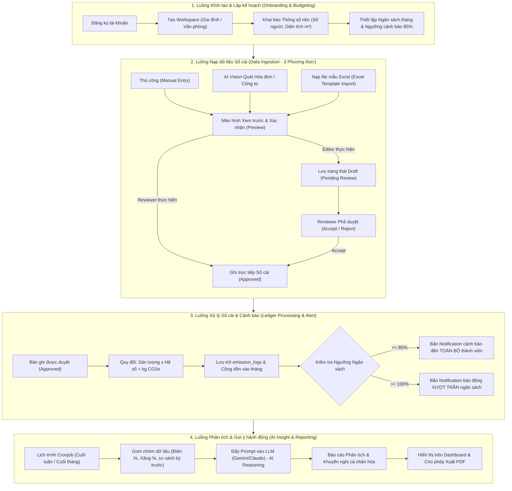
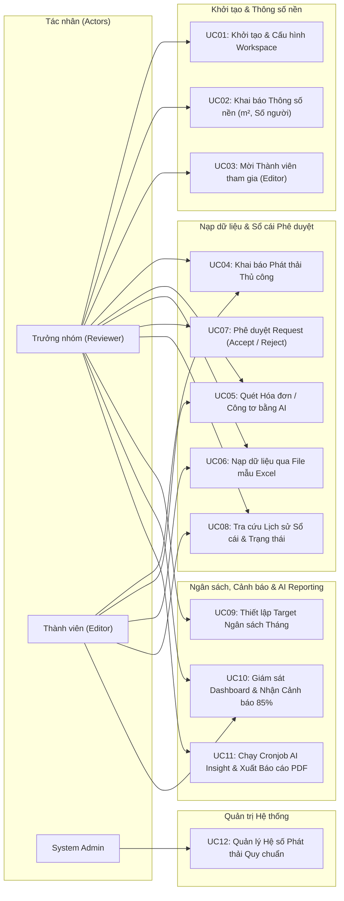

# ĐẶC TẢ PHẠM VI BÀI TOÁN & TỔNG QUAN HỆ THỐNG (PROJECT SPECIFICATION)
**Dự án:** Hệ thống Quản trị & Phân tích Dấu chân Carbon cho Gia đình/Văn phòng nhỏ (Personal & Micro-Office Carbon Ledger)  
**Thời gian triển khai:** 6 tuần  

---

## 1. Mục đích tài liệu
Tài liệu này xác định rõ ranh giới của dự án, quy định cụ thể các vai trò người dùng (Roles), các luồng hoạt động chính của ứng dụng (Application Workflows), danh mục Use Cases và các tính năng nghiệp vụ mà hệ thống phục vụ, đồng thời loại trừ các yếu tố phức tạp không cần thiết để đảm bảo tính khả thi trong khung thời gian 6 tuần.

---

## 2. Phạm vi Người dùng & Ma trận Phân quyền (Roles & Permissions)

Hệ thống phân định 3 vai trò rõ ràng, kết hợp mô hình Multi-tenant (Workspace-based) cho Hộ gia đình / Văn phòng nhỏ và vai trò Quản trị hệ thống:

### 2.1. Danh sách Vai trò (Roles)
1. **Trưởng nhóm gia đình / Văn phòng (Reviewer / Workspace Admin):**
   - **Quyền Reviewer:** Kiểm duyệt, phê duyệt (Accept) hoặc từ chối (Reject) các yêu cầu (request) ghi nhận hoạt động phát thải do Thành viên gửi lên.
   - **Quyền Quản trị & Ghi nhận:** Tạo Workspace, khai báo thông số nền (diện tích $m^2$, số nhân khẩu), trực tiếp tạo hoạt động phát thải (được tự động phê duyệt), quản lý thành viên.
   - **Quyền Giám sát & Chiến lược:** Xem Dashboard tổng thể (gồm các chỉ số chuẩn hóa $\text{CO}_2\text{e}/\text{người}$, $\text{CO}_2\text{e}/m^2$), thiết lập và theo dõi Target tiến độ phát thải, xem báo cáo phân tích, nhận thông báo cảnh báo và xuất Kế hoạch cắt giảm phát thải (Reduction Plan) ra file PDF.

2. **Thành viên gia đình / Văn phòng (Editor / Workspace Member):**
   - **Quyền Editor:** Khai báo các hoạt động tiêu thụ năng lượng cá nhân qua 3 phương thức: Thủ công (Manual), Quét ảnh hóa đơn/công tơ bằng AI (AI Vision), hoặc Nhập file mẫu Excel (Excel Template Import). Mọi bản ghi do Editor tạo sẽ ở trạng thái **`Draft / Chờ duyệt (Pending Review)`** để chờ Reviewer chấp thuận trước khi chính thức ghi vào sổ cái.
   - **Quyền Giám sát:** Xem Dashboard tiến độ phát thải chung của Workspace, nhận thông báo cảnh báo ngưỡng 85% và theo dõi lịch sử trạng thái duyệt các hoạt động do mình khai báo.

3. **Quản trị viên Hệ thống (System Admin):**
   - Đứng ngoài phạm vi dữ liệu sinh hoạt của từng Workspace cụ thể.
   - Quản trị danh mục và cấu hình/chỉnh sửa các **Hệ số phát thải chuẩn (Standard Emission Factors)** theo quy chuẩn mới nhất của Nhà nước (EVN, Bộ TN&MT, GHG Protocol) khi có thay đổi.

### 2.2. Ma trận Phân quyền (RBAC Matrix)

| Chức năng / Quyền hạn | System Admin | Trưởng nhóm (Reviewer) | Thành viên (Editor) |
|---|:---:|:---:|:---:|
| Khởi tạo & Cấu hình Workspace | ❌ | ✅ | ❌ |
| Khai báo thông số nền (thành viên, diện tích $m^2$) | ❌ | ✅ | ❌ |
| Mời thành viên vào Workspace | ❌ | ✅ | ❌ |
| Xem Dashboard & chỉ số chuẩn hóa ($\text{CO}_2\text{e}/\text{người}$, $\text{CO}_2\text{e}/m^2$) | ❌ | ✅ (Toàn diện) | ✅ (Xem chung) |
| Khai báo phát thải thủ công (Manual Entry) | ❌ | ✅ (Tự duyệt) | ✅ (Trạng thái Draft) |
| Quét hóa đơn / công tơ bằng AI Vision | ❌ | ✅ (Tự duyệt) | ✅ (Trạng thái Draft) |
| Nạp dữ liệu bằng Excel Template | ❌ | ✅ (Tự duyệt) | ✅ (Trạng thái Draft) |
| Phê duyệt / Từ chối Request phát thải | ❌ | ✅ | ❌ |
| Thiết lập Ngân sách (Budgeting) & Target tháng | ❌ | ✅ | ❌ |
| Nhận Notification cảnh báo ngưỡng 85% & 100% | ❌ | ✅ | ✅ |
| Xem & Xuất Kế hoạch cắt giảm (Reduction Plan) ra PDF | ❌ | ✅ | ❌ |
| Quản lý Hệ số phát thải quy chuẩn | ✅ | ❌ | ❌ |

---

## 3. Các Luồng Hoạt động Cốt lõi của Ứng dụng (Application Core Workflows)

### 3.1. Luồng 1: Khởi tạo & Lập kế hoạch (Onboarding & Budgeting)
1. **Tạo Workspace:** Admin đăng ký tài khoản, khởi tạo Workspace mới và chọn loại hình (Hộ gia đình hoặc Văn phòng nhỏ).
2. **Khai báo thông số nền (Baseline Setup):** Admin nhập số lượng thành viên và diện tích mặt sàn ($m^2$). Dữ liệu này giúp hệ thống tự động tính toán các chỉ số cường độ phát thải chuẩn hóa:
   $$\text{Chỉ số theo nhân khẩu} = \frac{\text{Tổng kg CO}_2\text{e}}{\text{Số thành viên}} \quad (\text{kg CO}_2\text{e}/\text{người})$$
   $$\text{Chỉ số theo diện tích} = \frac{\text{Tổng kg CO}_2\text{e}}{\text{Diện tích mặt sàn}} \quad (\text{kg CO}_2\text{e}/m^2)$$
3. **Thiết lập Ngân sách (Budgeting):** Vào đầu tháng, Admin đặt ra ngưỡng phát thải tối đa (ví dụ: $300\text{ kg CO}_2\text{e}$ cho tháng 10) và hệ thống kích hoạt cơ chế theo dõi cùng ngưỡng cảnh báo sớm ở mức $85\%$.

### 3.2. Luồng 2: Nạp dữ liệu (Data Ingestion Workflow)
Hệ thống cung cấp **3 phương thức** linh hoạt để ghi nhận vào Sổ cái:
1. **Luồng thủ công (Manual Entry):** Member điền form định lượng cho các sinh hoạt lẻ (ví dụ: khai báo đi làm bằng xe máy xăng 110cc với quãng đường 15 km, nấu ăn dùng gas LPG).
2. **Luồng AI quét hóa đơn & công tơ (AI Vision Ingestion):**
   - Member chụp ảnh và tải lên ảnh hóa đơn tiền điện/nước hoặc ảnh chụp công tơ thực tế.
   - Backend đẩy ảnh qua Multimodal AI API (Google Gemini / Anthropic Claude) để bóc tách thông tin.
   - AI trả về kết quả JSON có cấu trúc (loại dịch vụ, sản lượng tiêu thụ, đơn vị đo, kỳ hóa đơn, số tiền).
   - Frontend hiển thị popup preview để người dùng rà soát, điều chỉnh nếu cần và nhấn "Xác nhận".
3. **Luồng nạp dữ liệu bằng file mẫu Excel (Excel Template Ingestion):**
   - Người dùng tải template file Excel chuẩn do hệ thống cung cấp (gồm các cột: Ngày, Danh mục, Phân loại chi tiết, Sản lượng, Đơn vị, Ghi chú).
   - Người dùng điền dữ liệu hàng loạt và upload file lên hệ thống.
   - Hệ thống tự động đọc, ánh xạ (map) các trường thông tin và hiển thị bảng preview xác nhận trên giao diện trước khi lưu.
*Quy tắc duyệt:* Nếu người nạp là Thành viên (Editor), bản ghi tạo ra sẽ ở trạng thái `Draft / Pending Review` chờ Reviewer phê duyệt. Nếu là Trưởng nhóm (Reviewer) nạp, bản ghi sẽ được ghi sổ `Approved` trực tiếp.

### 3.3. Luồng 3: Xử lý Sổ cái & Cảnh báo (Ledger Processing & Alert)
1. **Ghi nhận & Quy đổi giao dịch:** Khi một bản ghi được phê duyệt ghi sổ (ví dụ: $250\text{ kWh}$ điện sinh hoạt), Backend lấy sản lượng tiêu thụ nhân với Hệ số phát thải quy chuẩn tương ứng do System Admin thiết lập (ví dụ: $0.7221\text{ kg CO}_2\text{e}/\text{kWh}$) để quy đổi ra mức phát thải chuẩn:
   $$\text{Lượng phát thải } (\text{kg CO}_2\text{e}) = \text{Sản lượng} \times \text{Hệ số phát thải}$$
2. **Lưu trữ & Cộng dồn:** Lưu bản ghi vào bảng `emission_logs` (kèm thông tin người ghi nhận, người duyệt, hệ số áp dụng) và tự động cộng dồn vào tổng phát thải của tháng hiện tại.
3. **Kích hoạt cảnh báo (Threshold Trigger):**
   - Nếu tổng phát thải đạt ngưỡng $\ge 85\%$ của Carbon Budget tháng, hệ thống tự động kích hoạt notification cảnh báo sớm gửi đến **toàn bộ thành viên** trong Workspace.
   - Nếu tổng phát thải vượt $\ge 100\%$ ngân sách, hệ thống bắn notification báo động vượt trần và chuyển trạng thái Dashboard sang mức Đỏ.

### 3.4. Luồng 4: Phân tích & Gợi ý hành động (AI Insight & Reporting)
1. **Lịch trình chạy tự động (Cronjob):** Vào ngày cuối cùng của tuần hoặc ngày cuối cùng của tháng, hệ thống tự động kích hoạt module AI Report chạy nền (Background Task).
2. **Gom nhóm dữ liệu (Aggregation):** Hệ thống tổng hợp toàn bộ dữ liệu tiêu dùng của Workspace theo nhóm (Điện chiếm bao nhiêu %, Xăng xe chiếm bao nhiêu %, Nước chiếm bao nhiêu %, so sánh tỷ lệ tăng/giảm với kỳ trước).
3. **Sinh khuyến nghị bằng AI (AI Reasoning):** Đẩy context dữ liệu tổng hợp vào LLM Prompt. LLM phân tích nguyên nhân cốt lõi và trả về báo cáo tối ưu hóa mang tính cá nhân hóa và định lượng cao (ví dụ: *"Tháng này lượng phát thải từ việc sử dụng xe máy cá nhân tăng đột biến 40%. Nếu 2 thành viên chuyển sang dùng tàu điện trên cao Cát Linh - Hà Đông 3 ngày/tuần, gia đình có thể cắt giảm 18 kg CO2e vào tháng sau"*).
4. **Trình bày & Xuất bản:** Báo cáo Kế hoạch cắt giảm (Reduction Plan) được hiển thị trực quan trên Dashboard chính của Reviewer và hỗ trợ **xuất ra file PDF** chuẩn in ấn để lưu trữ hoặc chia sẻ nội bộ gia đình/văn phòng.

---

## 4. Phạm vi Nghiệp vụ (Business Scope)

### 4.1. Các nghiệp vụ NẰM TRONG phạm vi (In-Scope)
Hệ thống giải quyết 4 trụ cột nghiệp vụ:
1. **Quản lý Sổ cái phát thải đa phương thức có phê duyệt:** Số hóa các hoạt động tiêu thụ năng lượng thành chỉ số kg CO2e chuẩn thông qua 3 kênh nhập liệu (Thủ công, AI Vision quét hóa đơn/công tơ, Import Excel template); quy trình kiểm duyệt Draft -> Approved/Rejected.
2. **Quản trị Ngân sách & Chỉ số Chuẩn hóa:** Khai báo thông số nền (thành viên, diện tích $m^2$), thiết lập hạn ngạch tháng, tính toán $\text{CO}_2\text{e}/\text{người}$ và $\text{CO}_2\text{e}/m^2$, bắn notification cảnh báo ngưỡng 85% & 100% đến toàn thể thành viên.
3. **Tự động hóa AI & Báo cáo Thông minh:** Vision Parser bóc tách hóa đơn/công tơ; Insight Generator chạy Cronjob định kỳ phân tích bất thường, đề xuất hành động định lượng cá nhân hóa và xuất file báo cáo PDF.
4. **Quản trị Hệ thống & Chuẩn hóa Hệ số:** System Admin quản lý danh mục quy chuẩn quốc gia (EVN, GHG Protocol).

### 4.2. Các nghiệp vụ NẰM NGOÀI phạm vi (Out-of-Scope)
- Không tích hợp thiết bị IoT / Smart meter đo dòng thời gian thực.
- Không tính toán phát thải Scope 3 chuỗi cung ứng phức tạp.
- Không có cổng thanh toán tiền tệ hay sàn giao dịch tín chỉ carbon.
- Không tự động cào dữ liệu (web scraping) các trang web điện lực bên ngoài.

---

## 5. Danh mục Use Cases & Sơ đồ Tổng quan

### 5.1. Sơ đồ Use Case Tổng quan (Use Case Diagram)

### 5.2. Bảng Danh mục 12 Use Cases

| Mã UC | Tên Use Case | Actor chính | Mục tiêu nghiệp vụ |
|---|---|---|---|
| **UC01** | Khởi tạo Workspace | Trưởng nhóm (Reviewer) | Tạo không gian dữ liệu riêng biệt cho gia đình/văn phòng. |
| **UC02** | Khai báo Thông số nền | Trưởng nhóm (Reviewer) | Nhập số người, diện tích $m^2$ để tính chỉ số $\text{CO}_2\text{e}/\text{người}$, $/m^2$. |
| **UC03** | Mời thành viên gia nhập | Trưởng nhóm (Reviewer) | Sinh mã mời tham gia Workspace với vai trò Editor. |
| **UC04** | Khai báo phát thải thủ công | Thành viên (Editor), Reviewer | Nhập sinh hoạt lẻ (xe máy, gas, điện) tạo Draft / Approved. |
| **UC05** | Quét hóa đơn / công tơ bằng AI | Thành viên (Editor), Reviewer | Dùng Multimodal AI bóc tách ảnh hóa đơn/công tơ điền form. |
| **UC06** | Nạp dữ liệu qua File mẫu Excel | Thành viên (Editor), Reviewer | Upload Excel template, preview ánh xạ dữ liệu và lưu hàng loạt. |
| **UC07** | Phê duyệt yêu cầu phát thải | Trưởng nhóm (Reviewer) | Reviewer chấp thuận (Accept) hoặc từ chối (Reject) request từ Editor. |
| **UC08** | Tra cứu lịch sử sổ cái | Thành viên (Editor), Reviewer | Lọc theo tháng, danh mục và trạng thái phê duyệt. |
| **UC09** | Thiết lập Target ngân sách tháng | Trưởng nhóm (Reviewer) | Cài đặt trần phát thải tối đa (kg CO2e) và ngưỡng cảnh báo 85%. |
| **UC10** | Giám sát Dashboard & Cảnh báo | Thành viên (Editor), Reviewer | Theo dõi tiến độ % ngân sách, nhận notification cảnh báo 85% & 100%. |
| **UC11** | AI Insight Cronjob & Xuất PDF | Trưởng nhóm (Reviewer) | Chạy định kỳ tổng hợp báo cáo, gợi ý cắt giảm và xuất file PDF. |
| **UC12** | Quản lý Hệ số phát thải chuẩn | System Admin | Cập nhật hệ số quốc gia (EVN, GHG Protocol) độc lập. |

---

## 6. Phạm vi Nền tảng Kỹ thuật (Technical Scope)

- **Nền tảng:** Web Application Mobile-First Responsive (PWA) để dễ dàng thao tác trên smartphone (chụp ảnh hóa đơn, duyệt nhanh request, nhận Web Push / In-App Notification).
- **Cơ sở dữ liệu:** PostgreSQL đảm bảo tính toàn vẹn giao dịch của bảng `emission_logs` và phân quyền RBAC.
- **Tác vụ định kỳ (Cronjob):** Background Worker / Cron Scheduler kích hoạt module AI Report vào cuối tuần hoặc cuối tháng.
- **Tích hợp AI:** Sử dụng Commercial Multimodal/LLM APIs (Google Gemini 1.5 Flash/Pro hoặc Anthropic Claude).
- **Xử lý tệp tin:** Hỗ trợ thư viện phân tích bảng tính (Excel/Sheet parser) và module kết xuất tài liệu PDF (PDF Generator).
